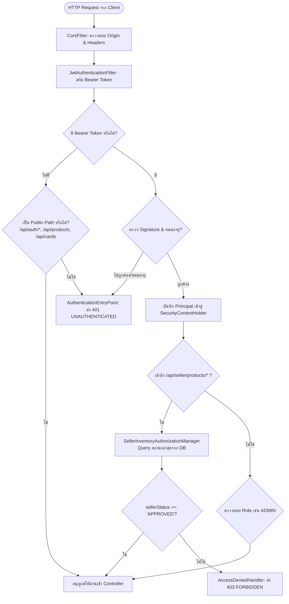

# 🛡️ 01: สถาปัตยกรรมความปลอดภัยและการจัดการข้อผิดพลาด (Security & Exceptions)
**โฟลเดอร์ปลายทาง:** `tcg-store-backend/src/main/java/com/mythix/tcg/common`  
**เอกสารอ้างอิง:** [⬅️ กลับสู่สารบัญ Backend](../README.md) | [🏠 หน้าหลักสารบัญ Code](../../README.md)

---

## 📌 บทสรุปและหน้าที่ของส่วนนี้ (Overview & Responsibilities)
โมดูลนี้คือด่านหน้า (Frontline Gateway) ของระบบ Backend Spring Boot 3 ที่รับผิดชอบความปลอดภัยและเสถียรภาพของ API ทั้งหมด:
1. **Spring Security 6 Stateless Filter Chain (`SecurityConfig.java`):** ปิดใช้งาน CSRF และ Session Creation (STATELESS) เพื่อรองรับ REST API แบบ Microservices
2. **Stateless JWT Verification (`JwtAuthenticationFilter.java`):** แกะอ่าน Header `Authorization: Bearer <token>`, ตรวจสอบลายเซ็นดิจิทัล (HMAC-SHA), และนำ User Object ใส่ลงใน `SecurityContextHolder`
3. **Dynamic Role & Seller Authorization (`SellerInventoryAuthorizationManager.java`):** ตรวจสอบสิทธิ์แบบ Real-time จากฐานข้อมูล เพื่อรองรับกรณีที่ผู้ใช้เพิ่งได้รับการอนุมัติเป็นผู้ขาย โดยไม่ต้องบังคับให้ออกและล็อกอินใหม่
4. **Uniform RFC 7807 Error Handling (`GlobalExceptionHandler.java`):** แปลง Exception ทุกชนิดในระบบให้กลายเป็นโครงสร้าง JSON มาตรฐานเดียวกัน (`ApiError`) เพื่อให้ Frontend จัดการ Error ได้อย่างสม่ำเสมอ
5. **Configurable Cross-Origin Resource Sharing (CORS):** กำหนด Allowed Origins, Allowed Methods และ Allowed Headers (รวมถึง `Idempotency-Key`)

---

## 📂 ตารางโครงสร้างไฟล์และตำแหน่งที่ตั้ง (File Structure)

| ชื่อไฟล์ | ตำแหน่ง Path | หน้าที่ความรับผิดชอบ |
| :--- | :--- | :--- |
| `config/SecurityConfig.java` | `src/.../common/config/SecurityConfig.java` | กำหนด Security Filter Chain, CORS, PasswordEncoder, และ Route Rules |
| `security/JwtAuthenticationFilter.java` | `src/.../auth/security/JwtAuthenticationFilter.java` | ฟิลเตอร์สกัดและตรวจสอบ JWT Token ในทุกๆ HTTP Request |
| `seller/api/SellerInventoryAuthorizationManager.java` | `src/.../seller/api/SellerInventoryAuthorizationManager.java` | Spring Security 6 Authorization Manager ตรวจสอบสถานะ Seller จาก DB แบบสด |
| `api/GlobalExceptionHandler.java` | `src/.../common/api/GlobalExceptionHandler.java` | ศูนย์รวมการดักจับข้อผิดพลาดระดับ Controller (Validation, Domain, Concurrency) |
| `api/ApiError.java` | `src/.../common/api/ApiError.java` | Java Record กำหนดโครงสร้างมาตรฐานของข้อผิดพลาด (`code`, `message`, `fieldErrors`) |
| `config/AppProperties.java` | `src/.../common/config/AppProperties.java` | แมปปิ้ง Configuration Properties จากไฟล์ `application.yml` |

---

## 🔄 แผนผังการทำงานของ Security Filter Chain (Security Flowchart)



---

## 💻 เจาะลึกโค้ดสำคัญและตัวอย่างจริง (Deep-Dive Implementation)

### 1. การตั้งค่า Security Filter Chain (`src/.../common/config/SecurityConfig.java`)
ใช้ Spring Security 6 Component-based configuration โดยไม่พึ่งพา Deprecated classes:

```java
// src/main/java/com/mythix/tcg/common/config/SecurityConfig.java
package com.mythix.tcg.common.config;

import com.mythix.tcg.auth.security.JwtAuthenticationFilter;
import com.mythix.tcg.seller.api.SellerInventoryAuthorizationManager;
import org.springframework.context.annotation.Bean;
import org.springframework.context.annotation.Configuration;
import org.springframework.security.config.annotation.web.builders.HttpSecurity;
import org.springframework.security.config.annotation.web.configuration.EnableWebSecurity;
import org.springframework.security.config.annotation.web.configurers.AbstractHttpConfigurer;
import org.springframework.security.config.http.SessionCreationPolicy;
import org.springframework.security.web.SecurityFilterChain;
import org.springframework.security.web.authentication.UsernamePasswordAuthenticationFilter;
import org.springframework.http.HttpStatus;
import org.springframework.http.HttpMethod;

@Configuration
@EnableWebSecurity
public class SecurityConfig {

    private final JwtAuthenticationFilter jwtAuthenticationFilter;
    private final SellerInventoryAuthorizationManager sellerInventoryAuthorizationManager;

    public SecurityConfig(
        JwtAuthenticationFilter jwtAuthenticationFilter,
        SellerInventoryAuthorizationManager sellerInventoryAuthorizationManager
    ) {
        this.jwtAuthenticationFilter = jwtAuthenticationFilter;
        this.sellerInventoryAuthorizationManager = sellerInventoryAuthorizationManager;
    }

    @Bean
    public SecurityFilterChain securityFilterChain(HttpSecurity http) throws Exception {
        http
            .csrf(AbstractHttpConfigurer::disable)
            .formLogin(AbstractHttpConfigurer::disable)
            .sessionManagement(s -> s.sessionCreationPolicy(SessionCreationPolicy.STATELESS))
            .exceptionHandling(ex -> ex
                .authenticationEntryPoint((req, res, err) -> {
                    res.setStatus(HttpStatus.UNAUTHORIZED.value());
                    res.setContentType("application/json");
                    res.getWriter().write("{\"code\":\"UNAUTHENTICATED\",\"message\":\"Authentication is required\",\"fieldErrors\":{}}");
                })
                .accessDeniedHandler((req, res, err) -> {
                    res.setStatus(HttpStatus.FORBIDDEN.value());
                    res.setContentType("application/json");
                    res.getWriter().write("{\"code\":\"FORBIDDEN\",\"message\":\"Access denied\",\"fieldErrors\":{}}");
                })
            )
            .authorizeHttpRequests(auth -> auth
                // เส้นทางสาธารณะที่บุคคลทั่วไปเข้าถึงได้
                .requestMatchers("/api/health", "/api/cards/**", "/api/products/**", "/api/auth/**", "/uploads/**").permitAll()
                .requestMatchers(HttpMethod.GET, "/api/collections/**").permitAll()
                // เส้นทางสำหรับผู้ดูแลระบบ
                .requestMatchers("/api/admin/**").hasRole("ADMIN")
                // เส้นทางสำหรับผู้ขาย ตรวจสอบแบบ Dynamic ป้องกัน Token ค้าง
                .requestMatchers("/api/seller/products/**", "/api/seller/listings/**")
                    .access(sellerInventoryAuthorizationManager)
                .anyRequest().authenticated()
            )
            .addFilterBefore(jwtAuthenticationFilter, UsernamePasswordAuthenticationFilter.class);

        return http.build();
    }
}
```

---

### 2. ศูนย์รวมการดักจับข้อผิดพลาดระดับสากล (`src/.../common/api/GlobalExceptionHandler.java`)
ดักจับ Exception ทั่วทั้งระบบและแปลงเป็น `ApiError` อย่างเป็นระบบ:

```java
// src/main/java/com/mythix/tcg/common/api/GlobalExceptionHandler.java
package com.mythix.tcg.common.api;

import com.mythix.tcg.order.application.CheckoutInsufficientStockException;
import com.mythix.tcg.order.application.CheckoutValidationException;
import org.springframework.http.HttpStatus;
import org.springframework.http.ResponseEntity;
import org.springframework.web.bind.MethodArgumentNotValidException;
import org.springframework.web.bind.annotation.ExceptionHandler;
import org.springframework.web.bind.annotation.RestControllerAdvice;

import java.util.LinkedHashMap;
import java.util.Map;

@RestControllerAdvice
public class GlobalExceptionHandler {

    // 1. ดักจับ Validation Error จาก Bean Validation (@Valid, @NotNull, @Min)
    @ExceptionHandler(MethodArgumentNotValidException.class)
    public ResponseEntity<ApiError> handleValidation(MethodArgumentNotValidException ex) {
        Map<String, String> errors = new LinkedHashMap<>();
        ex.getBindingResult().getFieldErrors().forEach(f -> errors.put(f.getField(), f.getDefaultMessage()));
        return ResponseEntity.badRequest().body(new ApiError("VALIDATION_ERROR", "Invalid request content", errors));
    }

    // 2. ดักจับข้อผิดพลาดเรื่องสินค้าในสต็อกไม่พอตอน Checkout
    @ExceptionHandler(CheckoutInsufficientStockException.class)
    public ResponseEntity<ApiError> handleStock(CheckoutInsufficientStockException ex) {
        return ResponseEntity.badRequest().body(new ApiError("INSUFFICIENT_STOCK", ex.getMessage(), Map.of()));
    }

    // 3. ดักจับข้อผิดพลาดเรื่อง Idempotency-Key ซ้ำ
    @ExceptionHandler(CheckoutValidationException.class)
    public ResponseEntity<ApiError> handleCheckoutValidation(CheckoutValidationException ex) {
        return ResponseEntity.badRequest().body(new ApiError("CHECKOUT_VALIDATION_FAILED", ex.getMessage(), Map.of(ex.getField(), ex.getMessage())));
    }
}
```

---

## 🎯 จุดเด่นทางวิศวกรรม (Engineering Highlights)
* **Dynamic Seller Authorization:** การใช้ `SellerInventoryAuthorizationManager` ตรวจสอบสถานะผู้ขายสดจากฐานข้อมูล แก้ปัญหาคลาสสิกของระบบ JWT ที่ต้องรอบังคับให้ User Logout เมื่อได้รับสิทธิ์ใหม่
* **Predictable Error Schema:** การันตีว่าไม่ว่าระบบจะล้มเหลวที่จุดใด ผลลัพธ์ JSON จะมีโครงสร้าง `code`, `message`, `fieldErrors` เสมอ ช่วยให้ Frontend เขียน Error Handling ได้ง่ายขึ้น
* **Stateless Resource Protection:** ไม่มีการเก็บ Session บน RAM ของเซิร์ฟเวอร์ ทำให้ Backend สามารถ Scale-out ใน Kubernetes แบบ Multi-replica ได้ทันที
