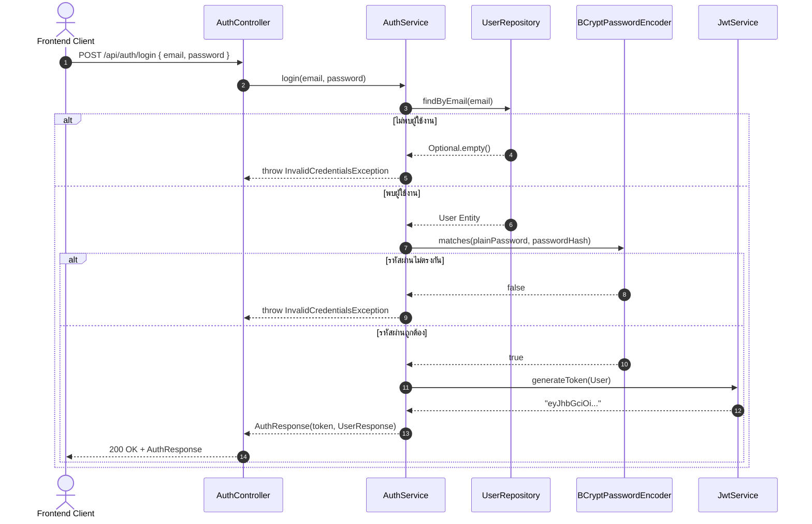

# 🔑 02: ระบบสมาชิกและการจัดการสิทธิ์ (Auth & User Domain)
**โฟลเดอร์ปลายทาง:** `tcg-store-backend/src/main/java/com/mythix/tcg/auth` และ `tcg/user`  
**เอกสารอ้างอิง:** [⬅️ กลับสู่สารบัญ Backend](../README.md) | [🏠 หน้าหลักสารบัญ Code](../../README.md)

---

## 📌 บทสรุปและหน้าที่ของส่วนนี้ (Overview & Responsibilities)
โมดูลนี้รับผิดชอบวงจรชีวิตของผู้ใช้งาน (User Lifecycle) และการออก Token ยืนยันตัวตน:
1. **User Registration & Email Deduplication:** ตรวจสอบอีเมลซ้ำ, เข้ารหัสผ่านด้วย **BCrypt (10 rounds)** และกำหนดบทบาทเริ่มต้นเป็น `ROLE_USER`
2. **Secure Authentication & Token Issuance:** ตรวจสอบรหัสผ่านผ่าน `PasswordEncoder.matches()` และสร้าง JSON Web Token (JWT) ที่บรรจุ Claims สำคัญ (User ID, Email, Role, Seller Status)
3. **Password Reset Workflow:** กลไกการขอรีเซ็ตรหัสผ่านผ่าน Secure Temporary Token
4. **User Domain Entity & ORM Mapping:** เอนทิตี `User` ที่จัดการความสัมพันธ์กับร้านค้า คำสั่งซื้อ และตะกร้าสินค้า
5. **Profile Self-Management:** อัปเดตข้อมูลส่วนตัว หมายเลขโทรศัพท์ และชื่อที่แสดง

---

## 📂 ตารางโครงสร้างไฟล์และตำแหน่งที่ตั้ง (File Structure)

| ชื่อไฟล์ | ตำแหน่ง Path | หน้าที่ความรับผิดชอบ |
| :--- | :--- | :--- |
| `auth/api/AuthController.java` | `src/.../auth/api/AuthController.java` | REST Endpoints สำหรับ `/api/auth/register`, `/login`, `/me` |
| `auth/application/AuthService.java` | `src/.../auth/application/AuthService.java` | ตรรกะทางธุรกิจการสมัครสมาชิก การตรวจสอบรหัสผ่าน และการออก Token |
| `auth/security/JwtService.java` | `src/.../auth/security/JwtService.java` | สร้างและตรวจสอบความถูกต้องของ JWT Token (Sign / Parse / Validate) |
| `user/domain/User.java` | `src/.../user/domain/User.java` | JPA Entity บันทึกข้อมูลผู้ใช้ (`email`, `passwordHash`, `role`, `sellerStatus`) |
| `user/persistence/UserRepository.java` | `src/.../user/persistence/UserRepository.java` | Spring Data JPA Repository พร้อมเมธอดค้นหาและ Lock (`findByIdForUpdate`) |
| `user/api/UserProfileController.java` | `src/.../user/api/UserProfileController.java` | Endpoints ดูและแก้ไขโปรไฟล์ส่วนตัวของผู้ใช้งาน |

---

## 🔄 ลำดับขั้นตอนการล็อกอินและออก Token (Login Sequence)



---

## 💻 เจาะลึกโค้ดสำคัญและตัวอย่างจริง (Deep-Dive Implementation)

### 1. บริการยืนยันตัวตนและการเข้ารหัส (`src/.../auth/application/AuthService.java`)
```java
// src/main/java/com/mythix/tcg/auth/application/AuthService.java
package com.mythix.tcg.auth.application;

import com.mythix.tcg.auth.api.AuthResponse;
import com.mythix.tcg.auth.api.LoginRequest;
import com.mythix.tcg.auth.api.RegisterRequest;
import com.mythix.tcg.auth.api.UserResponse;
import com.mythix.tcg.auth.security.JwtService;
import com.mythix.tcg.user.domain.User;
import com.mythix.tcg.user.persistence.UserRepository;
import lombok.RequiredArgsConstructor;
import org.springframework.security.crypto.password.PasswordEncoder;
import org.springframework.stereotype.Service;
import org.springframework.transaction.annotation.Transactional;

@Service
@RequiredArgsConstructor
public class AuthService {

    private final UserRepository userRepository;
    private final PasswordEncoder passwordEncoder;
    private final JwtService jwtService;

    @Transactional
    public AuthResponse register(RegisterRequest request) {
        // ตรวจสอบความซ้ำซ้อนของอีเมลในระบบ
        if (userRepository.existsByEmail(request.email().toLowerCase().trim())) {
            throw new DuplicateEmailException("Email is already registered");
        }

        // เข้ารหัสผ่านด้วย BCrypt ป้องกันรหัสผ่านรั่วไหล
        String passwordHash = passwordEncoder.encode(request.password());

        User user = User.builder()
            .email(request.email().toLowerCase().trim())
            .passwordHash(passwordHash)
            .fullName(request.fullName())
            .role("USER")
            .sellerStatus("NONE")
            .build();

        user = userRepository.save(user);

        // สร้าง JWT Token ส่งมอบให้ผู้ใช้ทันทีหลังสมัครเสร็จ
        String token = jwtService.generateToken(user);
        return new AuthResponse(token, UserResponse.from(user));
    }

    @Transactional(readOnly = true)
    public AuthResponse login(LoginRequest request) {
        User user = userRepository.findByEmail(request.email().toLowerCase().trim())
            .orElseThrow(InvalidCredentialsException::new);

        if (!passwordEncoder.matches(request.password(), user.getPasswordHash())) {
            throw new InvalidCredentialsException();
        }

        String token = jwtService.generateToken(user);
        return new AuthResponse(token, UserResponse.from(user));
    }
}
```

---

### 2. โมเดลข้อมูลผู้ใช้ (`src/.../user/domain/User.java`)
ออกแบบให้รองรับการตรวจสอบสิทธิ์และสถานะร้านค้าในตัวเดียว:

```java
// src/main/java/com/mythix/tcg/user/domain/User.java
package com.mythix.tcg.user.domain;

import jakarta.persistence.*;
import lombok.*;
import java.time.LocalDateTime;

@Entity
@Table(name = "users")
@Getter
@Setter
@NoArgsConstructor
@AllArgsConstructor
@Builder
public class User {

    @Id
    @GeneratedValue(strategy = GenerationType.IDENTITY)
    private Long id;

    @Column(nullable = false, unique = true, length = 150)
    private String email;

    @Column(name = "password_hash", nullable = false)
    private String passwordHash;

    @Column(name = "full_name", nullable = false)
    private String fullName;

    @Column(nullable = false, length = 30)
    private String role; // "USER", "ADMIN"

    @Column(name = "seller_status", nullable = false, length = 30)
    private String sellerStatus; // "NONE", "PENDING", "APPROVED", "REJECTED"

    @Column(length = 50)
    private String phone;

    @Column(name = "created_at", nullable = false, updatable = false)
    private LocalDateTime createdAt;

    @PrePersist
    protected void onCreate() {
        this.createdAt = LocalDateTime.now();
        if (this.role == null) this.role = "USER";
        if (this.sellerStatus == null) this.sellerStatus = "NONE";
    }
}
```

---

## 🎯 จุดเด่นทางวิศวกรรม (Engineering Highlights)
* **Cryptographic Strength:** ใช้กลไกถอดรหัสช้าของ BCrypt (Salted Key Derivation) ป้องกันการโจมตีแบบ Rainbow Table และ Brute Force
* **Normalized Data Sanitization:** อีเมลทั้งหมดถูกบังคับเป็น Lowercase และ Trim ช่องว่าง ป้องกันปัญหาผู้ใช้พิมพ์ตัวพิมพ์ใหญ่แล้วล็อกอินไม่ผ่าน
* **Role/Status Decoupling:** แยกสถานะ `role` (สิทธิ์ระดับระบบ เช่น User/Admin) ออกจาก `sellerStatus` (สถานะการค้าขาย) ทำให้ผู้ใช้ 1 บัญชีสามารถเป็นทั้งผู้ซื้อและผู้ขายได้โดยไม่ต้องสมัครใหม่
