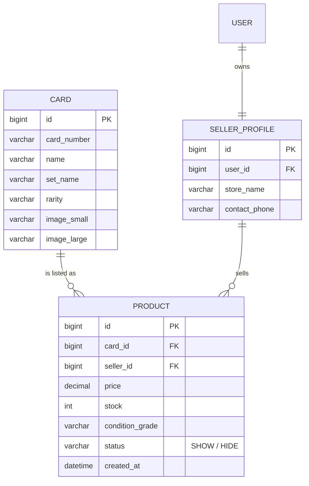

# 📦 03: คลังการ์ดแม่แบบและสินค้าในตลาด (Catalog & Products)
**โฟลเดอร์ปลายทาง:** `tcg-store-backend/src/main/java/com/mythix/tcg/catalog` และ `tcg/product`  
**เอกสารอ้างอิง:** [⬅️ กลับสู่สารบัญ Backend](../README.md) | [🏠 หน้าหลักสารบัญ Code](../../README.md)

---

## 📌 บทสรุปและหน้าที่ของส่วนนี้ (Overview & Responsibilities)
โมดูลนี้จัดการเรื่องข้อมูลสินค้าและการแสดงผลในตลาดซื้อขายการ์ด โดยแยกเป็น 2 ชั้นอย่างชัดเจน:
1. **Master Card Catalog (`com.mythix.tcg.catalog`):** ข้อมูลการ์ดต้นแบบมาตรฐานสากล (Canonical Card Metadata) เช่น รหัสการ์ด, ชื่อ, ชุดเซ็ต (Set), ระดับความหายาก (Rarity), ธาตุ (Type), พลังชีวิต (HP) และรูปภาพความละเอียดสูงจากค่ายเกม
2. **Marketplace Product Listings (`com.mythix.tcg.product`):** การ์ดที่ผู้ขายแต่ละรายนำมาวางขายจริงในตลาด มีราคา, สภาพการ์ด (Condition), จำนวนสต็อก (Stock), รูปถ่ายจริง และสถานะการขาย (`SHOW`, `HIDE`)
3. **Dynamic Multi-criteria Search & Filter:** ค้นหาสินค้าด้วย Spring Data JPA Specifications รองรับการกรองหลายเงื่อนไขพร้อมกัน (ชื่อ, เซ็ต, ความหายาก, สภาพ, ช่วงราคา)
4. **Pessimistic Read-Locking Preparation:** มีเมธอด `findByIdForUpdate` ที่ใช้ `@Lock(LockModeType.PESSIMISTIC_WRITE)` พร้อม `join fetch` เพื่อเตรียมพร้อมสำหรับกระบวนการตัดสต็อกในทรานแซกชันการสั่งซื้อ

---

## 📂 ตารางโครงสร้างไฟล์และตำแหน่งที่ตั้ง (File Structure)

| ชื่อไฟล์ | ตำแหน่ง Path | หน้าที่ความรับผิดชอบ |
| :--- | :--- | :--- |
| `catalog/api/CardController.java` | `src/.../catalog/api/CardController.java` | REST Endpoint สำหรับค้นหาและดึงข้อมูล Master Card Catalog |
| `catalog/domain/Card.java` | `src/.../catalog/domain/Card.java` | JPA Entity แทนการ์ดต้นแบบ (`name`, `setName`, `rarity`, `imageSmall`, `imageLarge`) |
| `catalog/persistence/CardRepository.java` | `src/.../catalog/persistence/CardRepository.java` | Repository ค้นหาการ์ดต้นแบบตามชื่อ หรือหมายเลขการ์ด |
| `product/api/ProductController.java` | `src/.../product/api/ProductController.java` | REST Endpoint ค้นหาและกรองสินค้าใน Marketplace (`/api/products`) |
| `product/application/ProductService.java` | `src/.../product/application/ProductService.java` | บริการประกอบ Query Specification, Pagination และตรวจสอบสินค้า |
| `product/domain/Product.java` | `src/.../product/domain/Product.java` | JPA Entity สินค้าที่วางขาย ผูกโยงกับ `Card` และ `SellerProfile` |
| `product/persistence/ProductRepository.java` | `src/.../product/persistence/ProductRepository.java` | จัดการ Query ข้อมูลสินค้า, Specification Search, และ Pessimistic Write Lock |

---

## 🔄 แผนผังความสัมพันธ์ข้อมูล (Entity Relationship)



---

## 💻 เจาะลึกโค้ดสำคัญและตัวอย่างจริง (Deep-Dive Implementation)

### 1. ระบบค้นหาแบบ Dynamic Specification (`src/.../product/application/ProductService.java`)
รองรับการประกอบเงื่อนไข SQL แบบยืดหยุ่น โดยไม่เสี่ยงต่อ SQL Injection:

```java
// src/main/java/com/mythix/tcg/product/application/ProductService.java (ส่วนสำคัญ)
package com.mythix.tcg.product.application;

import com.mythix.tcg.product.api.ProductPageResponse;
import com.mythix.tcg.product.api.ProductResponse;
import com.mythix.tcg.product.domain.Product;
import com.mythix.tcg.product.persistence.ProductRepository;
import jakarta.persistence.criteria.Predicate;
import lombok.RequiredArgsConstructor;
import org.springframework.data.domain.Page;
import org.springframework.data.domain.PageRequest;
import org.springframework.data.domain.Sort;
import org.springframework.data.jpa.domain.Specification;
import org.springframework.stereotype.Service;
import org.springframework.transaction.annotation.Transactional;

import java.math.BigDecimal;
import java.util.ArrayList;
import java.util.List;

@Service
@RequiredArgsConstructor
public class ProductService {

    private final ProductRepository productRepository;

    @Transactional(readOnly = true)
    public ProductPageResponse searchProducts(
        String query,
        List<String> rarities,
        List<String> conditions,
        BigDecimal minPrice,
        BigDecimal maxPrice,
        int page,
        int size,
        String sortBy
    ) {
        Specification<Product> spec = (root, q, cb) -> {
            List<Predicate> predicates = new ArrayList<>();
            
            // 1. กรองเฉพาะสินค้าที่สถานะเปิดขาย (SHOW) และมีสต็อกคงเหลือ > 0
            predicates.add(cb.equal(root.get("status"), "SHOW"));
            predicates.add(cb.greaterThan(root.get("stock"), 0));

            // 2. ค้นหาชื่อการ์ดแบบ Partial Search (Case-insensitive)
            if (query != null && !query.isBlank()) {
                predicates.add(cb.like(cb.lower(root.get("card").get("name")), "%" + query.toLowerCase() + "%"));
            }

            // 3. กรองตามระดับความหายาก (Rarity In-list)
            if (rarities != null && !rarities.isEmpty()) {
                predicates.add(root.get("card").get("rarity").in(rarities));
            }

            // 4. กรองตามสภาพการ์ด (Condition In-list)
            if (conditions != null && !conditions.isEmpty()) {
                predicates.add(root.get("condition").in(conditions));
            }

            // 5. กรองตามช่วงราคา (Between Price)
            if (minPrice != null) predicates.add(cb.greaterThanOrEqualTo(root.get("price"), minPrice));
            if (maxPrice != null) predicates.add(cb.lessThanOrEqualTo(root.get("price"), maxPrice));

            return cb.and(predicates.toArray(new Predicate[0]));
        };

        // กำหนดการเรียงลำดับผลลัพธ์
        Sort sort = "price_asc".equalsIgnoreCase(sortBy) ? Sort.by("price").ascending()
            : "price_desc".equalsIgnoreCase(sortBy) ? Sort.by("price").descending()
            : Sort.by("createdAt").descending();

        Page<Product> resultPage = productRepository.findAll(spec, PageRequest.of(page, size, sort));
        return ProductPageResponse.from(resultPage);
    }
}
```

---

### 2. Pessimistic Write Lock ใน Repository (`src/.../product/persistence/ProductRepository.java`)
เมธอดสำหรับดึงข้อมูลสินค้าพร้อมล็อค Row ในระดับฐานข้อมูล เพื่อรองรับการตัดสต็อกในกระบวนการ Checkout:

```java
// src/main/java/com/mythix/tcg/product/persistence/ProductRepository.java
package com.mythix.tcg.product.persistence;

import com.mythix.tcg.product.domain.Product;
import org.springframework.data.jpa.repository.JpaRepository;
import org.springframework.data.jpa.repository.JpaSpecificationExecutor;
import org.springframework.data.jpa.repository.Lock;
import org.springframework.data.jpa.repository.Query;
import org.springframework.data.repository.query.Param;
import org.springframework.stereotype.Repository;

import java.util.Optional;
import jakarta.persistence.LockModeType;

@Repository
public interface ProductRepository extends JpaRepository<Product, Long>, JpaSpecificationExecutor<Product> {

    Optional<Product> findByIdAndStatus(Long id, String status);

    long countByStatus(String status);

    /**
     * ดึงแถวข้อมูลสินค้าและทำ Pessimistic Write Lock (SELECT ... FOR UPDATE)
     * พร้อม join fetch card และ seller เพื่อป้องกันปัญหา N+1 Query
     */
    @Lock(LockModeType.PESSIMISTIC_WRITE)
    @Query("select p from Product p join fetch p.card join fetch p.seller where p.id = :id")
    Optional<Product> findByIdForUpdate(@Param("id") Long id);
}
```

---

## 🎯 จุดเด่นทางวิศวกรรม (Engineering Highlights)
* **Master-Detail Data Model:** แยก Catalog (การ์ดจริงจากผู้ผลิต) ออกจาก Product (การลงขายของร้านค้า) ทำให้ระบบมีความถูกต้องของ Metadata 100%
* **Preventing N+1 Queries:** การใช้ `join fetch p.card join fetch p.seller` ในคิวรี ช่วยให้การดึงข้อมูลและล็อคแถวทำได้ใน SQL Statement เดียว
* **Dynamic Search with Specification:** รองรับการผสมผสานตัวกรองนับสิบเงื่อนไขได้อย่างมีประสิทธิภาพโดยไม่มี Code Duplication
