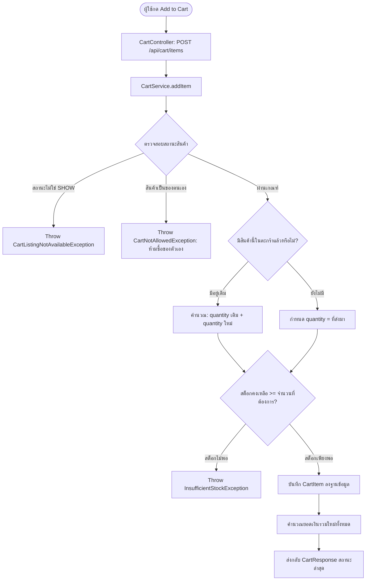

# 🛒 04: ระบบจัดการตะกร้าสินค้า (Cart Management System)
**โฟลเดอร์ปลายทาง:** `tcg-store-backend/src/main/java/com/mythix/tcg/cart`  
**เอกสารอ้างอิง:** [⬅️ กลับสู่สารบัญ Backend](../README.md) | [🏠 หน้าหลักสารบัญ Code](../../README.md)

---

## 📌 บทสรุปและหน้าที่ของส่วนนี้ (Overview & Responsibilities)
โมดูลนี้ทำหน้าที่จัดการตะกร้าสินค้าของผู้ซื้อ (Buyer Shopping Cart) ที่มีการเชื่อมต่อโดยตรงกับฐานข้อมูล:
1. **Server-Side Persistent Cart:** รายการในตะกร้าถูกบันทึกลงฐานข้อมูลตาราง `cart_items` ทำให้ผู้ใช้เปลี่ยนอุปกรณ์ (Cross-device) หรือปิดเบราว์เซอร์แล้วกลับมา สินค้าในตะกร้ายังคงอยู่
2. **Real-time Stock Validation:** ทุกครั้งที่มีการเพิ่มหรือแก้ไขจำนวนสินค้าในตะกร้า ระบบจะตรวจสอบจำนวนคงเหลือในสต็อกของสินค้า (`validateStock`) ทันที
3. **Purchasability Verification:** ตรวจสอบสถานะของสินค้า หากผู้ขายเปลี่ยนสถานะเป็น `HIDE` หรือลบสินค้า ระบบจะปฏิเสธการใส่ตะกร้าทันที (`validatePurchasable`)
4. **Self-Purchase Prevention:** ป้องกันไม่ให้ผู้ขายนำสินค้าของร้านตนเองใส่ลงในตะกร้า (`CartNotAllowedException`)
5. **Safe Quantity Accumulation:** ป้องกันข้อผิดพลาดจากการคำนวณจำนวนสินค้าล้น (Integer Overflow Protection ผ่าน `Math.addExact`)

---

## 📂 ตารางโครงสร้างไฟล์และตำแหน่งที่ตั้ง (File Structure)

| ชื่อไฟล์ | ตำแหน่ง Path | หน้าที่ความรับผิดชอบ |
| :--- | :--- | :--- |
| `api/CartController.java` | `src/.../cart/api/CartController.java` | REST Endpoints: `GET /api/cart`, `POST /api/cart/items`, `PUT/DELETE` |
| `application/CartService.java` | `src/.../cart/application/CartService.java` | ตรรกะทางธุรกิจของตะกร้า ตรวจสอบสต็อก กฎการซื้อ และการคำนวณยอดเงิน |
| `domain/CartItem.java` | `src/.../cart/domain/CartItem.java` | JPA Entity เชื่อมโยง `User` เข้ากับ `Product` และระบุ `quantity` |
| `persistence/CartItemRepository.java` | `src/.../cart/persistence/CartItemRepository.java` | Spring Data Repository สำหรับดึงรายการตะกร้าพร้อม Join Fetch |
| `application/InsufficientStockException.java` | `src/.../cart/application/InsufficientStockException.java` | Exception ถูกโยนเมื่อจำนวนสินค้าที่ขอมากกว่าสต็อกที่มี |

---

## 🔄 ลำดับขั้นตอนการเพิ่มสินค้าในตะกร้า (Cart Flowchart)



---

## 💻 เจาะลึกโค้ดสำคัญและตัวอย่างจริง (Deep-Dive Implementation)

### 1. การตรวจสอบและจัดการตะกร้าสินค้า (`src/.../cart/application/CartService.java`)
```java
// src/main/java/com/mythix/tcg/cart/application/CartService.java (ส่วนสำคัญ)
package com.mythix.tcg.cart.application;

import com.mythix.tcg.cart.api.AddCartItemRequest;
import com.mythix.tcg.cart.api.CartResponse;
import com.mythix.tcg.cart.domain.CartItem;
import com.mythix.tcg.cart.persistence.CartItemRepository;
import com.mythix.tcg.product.domain.Product;
import com.mythix.tcg.product.persistence.ProductRepository;
import com.mythix.tcg.user.domain.User;
import com.mythix.tcg.user.persistence.UserRepository;
import lombok.RequiredArgsConstructor;
import org.springframework.stereotype.Service;
import org.springframework.transaction.annotation.Transactional;

@Service
@RequiredArgsConstructor
public class CartService {

    private final CartItemRepository cartItemRepository;
    private final ProductRepository productRepository;
    private final UserRepository userRepository;

    @Transactional
    public CartResponse addItem(Long userId, AddCartItemRequest request) {
        User user = userRepository.findById(userId).orElseThrow(CartNotAllowedException::new);
        Long productId = request.productId();
        Product product = productRepository.findById(productId)
            .orElseThrow(() -> new CartListingNotFoundException(productId));

        // 1. ป้องกันไม่ให้ผู้ขายซื้อการ์ดจากร้านของตนเอง
        if (product.getSeller() != null && product.getSeller().getUser().getId().equals(userId)) {
            throw new CartNotAllowedException("Sellers cannot add their own products to cart");
        }

        // 2. ตรวจสอบสถานะการเปิดขาย
        if (!"SHOW".equalsIgnoreCase(product.getStatus())) {
            throw new CartListingNotAvailableException(productId);
        }

        // 3. ค้นหารายการในตะกร้าเดิม หรือสร้างรายการใหม่หากยังไม่มี
        CartItem item = cartItemRepository.findByUserIdAndProductId(userId, productId)
            .orElseGet(() -> CartItem.builder().user(user).product(product).quantity(0).build());

        int targetQuantity = Math.addExact(item.getQuantity(), request.quantity());

        // 4. ตรวจสอบสต็อกคงเหลือจริง
        if (product.getStock() < targetQuantity) {
            throw new InsufficientStockException("Insufficient stock available for this card");
        }

        item.setQuantity(targetQuantity);
        cartItemRepository.save(item);

        return getCart(userId);
    }
}
```

---

### 2. JPA Repository สำหรับตะกร้าสินค้า (`src/.../cart/persistence/CartItemRepository.java`)
```java
// src/main/java/com/mythix/tcg/cart/persistence/CartItemRepository.java
package com.mythix.tcg.cart.persistence;

import com.mythix.tcg.cart.domain.CartItem;
import org.springframework.data.jpa.repository.JpaRepository;
import org.springframework.data.jpa.repository.Query;
import org.springframework.data.repository.query.Param;
import org.springframework.stereotype.Repository;

import java.util.List;
import java.util.Optional;

@Repository
public interface CartItemRepository extends JpaRepository<CartItem, Long> {

    @Query("select c from CartItem c join fetch c.product p join fetch p.card join fetch p.seller where c.user.id = :userId")
    List<CartItem> findAllByUserIdWithProduct(@Param("userId") Long userId);

    Optional<CartItem> findByUserIdAndProductId(Long userId, Long productId);

    void deleteAllByUserId(Long userId);
}
```

---

## 🎯 จุดเด่นทางวิศวกรรม (Engineering Highlights)
* **Zero Discrepancy Integrity:** สต็อกสินค้าจะถูกตรวจสอบตั้งแต่จังหวะเพิ่มลงตะกร้า เพื่อให้ผู้ซื้อทราบทันทีหากสินค้าหมด ไม่ต้องรอจนถึงขั้นตอนการจ่ายเงิน
* **Cross-Device Persistence:** ตะกร้าถูกเก็บในฐานข้อมูลจริง ทำให้ผู้ซื้อสามารถเลือกสินค้าบนมือถือ แล้วสลับมาเปิดดูและชำระเงินบนคอมพิวเตอร์ต่อได้อย่างต่อเนื่อง
* **Arithmetic Overflow Protection:** การใช้ `Math.addExact` ช่วยกำจัดช่องโหว่ทางคณิตศาสตร์กรณีมีผู้ไม่หวังดีส่งจำนวนสั่งซื้อระดับพันล้าน (Integer Overflow Exploit)
