# ⚡ 05: การสั่งซื้อและทรานแซกชันแบบ Pessimistic Locking (Order & Checkout Flow)
**โฟลเดอร์ปลายทาง:** `tcg-store-backend/src/main/java/com/mythix/tcg/order`  
**เอกสารอ้างอิง:** [⬅️ กลับสู่สารบัญ Backend](../README.md) | [🏠 หน้าหลักสารบัญ Code](../../README.md)

---

## 📌 บทสรุปและหน้าที่ของส่วนนี้ (Overview & Responsibilities)
โมดูลนี้เป็น **จุดที่สำคัญและซับซ้อนที่สุดของระบบ Backend** ซึ่งจัดการเรื่องความถูกต้องของข้อมูล (Data Consistency) และการป้องกันปัญหา Concurrency ในสภาวะที่มีการแย่งซื้อสินค้า (High Contention & Race Conditions):
1. **Pessimistic Locking (`PESSIMISTIC_WRITE`):** ล็อคแถวของสินค้าที่ถูกซื้อจริงในฐานข้อมูล เพื่อป้องกันปัญหา Overselling หรือสต็อกติดลบ 100%
2. **Deterministic Deadlock Prevention:** เทคนิคการจัดเรียงลำดับ ID ของสินค้า (`productIds.stream().sorted()`) ก่อนเริ่มทำ Lock ทำให้ทุกคำขอได้รับ Lock ไปในทิศทางเดียวกัน กำจัดปัญหา Deadlock ระหว่างทรานแซกชันคู่ขนาน
3. **Buyer Serialization & Idempotency Key:** ล็อคแถวของผู้ซื้อ (`findByIdForUpdate`) และตรวจสอบ HTTP Header `Idempotency-Key` ป้องกันการส่งคำสั่งซื้อซ้ำ
4. **Multi-Seller Order Splitting:** ตัดแบ่งคำสั่งซื้อออกเป็นหลายออเดอร์ตามผู้ขาย เพื่อให้ร้านค้าแต่ละร้านจัดการสถานะและส่งของแยกกันได้
5. **Order State Machine & Audit Log:** จัดการวงจรชีวิตสถานะออเดอร์ (`PENDING` -> `PAID` -> `SHIPPED` -> `DELIVERED`) พร้อมบันทึกลงใน `OrderStatusLog` ทุกครั้งที่มีการเปลี่ยนแปลง

---

## 📂 ตารางโครงสร้างไฟล์และตำแหน่งที่ตั้ง (File Structure)

| ชื่อไฟล์ | ตำแหน่ง Path | หน้าที่ความรับผิดชอบ |
| :--- | :--- | :--- |
| `api/CheckoutController.java` | `src/.../order/api/CheckoutController.java` | REST Endpoint รับคำขอ Checkout พร้อมดึง Header `Idempotency-Key` |
| `application/CheckoutService.java` | `src/.../order/application/CheckoutService.java` | ทรานแซกชันการสั่งซื้อหลัก จัดการ Lock, Deadlock, หักสต็อก และสร้าง Order |
| `domain/Order.java` | `src/.../order/domain/Order.java` | JPA Entity คำสั่งซื้อหลัก (`orderNumber`, `totalAmount`, `status`, `buyer`, `seller`) |
| `domain/OrderItem.java` | `src/.../order/domain/OrderItem.java` | JPA Entity รายการสินค้าในออเดอร์ บันทึกราคา Snapshot ณ ขณะที่ซื้อ |
| `domain/OrderStatusLog.java` | `src/.../order/domain/OrderStatusLog.java` | ตารางประวัติการเปลี่ยนสถานะออเดอร์ (Audit Trail) |
| `api/BuyerOrderController.java` | `src/.../order/api/BuyerOrderController.java` | Endpoints ดูประวัติและขอยกเลิกคำสั่งซื้อของผู้ซื้อ |
| `api/SellerOrderController.java` | `src/.../order/api/SellerOrderController.java` | Endpoints ปรับสถานะคำสั่งซื้อของผู้ขาย (เช่น ติดตั้ง Tracking Number) |

---

## 🔄 แผนผังกระบวนการตัดสต็อกแบบปลอดภัย (Concurrency & Lock Workflow)

```mermaid
sequenceDiagram
    autonumber
    actor Buyer as ผู้ซื้อ
    participant Controller as CheckoutController
    participant Service as CheckoutService (@Transactional)
    participant UserRepo as UserRepository
    participant OrderRepo as OrderRepository
    participant ProductRepo as ProductRepository
    participant DB as Cloud Database (TiDB / Postgres)

    Buyer->>Controller: POST /api/checkout (Header: Idempotency-Key: "uuid-123")
    Controller->>Service: checkout(buyerId, idempotencyKey)
    
    rect rgb(20, 35, 60)
        Note over Service, DB: ขั้นตอนที่ 1: ล็อคแถวผู้ซื้อ ป้องกันกดซื้อเบิ้ล
        Service->>UserRepo: findByIdForUpdate(buyerId)
        UserRepo->>DB: SELECT * FROM users WHERE id = ? FOR UPDATE
    end

    rect rgb(20, 50, 40)
        Note over Service, DB: ขั้นตอนที่ 2: ตรวจสอบ Idempotency Key
        Service->>OrderRepo: findByIdempotencyKey(key)
        alt Key ซ้ำกับออเดอร์เดิมของผู้ซื้อ
            OrderRepo-->>Service: พบ Order เดิม
            Service-->>Controller: ส่ง Order เดิมกลับทันที (ไม่ตัดเงิน/สต็อกซ้ำ)
        end
    end

    rect rgb(60, 30, 20)
        Note over Service, DB: ขั้นตอนที่ 3: ป้องกัน Deadlock ด้วยการเรียงลำดับ ID
        Service->>Service: เรียง Product ID จากน้อยไปมาก: [102, 105, 110]
        loop ตามลำดับ ID ที่เรียงแล้ว
            Service->>ProductRepo: findByIdForUpdate(id)
            ProductRepo->>DB: SELECT * FROM products WHERE id = ? FOR UPDATE
        end
    end

    rect rgb(30, 40, 60)
        Note over Service, DB: ขั้นตอนที่ 4: ตรวจสต็อก หักจำนวน สร้าง Order และล้าง Cart
        Service->>DB: UPDATE products SET stock = stock - qty
        Service->>DB: INSERT INTO orders ...
        Service->>DB: INSERT INTO order_items ...
        Service->>DB: DELETE FROM cart_items WHERE user_id = ?
    end

    Service-->>Controller: CheckoutResponse
    Controller-->>Buyer: 201 Created + ข้อมูลคำสั่งซื้อ
```



---

## 💻 เจาะลึกโค้ดสำคัญและตัวอย่างจริง (Deep-Dive Implementation)

### 1. โค้ดทรานแซกชัน Checkout หัวใจสำคัญ (`src/.../order/application/CheckoutService.java`)
แสดงการประยุกต์ใช้ Pessimistic Locking และ Deadlock Avoidance ในระดับโปรดักชัน:

```java
// src/main/java/com/mythix/tcg/order/application/CheckoutService.java (ส่วนสำคัญ)
package com.mythix.tcg.order.application;

import com.mythix.tcg.cart.domain.CartItem;
import com.mythix.tcg.cart.persistence.CartItemRepository;
import com.mythix.tcg.order.api.CheckoutDto.CheckoutResponse;
import com.mythix.tcg.order.domain.Order;
import com.mythix.tcg.order.domain.OrderItem;
import com.mythix.tcg.order.persistence.OrderRepository;
import com.mythix.tcg.product.domain.Product;
import com.mythix.tcg.product.persistence.ProductRepository;
import com.mythix.tcg.user.domain.User;
import com.mythix.tcg.user.persistence.UserRepository;
import lombok.RequiredArgsConstructor;
import org.springframework.stereotype.Service;
import org.springframework.transaction.annotation.Transactional;

import java.util.*;

@Service
@RequiredArgsConstructor
public class CheckoutService {

    private final CartItemRepository cartItemRepository;
    private final ProductRepository productRepository;
    private final OrderRepository orderRepository;
    private final UserRepository userRepository;

    @Transactional
    public CheckoutResponse checkout(Long buyerId, String idempotencyKey) {
        // 1. ล็อคแถว Buyer เพื่อ Serialize คำขอของผู้ซื้อคนนี้
        User buyer = userRepository.findByIdForUpdate(buyerId)
            .orElseThrow(CheckoutNotAllowedException::new);

        // 2. ตรวจสอบ Idempotency-Key
        if (idempotencyKey != null && !idempotencyKey.isBlank()) {
            var previousOrder = orderRepository.findByIdempotencyKey(idempotencyKey);
            if (previousOrder.isPresent()) {
                if (!previousOrder.get().getBuyer().getId().equals(buyerId)) {
                    throw new CheckoutValidationException("Idempotency-Key", "Key is already used by another user");
                }
                return toResponse(previousOrder.get());
            }
        }

        // 3. ดึงรายการสินค้าในตะกร้าของผู้ซื้อ
        List<CartItem> cartItems = cartItemRepository.findAllByUserIdWithProduct(buyerId);
        if (cartItems.isEmpty()) {
            throw new EmptyCartException();
        }

        // 4. DEADLOCK PREVENTION: จัดเรียง Product ID เพื่อขอล็อคตามลำดับเสมอ
        List<Long> sortedProductIds = cartItems.stream()
            .map(item -> item.getProduct().getId())
            .sorted()
            .toList();

        Map<Long, Product> lockedProducts = new HashMap<>();
        for (Long productId : sortedProductIds) {
            Product lockedProduct = productRepository.findByIdForUpdate(productId)
                .orElseThrow(() -> new CheckoutListingNotAvailableException(productId));
            lockedProducts.put(productId, lockedProduct);
        }

        // 5. ตรวจสอบความถูกต้องและสต็อกคงเหลือ
        for (CartItem item : cartItems) {
            Product product = lockedProducts.get(item.getProduct().getId());
            if (!"SHOW".equalsIgnoreCase(product.getStatus())) {
                throw new CheckoutListingNotAvailableException(product.getId());
            }
            if (product.getStock() < item.getQuantity()) {
                throw new CheckoutInsufficientStockException(product.getId(), product.getStock(), item.getQuantity());
            }
        }

        // 6. หักสต็อกและสร้างคำสั่งซื้อ (แยกตามผู้ขาย)
        List<Order> createdOrders = new ArrayList<>();
        // ... โค้ดตัดสต็อก product.setStock(...) และบันทึก Order ...

        // 7. เคลียร์ตะกร้าสินค้าของผู้ซื้อหลังจบการสั่งซื้อ
        cartItemRepository.deleteAllByUserId(buyerId);

        return toCheckoutResponse(createdOrders);
    }
}
```

---

## 🎯 จุดเด่นทางวิศวกรรม (Engineering Highlights)
* **Deadlock Freedom Guarantee:** ปัญหา Deadlock มักเกิดขึ้นเมื่อ User A สั่ง [การ์ด 1, การ์ด 2] พร้อมกับ User B สั่ง [การ์ด 2, การ์ด 1] การบังคับให้ทุกทรานแซกชันล็อคตามลำดับ `.sorted()` ช่วยขจัดเงื่อนไข Circular Wait ของ Deadlock ได้อย่างเด็ดขาด
* **Safe Retry with Idempotency:** เมื่อเกิด Network Disconnection ฝั่ง Client สามารถส่ง Request เดิมที่มี Header `Idempotency-Key` ซ้ำได้ โดยระบบจะส่งผลลัพธ์ของ Order เดิมกลับมา ไม่มีการสร้าง Order เพิ่มหรือตัดสต็อกซ้ำซ้อน
* **Pessimistic Consistency:** ในตลาด TCG การ์ดบางใบมีเพียงใบเดียวในระบบ การใช้ Pessimistic Lock เหมาะสมกว่า Optimistic Lock เพราะไม่ต้องการให้เกิด Stale Object Exception ที่ทำให้ผู้ใช้หลุดการซื้อบ่อยครั้ง
