# 🏬 06: ระบบผู้ขายและการยืนยันตัวตน (Seller & Verification)
**โฟลเดอร์ปลายทาง:** `tcg-store-backend/src/main/java/com/mythix/tcg/seller`  
**เอกสารอ้างอิง:** [⬅️ กลับสู่สารบัญ Backend](../README.md) | [🏠 หน้าหลักสารบัญ Code](../../README.md)

---

## 📌 บทสรุปและหน้าที่ของส่วนนี้ (Overview & Responsibilities)
โมดูลนี้จัดการเรื่องสิทธิ์และเครื่องมือของผู้ขาย (Merchant Lifecycle & Inventory Management):
1. **Seller Verification & KYC Workflow (`SellerVerificationService.java`):** ผู้ใช้ทั่วไปยื่นคำขอเป็นผู้ขาย กรอกเลขบัตรประชาชน ข้อมูลร้านค้า และข้อมูลบัญชีธนาคาร สถานะผู้ใช้จะเปลี่ยนเป็น `PENDING` เพื่อรอ Admin อนุมัติ
2. **Seller Product Inventory CRUD (`SellerProductService.java`):** เพิ่ม แก้ไข ปรับราคา และลบรายการสินค้าที่วางขาย พร้อมทั้งตรวจสอบว่าสินค้าเป็นของตนเองจริง (Ownership Protection)
3. **Active Order Deletion Guard:** ป้องกันไม่ให้ผู้ขายลบสินค้าที่มีคำสั่งซื้อที่ยังค้างดำเนินการอยู่ (`SellerProductHasActiveOrdersException`)
4. **Secure Image Storage with Magic Bytes Inspection (`SellerProductImageStorage.java`):**
   - ตรวจสอบชนิดไฟล์จาก **Magic Bytes Signature** ที่แท้จริง (ป้องกันการเปลี่ยนนามสกุลไฟล์หลอก)
   - ป้องกัน Path Traversal Attack ด้วยการสุ่มชื่อไฟล์เป็น UUID ใหม่เสมอ
   - **Transaction-Aware File Management:** สั่งลบไฟล์อัตโนมัติหาก Database Transaction เกิด Rollback และชะลอการลบไฟล์รูปภาพเก่าจนกว่า Database จะ Commit สำเร็จ

---

## 📂 ตารางโครงสร้างไฟล์และตำแหน่งที่ตั้ง (File Structure)

| ชื่อไฟล์ | ตำแหน่ง Path | หน้าที่ความรับผิดชอบ |
| :--- | :--- | :--- |
| `api/SellerProductController.java` | `src/.../seller/api/SellerProductController.java` | REST Endpoints สำหรับจัดการสินค้าของร้านค้า (`/api/seller/products`) |
| `application/SellerProductService.java` | `src/.../seller/application/SellerProductService.java` | ตรรกะทางธุรกิจคลังสินค้า ตรวจสอบสิทธิ์เจ้าของและออเดอร์ที่ค้างอยู่ |
| `application/SellerProductImageStorage.java` | `src/.../seller/application/SellerProductImageStorage.java` | ระบบจัดเก็บรูปภาพปลอดภัย ตรวจสอบ Magic Bytes, ขนาดไฟล์, และ Transaction Sync |
| `api/SellerVerificationController.java` | `src/.../seller/api/SellerVerificationController.java` | Endpoint ส่งเอกสารขอเปิดร้านค้า (`POST /api/seller/verification`) |
| `domain/SellerProfile.java` | `src/.../seller/domain/SellerProfile.java` | JPA Entity บันทึกข้อมูลร้านค้า (`storeName`, `idCardNumber`, `verifiedAt`, `approvedBy`) |
| `persistence/SellerProductRepository.java` | `src/.../seller/persistence/SellerProductRepository.java` | Repository ค้นหาสินค้าของผู้ขายและสถิติต่างๆ |

---

## 🔄 แผนผังวงจรการอัปโหลดรูปภาพที่ปลอดภัย (Secure Image Storage Flow)

```mermaid
sequenceDiagram
    autonumber
    actor Seller as ผู้ขาย
    participant Controller as SellerProductController
    participant Service as SellerProductService
    participant Storage as SellerProductImageStorage
    participant Disk as Persistent File Storage
    participant DB as Database Transaction

    Seller->>Controller: POST /api/seller/products (Multipart: data + image)
    Controller->>Service: createProduct(sellerId, request, imageFile)
    Service->>Storage: store(imageFile)
    
    rect rgb(30, 40, 50)
        Note over Storage: ตรวจสอบความปลอดภัยเชิงลึก<br/>1. ขนาดไฟล์ <= 5MB<br/>2. อ่าน Magic Bytes (PNG / JPEG / WebP Signature)<br/>3. สร้างชื่อใหม่ด้วย UUID: [uuid].png
    end

    Storage->>Disk: บันทึกไฟล์ลง Storage Root
    Storage->>DB: ลงทะเบียน TransactionSynchronization
    Service->>DB: INSERT INTO products (..., image_url)
    
    alt Database Commit สำเร็จ
        DB-->>Service: Commit OK
        Storage-->>Disk: ยืนยันเก็บไฟล์ไว้ถาวร
    else Database เกิด Rollback (Error)
        DB-->>Service: Transaction Rollback
        Storage->>Disk: สั่งลบไฟล์ภาพที่เพิ่งเซฟทิ้งทันที! (Cleanup Ghost Files)
    end
```



---

## 💻 เจาะลึกโค้ดสำคัญและตัวอย่างจริง (Deep-Dive Implementation)

### 1. การตรวจสอบ Magic Bytes และ Transaction Synchronization (`src/.../seller/application/SellerProductImageStorage.java`)
```java
// src/main/java/com/mythix/tcg/seller/application/SellerProductImageStorage.java (ส่วนสำคัญ)
package com.mythix.tcg.seller.application;

import org.springframework.stereotype.Service;
import org.springframework.transaction.support.TransactionSynchronization;
import org.springframework.transaction.support.TransactionSynchronizationManager;
import org.springframework.web.multipart.MultipartFile;

import java.io.InputStream;
import java.nio.file.*;
import java.util.UUID;

@Service
public class SellerProductImageStorage {

    public static final long MAX_IMAGE_SIZE_BYTES = 5L * 1024L * 1024L; // 5MB
    private final Path storageRoot = Paths.get("uploads/products");

    public String store(MultipartFile file) {
        if (file == null || file.isEmpty()) return null;

        // 1. ตรวจสอบขนาดไฟล์
        if (file.getSize() > MAX_IMAGE_SIZE_BYTES) {
            throw new InvalidSellerProductImageException("File size exceeds 5MB limit");
        }

        // 2. ตรวจสอบ Magic Bytes ป้องกันการปลอมแปลงนามสกุลไฟล์
        String extension = detectImageExtensionFromMagicBytes(file);

        // 3. ป้องกัน Path Traversal ด้วยการสุ่มชื่อไฟล์ใหม่เป็น UUID
        String filename = UUID.randomUUID() + "." + extension;
        Path targetPath = this.storageRoot.resolve(filename);

        try (InputStream in = file.getInputStream()) {
            Files.copy(in, targetPath, StandardCopyOption.REPLACE_EXISTING);
        } catch (Exception e) {
            throw new SellerProductImageStorageException("Failed to write image file", e);
        }

        // 4. ผูกเข้ากับ Spring Transaction หากเกิด Rollback ให้ลบไฟล์ทิ้ง
        if (TransactionSynchronizationManager.isActualTransactionActive()) {
            TransactionSynchronizationManager.registerSynchronization(new TransactionSynchronization() {
                @Override
                public void afterCompletion(int status) {
                    if (status == STATUS_ROLLED_BACK) {
                        try { Files.deleteIfExists(targetPath); } catch (Exception ignored) {}
                    }
                }
            });
        }

        return "/uploads/products/" + filename;
    }

    private String detectImageExtensionFromMagicBytes(MultipartFile file) {
        try (InputStream in = file.getInputStream()) {
            byte[] header = new byte[8];
            int read = in.read(header);
            if (read >= 8) {
                // PNG Signature: 89 50 4E 47 0D 0A 1A 0A
                if (header[0] == (byte) 0x89 && header[1] == (byte) 0x50 && header[2] == (byte) 0x4E && header[3] == (byte) 0x47) {
                    return "png";
                }
                // JPEG Signature: FF D8 FF
                if (header[0] == (byte) 0xFF && header[1] == (byte) 0xD8 && header[2] == (byte) 0xFF) {
                    return "jpg";
                }
            }
        } catch (Exception ignored) {}
        throw new InvalidSellerProductImageException("Only PNG and JPEG formats are allowed");
    }
}
```

---

### 2. ป้องกันการลบสินค้าที่มีคำสั่งซื้อค้างอยู่ (`src/.../seller/application/SellerProductService.java`)
```java
// src/main/java/com/mythix/tcg/seller/application/SellerProductService.java (ส่วนสำคัญ)
@Transactional
public void deleteProduct(Long sellerUserId, Long productId) {
    Product product = productRepository.findById(productId)
        .orElseThrow(SellerProductNotFoundException::new);

    // ตรวจสอบความเป็นเจ้าของสินค้า
    if (!product.getSeller().getUser().getId().equals(sellerUserId)) {
        throw new SellerProductForbiddenException();
    }

    // ป้องกันการลบสินค้าหากยังมีคำสั่งซื้อที่ยังไม่เสร็จสิ้น (Pending หรือ Paid)
    boolean hasActiveOrders = sellerOrderItemRepository.existsActiveOrdersForProduct(productId);
    if (hasActiveOrders) {
        throw new SellerProductHasActiveOrdersException("Cannot delete product with active orders");
    }

    productRepository.delete(product);
}
```

---

## 🎯 จุดเด่นทางวิศวกรรม (Engineering Highlights)
* **True File Inspection:** ตรวจสอบไบต์จริงของไฟล์ (Magic Bytes) ไม่เชื่อถือ Header `Content-Type` หรือนามสกุลไฟล์ที่ Client ส่งมา ป้องกัน Web Shell และ RCE Attack
* **Zero Ghost Files:** ใช้ Spring `TransactionSynchronization` รับประกันว่าจะไม่มีไฟล์ขยะตกค้างในดิสก์เมื่อ Database เกิด Error
* **Integrity Constraints Protection:** บล็อคการลบสินค้าที่มีประวัติสั่งซื้อค้าง ช่วยรักษาความถูกต้องของประวัติคำสั่งซื้อของฝั่งลูกค้า
