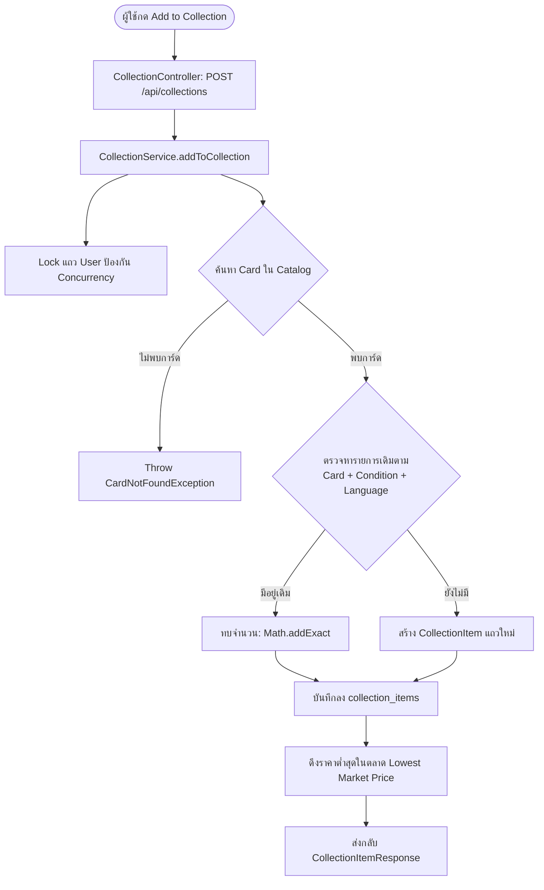

# 📚 07: ระบบจัดการคอลเลกชันการ์ดสะสม (Collection Management)
**โฟลเดอร์ปลายทาง:** `tcg-store-backend/src/main/java/com/mythix/tcg/collection`  
**เอกสารอ้างอิง:** [⬅️ กลับสู่สารบัญ Backend](../README.md) | [🏠 หน้าหลักสารบัญ Code](../../README.md)

---

## 📌 บทสรุปและหน้าที่ของส่วนนี้ (Overview & Responsibilities)
โมดูลนี้รองรับระบบสะสมการ์ดส่วนบุคคลของนักสะสม (Personal Digital Binder):
1. **Collector Binder Storage (`CollectionService.java`):** เพิ่มการ์ดเข้าคอลเลกชัน ระบุสภาพการ์ด (Condition), ภาษา (Language), และจำนวน (Quantity)
2. **Smart Entry Deduplication:** หากผู้ใช้เพิ่มการ์ดใบเดิมที่มีสภาพและภาษาเดียวกัน ระบบจะทำการทบจำนวน (`Math.addExact`) แทนการสร้างแถวใหม่ ช่วยให้ฐานข้อมูลกระชับและเป็นระเบียบ
3. **Public Binder Showcase (`PublicCollectionService.java`):** ให้บริการ Endpoint สาธารณะสำหรับการเปิดดูคอลเลกชันของผู้อื่น โดยกรองข้อมูลส่วนบุคคล (เช่น อีเมล, เบอร์โทร) ออกอัตโนมัติ
4. **Market Price Correlation:** เชื่อมโยงการ์ดในคอลเลกชันเข้ากับราคาตลาดปัจจุบัน (Market Price) เพื่อแสดงมูลค่าประเมินของแฟ้มสะสม

---

## 📂 ตารางโครงสร้างไฟล์และตำแหน่งที่ตั้ง (File Structure)

| ชื่อไฟล์ | ตำแหน่ง Path | หน้าที่ความรับผิดชอบ |
| :--- | :--- | :--- |
| `api/CollectionController.java` | `src/.../collection/api/CollectionController.java` | REST Endpoints จัดการคอลเลกชันส่วนตัว (`/api/collections`) |
| `api/PublicCollectionController.java` | `src/.../collection/api/PublicCollectionController.java` | REST Endpoint แสดงคอลเลกชันสาธารณะ (`/api/collections/public/{userId}`) |
| `application/CollectionService.java` | `src/.../collection/application/CollectionService.java` | ตรรกะทางธุรกิจคอลเลกชัน ตรวจสอบการ์ด ทบจำนวน และดึงราคาตลาด |
| `application/PublicCollectionService.java` | `src/.../collection/application/PublicCollectionService.java` | บริการแปลงข้อมูลเพื่อการแชร์สาธารณะอย่างปลอดภัย |
| `domain/CollectionItem.java` | `src/.../collection/domain/CollectionItem.java` | JPA Entity เชื่อมโยง `User`, `Card`, `condition`, `language`, `quantity` |
| `persistence/CollectionRepository.java` | `src/.../collection/persistence/CollectionRepository.java` | Spring Data Repository ค้นหาตาม User, Card, และเงื่อนไขสภาพ |

---

## 🔄 แผนผังการเพิ่มการ์ดสะสม (Add to Collection Flow)



---

## 💻 เจาะลึกโค้ดสำคัญและตัวอย่างจริง (Deep-Dive Implementation)

### 1. การเพิ่มการ์ดและรวมจำนวนอัตโนมัติ (`src/.../collection/application/CollectionService.java`)
```java
// src/main/java/com/mythix/tcg/collection/application/CollectionService.java (ส่วนสำคัญ)
package com.mythix.tcg.collection.application;

import com.mythix.tcg.catalog.domain.Card;
import com.mythix.tcg.catalog.persistence.CardRepository;
import com.mythix.tcg.collection.api.CollectionDto.AddToCollectionRequest;
import com.mythix.tcg.collection.api.CollectionDto.CollectionItemResponse;
import com.mythix.tcg.collection.domain.CollectionItem;
import com.mythix.tcg.collection.persistence.CollectionRepository;
import com.mythix.tcg.user.domain.User;
import com.mythix.tcg.user.persistence.UserRepository;
import lombok.RequiredArgsConstructor;
import org.springframework.stereotype.Service;
import org.springframework.transaction.annotation.Transactional;

@Service
@RequiredArgsConstructor
public class CollectionService {

    private final CollectionRepository collectionRepository;
    private final CardRepository cardRepository;
    private final UserRepository userRepository;

    @Transactional
    public CollectionItemResponse addToCollection(Long userId, AddToCollectionRequest request) {
        User user = userRepository.findByIdForUpdate(userId)
            .orElseThrow(() -> new CollectionUserNotFoundException(userId));

        Card card = cardRepository.findById(request.getCardId())
            .orElseThrow(() -> new CardNotFoundException("Card not found in master catalog"));

        int quantity = request.getQuantity() != null ? request.getQuantity() : 1;
        String condition = request.getCondition() != null ? request.getCondition().toUpperCase() : "NM";
        String language = request.getLanguage() != null ? request.getLanguage().toUpperCase() : "EN";

        // ตรวจสอบว่ามีการ์ดใบนี้ สภาพนี้ ภาษา นี้อยู่ในคอลเลกชันแล้วหรือไม่
        CollectionItem item = collectionRepository
            .findByUserIdAndCardIdAndConditionAndLanguage(userId, card.getId(), condition, language)
            .map(existing -> {
                existing.setQuantity(Math.addExact(existing.getQuantity(), quantity));
                return existing;
            })
            .orElseGet(() -> CollectionItem.builder()
                .user(user)
                .card(card)
                .condition(condition)
                .language(language)
                .quantity(quantity)
                .build());

        CollectionItem saved = collectionRepository.save(item);
        return mapToResponse(saved);
    }
}
```

---

### 2. JPA Entity ของคอลเลกชันการ์ด (`src/.../collection/domain/CollectionItem.java`)
```java
// src/main/java/com/mythix/tcg/collection/domain/CollectionItem.java
package com.mythix.tcg.collection.domain;

import com.mythix.tcg.catalog.domain.Card;
import com.mythix.tcg.user.domain.User;
import jakarta.persistence.*;
import lombok.*;
import java.time.LocalDateTime;

@Entity
@Table(name = "collection_items",
       uniqueConstraints = @UniqueConstraint(columnNames = {"user_id", "card_id", "card_condition", "language"}))
@Getter
@Setter
@NoArgsConstructor
@AllArgsConstructor
@Builder
public class CollectionItem {

    @Id
    @GeneratedValue(strategy = GenerationType.IDENTITY)
    private Long id;

    @ManyToOne(fetch = FetchType.LAZY)
    @JoinColumn(name = "user_id", nullable = false)
    private User user;

    @ManyToOne(fetch = FetchType.LAZY)
    @JoinColumn(name = "card_id", nullable = false)
    private Card card;

    @Column(name = "card_condition", nullable = false, length = 20)
    private String condition; // NM, LP, MP, HP

    @Column(nullable = false, length = 10)
    private String language; // EN, JP, TH

    @Column(nullable = false)
    private Integer quantity;

    @Column(name = "created_at", nullable = false, updatable = false)
    private LocalDateTime createdAt;

    @PrePersist
    protected void onCreate() {
        this.createdAt = LocalDateTime.now();
        if (this.quantity == null) this.quantity = 1;
    }
}
```

---

## 🎯 จุดเด่นทางวิศวกรรม (Engineering Highlights)
* **Compound Unique Constraint:** การกำหนด Unique Key ที่ประกอบด้วย `(user_id, card_id, card_condition, language)` ในระดับฐานข้อมูล ช่วยป้องกันแถวซ้ำซ้อน 100% แม้จะมีการยิง Request พร้อมกัน
* **Privacy-Preserving Public API:** การแยก `PublicCollectionService` ออกมาชัดเจน ช่วยป้องกันการเผลอส่งข้อมูลติดต่อหรือประวัติส่วนตัวของผู้ใช้ออกไปยังบุคคลภายนอก
* **Lazy Fetching Optimization:** เชื่อมโยงความสัมพันธ์ด้วย `FetchType.LAZY` และใช้ Fetch Join เฉพาะเมื่อต้องการแสดงผล ช่วยลดการดึงข้อมูลที่ไม่จำเป็น
