# 👑 08: การบริหารจัดการและระบบบันทึกความปลอดภัย (Admin & Audit Logs)
**โฟลเดอร์ปลายทาง:** `tcg-store-backend/src/main/java/com/mythix/tcg/admin`  
**เอกสารอ้างอิง:** [⬅️ กลับสู่สารบัญ Backend](../README.md) | [🏠 หน้าหลักสารบัญ Code](../../README.md)

---

## 📌 บทสรุปและหน้าที่ของส่วนนี้ (Overview & Responsibilities)
โมดูลนี้ทำหน้าที่เป็นศูนย์กลางการกำกับดูแลแพลตฟอร์ม (Platform Governance & Compliance):
1. **Seller Application Moderation (`AdminSellerService.java`):** ระบบตรวจสอบคำขอเปิดร้านค้า ตรวจสอบสถานะเดิมต้องเป็น `PENDING` ก่อนอนุญาตให้อนุมัติ (`APPROVE`) หรือปฏิเสธ (`REJECT`) พร้อมบันทึก ID ของแอดมินผู้อนุมัติ (`approvedBy`)
2. **Platform KPI Metrics Aggregation (`dashboard()`):** รวมสถิติเรียลไทม์ เช่น ยอดผู้ใช้งานแยกตามบทบาท, สินค้าที่เปิดขาย, ยอดออเดอร์ทั้งหมด และมูลค่าสินค้ารวมที่ชำระเงินแล้ว (GMV)
3. **Immutable Security Audit Trail (`AuditLog.java`):** บันทึกการกระทำที่สำคัญของผู้ดูแลระบบ (Admin Actions) ลงฐานข้อมูลอย่างถาวร โดยไม่มี Endpoint สำหรับการแก้ไขหรือลบ (Append-only Audit Log)
4. **Automated Notification Dispatch:** ยิงแจ้งเตือนไปยังผู้ใช้ทันทีเมื่อคำขอเปิดร้านได้รับการอนุมัติหรือปฏิเสธ

---

## 📂 ตารางโครงสร้างไฟล์และตำแหน่งที่ตั้ง (File Structure)

| ชื่อไฟล์ | ตำแหน่ง Path | หน้าที่ความรับผิดชอบ |
| :--- | :--- | :--- |
| `api/AdminSellerController.java` | `src/.../admin/api/AdminSellerController.java` | Endpoints ดูคำขอที่รออนุมัติ สั่งอนุมัติ หรือปฏิเสธร้านค้า |
| `application/AdminSellerService.java` | `src/.../admin/application/AdminSellerService.java` | ทรานแซกชันการอนุมัติร้านค้า สร้าง Audit Log และส่งการแจ้งเตือน |
| `domain/AuditLog.java` | `src/.../admin/domain/AuditLog.java` | JPA Entity บันทึกกิจกรรม (`actor`, `action`, `targetType`, `targetId`, `details`) |
| `persistence/AuditLogRepository.java` | `src/.../admin/persistence/AuditLogRepository.java` | Repository สำหรับสืบค้นและบันทึกประวัติการกระทำของระบบ |
| `api/AdminDashboardController.java` | `src/.../admin/api/AdminDashboardController.java` | Endpoint ดึงตัวเลข Dashboard KPIs สรุปผลทั้งแพลตฟอร์ม |
| `api/AdminAuditLogsController.java` | `src/.../admin/api/AdminAuditLogsController.java` | Endpoint ดูรายการ Audit Logs ทั้งหมดสำหรับทีม Audit |

---

## 🔄 แผนผังกระบวนการอนุมัติและบันทึก Audit (Admin Approval Flowchart)

```mermaid
sequenceDiagram
    autonumber
    actor Admin as ผู้ดูแลระบบ (ADMIN)
    participant Controller as AdminSellerController
    participant Service as AdminSellerService (@Transactional)
    participant ProfileRepo as SellerProfileRepository
    participant UserRepo as UserRepository
    participant AuditRepo as AuditLogRepository
    participant Notif as NotificationService

    Admin->>Controller: POST /api/admin/sellers/{id}/approve
    Controller->>Service: approve(applicationId, adminUserId)
    
    Service->>ProfileRepo: findByIdForUpdate(applicationId)
    Note over Service: ล็อคใบสมัครเพื่อป้องกัน<br/>แอดมินสองคนกดอนุมัติพร้อมกัน
    
    alt สถานะผู้สมัครไม่ใช่ PENDING
        Service-->>Controller: throw SellerApplicationStateException
    else สถานะถูกต้อง (PENDING)
        Service->>UserRepo: ปรับ applicant.sellerStatus = 'APPROVED'
        Service->>ProfileRepo: บันทึก approvedBy = adminId, verifiedAt = NOW()
        
        rect rgb(40, 50, 30)
            Note over Service, AuditRepo: บันทึกหลักฐาน Audit Trail ถาวร
            Service->>AuditRepo: save(AuditLog: actor, "APPROVE_SELLER", targetId)
        end
        
        Service->>Notif: dispatchApproved(applicantId, storeName)
        Service-->>Controller: AdminSellerApplicationResponse
        Controller-->>Admin: 200 OK
    end
```



---

## 💻 เจาะลึกโค้ดสำคัญและตัวอย่างจริง (Deep-Dive Implementation)

### 1. ทรานแซกชันการอนุมัติร้านค้าและบันทึก Audit (`src/.../admin/application/AdminSellerService.java`)
```java
// src/main/java/com/mythix/tcg/admin/application/AdminSellerService.java (ส่วนสำคัญ)
package com.mythix.tcg.admin.application;

import com.mythix.tcg.admin.api.AdminSellerApplicationResponse;
import com.mythix.tcg.admin.domain.AuditLog;
import com.mythix.tcg.admin.persistence.AuditLogRepository;
import com.mythix.tcg.notification.application.NotificationService;
import com.mythix.tcg.seller.domain.SellerProfile;
import com.mythix.tcg.seller.persistence.SellerProfileRepository;
import com.mythix.tcg.user.domain.User;
import com.mythix.tcg.user.persistence.UserRepository;
import lombok.RequiredArgsConstructor;
import org.springframework.stereotype.Service;
import org.springframework.transaction.annotation.Transactional;

import java.time.LocalDateTime;

@Service
@RequiredArgsConstructor
public class AdminSellerService {

    private final SellerProfileRepository sellerProfileRepository;
    private final UserRepository userRepository;
    private final AuditLogRepository auditLogRepository;
    private final NotificationService notificationService;

    @Transactional
    public AdminSellerApplicationResponse approve(Long applicationId, Long adminUserId) {
        // 1. ล็อคใบสมัครเพื่อป้องกัน Race Condition
        SellerProfile profile = sellerProfileRepository.findByIdForUpdate(applicationId)
            .orElseThrow(SellerApplicationNotFoundException::new);

        User applicant = profile.getUser();
        if (!"PENDING".equalsIgnoreCase(applicant.getSellerStatus())) {
            throw new SellerApplicationStateException("Application is not in PENDING state");
        }

        User admin = userRepository.findById(adminUserId)
            .orElseThrow(SellerApplicationNotFoundException::new);

        // 2. อัปเดตสถานะเป็น APPROVED และบันทึกเวลา
        applicant.setSellerStatus("APPROVED");
        profile.setApprovedBy(admin.getId());
        profile.setVerifiedAt(LocalDateTime.now());

        // 3. บันทึกหลักฐานลง Audit Log อย่างถาวร
        auditLogRepository.save(AuditLog.builder()
            .actor(admin)
            .action("APPROVE_SELLER")
            .targetType("SELLER_PROFILE")
            .targetId(String.valueOf(profile.getId()))
            .details("Approved seller application for store: " + profile.getStoreName())
            .build());

        // 4. ส่ง Notification แจ้งเตือนผู้ใช้งาน
        notificationService.dispatchApproved(applicant.getId(), profile.getStoreName());

        return AdminSellerApplicationResponse.from(profile);
    }
}
```

---

### 2. JPA Entity บันทึกประวัติความปลอดภัย (`src/.../admin/domain/AuditLog.java`)
```java
// src/main/java/com/mythix/tcg/admin/domain/AuditLog.java
package com.mythix.tcg.admin.domain;

import com.mythix.tcg.user.domain.User;
import jakarta.persistence.*;
import lombok.*;
import java.time.LocalDateTime;

@Entity
@Table(name = "audit_logs")
@Getter
@NoArgsConstructor
@AllArgsConstructor
@Builder
public class AuditLog {

    @Id
    @GeneratedValue(strategy = GenerationType.IDENTITY)
    private Long id;

    @ManyToOne(fetch = FetchType.LAZY)
    @JoinColumn(name = "actor_user_id", nullable = false)
    private User actor;

    @Column(nullable = false, length = 50)
    private String action; // APPROVE_SELLER, REJECT_SELLER, BAN_USER

    @Column(name = "target_type", nullable = false, length = 50)
    private String targetType; // SELLER_PROFILE, USER, ORDER

    @Column(name = "target_id", nullable = false, length = 100)
    private String targetId;

    @Column(columnDefinition = "TEXT")
    private String details;

    @Column(name = "created_at", nullable = false, updatable = false)
    private LocalDateTime createdAt;

    @PrePersist
    protected void onCreate() {
        this.createdAt = LocalDateTime.now();
    }
}
```

---

## 🎯 จุดเด่นทางวิศวกรรม (Engineering Highlights)
* **Pessimistic Application Locking:** การใช้ `findByIdForUpdate` บนใบสมัคร ป้องกันข้อผิดพลาดกรณีที่แอดมินสองคนเปิดหน้าจอพร้อมกันแล้วกดอนุมัติหรือปฏิเสธชนกัน
* **Non-Repudiation Security:** บันทึก Actor ID ของแอดมินทุกครั้ง ทำให้ระบบมีความโปร่งใส สามารถตรวจสอบย้อนหลังได้ว่าใครเป็นผู้อนุมัติร้านค้าใด
* **Integrated Event Notification:** รวมการอัปเดตสิทธิ์, การบันทึก Log และการแจ้งเตือนไว้ใน Atomic Transaction เดียวกัน หากมีส่วนใดล้มเหลว ข้อมูลจะ Rollback ทั้งหมด
