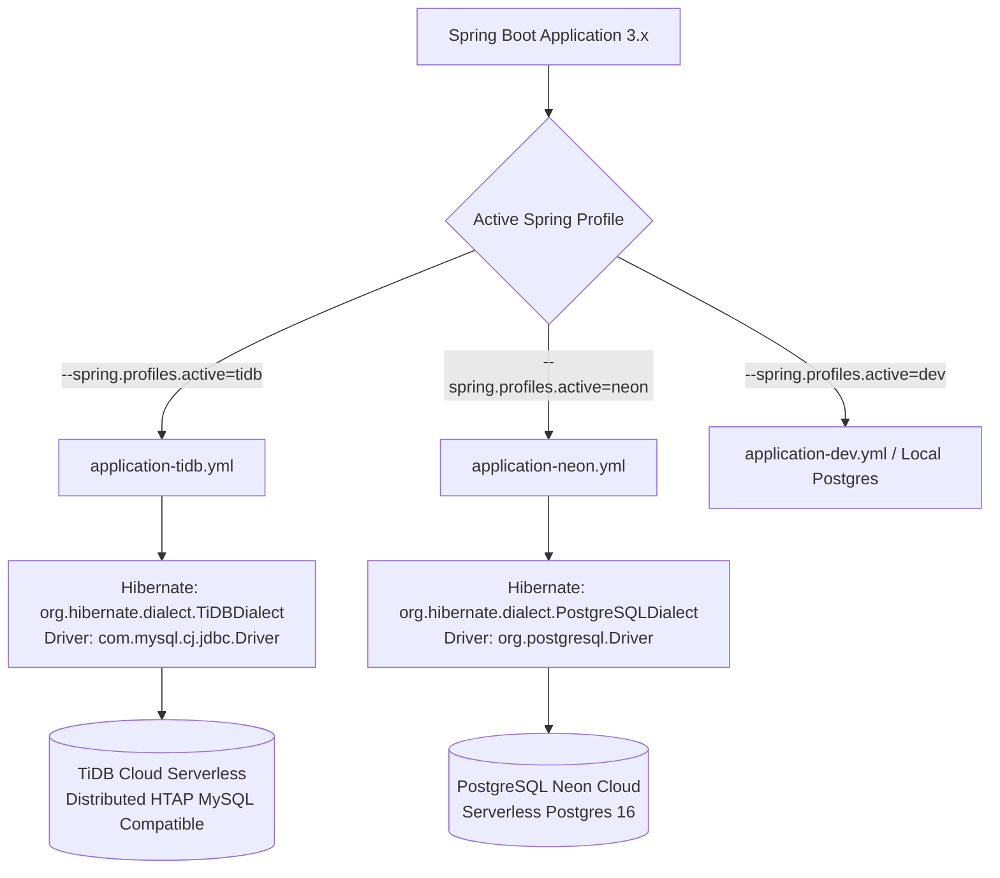

# 🗄️ 10: สถาปัตยกรรมฐานข้อมูลและโครงสร้างพื้นฐานคลาวด์ (Database & Multi-Cloud Infra)
**โฟลเดอร์ปลายทาง:** `tcg-store-backend/src/main/resources` และ Root Project  
**เอกสารอ้างอิง:** [⬅️ กลับสู่สารบัญ Backend](../README.md) | [🏠 หน้าหลักสารบัญ Code](../../README.md)

---

## 📌 บทสรุปและหน้าที่ของส่วนนี้ (Overview & Responsibilities)
โมดูลนี้รับผิดชอบความยืดหยุ่นของชั้นจัดเก็บข้อมูล (Data Persistence Layer) และการส่งมอบซอฟต์แวร์แบบ Container:
1. **Multi-Database Dialect Abstraction:** รองรับการรันแอปพลิเคชันได้ทั้งบน **TiDB Cloud (Distributed MySQL Dialect)** สำหรับโหมด Production/Staging Scale และ **PostgreSQL Neon (PostgreSQL Dialect)** หรือ Local Docker Compose
2. **Strict Schema Validation (`ddl-auto: validate`):** ป้องกันไม่ให้แอปพลิเคชันแก้ไขหรือเปลี่ยนแปลงโครงสร้างตารางเองโดยพลการใน Production เพื่อรักษาความเสถียรของข้อมูล
3. **Optimized HikariCP Connection Pool:** ปรับแต่งขนาด Pool และ Timeout (`connection-timeout: 10000ms`, `validation-timeout: 5000ms`) ให้เหมาะสมกับฐานข้อมูลแบบ Serverless Cloud ที่มีการตัด Idle Connections
4. **Hardened Multi-Stage Dockerfile:** สร้าง Docker Image ขนาดเล็กด้วย Eclipse Temurin 21 Alpine รันภายใต้ Non-root user (`USER spring:spring`) เพื่อความปลอดภัยระดับคอนเทนเนอร์
5. **Liveness & Readiness Health Probes (`/api/health`, `/actuator/health`):** ให้บริการสถานะความพร้อมของแอปพลิเคชันสำหรับ Kubernetes Probes

---

## 📂 ตารางโครงสร้างไฟล์และตำแหน่งที่ตั้ง (File Structure)

| ชื่อไฟล์ | ตำแหน่ง Path | หน้าที่ความรับผิดชอบ |
| :--- | :--- | :--- |
| `application.yml` | `src/main/resources/application.yml` | การตั้งค่าสากลของ Spring Boot (Port, Security, File Size Limits) |
| `application-tidb.yml` | `src/main/resources/application-tidb.yml` | โปรไฟล์เชื่อมต่อ TiDB Cloud Serverless (MySQL Driver + TiDBDialect) |
| `application-neon.yml` | `src/main/resources/application-neon.yml` | โปรไฟล์เชื่อมต่อ PostgreSQL Neon Cloud (PostgreSQL Driver) |
| `Dockerfile` | `tcg-store-backend/Dockerfile` | Multi-stage Docker build ปลอดภัยด้วย Non-root user |
| `common/health/HealthController.java` | `src/.../common/health/HealthController.java` | Health Check Endpoint สาธารณะสำหรับ Load Balancer |

---

## 🔄 แผนผังสถาปัตยกรรมการสลับฐานข้อมูล (Multi-Cloud DB Architecture)



---

## 💻 เจาะลึกโค้ดสำคัญและตัวอย่างจริง (Deep-Dive Implementation)

### 1. การกำหนดค่า TiDB Profile (`src/main/resources/application-tidb.yml`)
ออกแบบมาเพื่อเชื่อมต่อกับ TiDB Cloud อย่างปลอดภัย โดยข้อมูล Host และรหัสผ่านทั้งหมดรับผ่าน Environment Variables:

```yaml
# src/main/resources/application-tidb.yml
spring:
  datasource:
    url: ${TIDB_JDBC_URL}
    username: ${TIDB_USER}
    password: ${TIDB_PASSWORD}
    driver-class-name: com.mysql.cj.jdbc.Driver
    hikari:
      maximum-pool-size: ${TIDB_POOL_MAX_SIZE:5}
      minimum-idle: ${TIDB_POOL_MIN_IDLE:0}
      connection-timeout: 10000
      validation-timeout: 5000
  jpa:
    database-platform: org.hibernate.dialect.TiDBDialect
    hibernate:
      ddl-auto: validate # บังคับตรวจสอบ Schema อย่างเคร่งครัด ห้ามแก้ DDL อัตโนมัติ
    properties:
      hibernate:
        jdbc:
          time_zone: UTC

logging:
  level:
    org.hibernate.SQL: ${TIDB_SQL_LOG_LEVEL:WARN}
```

---

### 2. Multi-Stage Hardened Dockerfile (`tcg-store-backend/Dockerfile`)
ใช้คอนเซปต์ Least Privilege Security โดยสร้าง User เฉพาะกลุ่ม `spring:spring` ไม่รันด้วย root:

```dockerfile
# Stage 1: Build JAR จาก Source Code
FROM eclipse-temurin:21-jdk-alpine AS build
WORKDIR /workspace

COPY .mvn .mvn
COPY mvnw pom.xml ./
# ดาวน์โหลด Dependencies เก็บเป็น Cache Layer ก่อน
RUN chmod +x mvnw && ./mvnw --batch-mode dependency:go-offline

COPY src src
RUN ./mvnw --batch-mode clean package -DskipTests

# Stage 2: Minimal Runtime Environment
FROM eclipse-temurin:21-jre-alpine

# สร้าง Non-root User เพื่อความปลอดภัยระดับ Enterprise
RUN addgroup -S spring && adduser -S spring -G spring
WORKDIR /app

# สร้างโฟลเดอร์สำหรับเก็บภาพอัปโหลดและมอบสิทธิ์ให้ user spring
RUN mkdir -p /app/uploads/products && chown -R spring:spring /app

COPY --from=build --chown=spring:spring /workspace/target/*.jar app.jar

# สลับไปรันด้วยสิทธิ์ spring
USER spring:spring
EXPOSE 8080

ENTRYPOINT ["java", "-jar", "/app/app.jar"]
```

---

## 🎯 จุดเด่นทางวิศวกรรม (Engineering Highlights)
* **Cloud-Agnostic Resilience:** การสลับระหว่าง TiDB (MySQL Engine) และ Neon (PostgreSQL Engine) ได้โดยไม่ต้องแก้ไขซอร์สโค้ดแม้แต่บรรทัดเดียว เป็นตัวอย่างที่ดีของการใช้ JPA / Hibernate Abstraction
* **Container Security Best Practices:**
  - รันด้วย JRE ตัวเบา (Alpine Linux) ช่วยลดขนาด Image และลดช่องโหว่ CVE
  - รันด้วย Non-root User ป้องกัน Container Escape Vulnerabilities
* **Kubernetes Probe Readiness:** รองรับการเชื่อมต่อกับ Kubernetes Liveness Probe และ Readiness Probe ได้ทั้งผ่าน Custom Lightweight `/api/health` และ Spring Boot Actuator
