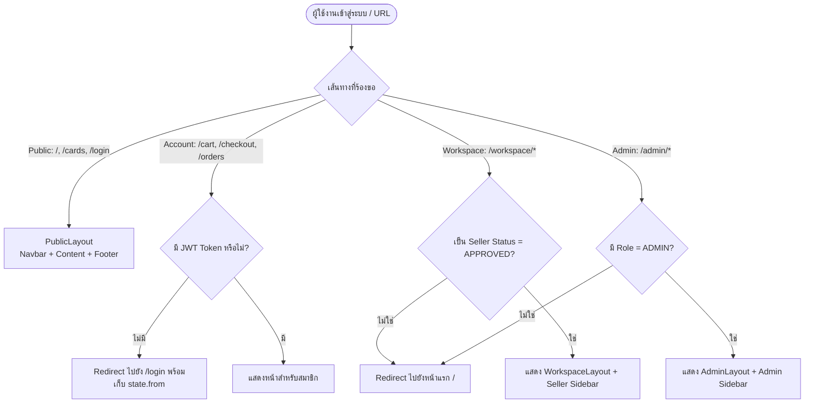

# 🌐 01: โครงสร้างหลักของแอปพลิเคชันและการจัดการ Routing (App & Routing)
**โฟลเดอร์ปลายทาง:** `tcg-store-frontend/src/app`  
**เอกสารอ้างอิง:** [⬅️ กลับสู่สารบัญ Frontend](../README.md) | [🏠 หน้าหลักสารบัญ Code](../../README.md)

---

## 📌 บทสรุปและหน้าที่ของส่วนนี้ (Overview & Responsibilities)
โมดูลนี้ทำหน้าที่เป็น **แกนกลาง (Application Core Engine)** ของระบบ Frontend ซึ่งรับผิดชอบ:
1. การ Bootstrapping และ Mount React เข้าสู่ DOM (`main.tsx`, `App.tsx`)
2. การกำหนดเส้นทาง (Routing Configuration) ทั้งระบบด้วย `react-router-dom` (Data Router v6+)
3. การจำแนก Layout ตามบริบทผู้ใช้งาน (Public Layout, Seller Workspace Layout, และ Admin Layout)
4. การควบคุมความปลอดภัยในการเข้าถึงหน้า (Route Guarding / RBAC) ผ่านคอมโพเนนต์ `ProtectedRoute`
5. การดักจับและกู้คืนข้อผิดพลาดระดับเส้นทาง (Route-level Error Boundary)

---

## 📂 ตารางโครงสร้างไฟล์และตำแหน่งที่ตั้ง (File Structure)

| ชื่อไฟล์ | ตำแหน่ง Path | หน้าที่ความรับผิดชอบ |
| :--- | :--- | :--- |
| `main.tsx` | `src/main.tsx` | จุดเริ่มต้นของแอปพลิเคชัน โหลด CSS หลัก และ Mount React Tree |
| `App.tsx` | `src/app/App.tsx` | Root Component ให้บริการ Providers, Routing และ Global Toaster |
| `router/index.tsx` | `src/app/router/index.tsx` | กำหนดโครงสร้าง Route ทั้งหมดของแอปพลิเคชัน (Public, Seller, Admin) |
| `router/ProtectedRoute.tsx` | `src/app/router/ProtectedRoute.tsx` | ควบคุมสิทธิ์การเข้าถึงหน้า ตรวจสอบ JWT Session, Role (ADMIN) และ Seller Status |
| `router/NotFoundPage.tsx` | `src/app/router/NotFoundPage.tsx` | หน้า 404 Fallback เมื่อผู้ใช้พิมพ์ URL ไม่ถูกต้อง |
| `layouts/PublicLayout.tsx` | `src/app/layouts/PublicLayout.tsx` | โครงร่างหน้าทั่วไปสำหรับลูกค้า (มี Navbar สาธารณะ + Body + Footer) |
| `layouts/WorkspaceLayout.tsx` | `src/app/layouts/WorkspaceLayout.tsx` | โครงร่างหน้าจัดการของฝั่งผู้ขาย (Seller Workspace Sidebar + Content) |
| `layouts/AdminLayout.tsx` | `src/app/layouts/AdminLayout.tsx` | โครงร่างหลังบ้านของผู้ดูแลระบบ (Admin Sidebar + Dashboard Content) |

---

## 🔄 แผนผังการทำงานของระบบ Routing & Guards (Route Flowchart)



---

## 💻 เจาะลึกโค้ดสำคัญและตัวอย่างจริง (Deep-Dive Implementation)

### 1. การกำหนด Routing แบบแยก Domain (`src/app/router/index.tsx`)
ระบบใช้การจัดกลุ่ม Route ตาม Bounded Context โดยนำ Routes ย่อยจากแต่ละ Feature Folder มารวมกัน เพื่อให้แต่ละทีมทำงานแยกจากกันได้โดยไม่เกิด Git Conflict:

```typescript
// src/app/router/index.tsx
import { createBrowserRouter, type RouteObject } from 'react-router-dom';
import { PublicLayout } from '@/app/layouts/PublicLayout';
import { WorkspaceLayout } from '@/app/layouts/WorkspaceLayout';
import { AdminLayout } from '@/app/layouts/AdminLayout';
import { discoveryRoutes } from '@/features/discovery/routes';
import { authRoutes } from '@/features/auth/routes';
import { reservationCartRoutes } from '@/features/reservation-cart/routes';
import { checkoutRoutes } from '@/features/checkout/routes';
import { buyerReservationRoutes, sellerReservationRoutes } from '@/features/reservations/routes';
import { listingWorkspaceRoutes } from '@/features/listings/routes';
import { ProtectedRoute } from './ProtectedRoute';
import { RouteErrorBoundary } from '@/shared/components/ErrorBoundary';

// 1. เส้นทางที่ต้องการยืนยันตัวตนสำหรับผู้ซื้อทั่วไป (Buyer Context)
const accountRoutes: RouteObject = {
  element: <ProtectedRoute />,
  children: [
    ...reservationCartRoutes,
    ...checkoutRoutes,
    ...buyerReservationRoutes,
  ],
};

// 2. เส้นทางพื้นที่ทำงานของผู้ขาย (Seller Workspace Context)
const workspaceRoute: RouteObject = {
  path: '/workspace',
  element: <ProtectedRoute requiredSeller />,
  children: [
    {
      element: <WorkspaceLayout />,
      children: [...listingWorkspaceRoutes, ...sellerReservationRoutes],
    },
  ],
};

// 3. เส้นทางแอดมินสำหรับบริหารจัดการแพลตฟอร์ม (Admin Context)
const adminRoute: RouteObject = {
  path: '/admin',
  element: <ProtectedRoute requiredRole="ADMIN" />,
  children: [
    {
      element: <AdminLayout />,
      children: [/* Admin pages */],
    },
  ],
};

export const router = createBrowserRouter([
  {
    path: '/',
    element: <PublicLayout />,
    errorElement: <RouteErrorBoundary />,
    children: [
      ...discoveryRoutes,
      ...authRoutes,
      accountRoutes,
      { path: '*', element: <NotFoundPage /> },
    ],
  },
  { ...workspaceRoute, errorElement: <RouteErrorBoundary /> },
  adminRoute,
]);
```

---

### 2. ตัวป้องกันสิทธิ์การเข้าถึง (`src/app/router/ProtectedRoute.tsx`)
คอมโพเนนต์นี้ทำหน้าที่ตรวจสอบสิทธิ์ (Guarding) และจัดการเรื่อง Session Hydration เพื่อป้องกันการเกิดหน้าขาวหรือ Redirect ผิดพลาดขณะดึงข้อมูลผู้ใช้จาก Cache:

```typescript
// src/app/router/ProtectedRoute.tsx
import { Navigate, Outlet, useLocation } from 'react-router-dom';
import { useAuthStore } from '@/features/auth/model/useAuthStore';
import { isSellerUser, type Role } from '@/entities/account/model/types';

interface ProtectedRouteProps {
  requiredRole?: Role;
  requiredSeller?: boolean;
}

export function ProtectedRoute({ requiredRole, requiredSeller }: ProtectedRouteProps) {
  const location = useLocation();
  const token = useAuthStore((s) => s.token);
  const user = useAuthStore((s) => s.user);
  const isHydrating = useAuthStore((s) => s.isHydrating);

  // 1. กรณีไม่มี Token อยู่ใน State -> สั่งกลับไปหน้า Login และจำหน้าเดิมไว้
  if (!token) {
    return <Navigate to="/login" replace state={{ from: location.pathname + location.search }} />;
  }

  // 2. กรณีที่กำลังฟื้นฟู Session (Hydrating จาก LocalStorage) -> แสดง Loading State
  if (isHydrating) {
    return (
      <div role="status" className="flex min-h-screen items-center justify-center bg-bg-base text-gray-400">
        Checking your session...
      </div>
    );
  }

  // 3. ป้องกันกรณี Token ค้างแต่ไม่มี User Object
  if (!user) {
    return <Navigate to="/login" replace state={{ from: location.pathname }} />;
  }

  // 4. ตรวจสอบ Role เฉพาะ เช่น ADMIN
  if (requiredRole && user.role !== requiredRole) {
    return <Navigate to="/" replace />;
  }

  // 5. ตรวจสอบสถานะการเป็นผู้ขาย (Seller Status ต้อง APPROVED)
  if (requiredSeller && !isSellerUser(user)) {
    return <Navigate to="/" replace />;
  }

  // ผ่านทุกเงื่อนไข อนุญาตให้แสดงเนื้อหาลูกใน Outlet
  return <Outlet />;
}
```

---

## 🎯 จุดเด่นทางวิศวกรรม (Engineering Highlights)
* **Zero Flicker Session Check:** การใช้ตัวแปร `isHydrating` ใน Store ช่วยกำจัดปัญหาการกระพริบหลุดไปยังหน้า Login ขณะเปิดเว็บใหม่
* **Return-to-Origin Redirect:** เก็บ Path ปลายทางไว้ใน `state.from` เพื่อให้หลังผู้ใช้ล็อกอินสำเร็จ สามารถพากลับมาทำงานที่เดิมต่อได้ทันที
* **Fault Isolation with ErrorBoundary:** แต่ละ Route Root ติดตั้ง `RouteErrorBoundary` ป้องกันไม่ให้แอปพลิเคชันพังทั้งหน้าจอเมื่อเกิดข้อผิดพลาดในคอมโพเนนต์ย่อย
