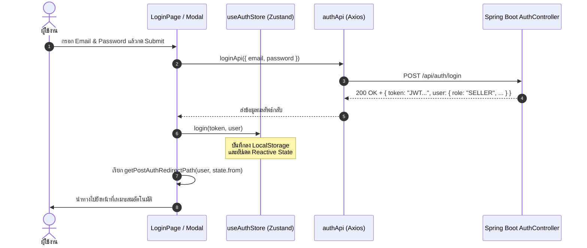

# 🔐 02: ระบบยืนยันตัวตนและการจัดการสิทธิ์ (Authentication & State)
**โฟลเดอร์ปลายทาง:** `tcg-store-frontend/src/features/auth`  
**เอกสารอ้างอิง:** [⬅️ กลับสู่สารบัญ Frontend](../README.md) | [🏠 หน้าหลักสารบัญ Code](../../README.md)

---

## 📌 บทสรุปและหน้าที่ของส่วนนี้ (Overview & Responsibilities)
โมดูลนี้รับผิดชอบวงจรชีวิตของ **User Session** และการยืนยันตัวตนทั้งหมดบนระบบ Frontend:
1. การเชื่อมต่อ REST API เข้ากับ Endpoint `/api/auth/*` (Login, Register, Password Reset)
2. การจัดการ Global State ด้วย **Zustand (`useAuthStore`)** พร้อมการซิงค์ LocalStorage แบบทนทาน (Persistent & Hydration)
3. **Contextual Login Modal:** หน้าต่างเข้าสู่ระบบแบบ Modal สำหรับเรียกใช้งานเมื่อผู้ใช้พยายามกดกระทำบางอย่าง (เช่น เพิ่มสินค้าลงตะกร้า) โดยไม่ต้องเปลี่ยนหน้า
4. การคำนวณและตรวจสอบเงื่อนไขความปลอดภัยของรหัสผ่าน (Password Complexity Rules)
5. การคำนวณทิศทางการนำทางหลังยืนยันตัวตนสำเร็จ (Smart Post-Auth Navigation)

---

## 📂 ตารางโครงสร้างไฟล์และตำแหน่งที่ตั้ง (File Structure)

| ชื่อไฟล์ | ตำแหน่ง Path | หน้าที่ความรับผิดชอบ |
| :--- | :--- | :--- |
| `model/useAuthStore.ts` | `src/features/auth/model/useAuthStore.ts` | Zustand Store เก็บ `token`, `user`, สถานะ `isHydrating` และ Action `login()`, `logout()` |
| `api/auth.ts` | `src/features/auth/api/auth.ts` | ฟังก์ชันเรียก Backend API: `loginApi()`, `registerApi()`, `forgotPasswordApi()` |
| `components/ContextualLoginModal.tsx` | `src/features/auth/components/ContextualLoginModal.tsx` | Modal เข้าสู่ระบบแบบไม่เปลี่ยนหน้า สำหรับ Action ด่วนที่ต้องการ Auth ทันที |
| `pages/LoginPage.tsx` | `src/features/auth/pages/LoginPage.tsx` | หน้าจอเข้าสู่ระบบหลัก พร้อมรองรับการ Redirect กลับตำแหน่งเดิม (`state.from`) |
| `pages/SignUpPage.tsx` | `src/features/auth/pages/SignUpPage.tsx` | หน้าจอลงทะเบียนผู้ใช้งานใหม่ ตรวจสอบ Email ซ้ำและ Password Policy |
| `pages/ForgotPasswordPage.tsx` | `src/features/auth/pages/ForgotPasswordPage.tsx` | หน้าจอส่งคำขอกู้คืนรหัสผ่านไปยังอีเมล |
| `pages/ResetPasswordPage.tsx` | `src/features/auth/pages/ResetPasswordPage.tsx` | หน้าจอกำหนดรหัสผ่านใหม่จาก Token ที่ได้รับ |
| `lib/passwordRules.ts` | `src/features/auth/lib/passwordRules.ts` | Regex และ Business Rule สำหรับตรวจสอบความแข็งแรงของรหัสผ่าน |
| `lib/postAuthNavigation.ts` | `src/features/auth/lib/postAuthNavigation.ts` | ฟังก์ชันคำนวณหน้าที่ผู้ใช้ควรไปหลังเข้าสู่ระบบ (เช่น Admin ไป `/admin`, Seller ไป `/workspace`) |

---

## 🔄 ลำดับขั้นตอนการทำงาน (Auth Flowchart)



---

## 💻 เจาะลึกโค้ดสำคัญและตัวอย่างจริง (Deep-Dive Implementation)

### 1. Global Auth Store พร้อม LocalStorage Hydration (`src/features/auth/model/useAuthStore.ts`)
Store นี้จัดการสถานะการล็อกอินและแก้ปัญหาเรื่องหน้าขาวหรือ State หลุดเมื่อกด Refresh โดยออกแบบให้รองรับทั้ง LocalStorage ดั้งเดิมและโครงสร้าง Zustand Persist:

```typescript
// src/features/auth/model/useAuthStore.ts
import { create } from 'zustand';
import type { User } from '@/entities/account/model/types';

interface AuthStore {
  token: string | null;
  user: User | null;
  isHydrating: boolean;
  login: (token: string, user: User) => void;
  completeHydration: (user: User) => void;
  logout: () => void;
}

// ฟังก์ชันกู้คืน State เริ่มต้นจาก LocalStorage อย่างปลอดภัย
function getInitialAuth(): { token: string | null; user: User | null } {
  try {
    const raw = typeof window !== 'undefined' ? localStorage.getItem('tcg_auth_storage') : null;
    if (raw) {
      const parsed = JSON.parse(raw);
      if (parsed?.state?.token && parsed?.state?.user) {
        return { token: parsed.state.token, user: parsed.state.user };
      }
    }
  } catch {
    // ป้องกัน JSON Parse Error กรณี Storage เสียหาย
  }
  const token = typeof window !== 'undefined' ? localStorage.getItem('token') : null;
  return { token, user: null };
}

const initialAuth = getInitialAuth();

export const useAuthStore = create<AuthStore>((set) => ({
  token: initialAuth.token,
  user: initialAuth.user,
  // หากมี Token แต่ยังไม่มี User Object ให้ตั้งค่า Hydrating เป็น true เพื่อดึงข้อมูล User เพิ่มเติม
  isHydrating: Boolean(initialAuth.token && !initialAuth.user),

  login: (token, user) => {
    localStorage.setItem('token', token);
    localStorage.setItem(
      'tcg_auth_storage',
      JSON.stringify({ state: { token, user, isAuthenticated: true }, version: 0 })
    );
    set({ token, user, isHydrating: false });
  },

  completeHydration: (user) => {
    const token = localStorage.getItem('token');
    if (token) {
      localStorage.setItem(
        'tcg_auth_storage',
        JSON.stringify({ state: { token, user, isAuthenticated: true }, version: 0 })
      );
    }
    set({ user, isHydrating: false });
  },

  logout: () => {
    localStorage.removeItem('token');
    localStorage.removeItem('tcg_auth_storage');
    set({ token: null, user: null, isHydrating: false });
  },
}));
```

---

### 2. Contextual Login Modal (`src/features/auth/components/ContextualLoginModal.tsx`)
ช่วยเพิ่ม Conversion Rate ในการสั่งซื้อและสะสมการ์ด หากผู้ใช้ยังไม่ได้ล็อกอินแล้วกดปุ่ม เช่น "ใส่ตะกร้า" ระบบจะเปิด Modal นี้ขึ้นมาโดยที่ผู้ใช้ไม่ต้องเสียเวลาเปลี่ยนหน้าหรือเริ่มค้นหาการ์ดใหม่:

```typescript
// src/features/auth/components/ContextualLoginModal.tsx
import { useState } from 'react';
import { useAuthStore } from '../model/useAuthStore';
import { loginApi } from '../api/auth';
import { Modal } from '@/shared/components/Modal';
import { Button } from '@/shared/components/Button';
import { Input } from '@/shared/components/Input';

interface ContextualLoginModalProps {
  isOpen: boolean;
  onClose: () => void;
  onSuccess?: () => void;
  title?: string;
}

export function ContextualLoginModal({ isOpen, onClose, onSuccess, title = "กรุณาเข้าสู่ระบบก่อนดำเนินการ" }: ContextualLoginModalProps) {
  const [email, setEmail] = useState('');
  const [password, setPassword] = useState('');
  const [error, setError] = useState<string | null>(null);
  const [loading, setLoading] = useState(false);
  const login = useAuthStore((s) => s.login);

  const handleSubmit = async (e: React.FormEvent) => {
    e.preventDefault();
    setLoading(true);
    setError(null);
    try {
      const response = await loginApi({ email, password });
      login(response.token, response.user);
      onClose();
      if (onSuccess) onSuccess(); // ทำ Action เดิมต่อได้ทันที
    } catch (err: any) {
      setError(err.response?.data?.message || 'อีเมลหรือรหัสผ่านไม่ถูกต้อง');
    } finally {
      setLoading(false);
    }
  };

  return (
    <Modal isOpen={isOpen} onClose={onClose} title={title}>
      <form onSubmit={handleSubmit} className="space-y-4">
        {error && <div className="p-3 text-sm text-red-500 bg-red-950/30 rounded border border-red-800">{error}</div>}
        <Input label="อีเมล" type="email" value={email} onChange={(e) => setEmail(e.target.value)} required />
        <Input label="รหัสผ่าน" type="password" value={password} onChange={(e) => setPassword(e.target.value)} required />
        <div className="flex justify-end gap-2 pt-2">
          <Button variant="ghost" onClick={onClose} type="button">ยกเลิก</Button>
          <Button variant="primary" type="submit" disabled={loading}>
            {loading ? 'กำลังเข้าสู่ระบบ...' : 'เข้าสู่ระบบ'}
          </Button>
        </div>
      </form>
    </Modal>
  );
}
```

---

## 🎯 จุดเด่นทางวิศวกรรม (Engineering Highlights)
* **Cross-Tab Synchronization Support:** โครงสร้าง LocalStorage ช่วยรักษาการล็อกอินข้ามแท็บเบราว์เซอร์
* **Smart Post-Auth Navigation:** ผู้ใช้ที่กลับมาจากหน้าสินค้าจะถูกส่งกลับไปหน้าสินค้าเดิม แต่หากเป็นผู้ดูแลระบบที่ล็อกอินผ่านหน้าหลัก ระบบจะพาเข้าสู่ `/admin` โดยอัตโนมัติ
* **Security Resilience:** เมื่อ Token หมดอายุ Interceptor ของเครือข่ายจะสั่ง `logout()` และเคลียร์ State ทันที ป้องกันการส่งคำขอที่ผิดพลาดซ้ำ
