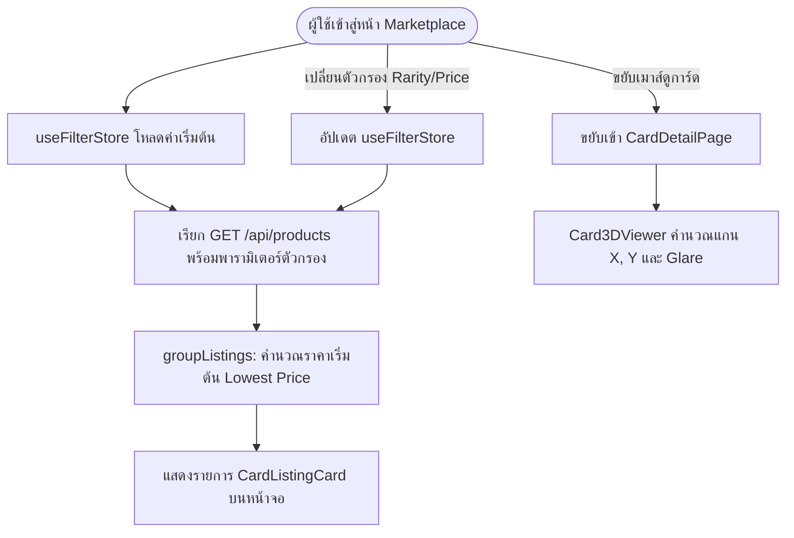

# 🎴 03: ตลาดการ์ด การค้นหา และตัวแสดงผล 3D (Discovery & Marketplace)
**โฟลเดอร์ปลายทาง:** `tcg-store-frontend/src/features/discovery`  
**เอกสารอ้างอิง:** [⬅️ กลับสู่สารบัญ Frontend](../README.md) | [🏠 หน้าหลักสารบัญ Code](../../README.md)

---

## 📌 บทสรุปและหน้าที่ของส่วนนี้ (Overview & Responsibilities)
โมดูลนี้เป็นศูนย์กลางของประสบการณ์การซื้อขายและการค้นหาการ์ดบนแพลตฟอร์ม (Customer Facing Core):
1. **Marketplace & Catalog Browser:** หน้าค้นหาและเรียกดูการ์ด รองรับการกรองหลายมิติพร้อมกัน (Multi-facet Filtering: ชื่อ, ชุดเซ็ต, ความหายาก, ช่วงราคา, สภาพการ์ด)
2. **Card Grouping Strategy:** จัดกลุ่มข้อเสนอการขาย (Offers) จากผู้ขายหลายรายมารวมไว้ใต้การ์ดแม่แบบเดียวกัน (Canonical Card View)
3. **Card 3D Interactive Viewer:** การแสดงผลตัวอย่างการ์ดแบบสามมิติ มีเอฟเฟกต์การเอียงการ์ดตามพิกัดเมาส์ (Mouse Physics) และแสงสะท้อนโฮโลแกรม (Holographic Glare) ด้วย CSS 3D Transforms
4. **Seller Offers Comparison:** แสดงตารางเปรียบเทียบราคา สภาพการ์ด (Near Mint, Lightly Played) และชื่อร้านค้า ให้ผู้ซื้อเลือกข้อเสนอที่คุ้มค่าที่สุด
5. **State Management:** จัดการตัวกรองและการค้นหาแบบ Reactive ผ่าน `useFilterStore`

---

## 📂 ตารางโครงสร้างไฟล์และตำแหน่งที่ตั้ง (File Structure)

| ชื่อไฟล์ | ตำแหน่ง Path | หน้าที่ความรับผิดชอบ |
| :--- | :--- | :--- |
| `pages/Marketplace.tsx` | `src/features/discovery/pages/Marketplace.tsx` | หน้ารวมสินค้าตลาดการ์ด พร้อม Sidebar กรองสินค้าและ Infinite / Paginated Grid |
| `pages/CardDetailPage.tsx` | `src/features/discovery/pages/CardDetailPage.tsx` | หน้ารายละเอียดการ์ด มีตัวแสดงผล 3D, ตารางเปรียบเทียบผู้ขาย และปุ่มสะสม |
| `components/Card3DViewer.tsx` | `src/features/discovery/components/Card3DViewer.tsx` | คอมโพเนนต์การ์ด 3D พร้อมแสงโฮโลแกรมเลื่อนตามตำแหน่งเมาส์ |
| `components/SellerOfferRow.tsx` | `src/features/discovery/components/SellerOfferRow.tsx` | แถวแสดงรายการข้อเสนอของผู้ขายแต่ละคน ราคา สภาพ และปุ่มกดจอง |
| `components/CardCollectPanel.tsx` | `src/features/discovery/components/CardCollectPanel.tsx` | แผงควบคุมสำหรับกดเพิ่มการ์ดนี้เข้าสู่ Personal Collection ทันที |
| `model/useFilterStore.ts` | `src/features/discovery/model/useFilterStore.ts` | Zustand Store บันทึกเงื่อนไขตัวกรอง (Rarity, Set, Condition, Price) |
| `lib/groupListings.ts` | `src/features/discovery/lib/groupListings.ts` | Utility จัดกลุ่มและคำนวณราคาต่ำสุด (Lowest Price) ของแต่ละการ์ด |
| `api/catalog.ts` | `src/features/discovery/api/catalog.ts` | ฟังก์ชันดึงข้อมูล Master Catalog และการ์ดแนะนำ |

---

## 🔄 แผนผังการทำงานของหน้า Marketplace (Discovery Flow)



---

## 💻 เจาะลึกโค้ดสำคัญและตัวอย่างจริง (Deep-Dive Implementation)

### 1. คอมโพเนนต์แสดงผลการ์ด 3 มิติ (`src/features/discovery/components/Card3DViewer.tsx`)
ไฮไลต์ทางเทคนิคของโปรเจกต์นี้คือการสร้างประสบการณ์ 3 มิติโดย **ไม่ต้องใช้ WebGL หรือ Three.js ขนาดใหญ่** แต่ใช้คณิตศาสตร์คำนวณมุมหมุน (Tilt Matrix) และ CSS 3D Transforms ทำให้ประหยัด Memory และรันได้ลื่นไหล 60 FPS:

```typescript
// src/features/discovery/components/Card3DViewer.tsx
import { useState, useRef, useCallback } from 'react';

interface Card3DViewerProps {
  imageSrc: string;
  cardName: string;
}

export function Card3DViewer({ imageSrc, cardName }: Card3DViewerProps) {
  const containerRef = useRef<HTMLDivElement>(null);
  const [rotation, setRotation] = useState({ x: 0, y: 0 });
  const [glare, setGlare] = useState({ x: 50, y: 50, opacity: 0 });
  const [isHovered, setIsHovered] = useState(false);

  // คำนวณพิกัดสัมพัทธ์ของเมาส์เทียบกับจุดกึ่งกลางของการ์ด
  const handleMouseMove = useCallback((e: React.MouseEvent<HTMLDivElement>) => {
    if (!containerRef.current) return;
    const rect = containerRef.current.getBoundingClientRect();
    
    const x = e.clientX - rect.left;
    const y = e.clientY - rect.top;
    const centerX = rect.width / 2;
    const centerY = rect.height / 2;
    
    // จำกัดมุมเอียงสูงสุดไม่เกิน 20 องศาทั้งสองแกน
    const rotateX = ((y - centerY) / centerY) * -20;
    const rotateY = ((x - centerX) / centerX) * 20;
    
    setRotation({ x: rotateX, y: rotateY });
    // กำหนดตำแหน่งไฮไลต์แสงสะท้อนโฮโลแกรม
    setGlare({
      x: (x / rect.width) * 100,
      y: (y / rect.height) * 100,
      opacity: 0.75,
    });
  }, []);

  const handleMouseLeave = () => {
    setIsHovered(false);
    // รีเซ็ตการ์ดกลับสู่ตำแหน่งระนาบเดิมอย่างนุ่มนวล
    setRotation({ x: 0, y: 0 });
    setGlare((prev) => ({ ...prev, opacity: 0 }));
  };

  return (
    <div className="flex flex-col items-center select-none w-full max-w-[420px]">
      <div
        ref={containerRef}
        onMouseMove={handleMouseMove}
        onMouseEnter={() => setIsHovered(true)}
        onMouseLeave={handleMouseLeave}
        className="relative w-full h-[530px] bg-white rounded-2xl p-6 flex items-center justify-center shadow-2xl overflow-hidden cursor-grab active:cursor-grabbing"
        style={{ perspective: '1000px' }} // เปิด Perspective ให้มองเห็นมิติเชิงลึก
      >
        <div
          className="relative w-full h-full transition-transform duration-100 ease-out flex items-center justify-center"
          style={{
            transform: `rotateX(${rotation.x}deg) rotateY(${rotation.y}deg)`,
            transformStyle: 'preserve-3d',
          }}
        >
          
          {/* Holographic Glare Overlay (เลื่อนตามจุดแสง) */}
          <div
            className="absolute inset-0 pointer-events-none rounded-lg transition-opacity duration-150"
            style={{
              opacity: glare.opacity,
              background: `radial-gradient(circle at ${glare.x}% ${glare.y}%, rgba(255, 255, 255, 0.8) 0%, rgba(255, 255, 255, 0) 60%)`,
              mixBlendMode: 'overlay',
            }}
          />
        </div>
      </div>
    </div>
  );
}
```

---

### 2. Multi-facet Filter Store (`src/features/discovery/model/useFilterStore.ts`)
Store จัดเก็บเงื่อนไขตัวกรองในตลาด ช่วยให้การเปลี่ยนตัวเลือกใน Sidebar ปรับปรุงผลการค้นหาได้ทันที:

```typescript
// src/features/discovery/model/useFilterStore.ts
import { create } from 'zustand';

interface FilterState {
  searchQuery: string;
  selectedRarities: string[];
  selectedSets: string[];
  minPrice: number | null;
  maxPrice: number | null;
  sortBy: 'price_asc' | 'price_desc' | 'newest';
  setSearchQuery: (query: string) => void;
  toggleRarity: (rarity: string) => void;
  setPriceRange: (min: number | null, max: number | null) => void;
  resetFilters: () => void;
}

export const useFilterStore = create<FilterState>((set) => ({
  searchQuery: '',
  selectedRarities: [],
  selectedSets: [],
  minPrice: null,
  maxPrice: null,
  sortBy: 'newest',

  setSearchQuery: (searchQuery) => set({ searchQuery }),
  toggleRarity: (rarity) =>
    set((state) => ({
      selectedRarities: state.selectedRarities.includes(rarity)
        ? state.selectedRarities.filter((r) => r !== rarity)
        : [...state.selectedRarities, rarity],
    })),
  setPriceRange: (minPrice, maxPrice) => set({ minPrice, maxPrice }),
  resetFilters: () =>
    set({
      searchQuery: '',
      selectedRarities: [],
      selectedSets: [],
      minPrice: null,
      maxPrice: null,
      sortBy: 'newest',
    }),
}));
```

---

## 🎯 จุดเด่นทางวิศวกรรม (Engineering Highlights)
* **High-Performance Physics:** การคำนวณ 3D Card Tilt ใช้ `useCallback` และ `requestAnimationFrame`-friendly math ทำให้ไม่กระทบประสิทธิภาพของหน้าเว็บแม้จะอยู่บนอุปกรณ์สเปกต่ำ
* **Unified Canonical View:** การจัดกลุ่ม Listing หลายร้านภายใต้ Card Catalog ID เดียว ช่วยลดความซ้ำซ้อนของการ์ดในหน้าตลาด และทำให้ผู้ซื้อเปรียบเทียบราคาได้ง่ายขึ้น
* **Deep Linking URL Params Sync:** รองรับการซิงค์ตัวกรองเข้ากับ Query Parameters ใน URL ทำให้ผู้ใช้แชร์ลิงก์ค้นหาให้เพื่อนได้โดยผลลัพธ์ยังคงเดิม
