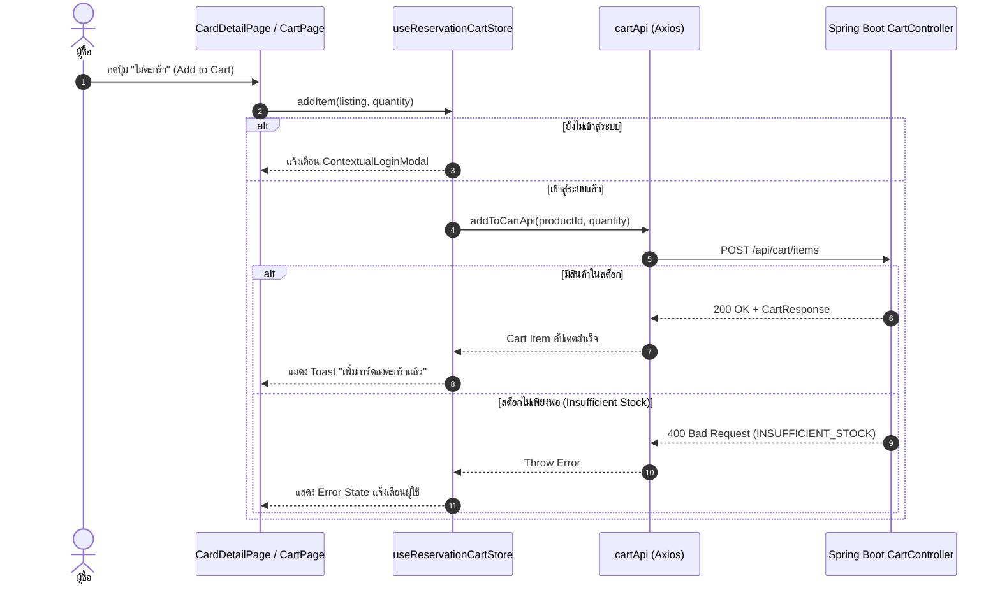

# 🛒 04: ระบบตะกร้าสินค้าและการจอง (Reservation Cart System)
**โฟลเดอร์ปลายทาง:** `tcg-store-frontend/src/features/reservation-cart`  
**เอกสารอ้างอิง:** [⬅️ กลับสู่สารบัญ Frontend](../README.md) | [🏠 หน้าหลักสารบัญ Code](../../README.md)

---

## 📌 บทสรุปและหน้าที่ของส่วนนี้ (Overview & Responsibilities)
โมดูลตะกร้าสินค้าของ TCG Store มีความเฉพาะตัวเนื่องจากสินค้าเป็นการ์ดสะสม (Single Copy หรือมีจำนวนจำกัดตามผู้ขายแต่ละราย):
1. **Cart State Management (`useReservationCartStore`):** บริหารจัดการรายการสินค้าที่ผู้ใช้เลือกไว้ ทั้งการเพิ่ม (`addItem`), แก้ไขจำนวน (`updateQuantity`), และการลบ (`removeItem`)
2. **Dual Mode Backend / Mock Synchronization:** รองรับการทำงานทั้งโหมดเชื่อมต่อ Live Spring Boot API (`/api/cart/*`) และ Mock Database Fallback เมื่อรันแบบ Offline/Staging
3. **Owner-Aware Session Binding:** ผูกตะกร้าเข้ากับ User ID ของผู้ใช้ปัจจุบันอย่างเคร่งครัด หากมีการสลับผู้ใช้ ระบบจะสลับตะกร้าตามทันที
4. **Stock Limit & Validation:** ตรวจสอบสต็อกคงเหลือของการ์ดก่อนอนุญาตให้เพิ่มจำนวน เพื่อป้องกันการสั่งซื้อเกินจำนวนที่ผู้ขายมีอยู่จริง
5. **Real-time Price & Quota Calculation:** คำนวณยอดรวมค่าใช้จ่าย จำนวนการ์ดทั้งหมด และตรวจสอบความพร้อมก่อนเข้าสู่หน้าชำระเงิน (Checkout)

---

## 📂 ตารางโครงสร้างไฟล์และตำแหน่งที่ตั้ง (File Structure)

| ชื่อไฟล์ | ตำแหน่ง Path | หน้าที่ความรับผิดชอบ |
| :--- | :--- | :--- |
| `model/useReservationCartStore.ts` | `src/features/reservation-cart/model/useReservationCartStore.ts` | Zustand Store หลัก จัดการสถานะตะกร้า การคำนวณยอดเงิน และการซิงค์ API |
| `api/cartApi.ts` | `src/features/reservation-cart/api/cartApi.ts` | ฟังก์ชันเรียก Backend: `fetchCartApi()`, `addToCartApi()`, `updateCartItemApi()`, `deleteCartItemApi()` |
| `pages/ReservationCartPage.tsx` | `src/features/reservation-cart/pages/ReservationCartPage.tsx` | หน้าจอแสดงรายการในตะกร้า สรุปยอดเงิน และปุ่มนำทางไปสู่ Checkout |
| `routes.tsx` | `src/features/reservation-cart/routes.tsx` | กำหนด Route `/cart` ให้อยู่ภายใต้ `ProtectedRoute` |

---

## 🔄 แผนผังวงจรการเพิ่มสินค้าลงตะกร้า (Add to Cart Sequence)



---

## 💻 เจาะลึกโค้ดสำคัญและตัวอย่างจริง (Deep-Dive Implementation)

### 1. Store จัดการตะกร้าสินค้า (`src/features/reservation-cart/model/useReservationCartStore.ts`)
Store นี้ผูกกับสถานะ Auth และรองรับการดึงข้อมูลตะกร้าแบบ Dynamic พร้อมคำนวณยอดรวมอย่างแม่นยำ:

```typescript
// src/features/reservation-cart/model/useReservationCartStore.ts
import { create } from 'zustand';
import type { CardListing } from '@/entities/card/model/types';
import type { ReservationCartItem } from '@/entities/reservation/model/types';
import { useAuthStore } from '@/features/auth/model/useAuthStore';
import { cartApi, toReservationCartItems } from '../api/cartApi';

interface ReservationCartStore {
  items: ReservationCartItem[];
  isLoading: boolean;
  error: string | null;
  loadCart: () => Promise<void>;
  addItem: (listing: CardListing, quantity?: number) => Promise<boolean>;
  removeItem: (listingId: string) => Promise<boolean>;
  updateQuantity: (listingId: string, quantity: number) => Promise<boolean>;
  clearCart: () => void;
  getTotalItems: () => number;
  getReservationValue: () => number;
}

export const useReservationCartStore = create<ReservationCartStore>()((set, get) => ({
  items: [],
  isLoading: false,
  error: null,

  // โหลดรายการตะกร้าจาก Backend ล่าสุด
  loadCart: async () => {
    const token = useAuthStore.getState().token;
    if (!token) {
      set({ items: [], isLoading: false });
      return;
    }
    set({ isLoading: true, error: null });
    try {
      const response = await cartApi.getCart();
      set({ items: toReservationCartItems(response.items), isLoading: false });
    } catch (err: any) {
      set({ error: err.response?.data?.message || 'ไม่สามารถโหลดตะกร้าได้', isLoading: false });
    }
  },

  // เพิ่มสินค้าพร้อมตรวจสอบการตอบกลับจาก Backend
  addItem: async (listing: CardListing, quantity = 1) => {
    set({ isLoading: true, error: null });
    try {
      await cartApi.addItem({ productId: Number(listing.id), quantity });
      // โหลดตะกร้าใหม่เพื่อความถูกต้องของราคาและสต็อก
      await get().loadCart();
      return true;
    } catch (err: any) {
      set({ error: err.response?.data?.message || 'สินค้าหมดหรือไม่สามารถใส่ตะกร้าได้', isLoading: false });
      return false;
    }
  },

  // อัปเดตจำนวนสินค้าในตะกร้า
  updateQuantity: async (listingId: string, quantity: number) => {
    if (quantity <= 0) return get().removeItem(listingId);
    set({ isLoading: true, error: null });
    try {
      await cartApi.updateItem(Number(listingId), { quantity });
      await get().loadCart();
      return true;
    } catch (err: any) {
      set({ error: err.response?.data?.message || 'ไม่สามารถแก้ไขจำนวนได้', isLoading: false });
      return false;
    }
  },

  // ลบสินค้าออกจากตะกร้า
  removeItem: async (listingId: string) => {
    set({ isLoading: true, error: null });
    try {
      await cartApi.removeItem(Number(listingId));
      await get().loadCart();
      return true;
    } catch (err: any) {
      set({ error: err.response?.data?.message || 'ไม่สามารถลบสินค้าได้', isLoading: false });
      return false;
    }
  },

  clearCart: () => set({ items: [], error: null }),
  getTotalItems: () => get().items.reduce((sum, item) => sum + item.quantity, 0),
  getReservationValue: () => get().items.reduce((sum, item) => sum + item.listing.price * item.quantity, 0),
}));
```

---

### 2. Client เชื่อมต่อ Cart API (`src/features/reservation-cart/api/cartApi.ts`)
ใช้ Axios Instance กลางที่มีการแนบ Bearer JWT Token อัตโนมัติ:

```typescript
// src/features/reservation-cart/api/cartApi.ts
import apiClient from '@/shared/api/client';

export interface CartItemDto {
  id: number;
  productId: number;
  cardName: string;
  sellerId: number;
  sellerName: string;
  price: number;
  quantity: number;
  stock: number;
  condition: string;
  imageUrl?: string;
}

export const cartApi = {
  getCart: async () => {
    const res = await apiClient.get<{ items: CartItemDto[]; total: number }>('/api/cart');
    return res.data;
  },
  addItem: async (payload: { productId: number; quantity: number }) => {
    const res = await apiClient.post('/api/cart/items', payload);
    return res.data;
  },
  updateItem: async (productId: number, payload: { quantity: number }) => {
    const res = await apiClient.put(`/api/cart/items/${productId}`, payload);
    return res.data;
  },
  removeItem: async (productId: number) => {
    await apiClient.delete(`/api/cart/items/${productId}`);
  },
};
```

---

## 🎯 จุดเด่นทางวิศวกรรม (Engineering Highlights)
* **Single Source of Truth:** เมื่อมีการเปลี่ยนแปลงจำนวนสินค้า ระบบจะดึงสถานะตะกร้าจาก Backend ใหม่เสมอ เพื่อการันตีว่ายอดเงินและสต็อกที่แสดงตรงกับฐานข้อมูล
* **Graceful Degradation:** มีการรองรับ Mock API หากรันใน Environment ที่ไม่มี Backend ทำให้ Frontend สามารถทดสอบ E2E ได้อย่างสมบูรณ์โดยไม่ต้องเปิด Backend
* **Proactive State Invalidation:** ทุกครั้งที่มีการล็อกเอาท์ ตะกร้าจะถูกเคลียร์ทันทีเพื่อความเป็นส่วนตัวและความถูกต้องของข้อมูลผู้ใช้ถัดไป
