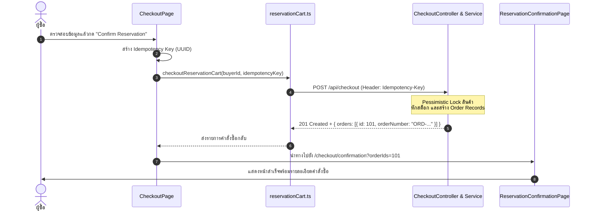

# 💳 05: การสั่งซื้อและติดตามสถานะคำสั่งซื้อ (Checkout & Orders)
**โฟลเดอร์ปลายทาง:** `tcg-store-frontend/src/features/checkout` และ `src/features/reservations`  
**เอกสารอ้างอิง:** [⬅️ กลับสู่สารบัญ Frontend](../README.md) | [🏠 หน้าหลักสารบัญ Code](../../README.md)

---

## 📌 บทสรุปและหน้าที่ของส่วนนี้ (Overview & Responsibilities)
โมดูลนี้ครอบคลุมการเปลี่ยนผ่านจากสินค้าในตะกร้าไปสู่การสร้างคำสั่งซื้อที่เสร็จสมบูรณ์ และการติดตามสถานะ:
1. **Order Preview & Grouping:** คำนวณสรุปคำสั่งซื้อแยกตามผู้ขาย (Multi-seller grouping) หากตะกร้ามีสินค้าจากหลายร้าน
2. **Idempotent Checkout Execution:** ส่งคำสั่งยืนยันการจอง/สั่งซื้อผ่าน API พร้อมการจัดการ HTTP Header เพื่อป้องกันการสั่งซื้อซ้ำ
3. **Reservation Confirmation:** หน้าแสดงผลยืนยันการสั่งซื้อสำเร็จ พร้อมแสดงรหัสคำสั่งซื้อ (Order Number) และรายละเอียดการจัดส่ง/ชำระเงิน
4. **Order Management (Buyer & Seller):**
   - **Buyer View (`MyOrdersPage`):** ผู้ซื้อตรวจสอบประวัติคำสั่งซื้อ ดูสถานะการจัดส่ง และกดยกเลิกคำสั่งซื้อได้หากยังไม่อนุมัติ
   - **Seller View (`SellerOrdersPage`):** ผู้ขายอัปเดตสถานะคำสั่งซื้อ (เตรียมสินค้า, จัดส่งแล้ว, ระบุ Tracking No.)

---

## 📂 ตารางโครงสร้างไฟล์และตำแหน่งที่ตั้ง (File Structure)

| ชื่อไฟล์ | ตำแหน่ง Path | หน้าที่ความรับผิดชอบ |
| :--- | :--- | :--- |
| `pages/CheckoutPage.tsx` | `src/features/checkout/pages/CheckoutPage.tsx` | หน้าตรวจสอบรายการสินค้า ค่าธรรมเนียม และกดยืนยันการสั่งซื้อ |
| `pages/ReservationConfirmationPage.tsx` | `src/features/checkout/pages/ReservationConfirmationPage.tsx` | หน้ายืนยันคำสั่งซื้อสำเร็จ แสดง Order ID และสรุปรายการที่จอง |
| `pages/MyOrdersPage.tsx` | `src/features/reservations/pages/MyOrdersPage.tsx` | รายการคำสั่งซื้อทั้งหมดของผู้ซื้อ พร้อม Badge สถานะ (`PENDING`, `PAID`, `SHIPPED`) |
| `pages/OrderDetailPage.tsx` | `src/features/reservations/pages/OrderDetailPage.tsx` | หน้ารายละเอียดเชิงลึกของแต่ละ Order พร้อม Timeline บันทึกประวัติ |
| `pages/SellerOrdersPage.tsx` | `src/features/reservations/pages/SellerOrdersPage.tsx` | หน้าจอหลังบ้านสำหรับร้านค้าเพื่อกดรับออเดอร์และอัปเดตสถานะจัดส่ง |
| `api/buyerOrders.ts` | `src/features/reservations/api/buyerOrders.ts` | ฟังก์ชันเรียก API: `getBuyerOrders()`, `cancelBuyerOrder()` |
| `api/sellerOrders.ts` | `src/features/reservations/api/sellerOrders.ts` | ฟังก์ชันเรียก API: `getSellerOrders()`, `updateOrderStatus()` |

---

## 🔄 ลำดับขั้นตอนการชำระเงินและการจอง (Checkout Flowchart)



---

## 💻 เจาะลึกโค้ดสำคัญและตัวอย่างจริง (Deep-Dive Implementation)

### 1. หน้าตรวจสอบและกดยืนยันการสั่งซื้อ (`src/features/checkout/pages/CheckoutPage.tsx`)
จัดการความพร้อมของข้อมูล ตรวจสอบสินค้าคงเหลือ และส่งคำสั่งอย่างปลอดภัย:

```typescript
// src/features/checkout/pages/CheckoutPage.tsx
import { useState } from 'react';
import { useNavigate, Link } from 'react-router-dom';
import { useAuthStore } from '@/features/auth/model/useAuthStore';
import { useReservationCartStore } from '@/features/reservation-cart/model/useReservationCartStore';
import { checkoutReservationCart } from '@/features/reservation-cart/api/reservationCart';

export function CheckoutPage() {
  const navigate = useNavigate();
  const user = useAuthStore((s) => s.user);
  const items = useReservationCartStore((s) => s.items);
  const clearCart = useReservationCartStore((s) => s.clearCart);

  const [isSubmitting, setIsSubmitting] = useState(false);
  const [error, setError] = useState<string | null>(null);

  const totalPrice = items.reduce((sum, item) => sum + item.listing.price * item.quantity, 0);

  const handleConfirmReservation = async () => {
    if (!user) return;
    setIsSubmitting(true);
    setError(null);

    try {
      // เรียกฟังก์ชัน Checkout ซึ่งภายในจะสร้าง Idempotency-Key เพื่อความปลอดภัย
      const result = await checkoutReservationCart(user.id);
      
      // เคลียร์ตะกร้าในเครื่องหลังยืนยันสำเร็จ
      clearCart();

      // รวบรวม Order ID เพื่อส่งไปแสดงในหน้า Confirmation
      const orderIds = result.orders.map((o) => o.id).join(',');
      navigate(`/checkout/confirmation?orderIds=${encodeURIComponent(orderIds)}`);
    } catch (err: any) {
      const msg = err.response?.data?.message || 'เกิดข้อผิดพลาดในการสั่งซื้อ กรุณาลองใหม่อีกครั้ง';
      setError(msg);
    } finally {
      setIsSubmitting(false);
    }
  };

  return (
    <div className="max-w-4xl mx-auto px-4 py-8">
      <h1 className="text-3xl font-bold mb-6">สรุปรายการคำสั่งซื้อ (Order Review)</h1>
      {error && <div className="mb-4 p-4 bg-red-900/30 border border-red-700 text-red-400 rounded-lg">{error}</div>}

      <div className="grid grid-cols-1 md:grid-cols-3 gap-6">
        <div className="md:col-span-2 space-y-4">
          {items.map((item) => (
            <div key={item.id} className="flex items-center justify-between p-4 bg-slate-800 rounded-lg">
              <div>
                <p className="font-semibold text-white">{item.listing.cardName}</p>
                <p className="text-sm text-gray-400">ผู้ขาย: {item.listing.sellerName} | จำนวน: {item.quantity}</p>
              </div>
              <p className="font-bold text-blue-400">฿{(item.listing.price * item.quantity).toLocaleString()}</p>
            </div>
          ))}
        </div>

        <div className="p-6 bg-slate-800 rounded-lg h-fit space-y-4">
          <h2 className="text-xl font-bold">ยอดสุทธิ</h2>
          <div className="flex justify-between text-lg font-bold border-t border-slate-700 pt-4">
            <span>รวมทั้งหมด:</span>
            <span className="text-emerald-400">฿{totalPrice.toLocaleString()}</span>
          </div>
          <button
            onClick={handleConfirmReservation}
            disabled={isSubmitting || items.length === 0}
            className="w-full py-3 bg-blue-600 hover:bg-blue-500 font-bold rounded-lg disabled:opacity-50"
          >
            {isSubmitting ? 'กำลังดำเนินการ...' : 'ยืนยันการจอง / ชำระเงิน'}
          </button>
        </div>
      </div>
    </div>
  );
}
```

---

### 2. Client เชื่อมต่อ Orders API (`src/features/reservations/api/buyerOrders.ts`)
```typescript
// src/features/reservations/api/buyerOrders.ts
import apiClient from '@/shared/api/client';

export interface BuyerOrderResponse {
  id: number;
  orderNumber: string;
  totalAmount: number;
  status: 'PENDING' | 'PAID' | 'SHIPPED' | 'DELIVERED' | 'CANCELLED';
  sellerName: string;
  createdAt: string;
  items: {
    productId: number;
    cardName: string;
    quantity: number;
    price: number;
  }[];
}

export const getBuyerOrders = async (): Promise<BuyerOrderResponse[]> => {
  const response = await apiClient.get<BuyerOrderResponse[]>('/api/orders/buyer');
  return response.data;
};

export const cancelBuyerOrder = async (orderId: number): Promise<void> => {
  await apiClient.post(`/api/orders/buyer/${orderId}/cancel`);
};
```

---

## 🎯 จุดเด่นทางวิศวกรรม (Engineering Highlights)
* **Double-Submit Prevention:** คอมโพเนนต์ป้องกันการคลิกเบิ้ลด้วยปุ่ม Disable ระหว่างรอคำตอบ และ Backend มีระบบตรวจสอบ Idempotency ซ้ำอีกชั้น
* **Order Split by Merchant:** หากสินค้าในตะกร้ามาจากหลายร้านค้า ระบบจะทำการแยกคำสั่งซื้อตามร้านค้าอย่างเป็นระเบียบ ทำให้แต่ละร้านสามารถแพ็กและจัดส่งของตนเองได้อิสระ
* **Audit Trail Integration:** ทุกสถานะที่เปลี่ยนแปลงในหน้านี้จะถูกส่งต่อไปบันทึกใน Order Status Log ในฐานข้อมูล
