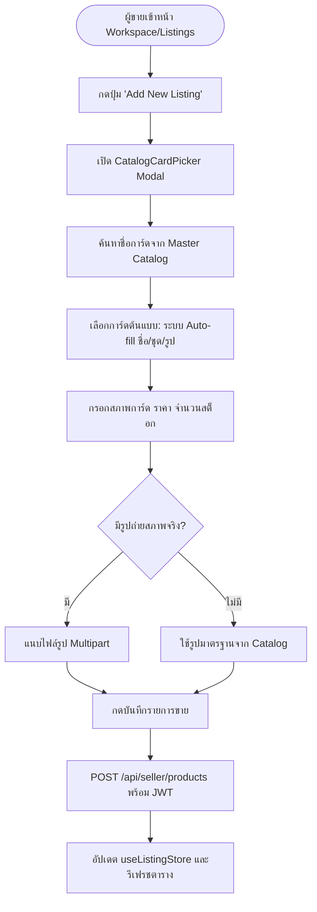

# 🏪 06: ระบบผู้ขายและการจัดการสต็อก (Seller Portal & Inventory)
**โฟลเดอร์ปลายทาง:** `tcg-store-frontend/src/features/listings` และ `src/features/stores`  
**เอกสารอ้างอิง:** [⬅️ กลับสู่สารบัญ Frontend](../README.md) | [🏠 หน้าหลักสารบัญ Code](../../README.md)

---

## 📌 บทสรุปและหน้าที่ของส่วนนี้ (Overview & Responsibilities)
โมดูลนี้คือศูนย์ควบคุมหลังบ้านสำหรับพ่อค้า/แม่ค้า (Merchant Workspace) ที่ได้รับอนุมัติสถานะ `SELLER`:
1. **Inventory & Listing Management (`ListingManagementPage`):** เพิ่ม แก้ไข ลบ และเปิด/ปิดการมองเห็นรายการขายการ์ด (Active / Inactive / Draft)
2. **Master Catalog Picker (`CatalogCardPicker`):** ระบบค้นหาและเลือกการ์ดมาตรฐานจากฐานข้อมูลส่วนกลาง (Official Catalog) เพื่อดึงชื่อ รูป และรายละเอียดมาใส่ใน Listing อัตโนมัติ ป้องกันข้อมูลการ์ดผิดเพี้ยน
3. **Card Condition & Proof Upload:** ระบุสภาพการ์ด (Mint, Near Mint, Excellent, Good, Played, Poor) พร้อมอัปโหลดรูปภาพถ่ายสภาพจริงของใบการ์ดผ่าน Multipart Form Data
4. **Store Profile Customization (`StoreSettingsPage`):** ตั้งชื่อร้านค้า คำอธิบาย ข้อมูลติดต่อ และดูหน้าตัวอย่างร้านค้าสาธารณะ (`PublicStorePage`)

---

## 📂 ตารางโครงสร้างไฟล์และตำแหน่งที่ตั้ง (File Structure)

| ชื่อไฟล์ | ตำแหน่ง Path | หน้าที่ความรับผิดชอบ |
| :--- | :--- | :--- |
| `pages/ListingManagementPage.tsx` | `src/features/listings/pages/ListingManagementPage.tsx` | หน้าจอแสดงตารางสินค้าของผู้ขาย พร้อมปุ่มเพิ่มสินค้าใหม่ และกรองตามสถานะ |
| `components/CatalogCardPicker.tsx` | `src/features/listings/components/CatalogCardPicker.tsx` | ตัวเลือกการ์ดจาก Master Catalog พร้อมระบบ Auto-complete และ Preview รูป |
| `layouts/WorkspaceSidebar.tsx` | `src/features/listings/layouts/WorkspaceSidebar.tsx` | แถบเมนูด้านข้างสำหรับ Seller: สินค้า, ออเดอร์, และการตั้งค่าร้าน |
| `model/useListingStore.ts` | `src/features/listings/model/useListingStore.ts` | Zustand Store เก็บรายการสินค้าของผู้ขายและฟังก์ชัน CRUD |
| `api/listings.ts` | `src/features/listings/api/listings.ts` | ฟังก์ชันเรียก Backend API: `createListing()`, `updateListing()`, `deleteListing()` |
| `pages/StoreSettingsPage.tsx` | `src/features/stores/pages/StoreSettingsPage.tsx` | หน้าจอตั้งค่าโปรไฟล์ร้านค้า โลโก้ และข้อมูลการจัดส่ง |
| `pages/PublicStorePage.tsx` | `src/features/stores/pages/PublicStorePage.tsx` | หน้าร้านค้าที่บุคคลทั่วไปสามารถเข้าชมสินค้าทั้งหมดของร้านนี้ได้ |

---

## 🔄 แผนผังขั้นตอนการลงขายการ์ด (Listing Creation Flow)



---

## 💻 เจาะลึกโค้ดสำคัญและตัวอย่างจริง (Deep-Dive Implementation)

### 1. ระบบเลือกการ์ดจาก Catalog อัตโนมัติ (`src/features/listings/components/CatalogCardPicker.tsx`)
ช่วยให้ผู้ขายไม่ต้องพิมพ์ชื่อการ์ดหรือหาภาพเอง เพียงค้นหาแล้วเลือกระบบจะผูก Metadata ระดับสากลให้ทันที:

```typescript
// src/features/listings/components/CatalogCardPicker.tsx
import { useState, useEffect } from 'react';
import { Search, Check } from 'lucide-react';
import { catalogApi, type CatalogCard } from '@/features/discovery/api/catalog';
import { Input } from '@/shared/components/Input';

interface CatalogCardPickerProps {
  selectedCard: CatalogCard | null;
  onSelect: (card: CatalogCard) => void;
}

export function CatalogCardPicker({ selectedCard, onSelect }: CatalogCardPickerProps) {
  const [query, setQuery] = useState('');
  const [results, setResults] = useState<CatalogCard[]>([]);
  const [loading, setLoading] = useState(false);

  useEffect(() => {
    if (!query.trim()) {
      setResults([]);
      return;
    }
    const timer = setTimeout(async () => {
      setLoading(true);
      try {
        const cards = await catalogApi.searchCatalogCards(query);
        setResults(cards);
      } catch (err) {
        console.error('Failed to search catalog', err);
      } finally {
        setLoading(false);
      }
    }, 300); // Debounce 300ms เพื่อประหยัด Network requests

    return () => clearTimeout(timer);
  }, [query]);

  return (
    <div className="space-y-4">
      <Input
        label="ค้นหาการ์ดจากฐานข้อมูล Master Catalog"
        placeholder="พิมพ์ชื่อการ์ด เช่น Charizard, Pikachu..."
        value={query}
        onChange={(e) => setQuery(e.target.value)}
        icon={<Search size={18} className="text-gray-400" />}
      />

      {loading && <p className="text-sm text-gray-400">กำลังค้นหา...</p>}

      <div className="max-h-60 overflow-y-auto space-y-2 border border-slate-700 rounded-lg p-2 bg-slate-900/50">
        {results.map((card) => (
          <div
            key={card.id}
            onClick={() => onSelect(card)}
            className={`flex items-center gap-3 p-2 rounded cursor-pointer transition ${
              selectedCard?.id === card.id ? 'bg-blue-600/30 border border-blue-500' : 'hover:bg-slate-800'
            }`}
          >
            
            <div className="flex-1">
              <p className="font-semibold text-white">{card.name}</p>
              <p className="text-xs text-gray-400">{card.setName} ({card.rarity})</p>
            </div>
            {selectedCard?.id === card.id && <Check size={18} className="text-blue-400" />}
          </div>
        ))}
      </div>
    </div>
  );
}
```

---

### 2. ฟังก์ชัน API สำหรับลงขายสินค้า (`src/features/listings/api/listings.ts`)
รองรับการส่งทั้งข้อมูล JSON และภาพสภาพการ์ดจริงผ่าน `FormData`:

```typescript
// src/features/listings/api/listings.ts
import apiClient from '@/shared/api/client';

export interface CreateListingPayload {
  cardId: number;
  condition: string;
  price: number;
  stock: number;
  description?: string;
  imageFile?: File;
}

export const createSellerListing = async (payload: CreateListingPayload) => {
  const formData = new FormData();
  formData.append('cardId', String(payload.cardId));
  formData.append('condition', payload.condition);
  formData.append('price', String(payload.price));
  formData.append('stock', String(payload.stock));
  if (payload.description) formData.append('description', payload.description);
  if (payload.imageFile) formData.append('image', payload.imageFile);

  const res = await apiClient.post('/api/seller/products', formData, {
    headers: { 'Content-Type': 'multipart/form-data' },
  });
  return res.data;
};
```

---

## 🎯 จุดเด่นทางวิศวกรรม (Engineering Highlights)
* **Data Integrity via Master Catalog:** การบังคับให้ผูกสินค้าเข้ากับ Master Card ID ช่วยป้องกันการตั้งชื่อผิด สะกดผิด หรือหลอกลวงสเปกการ์ด
* **Debounced Search:** การค้นหา Master Catalog มีการหน่วงเวลา 300ms ช่วยลดโหลดของฐานข้อมูลหลังบ้าน
* **Live Status Toggling:** ผู้ขายสามารถกดพักการขาย (Toggle Status) การ์ดได้ทันทีโดยไม่ต้องลบรายการทิ้งเมื่อสต็อกหมดชั่วคราว
