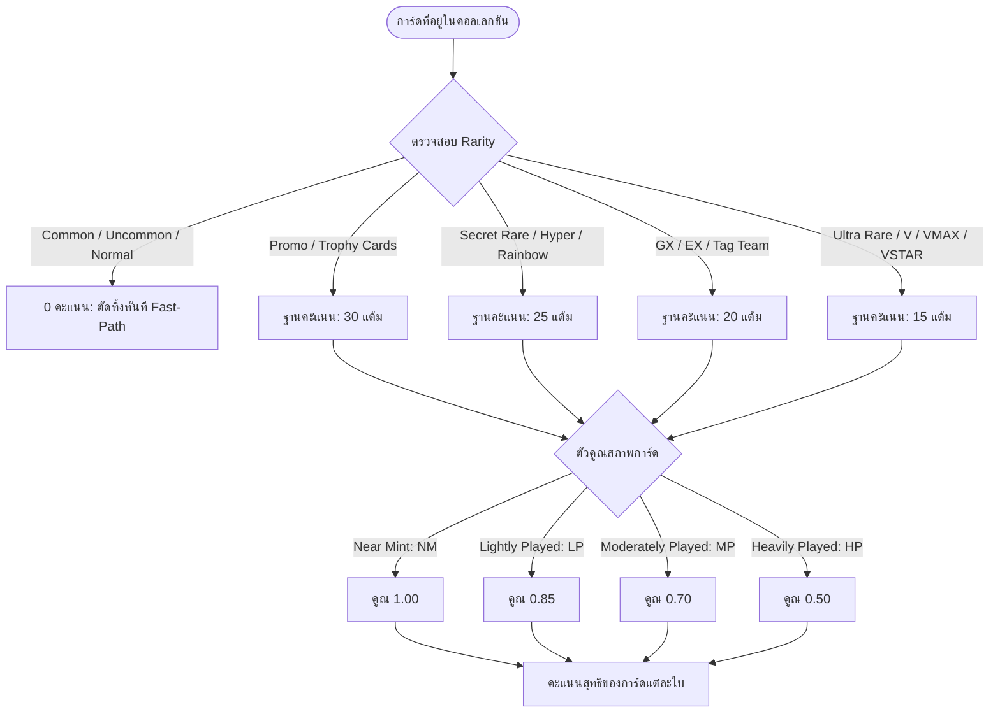

# 🏆 07: ระบบสะสมการ์ดและการจัดอันดับ (Collection & Leaderboard)
**โฟลเดอร์ปลายทาง:** `tcg-store-frontend/src/features/collection`  
**เอกสารอ้างอิง:** [⬅️ กลับสู่สารบัญ Frontend](../README.md) | [🏠 หน้าหลักสารบัญ Code](../../README.md)

---

## 📌 บทสรุปและหน้าที่ของส่วนนี้ (Overview & Responsibilities)
โมดูลนี้ถูกออกแบบมาเพื่อสร้างความผูกพันกับผู้ใช้งาน (Gamification & Engagement) สำหรับกลุ่มนักสะสม TCG:
1. **Personal Card Binder (`MyCollectionPage`):** แฟ้มสะสมการ์ดดิจิทัลส่วนตัว แสดงการ์ดทั้งหมดที่ครอบครองพร้อมสภาพและการประเมินราคา
2. **Ultra-Rare Scoring Engine (`collectionScoring.ts`):** อัลกอริทึมคำนวณคะแนนคอลเลกชัน โดยให้แต้มเฉพาะการ์ดระดับหายากพิเศษ (Promo, Secret Rare, Hyper Rare, GX, EX, VMAX) พร้อมตัวคูณตามสภาพการ์ด (Condition Multiplier)
3. **Public Collection Showcase (`PublicCollectionPage`):** หน้าแสดงผลคอลเลกชันสาธารณะสำหรับแชร์ให้เพื่อนหรือโพสต์ลงโซเชียลมีเดีย
4. **Collectors Leaderboard:** ตารางจัดอันดับนักสะสมที่มีคะแนนคอลเลกชันสูงสุดบนแพลตฟอร์ม

---

## 📂 ตารางโครงสร้างไฟล์และตำแหน่งที่ตั้ง (File Structure)

| ชื่อไฟล์ | ตำแหน่ง Path | หน้าที่ความรับผิดชอบ |
| :--- | :--- | :--- |
| `pages/MyCollectionPage.tsx` | `src/features/collection/pages/MyCollectionPage.tsx` | แฟ้มสะสมการ์ดของผู้ใช้ แสดงคะแนนรวม ตัวกรองระดับ และปุ่มแก้ไขการ์ด |
| `pages/PublicCollectionPage.tsx` | `src/features/collection/pages/PublicCollectionPage.tsx` | หน้าแสดงคอลเลกชันสาธารณะตาม User ID หรือ Handle |
| `components/CollectionCard.tsx` | `src/features/collection/components/CollectionCard.tsx` | คอมโพเนนต์แสดงการ์ดในแฟ้มสะสม พร้อม Badge แสดงคะแนนและสภาพ |
| `lib/collectionScoring.ts` | `src/features/collection/lib/collectionScoring.ts` | ฟังก์ชันคำนวณคะแนนตาม Rarity Tier และ Condition Multiplier |
| `api/collection.ts` | `src/features/collection/api/collection.ts` | ฟังก์ชันดึง/เพิ่ม/ลบการ์ดในคอลเลกชัน (`getUserCollection()`, `addToCollection()`) |
| `api/leaderboard.ts` | `src/features/collection/api/leaderboard.ts` | ฟังก์ชันดึงรายชื่อ Top Collectors ประจำสัปดาห์/เดือน |

---

## 🔄 เกณฑ์และอัลกอริทึมการคำนวณคะแนน (Scoring Rule Matrix)



---

## 💻 เจาะลึกโค้ดสำคัญและตัวอย่างจริง (Deep-Dive Implementation)

### 1. อัลกอริทึมคำนวณคะแนนการ์ดหายาก (`src/features/collection/lib/collectionScoring.ts`)
ออกแบบโดยเน้นประสิทธิภาพด้วยเทคนิค **Fast-path Set Lookup** เพื่อตัดการ์ดระดับธรรมดาทิ้งทันที ไม่ต้องเสียเวลาประมวลผล String:

```typescript
// src/features/collection/lib/collectionScoring.ts
const STANDARD_TIERS_TO_DISCARD = new Set([
  'common',
  'uncommon',
  'rare',
  'rare holo',
  'holo',
  'normal',
]);

/**
 * คำนวณคะแนนพื้นฐานตามระดับความหายาก (Ultra Rarity Points)
 */
export function getCardUltraRarityPoints(rarity?: string | null, name?: string | null): number {
  const r = (rarity ?? '').trim().toLowerCase();
  const n = (name ?? '').trim().toLowerCase();

  // 1. Fast path: การ์ดธรรมดาให้ 0 แต้มทันที
  if (STANDARD_TIERS_TO_DISCARD.has(r)) {
    return 0;
  }

  // 2. Promotional & Trophy Cards (30 แต้ม)
  if (r.includes('promo') || r.includes('trophy') || n.includes('trophy')) {
    return 30;
  }

  // 3. Secret Rare / Hyper Rare / Rainbow Rare (25 แต้ม)
  if (r.includes('secret') || r.includes('hyper') || r.includes('rainbow')) {
    return 25;
  }

  // 4. GX / EX / Tag Team (20 แต้ม)
  if (
    r.includes('gx') ||
    r.includes('tag team') ||
    n.endsWith('-gx') ||
    n.endsWith(' gx') ||
    r.includes('ex') ||
    n.endsWith('-ex')
  ) {
    return 20;
  }

  // 5. Ultra Rare / V / VMAX / VSTAR (15 แต้ม)
  if (r.includes('ultra rare') || r.includes('vmax') || r.includes('vstar') || r.includes(' v')) {
    return 15;
  }

  return 0;
}

/**
 * ตัวคูณตามสภาพการ์ด (Condition Multiplier)
 */
export function getConditionMultiplier(condition?: string | null): number {
  switch ((condition ?? '').toUpperCase()) {
    case 'NM':
    case 'NEAR_MINT':
      return 1.0;
    case 'LP':
    case 'LIGHTLY_PLAYED':
      return 0.85;
    case 'MP':
    case 'MODERATELY_PLAYED':
      return 0.7;
    case 'HP':
    case 'HEAVILY_PLAYED':
      return 0.5;
    default:
      return 1.0;
  }
}

/**
 * คำนวณคะแนนรวมของการ์ด 1 ใบ (Base Points * Multiplier)
 */
export function calculateEntryScore(rarity?: string, name?: string, condition?: string): number {
  const basePoints = getCardUltraRarityPoints(rarity, name);
  const multiplier = getConditionMultiplier(condition);
  return Math.round(basePoints * multiplier);
}
```

---

### 2. คอมโพเนนต์แสดงผลการ์ดในแฟ้มสะสม (`src/features/collection/components/CollectionCard.tsx`)
```typescript
// src/features/collection/components/CollectionCard.tsx
import { calculateEntryScore } from '../lib/collectionScoring';

interface CollectionCardProps {
  cardName: string;
  image: string;
  rarity: string;
  condition: string;
  quantity: number;
}

export function CollectionCard({ cardName, image, rarity, condition, quantity }: CollectionCardProps) {
  const score = calculateEntryScore(rarity, cardName, condition);

  return (
    <div className="relative group rounded-xl overflow-hidden bg-slate-800 border border-slate-700 hover:border-blue-500 transition shadow-lg">
      
      
      {/* Badge แสดงคะแนน Ultra-rare */}
      {score > 0 && (
        <span className="absolute top-2 right-2 px-2 py-0.5 text-xs font-bold bg-amber-500 text-black rounded-full shadow">
          ★ {score} pts
        </span>
      )}

      <div className="p-3 bg-slate-900/80">
        <p className="font-semibold text-white truncate text-sm">{cardName}</p>
        <div className="flex justify-between items-center mt-1 text-xs text-gray-400">
          <span className="px-1.5 py-0.5 rounded bg-slate-800 border border-slate-700">{condition}</span>
          <span>จำนวน: {quantity} ใบ</span>
        </div>
      </div>
    </div>
  );
}
```

---

## 🎯 จุดเด่นทางวิศวกรรม (Engineering Highlights)
* **High Efficiency Performance:** ฟังก์ชันคำนวณคะแนนไม่ขึ้นกับ Network สามารถรันบน Client ประมวลผลการ์ดนับร้อยใบได้ทันทีในเวลาไม่ถึง 2 Milliseconds
* **Sharable Deep-link URLs:** หน้ารวมคอลเลกชันสามารถแชร์ผ่าน OpenGraph Link ให้ผู้อื่นเข้าชมผลงานการสะสมได้โดยไม่ต้องล็อกอิน
* **Condition-Aware Valuation:** นำสภาพจริงของการ์ดมาเป็นตัวแปรถ่วงน้ำหนัก ทำให้สะท้อนมูลค่าและความทุ่มเทของนักสะสมได้สมจริง
