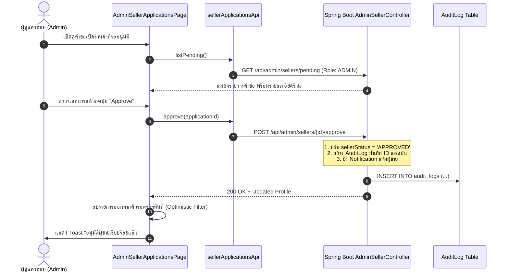

# 🛡️ 08: ระบบจัดการหลังบ้านสำหรับผู้ดูแลระบบ (Admin Backoffice)
**โฟลเดอร์ปลายทาง:** `tcg-store-frontend/src/features/admin`  
**เอกสารอ้างอิง:** [⬅️ กลับสู่สารบัญ Frontend](../README.md) | [🏠 หน้าหลักสารบัญ Code](../../README.md)

---

## 📌 บทสรุปและหน้าที่ของส่วนนี้ (Overview & Responsibilities)
โมดูลนี้สงวนสิทธิ์เฉพาะผู้ใช้ที่มี Role เป็น `ADMIN` เท่านั้น เพื่อใช้ในการกำกับดูแลแพลตฟอร์ม (Governance & Moderation):
1. **Platform Analytics Dashboard (`AdminDashboardPage`):** แสดงตัวเลขสถิติภาพรวม เช่น จำนวนผู้ใช้ทั้งหมด, ผู้ขายที่รออนุมัติ, มูลค่ายอดขายรวม (GMV: Gross Merchandise Value) และจำนวนรายการสินค้า
2. **Seller Verification & KYC (`AdminSellerApplicationsPage`):** ตรวจสอบใบสมัครเปิดร้านค้า ดูเอกสารบัตรประชาชน/บัญชีธนาคาร พร้อมดำเนินการอนุมัติ (Approve) หรือปฏิเสธ (Reject พร้อมระบุเหตุผล)
3. **Immutable Audit Trail (`AdminAuditLogsPage`):** ตรวจสอบประวัติการกระทำสำคัญทั้งหมดบนระบบ (ใครทำอะไร กับทรัพยากรชิ้นใด เวลาใด)
4. **Platform Order Logs (`AdminOrderLogsPage`):** ตรวจสอบคำสั่งซื้อและการเปลี่ยนสถานะย้อนหลังของทุกคำสั่งซื้อในระบบ
5. **User Management (`AdminUsersPage`):** ค้นหาและดูสถานะของผู้ใช้งานทั้งระบบ

---

## 📂 ตารางโครงสร้างไฟล์และตำแหน่งที่ตั้ง (File Structure)

| ชื่อไฟล์ | ตำแหน่ง Path | หน้าที่ความรับผิดชอบ |
| :--- | :--- | :--- |
| `pages/AdminDashboardPage.tsx` | `src/features/admin/pages/AdminDashboardPage.tsx` | หน้าสรุปตัวชี้วัด (KPIs Metrics Cards) และภาพรวมการเติบโตของแพลตฟอร์ม |
| `pages/AdminSellerApplicationsPage.tsx` | `src/features/admin/pages/AdminSellerApplicationsPage.tsx` | ตารางคำขอเปิดร้านค้า Modal แสดงเอกสาร KYC และปุ่มกดอนุมัติ/ปฏิเสธ |
| `pages/AdminAuditLogsPage.tsx` | `src/features/admin/pages/AdminAuditLogsPage.tsx` | ตารางแสดงบันทึกกิจกรรมความปลอดภัย (Security Audit Log Viewer) |
| `pages/AdminOrderLogsPage.tsx` | `src/features/admin/pages/AdminOrderLogsPage.tsx` | ตารางตรวจสอบสถานะคำสั่งซื้อทั้งหมดในระดับ Super Admin |
| `pages/AdminUsersPage.tsx` | `src/features/admin/pages/AdminUsersPage.tsx` | รายการสมาชิก ตรวจสอบ Role และ Seller Status |
| `layouts/AdminSidebar.tsx` | `src/features/admin/layouts/AdminSidebar.tsx` | เมนูนำทางเฉพาะส่วนแอดมิน |
| `api/sellerApplications.ts` | `src/features/admin/api/sellerApplications.ts` | ฟังก์ชันเรียก Backend API: `listPending()`, `approve()`, `reject()` |

---

## 🔄 แผนผังการอนุมัติผู้ขาย (Seller Approval Workflow)



---

## 💻 เจาะลึกโค้ดสำคัญและตัวอย่างจริง (Deep-Dive Implementation)

### 1. หน้าจออนุมัติคำขอเปิดร้านค้า (`src/features/admin/pages/AdminSellerApplicationsPage.tsx`)
มาพร้อม Modal ยืนยันการปฏิเสธที่บังคับกรอกเหตุผล เพื่อให้ผู้ขายทราบว่าต้องแก้ไขข้อมูลส่วนใด:

```typescript
// src/features/admin/pages/AdminSellerApplicationsPage.tsx (ส่วนสำคัญ)
import { useState, useEffect, useCallback } from 'react';
import { sellerApplicationsApi, type SellerApplication } from '../api/sellerApplications';
import { Modal } from '@/shared/components/Modal';
import { Button } from '@/shared/components/Button';

export function AdminSellerApplicationsPage() {
  const [applications, setApplications] = useState<SellerApplication[]>([]);
  const [loading, setLoading] = useState(true);
  const [rejectingApp, setRejectingApp] = useState<SellerApplication | null>(null);
  const [rejectReason, setRejectReason] = useState('');

  const loadPending = useCallback(async () => {
    setLoading(true);
    try {
      const data = await sellerApplicationsApi.listPending();
      setApplications(data);
    } finally {
      setLoading(false);
    }
  }, []);

  useEffect(() => { void loadPending(); }, [loadPending]);

  // ฟังก์ชันอนุมัติร้านค้า
  const handleApprove = async (id: string) => {
    try {
      await sellerApplicationsApi.approve(id);
      // นำรายการที่อนุมัติแล้วออกจากหน้าจอทันที
      setApplications((prev) => prev.filter((app) => app.id !== id));
    } catch (err) {
      alert('ไม่สามารถอนุมัติได้ กรุณาลองใหม่');
    }
  };

  // ฟังก์ชันปฏิเสธร้านค้าพร้อมระบุเหตุผล
  const handleReject = async () => {
    if (!rejectingApp || !rejectReason.trim()) return;
    try {
      await sellerApplicationsApi.reject(rejectingApp.id, rejectReason);
      setApplications((prev) => prev.filter((app) => app.id !== rejectingApp.id));
      setRejectingApp(null);
      setRejectReason('');
    } catch (err) {
      alert('เกิดข้อผิดพลาดในการปฏิเสธคำขอ');
    }
  };

  return (
    <div className="p-6 space-y-6">
      <h1 className="text-2xl font-bold text-white">คำขอเป็นผู้ขายที่รออนุมัติ (Pending Applications)</h1>
      
      <div className="overflow-x-auto bg-slate-800 rounded-xl border border-slate-700">
        <table className="w-full text-left text-sm text-gray-300">
          <thead className="bg-slate-900 text-gray-400 uppercase text-xs">
            <tr>
              <th className="p-4">ชื่อร้านค้า</th>
              <th className="p-4">ชื่อผู้สมัคร</th>
              <th className="p-4">อีเมล / เบอร์โทร</th>
              <th className="p-4">วันที่ยื่นเรื่อง</th>
              <th className="p-4 text-right">การจัดการ</th>
            </tr>
          </thead>
          <tbody className="divide-y divide-slate-700">
            {applications.map((app) => (
              <tr key={app.id} className="hover:bg-slate-750">
                <td className="p-4 font-semibold text-white">{app.storeName}</td>
                <td className="p-4">{app.fullName}</td>
                <td className="p-4">{app.email} | {app.phone}</td>
                <td className="p-4">{new Date(app.createdAt).toLocaleDateString()}</td>
                <td className="p-4 text-right space-x-2">
                  <Button variant="danger" size="sm" onClick={() => setRejectingApp(app)}>ปฏิเสธ</Button>
                  <Button variant="primary" size="sm" onClick={() => handleApprove(app.id)}>อนุมัติ</Button>
                </td>
              </tr>
            ))}
          </tbody>
        </table>
      </div>

      {/* Modal ระบุเหตุผลการปฏิเสธ */}
      <Modal isOpen={Boolean(rejectingApp)} onClose={() => setRejectingApp(null)} title="ระบุเหตุผลการปฏิเสธคำขอ">
        <div className="space-y-4">
          <p className="text-sm text-gray-300">แจ้งเหตุผลที่ปฏิเสธร้าน "{rejectingApp?.storeName}" เพื่อให้ผู้ใช้แก้ไขเอกสาร:</p>
          <textarea
            className="w-full p-3 rounded-lg bg-slate-900 border border-slate-700 text-white text-sm"
            rows={3}
            value={rejectReason}
            onChange={(e) => setRejectReason(e.target.value)}
            placeholder="เช่น ภาพถ่ายบัตรประชาชนไม่ชัดเจน..."
          />
          <div className="flex justify-end gap-2">
            <Button variant="ghost" onClick={() => setRejectingApp(null)}>ยกเลิก</Button>
            <Button variant="danger" onClick={handleReject} disabled={!rejectReason.trim()}>ยืนยันการปฏิเสธ</Button>
          </div>
        </div>
      </Modal>
    </div>
  );
}
```

---

### 2. Client เชื่อมต่อ Admin API (`src/features/admin/api/sellerApplications.ts`)
```typescript
// src/features/admin/api/sellerApplications.ts
import apiClient from '@/shared/api/client';

export interface SellerApplication {
  id: string;
  storeName: string;
  fullName: string;
  email: string;
  phone: string;
  idCardNumber: string;
  createdAt: string;
}

export const sellerApplicationsApi = {
  listPending: async (): Promise<SellerApplication[]> => {
    const res = await apiClient.get<SellerApplication[]>('/api/admin/sellers/pending');
    return res.data;
  },
  approve: async (id: string): Promise<void> => {
    await apiClient.post(`/api/admin/sellers/${id}/approve`);
  },
  reject: async (id: string, reason: string): Promise<void> => {
    await apiClient.post(`/api/admin/sellers/${id}/reject`, { reason });
  },
};
```

---

## 🎯 จุดเด่นทางวิศวกรรม (Engineering Highlights)
* **Strict Role Guarding:** ทางเข้าทั้งหมดถูกครอบด้วย `ProtectedRoute requiredRole="ADMIN"` และ Backend มี `@PreAuthorize("hasRole('ADMIN')")` รับรองความปลอดภัย 2 ชั้น
* **Non-Repudiation Audit Logs:** การอนุมัติหรือปฏิเสธทุกรายการจะบันทึก Actor ID ของแอดมินไว้ในระบบอย่างถาวร ไม่สามารถแก้ไขหรือลบได้
* **Responsive Modal KYC:** รองรับการดูข้อมูลผู้สมัครและคัดลอกข้อความ (Copy to Clipboard) อย่างสะดวกสำหรับแอดมิน
