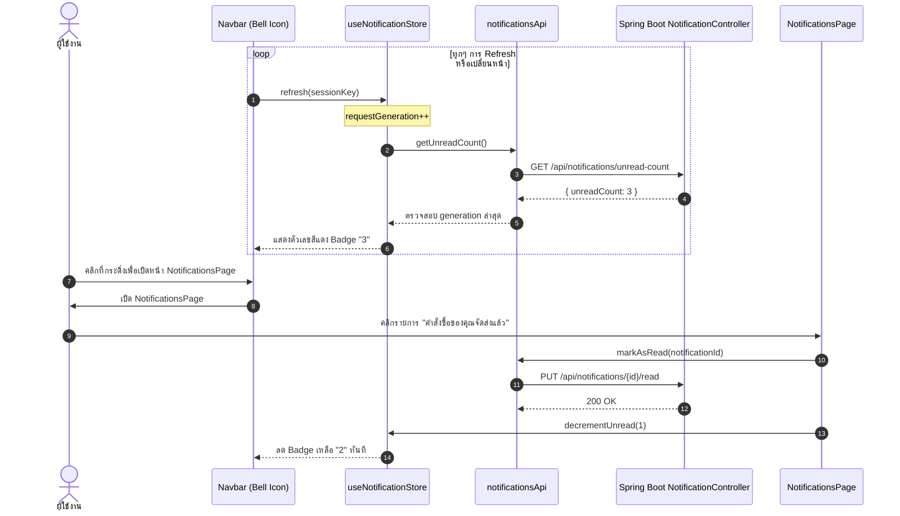

# 🔔 09: ระบบการแจ้งเตือนและข้อมูลโปรไฟล์ (Notifications & Profile)
**โฟลเดอร์ปลายทาง:** `tcg-store-frontend/src/features/notifications` และ `src/features/profile`  
**เอกสารอ้างอิง:** [⬅️ กลับสู่สารบัญ Frontend](../README.md) | [🏠 หน้าหลักสารบัญ Code](../../README.md)

---

## 📌 บทสรุปและหน้าที่ของส่วนนี้ (Overview & Responsibilities)
โมดูลนี้จัดการเรื่องการสื่อสารระหว่างแพลตฟอร์มกับผู้ใช้งาน (User Engagement & Identity):
1. **Real-time Alert Center (`NotificationsPage`):** ศูนย์รวมการแจ้งเตือน เช่น เมื่อออเดอร์เปลี่ยนสถานะ, ผู้ขายได้รับการอนุมัติร้านค้า หรือสินค้าถูกจัดส่ง
2. **Race-Condition-Resistant Polling Store (`useNotificationStore`):** บริหารจัดการตัวเลขนับข้อความที่ยังไม่ได้อ่าน (Unread Count Badge) โดยใช้เทคนิค **Request Generation Counter** เพื่อป้องกันข้อผิดพลาดจากการตอบกลับของเครือข่ายที่สลับลำดับกัน (Out-of-order Network Responses)
3. **User Profile & Identity Management (`ProfilePage`, `EditProfilePage`):** ตรวจสอบและแก้ไขข้อมูลส่วนตัว ที่อยู่ในการจัดส่ง และเบอร์ติดต่อ
4. **Merchant Onboarding Request (`SellerApplicationPage`):** ฟอร์มยื่นคำขอเปิดร้านค้าสำหรับผู้ใช้ทั่วไป พร้อมการกรอกข้อมูลนิติบุคคล/บุคคลธรรมดา และช่องทางการเงิน

---

## 📂 ตารางโครงสร้างไฟล์และตำแหน่งที่ตั้ง (File Structure)

| ชื่อไฟล์ | ตำแหน่ง Path | หน้าที่ความรับผิดชอบ |
| :--- | :--- | :--- |
| `pages/NotificationsPage.tsx` | `src/features/notifications/pages/NotificationsPage.tsx` | หน้ารวมรายการแจ้งเตือนทั้งหมด พร้อมฟังก์ชันกดอ่านทีละรายการ หรือ 'Mark All as Read' |
| `model/useNotificationStore.ts` | `src/features/notifications/model/useNotificationStore.ts` | Zustand Store เก็บ `unreadCount` พร้อมระบบป้องกัน Race Condition ด้วย `requestGeneration` |
| `api/notifications.ts` | `src/features/notifications/api/notifications.ts` | ฟังก์ชันเรียก Backend API: `getNotifications()`, `getUnreadCount()`, `markAsRead()` |
| `pages/ProfilePage.tsx` | `src/features/profile/pages/ProfilePage.tsx` | หน้าแสดงโปรไฟล์ผู้ใช้ สถานะบัญชี และสถานะการเป็นผู้ขาย |
| `pages/EditProfilePage.tsx` | `src/features/profile/pages/EditProfilePage.tsx` | ฟอร์มแก้ไขชื่อ นามสกุล และช่องทางติดต่อ |
| `pages/SellerApplicationPage.tsx` | `src/features/profile/pages/SellerApplicationPage.tsx` | ฟอร์มส่งคำขอเป็นผู้ขายสำหรับส่งให้ Admin อนุมัติ |
| `api/profile.ts` | `src/features/profile/api/profile.ts` | ฟังก์ชันเรียก API: `getProfile()`, `updateProfile()`, `submitSellerApplication()` |

---

## 🔄 ลำดับขั้นตอนการจัดการแจ้งเตือน (Notification Sequence)



---

## 💻 เจาะลึกโค้ดสำคัญและตัวอย่างจริง (Deep-Dive Implementation)

### 1. Store ป้องกัน Race Condition ด้วย Generation Counter (`src/features/notifications/model/useNotificationStore.ts`)
การดึงข้อมูลจำนวนแจ้งเตือนมักเกิดปัญหา Response เก่ามาถึงทีหลัง Response ใหม่ ทำให้ตัวเลขถอยหลัง โปรเจกต์นี้แก้ปัญหาด้วย `requestGeneration`:

```typescript
// src/features/notifications/model/useNotificationStore.ts
import { create } from 'zustand';
import { notificationsApi } from '../api/notifications';

interface NotificationState {
  unreadCount: number;
  isLoading: boolean;
  sessionKey: string | null;
  refresh: (sessionKey: string) => Promise<void>;
  decrementUnread: (amount?: number) => void;
  reset: () => void;
}

// ตัวแปรตัวนับ Generation ของ Request ในระดับ Module
let requestGeneration = 0;

export const useNotificationStore = create<NotificationState>((set, get) => ({
  unreadCount: 0,
  isLoading: false,
  sessionKey: null,

  refresh: async (sessionKey) => {
    // เพิ่มค่า Generation ทุกครั้งที่เริ่มยิง Request ใหม่
    const generation = ++requestGeneration;
    set((state) => ({
      sessionKey,
      isLoading: true,
      unreadCount: state.sessionKey === sessionKey ? state.unreadCount : 0,
    }));

    try {
      const unreadCount = await notificationsApi.getUnreadCount();
      // ยอมรับผลลัพธ์เฉพาะเมื่อ Generation ตรงกับอันล่าสุด และ Session ไม่เปลี่ยน
      if (generation === requestGeneration && get().sessionKey === sessionKey) {
        set({ unreadCount, isLoading: false });
      }
    } catch {
      if (generation === requestGeneration && get().sessionKey === sessionKey) {
        set({ isLoading: false });
      }
    }
  },

  decrementUnread: (amount = 1) =>
    set((state) => ({
      unreadCount: Math.max(0, state.unreadCount - Math.max(0, amount)),
    })),

  reset: () => {
    requestGeneration += 1;
    set({ unreadCount: 0, isLoading: false, sessionKey: null });
  },
}));
```

---

### 2. แบบฟอร์มขอสมัครเป็นผู้ขาย (`src/features/profile/pages/SellerApplicationPage.tsx`)
```typescript
// src/features/profile/pages/SellerApplicationPage.tsx (ส่วนสำคัญ)
import { useState } from 'react';
import { useNavigate } from 'react-router-dom';
import { submitSellerApplicationApi } from '../api/profile';
import { Input } from '@/shared/components/Input';
import { Button } from '@/shared/components/Button';

export function SellerApplicationPage() {
  const navigate = useNavigate();
  const [storeName, setStoreName] = useState('');
  const [phoneNumber, setPhoneNumber] = useState('');
  const [idCardNumber, setIdCardNumber] = useState('');
  const [loading, setLoading] = useState(false);
  const [error, setError] = useState<string | null>(null);

  const handleSubmit = async (e: React.FormEvent) => {
    e.preventDefault();
    setLoading(true);
    setError(null);

    try {
      await submitSellerApplicationApi({ storeName, phoneNumber, idCardNumber });
      alert('ส่งใบสมัครเรียบร้อยแล้ว กรุณารอผู้ดูแลระบบตรวจสอบและอนุมัติ');
      navigate('/profile');
    } catch (err: any) {
      setError(err.response?.data?.message || 'ไม่สามารถส่งใบสมัครได้ กรุณาตรวจสอบข้อมูล');
    } finally {
      setLoading(false);
    }
  };

  return (
    <div className="max-w-2xl mx-auto px-4 py-10">
      <h1 className="text-3xl font-bold mb-2 text-white">สมัครเปิดร้านค้าบน Mythix TCG</h1>
      <p className="text-gray-400 mb-6 text-sm">กรอกข้อมูลร้านค้าและยืนยันตัวตนเพื่อเริ่มลงขายการ์ด</p>

      {error && <div className="p-3 mb-4 bg-red-950/40 border border-red-800 text-red-400 rounded-lg">{error}</div>}

      <form onSubmit={handleSubmit} className="space-y-4 bg-slate-800 p-6 rounded-xl border border-slate-700">
        <Input label="ชื่อร้านค้า (Store Name)" value={storeName} onChange={(e) => setStoreName(e.target.value)} required />
        <Input label="เบอร์โทรศัพท์ติดต่อ" type="tel" value={phoneNumber} onChange={(e) => setPhoneNumber(e.target.value)} required />
        <Input label="เลขประจำตัวประชาชน (KYC)" value={idCardNumber} onChange={(e) => setIdCardNumber(e.target.value)} required />
        
        <div className="pt-4 flex justify-end">
          <Button variant="primary" type="submit" disabled={loading}>
            {loading ? 'กำลังส่งข้อมูล...' : 'ส่งใบสมัครเปิดร้าน'}
          </Button>
        </div>
      </form>
    </div>
  );
}
```

---

## 🎯 จุดเด่นทางวิศวกรรม (Engineering Highlights)
* **Out-of-Order Safety:** การประยุกต์ใช้โมเดล Generation Counter ช่วยแก้ปัญหา UI Stale Data ได้อย่างหมดจดโดยไม่ต้องพึ่งพา Library เพิ่มเติม
* **Immediate Local Optimistic Decrement:** เมื่อผู้ใช้เปิดอ่านแจ้งเตือน ตัวเลข Badge ลดลงทันทีในระดับ Client เพิ่มความลื่นไหลในการตอบสนอง (Zero Latency Feel)
* **Form Validation Guard:** มีการตรวจความถูกต้องของรูปแบบข้อมูล (หมายเลขโทรศัพท์, เลขบัตรประชาชน) ตั้งแต่ระดับ Client ก่อนส่งไปยังเซิร์ฟเวอร์
