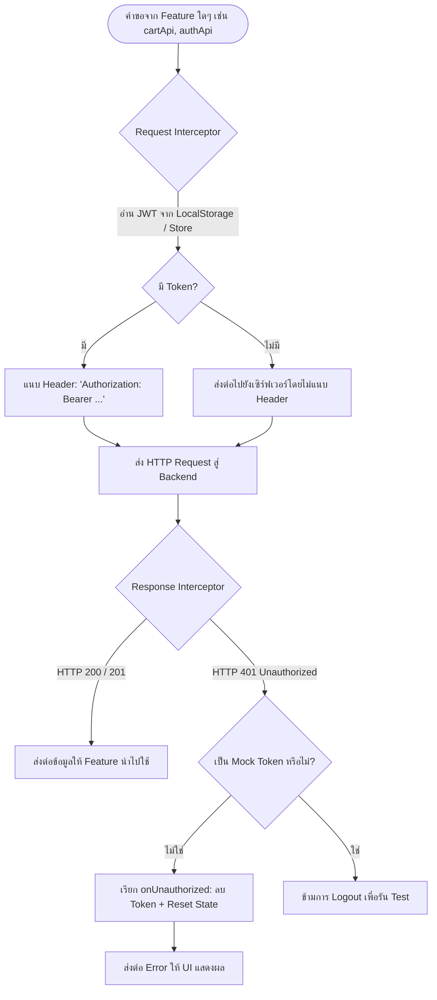

# 🧱 10: ส่วนประกอบ UI ส่วนกลางและโครงสร้างพื้นฐาน (Shared UI & Infra)
**โฟลเดอร์ปลายทาง:** `tcg-store-frontend/src/shared` และ `src/infrastructure`  
**เอกสารอ้างอิง:** [⬅️ กลับสู่สารบัญ Frontend](../README.md) | [🏠 หน้าหลักสารบัญ Code](../../README.md)

---

## 📌 บทสรุปและหน้าที่ของส่วนนี้ (Overview & Responsibilities)
โมดูลนี้เปรียบเสมือน **รากฐานทางวิศวกรรม (Engineering Foundation)** ที่ทุก Feature อื่นๆ พึ่งพา:
1. **Network Interceptor Architecture (`client.ts`):** ปรับแต่ง Axios Instance กลาง ให้แนบ `Authorization: Bearer <token>` อัตโนมัติทุก Request และดักจับ HTTP `401 Unauthorized` เพื่อเคลียร์ Session และพากลับหน้า Login
2. **Design System & Atomic Components:** รวมชุดคอมโพเนนต์มาตรฐานที่ออกแบบให้รองรับ Accessibility (A11y) และดีไซน์ Dark Palette ตามสไตล์ TCG Store (`Button`, `Input`, `Modal`, `Badge`, `Skeleton`)
3. **Global Feedback & Toast Notification (`useToastStore`, `Toast`):** ระบบแจ้งเตือน Pop-up Feedback แบบคิว (FIFO Queue) ไม่รบกวนหน้าจอหลัก
4. **Mock Database & Storage Layer (`infrastructure/mock-db`):** ฐานข้อมูลจำลองบนเบราว์เซอร์สำหรับใช้รัน Frontend เดี่ยวๆ ตอนพัฒนา หรือรัน Cypress E2E Test โดยไม่ต้องเปิด Spring Boot Backend

---

## 📂 ตารางโครงสร้างไฟล์และตำแหน่งที่ตั้ง (File Structure)

| ชื่อไฟล์ | ตำแหน่ง Path | หน้าที่ความรับผิดชอบ |
| :--- | :--- | :--- |
| `api/client.ts` | `src/shared/api/client.ts` | Axios Client กลาง พร้อม Request/Response Interceptors และ Auth Hooks |
| `components/Button.tsx` | `src/shared/components/Button.tsx` | ปุ่มมาตรฐาน รองรับ Variants (`primary`, `secondary`, `ghost`, `danger`) และ Loading State |
| `components/Input.tsx` | `src/shared/components/Input.tsx` | ฟิลด์กรอกข้อมูล รองรับ Label, Error Message, Prefix Icon |
| `components/Modal.tsx` | `src/shared/components/Modal.tsx` | หน้าต่างป็อปอัป พร้อมปุ่มปิด, Backdrop Blur, และการล็อค Scroll ของ Body |
| `components/Badge.tsx` | `src/shared/components/Badge.tsx` | ป้ายสถานะ (Status / Rarity Badges) พร้อมสีตามเงื่อนไข |
| `components/Skeleton.tsx` | `src/shared/components/Skeleton.tsx` | คอมโพเนนต์แสดงแอนิเมชันชิมเมอร์ขณะกำลังโหลดข้อมูล (Skeleton Loading) |
| `components/ErrorBoundary.tsx` | `src/shared/components/ErrorBoundary.tsx` | ดักจับ Exception ใน React Tree และแสดง UI กู้คืน |
| `model/useToastStore.ts` | `src/shared/model/useToastStore.ts` | Zustand Store จัดการคิวแจ้งเตือน Toast |
| `infrastructure/mock-db/storage.ts` | `src/infrastructure/mock-db/storage.ts` | ซอฟต์แวร์จำลองฐานข้อมูลใน LocalStorage สำหรับ Dev & Test |

---

## 🔄 ลำดับการทำงานของ Axios Interceptors (Network Flowchart)



---

## 💻 เจาะลึกโค้ดสำคัญและตัวอย่างจริง (Deep-Dive Implementation)

### 1. Axios Client พร้อม Interceptors และ Dynamic Auth Hooks (`src/shared/api/client.ts`)
รองรับการ Invert Control โดยเปิดให้โมดูล Auth สามารถ Inject ฟังก์ชันดึง Token และฟังก์ชัน Logout เข้ามาได้โดยตรง ป้องกัน Circular Dependency:

```typescript
// src/shared/api/client.ts
import axios from 'axios';
import { ENV } from '@/shared/config/env';

interface ApiClientAuthHooks {
  getAccessToken: () => string | null;
  onUnauthorized: () => void;
}

// กำหนด Hooks เริ่มต้นจาก LocalStorage
let authHooks: ApiClientAuthHooks = {
  getAccessToken: () => localStorage.getItem('token'),
  onUnauthorized: () => localStorage.removeItem('token'),
};

// เปิดให้ Auth Feature กำหนดการทำงานใหม่เมื่อ Store พร้อม
export function configureApiClientAuth(hooks: ApiClientAuthHooks) {
  authHooks = hooks;
}

const apiClient = axios.create({
  baseURL: ENV.API_BASE_URL,
  timeout: 15000,
  headers: {
    'Content-Type': 'application/json',
  },
});

// Request Interceptor: แนบ Token ก่อนส่งคำขอทุกครั้ง
apiClient.interceptors.request.use(
  (config) => {
    const token = authHooks.getAccessToken();
    if (token && config.headers) {
      config.headers.Authorization = `Bearer ${token}`;
    }
    return config;
  },
  (error) => Promise.reject(error)
);

// Response Interceptor: ดักจับ 401 Unauthorized อัตโนมัติ
apiClient.interceptors.response.use(
  (response) => response,
  (error) => {
    const token = authHooks.getAccessToken();
    const isMockToken = Boolean(token?.startsWith('mock-'));
    // หากได้รับ 401 และไม่ได้เปิดโหมด Mock ให้ทำการ Logout อัตโนมัติทันที
    if (error.response?.status === 401 && !ENV.ENABLE_MOCK_API && !isMockToken) {
      authHooks.onUnauthorized();
    }
    return Promise.reject(error);
  }
);

export default apiClient;
```

---

### 2. คอมโพเนนต์ Button อเนกประสงค์ (`src/shared/components/Button.tsx`)
คอมโพเนนต์ปุ่มที่ถูกนำมาใช้ทั่วทั้งแอปพลิเคชัน จัดการสถานะ Disabled และ Loading Spinner ไว้ในตัว:

```typescript
// src/shared/components/Button.tsx
import React from 'react';
import { Loader2 } from 'lucide-react';

interface ButtonProps extends React.ButtonHTMLAttributes<HTMLButtonElement> {
  variant?: 'primary' | 'secondary' | 'ghost' | 'danger';
  size?: 'sm' | 'md' | 'lg';
  isLoading?: boolean;
}

export function Button({
  children,
  variant = 'primary',
  size = 'md',
  isLoading = false,
  disabled,
  className = '',
  ...props
}: ButtonProps) {
  const baseStyles = 'inline-flex items-center justify-center font-medium rounded-lg transition-colors focus:outline-none focus:ring-2 focus:ring-offset-2 disabled:opacity-50 disabled:cursor-not-allowed';

  const variants = {
    primary: 'bg-blue-600 hover:bg-blue-500 text-white focus:ring-blue-500',
    secondary: 'bg-slate-700 hover:bg-slate-600 text-gray-200 focus:ring-slate-500',
    ghost: 'bg-transparent hover:bg-slate-800 text-gray-300 focus:ring-slate-500',
    danger: 'bg-red-600 hover:bg-red-500 text-white focus:ring-red-500',
  };

  const sizes = {
    sm: 'px-3 py-1.5 text-xs',
    md: 'px-4 py-2 text-sm',
    lg: 'px-6 py-3 text-base',
  };

  return (
    <button
      disabled={disabled || isLoading}
      className={`${baseStyles} ${variants[variant]} ${sizes[size]} ${className}`}
      {...props}
    >
      {isLoading && <Loader2 className="w-4 h-4 mr-2 animate-spin" />}
      {children}
    </button>
  );
}
```

---

## 🎯 จุดเด่นทางวิศวกรรม (Engineering Highlights)
* **Decoupled Architecture:** `client.ts` ไม่ขึ้นตรงกับ `useAuthStore` โดยตรง แต่ใช้ Hook Injection (`configureApiClientAuth`) ป้องกัน Circular Dependency ระหว่าง Network และ Auth Store
* **Design Consistency:** กำหนดขนาด สี ฟอนต์ และ Effect ผ่าน Tailwind CSS ให้สอดคล้องกันทั้งเว็บ ทำให้การบำรุงรักษาในอนาคตทำได้ง่าย
* **Offline Development Capability:** ระบบ Mock DB ในตัว ช่วยให้นักพัฒนาฝั่ง Frontend สามารถสร้างหน้าใหม่และทดสอบ Flow การทำงานได้ทันที แม้ Backend จะยังสร้างไม่เสร็จ
