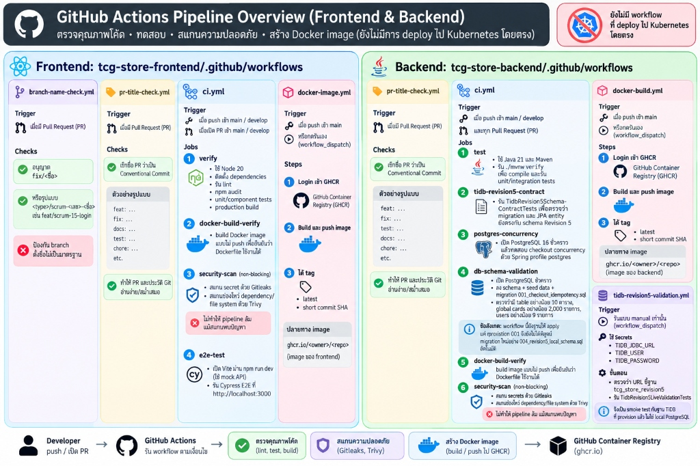
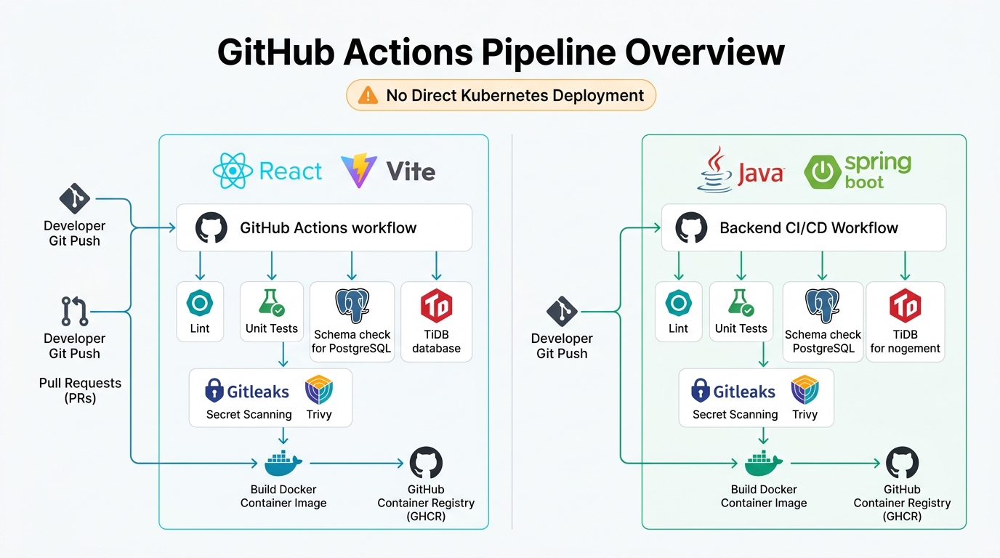
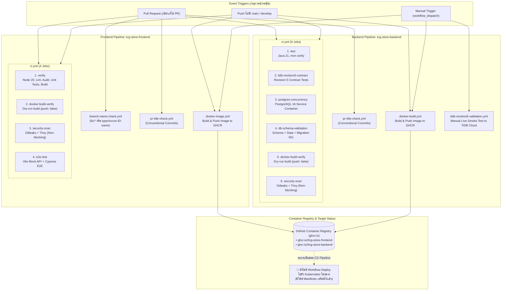

# รายงานสรุปและคู่มือสถาปัตยกรรม GitHub Actions Pipeline (Frontend & Backend)
**ระบบ TCG Store DevOps Platform**

---

## 📌 สารบัญ (Table of Contents)
1. [ภาพรวมสถาปัตยกรรม Pipeline (Architecture Overview)](#1-ภาพรวมสถาปัตยกรรม-pipeline-architecture-overview)
2. [แผนผังการทำงาน (Pipeline Flowcharts & Infographics)](#2-แผนผังการทำงาน-pipeline-flowcharts--infographics)
3. [เจาะลึก Pipeline ฝั่ง Frontend (`tcg-store-frontend`)](#3-เจาะลึก-pipeline-ฝั่ง-frontend-tcg-store-frontend)
   - [3.1 branch-name-check.yml](#31-branch-name-checkyml)
   - [3.2 pr-title-check.yml](#32-pr-title-checkyml)
   - [3.3 ci.yml (Continuous Integration)](#33-ciyml-continuous-integration)
   - [3.4 docker-image.yml (Docker Image Delivery)](#34-docker-imageyml-docker-image-delivery)
4. [เจาะลึก Pipeline ฝั่ง Backend (`tcg-store-backend`)](#4-เจาะลึก-pipeline-ฝั่ง-backend-tcg-store-backend)
   - [4.1 pr-title-check.yml](#41-pr-title-checkyml)
   - [4.2 ci.yml (Continuous Integration)](#42-ciyml-continuous-integration)
   - [4.3 docker-build.yml (Docker Image Delivery)](#43-docker-buildyml-docker-image-delivery)
   - [4.4 tidb-revision5-validation.yml (Live TiDB Smoke Test)](#44-tidb-revision5-validationyml-live-tidb-smoke-test)
5. [สถานะ Kubernetes Deployment และข้อเสนอแนะในการต่อยอด](#5-สถานะ-kubernetes-deployment-และข้อเสนอแนะในการต่อยอด)

---

## 1. ภาพรวมสถาปัตยกรรม Pipeline (Architecture Overview)

ระบบ CI/CD ปัจจุบันของโปรเจกต์ TCG Store ถูกออกแบบแยกเป็น **2 Repository อิสระ** ตามโครงสร้าง Microservices/Decoupled ได้แก่:
1. **Frontend:** React, Vite, TypeScript, Tailwind CSS, Cypress E2E
2. **Backend:** Java 21, Spring Boot 3, TiDB Cloud / PostgreSQL 16 Alpine, Maven

### หัวใจสำคัญของ Pipeline ปัจจุบัน:
* **Quality Gates (การตรวจสอบคุณภาพ):** มีการควบคุมตั้งแต่ระดับ Git เช่น ตรวจสอบชื่อ Branch (`branch-name-check.yml`) และชื่อ Pull Request (`pr-title-check.yml`) ตามมาตรฐาน Conventional Commits
* **Continuous Integration (CI):** ทำการทดสอบอัตโนมัติทั้ง Unit Tests, Integration Tests, E2E Tests, ตรวจสอบ Contract ของ Schema ฐานข้อมูล และตรวจสอบความถูกต้องของ Dockerfile แบบ Dry-run
* **Security Scanning (ความปลอดภัย):** มีการสแกนหา Secret หลุดด้วย **Gitleaks** และตรวจหาช่องโหว่ระดับ Dependency / Filesystem ด้วย **Trivy** (กำหนดเป็น *Non-blocking* เพื่อไม่ให้ Pipeline ล้มหากพบ warning)
* **Container Delivery:** เมื่อโค้ดถูก Merge เข้า Branch `main` ระบบจะทำการ Build Docker Image อัตโนมัติและ Push ไปยัง **GitHub Container Registry (GHCR)** ที่ `ghcr.io/<owner>/<repo>` พร้อมติดแท็ก `latest` และ `short commit SHA`
* ⚠️ **สถานะการ Deploy ไปยัง Kubernetes:** ในโปรเจกต์ปัจจุบันมี Kubernetes Manifests เตรียมไว้แล้ว (`infra/kubernetes/` และ `frontend/k8s/`) แต่ **ยังไม่มี Workflow ที่สั่ง Deploy (`kubectl` หรือ ArgoCD) ไปยัง Kubernetes Cluster โดยตรง**

---

## 2. แผนผังการทำงาน (Pipeline Flowcharts & Infographics)

### ภาพรวมการทำงาน (Pipeline Overview Infographic)


### สถาปัตยกรรมระบบ CI/CD (Architecture Flow Diagram)


### แผนผังการตัดสินใจและการทำงาน (Mermaid Flowchart)



---

## 3. เจาะลึก Pipeline ฝั่ง Frontend (`tcg-store-frontend`)

ที่ตั้งโฟลเดอร์: `Code_devops/tcg-store-frontend/.github/workflows/`

### 3.1 `branch-name-check.yml`
* **วัตถุประสงค์:** ป้องกันการตั้งชื่อ Branch สะเปะสะปะ บังคับให้การแตก Branch เป็นไปตามมาตรฐาน Scrum
* **เงื่อนไขการทำงาน (`on`):** ทำงานเมื่อเปิด หรืออัปเดต Pull Request (`opened`, `edited`, `synchronize`, `reopened`)
* **กฎการตรวจสอบ:**
  * ข้อยกเว้น: อนุญาตให้ขึ้นต้นด้วย `fix/<ชื่อ>` หรือ `dependabot/*` สำหรับงาน Hotfix หรือ Library update
  * กฎหลัก: ต้องตรงตาม Regex `^(feat|fix|docs|test|ci|chore|refactor|build)/scrum-[0-9]+-[a-z0-9]+(-[a-z0-9]+)*$` เช่น `feat/scrum-15-login`, `refactor/scrum-42-cart-state`
* **โค้ดสำคัญ:**
  ```yaml
  name: Branch Name Check
  on:
    pull_request:
      types: [opened, edited, synchronize, reopened]
  jobs:
    validate:
      runs-on: ubuntu-latest
      steps:
        - env:
            BRANCH_NAME: ${{ github.head_ref }}
          run: |
            if [[ "$BRANCH_NAME" == dependabot/* || "$BRANCH_NAME" == fix/* ]]; then
              exit 0
            fi
            if [[ ! "$BRANCH_NAME" =~ ^(feat|fix|docs|test|ci|chore|refactor|build)/scrum-[0-9]+-[a-z0-9]+(-[a-z0-9]+)*$ ]]; then
              echo "Invalid branch: $BRANCH_NAME"
              exit 1
            fi
  ```

---

### 3.2 `pr-title-check.yml`
* **วัตถุประสงค์:** บังคับรูปแบบชื่อ PR ให้อยู่ในรูปแบบ **Conventional Commits** เพื่อให้ประวัติ Git ชัดเจนและสามารถทำ Auto-generate Changelog ได้
* **เงื่อนไขการทำงาน (`on`):** `pull_request_target` (เมื่อเปิด, แก้ไข, หรือ push โค้ดใหม่เข้า PR)
* **เครื่องมือ:** ใช้งาน GitHub Action สำเร็จรูป `amannn/action-semantic-pull-request@v5`
* **ประเภทคำนำหน้าที่อนุญาต:** `feat`, `fix`, `docs`, `style`, `refactor`, `perf`, `test`, `build`, `ci`, `chore`, `revert` (เช่น `feat: add payment gateway integration`)

---

### 3.3 `ci.yml` (Continuous Integration)
* **วัตถุประสงค์:** หัวใจหลักในการทดสอบและตรวจคุณภาพโค้ดฝั่งหน้าบ้าน
* **เงื่อนไขการทำงาน (`on`):**
  * เมื่อมีการ `push` เข้า branch `main` หรือ `develop`
  * เมื่อเปิด `pull_request` เข้าหา branch `main` หรือ `develop`

> 💡 **Branch `develop` คืออะไร? และต่างจาก `main` อย่างไร? (อธิบายภาษาคน)**
> * **`main` (Production Branch):** เปรียบเหมือน **"หน้าร้านจริงที่เปิดให้ลูกค้าเข้ามาซื้อของ"** โค้ดใน branch นี้ต้องนิ่งที่สุด เสถียรที่สุด และพร้อมใช้งานจริงเสมอ ห้ามมีบั๊กหลุดลงไปเด็ดขาด
> * **`develop` (Integration Branch):** เปรียบเหมือน **"ห้องทดลองรวมของทีมพัฒนา"** เวลาที่นักพัฒนาแต่ละคนเขียนฟีเจอร์ของตัวเองเสร็จ (เช่น ทำระบบ Login ใน branch `feat/scrum-15-login`) จะส่งงานมารวมกันที่ `develop` ก่อน เพื่อให้โค้ดของทุกคนมาประกอบร่างและทดสอบร่วมกันว่าทำงานเข้ากันได้ดีไหม ก่อนจะนำไปปล่อยขึ้น `main`
> * **ทำไม Pipeline ต้องรันทั้ง 2 branch?:** เพื่อให้ระบบช่วย "ดักจับข้อผิดพลาดตั้งแต่ในห้องทดลอง (`develop`)" ทันทีที่มีคนส่งงานเข้ามา ถ้าพังจะรู้ทันที ไม่ปล่อยให้บั๊กหลุดรอดไปถึงหน้าร้านจริง (`main`)

* **ประกอบด้วย 4 Jobs หลัก:**

#### 1. `verify` (Lint, Test & Build) — ตรวจคุณภาพโค้ดแบบครบวงจร
Job นี้จะรันคำสั่งตรวจสอบทั้งหมด 5 ขั้นตอน โดยอ้างอิง scripts จากไฟล์ `package.json`:
1. **`npm run lint` (ตรวจสอบโค้ดได้อย่างไร ใช้วิธีอะไร?):**
   * **เครื่องมือที่ใช้:** โปรเจกต์เรียกใช้ `oxlint` (คำสั่งใน `package.json` คือ `"lint": "oxlint"`) ซึ่งเป็น JavaScript/TypeScript Linter ยุคใหม่ที่พัฒนาด้วยภาษา **Rust** จึงทำงานได้เร็วกว่า ESLint ทั่วไปมากถึง 50–100 เท่า
   * **วิธีการตรวจสอบ (Static Code Analysis):** Oxlint จะแปลงไฟล์โค้ดทั้งหมดในโปรเจกต์เป็นโครงสร้างต้นไม้ที่เรียกว่า AST (Abstract Syntax Tree) แล้ววิเคราะห์หาจุดบกพร่องโดยไม่ต้องรันโค้ดจริง
   * **สิ่งที่ตรวจสอบ:**
     * **Code Smells & Bad Practices:** เช่น ตัวแปรที่ประกาศทิ้งไว้แต่ไม่ได้ใช้ (`no-unused-vars`), โค้ดที่มีเงื่อนไขเป็นไปไม่ได้หรือไม่มีวันถูกเรียกใช้งาน (unreachable code)
     * **React Rules:** ตรวจสอบการใช้งาน React Hooks ว่าใส่ dependency ครบหรือไม่ (`react-hooks/exhaustive-deps`) เพื่อป้องกัน memory leak หรือ component re-render วนลูปไม่สิ้นสุด
     * **Syntax & Potential Bugs:** ตรวจจับรูปแบบโค้ดที่สุ่มเสี่ยงจะเกิด runtime exception เช่น การลืม handle ค่า `null` หรือ `undefined`
2. **`npm run audit` (ตรวจหาช่องโหว่ความปลอดภัยของ Library):**
   * รันคำสั่ง `npm audit --audit-level=critical`
   * ระบบจะนำรายชื่อและเวอร์ชันของทุก package ใน `package-lock.json` ไปเปรียบเทียบกับฐานข้อมูลช่องโหว่ความปลอดภัยระดับโลก (GitHub Advisory Database / CVE) หากพบว่า library ภายนอกตัวใดมีช่องโหว่ความเสี่ยงระดับวิกฤต (Critical Vulnerability) จะแจ้งเตือนทันที
3. **`npm run test` (รัน Unit & Component Tests อ้างอิงจากไหน ทำงานอย่างไร?):**
   * **เครื่องมือที่ใช้:** อ้างอิงคำสั่ง `"test": "vitest run"` ใน `package.json` ร่วมกับ `@testing-library/react` และ `jsdom`
   * **อ้างอิงไฟล์ทดสอบจากไหน?:** ตัวรันเทส (Vitest) จะสแกนหาไฟล์ที่มีนามสกุล `*.test.tsx`, `*.test.ts`, `*.spec.tsx` ทั่วทั้งโฟลเดอร์ `src/` โดยอัตโนมัติ
   * **วิธีการทำงาน:** Vitest จะจำลองสิ่งแวดล้อมเบราว์เซอร์ในหน่วยความจำผ่าน `jsdom` จากนั้น Testing Library จะทำการ Mount หน้าจอหรือ Component (เช่น ปุ่ม, แบบฟอร์ม, การ์ดสินค้า) ขึ้นมาใน memory แล้วจำลองการคลิก การพิมพ์ข้อความของผู้ใช้ พร้อมทั้ง Assert ตรวจสอบว่าผลลัพธ์บนหน้าจอหรือสถานะ (State) มีการเปลี่ยนแปลงถูกต้องตาม Business Logic หรือไม่
4. **`npm run build` (ทดสอบการ Build สำหรับ Production):**
   * รันคำสั่ง `"build": "tsc -b && vite build"`
   * **`tsc -b` (Typecheck):** สั่งคอมไพเลอร์ของ TypeScript ให้ตรวจเช็กชนิดข้อมูล (Type Checking) ทั้งหมดในโปรเจกต์ว่า Props, Interfaces, และฟังก์ชันส่งค่าเข้า-ออกตรงกัน 100% หรือไม่
   * **`vite build`:** คอมไพล์โค้ด React เป็น JavaScript/CSS แท้, ทำการบีบอัดไฟล์ (Minify), และทำ Tree-shaking ตัดโค้ดส่วนที่ไม่ได้ใช้ออก เตรียมพร้อมไว้ในโฟลเดอร์ `dist/`

#### 2. `docker-build-verify` (ทดสอบสร้าง Dockerfile)
* สั่งประกอบ Docker Image ตามขั้นตอนใน `Dockerfile` ด้วยตัวเลือก `push: false` (Dry-run) เพื่อรับประกันว่าไม่มีไฟล์ขาดหาย และสามารถนำไปสร้างเป็น Container ได้จริงโดยไม่เกิด Error

#### 3. `security-scan` (สแกนความปลอดภัย)
* **Gitleaks:** สแกนโค้ดทุกบรรทัดเพื่อค้นหาว่ามีใครเผลอเขียนรหัสผ่าน, API Key, หรือ JWT Secret ฝังไว้ในโค้ดหรือไม่ (`continue-on-error: true`)
* **Trivy:** สแกนหาช่องโหว่ของไฟล์ระบบและ libraries ในโปรเจกต์
* *ข้อสังเกต:* กำหนดเป็น Non-blocking เพื่อให้ทีมทราบปัญหาความปลอดภัยโดยไม่ขัดขวางการส่งงานด่วน

#### 4. `e2e-test` (Cypress E2E Tests)
* เปิด Vite Development Server จำลองขึ้นมาที่พอร์ต 3000 โดยเปิดระบบ Mock API (`VITE_ENABLE_MOCK_API: 'true'`)
* ให้หุ่นยนต์ Cypress เปิดเบราว์เซอร์เสมือนเข้าไปคลิก ใช้งานระบบจริงตาม User Journey (เช่น การนำทาง, การค้นหา, การใส่ตะกร้า) เพื่อยืนยันว่าทุกหน้าจอทำงานร่วมกันได้สมบูรณ์

---

### 3.4 `docker-image.yml` (Docker Image Delivery)
* **เงื่อนไขการทำงาน (`on`):** เมื่อมีการ `push` เข้า `main` หรือสั่งรันด้วยตนเองผ่าน `workflow_dispatch`

> 💡 **อธิบายภาษาคนให้เข้าใจง่าย: หน้านี้ทำหน้าที่อะไร?**
> * **ปัญหาเดิมของวงการซอฟต์แวร์:** บ่อยครั้งเรามักเจอปัญหา *"เครื่องของฉันรันเว็บได้ปกติ แต่ทำไมพอเอาไปเปิดบนเครื่องคนอื่นหรือบนเซิร์ฟเวอร์แล้วเว็บกลับพัง?"* สาเหตุเกิดจากเวอร์ชันของ Node.js ไม่ตรงกัน, ขาด library บางตัว, หรือระบบปฏิบัติการคนละแบบ
> * **Docker เข้ามาช่วยอย่างไร?:** Docker เปรียบเสมือน **"การแพ็กเว็บใส่กล่องคอนเทนเนอร์สำเร็จรูป"** ภายในกล่องจะมีทั้งตัวเว็บ, เซิร์ฟเวอร์ขนาดเล็ก (Nginx), และการตั้งค่าที่จำเป็นทั้งหมดถูกปิดผนึกไว้พร้อมใช้งาน ไม่ว่าจะนำกล่องนี้ไปเปิดบนเซิร์ฟเวอร์ตัวไหนในโลก เว็บก็จะรันได้เหมือนกันทุกประการ 100%
> * **GHCR (GitHub Container Registry) คืออะไร?:** เปรียบเสมือน **"โกดังสินค้าออนไลน์บนคลาวด์ของ GitHub"** สำหรับเก็บกล่อง Docker โดยเฉพาะ
> * **หน้าที่ของ Workflow นี้:** เมื่อมีโค้ดเวอร์ชันล่าสุดผ่านการตรวจสอบเข้าสู่ `main` ระบบจะแปลงร่างโค้ดนั้นให้กลายเป็นกล่องสินค้า Docker ➜ ปั๊มตราและวันที่ (Tag เช่น `latest` และเลข Commit SHA) ➜ นำกล่องขึ้นไปฝากไว้บนโกดัง GHCR ทันที ทำให้ทีม運 (DevOps) หรือ Server ของเราสามารถดาวน์โหลดกล่องเวอร์ชันใหม่นี้ไปเปิดให้บริการลูกค้าได้ตลอดเวลา

---

## 4. เจาะลึก Pipeline ฝั่ง Backend (`tcg-store-backend`)

ที่ตั้งโฟลเดอร์: `Code_devops/tcg-store-backend/.github/workflows/`

### 4.1 `pr-title-check.yml`
* บังคับใช้มาตรฐาน Conventional Commits กับชื่อ PR ทุกรายการเช่นเดียวกับ Frontend

---

### 4.2 `ci.yml` (Continuous Integration)
* **เงื่อนไขการทำงาน (`on`):** รันกับทุก PR (`pull_request`) และเมื่อมีการ `push` เข้า branch `main` หรือ `develop`

> 💡 **Branch `develop` ใน Backend (อธิบายภาษาคน):**
> เช่นเดียวกับ Frontend ตัว `develop` ของ Backend คือจุดรวมโค้ด API ใหม่ๆ ของทุกคนก่อนนำขึ้น Production เพื่อทดสอบว่าฟังก์ชันใหม่ที่เพิ่มเข้ามาไม่ไปทำลายระบบฐานข้อมูลเดิม และไม่ชนกับ API ที่เพื่อนร่วมทีมเขียนไว้

* **ประกอบด้วย 6 Jobs ย่อย (พร้อมคำอธิบายภาษาคนให้เข้าใจง่าย):**

#### 1. `test` (Java Unit & Integration Tests)
* **อธิบายภาษาคน: "ครูตรวจการบ้าน"**
* ติดตั้งสภาพแวดล้อม Java 21 (Temurin) แล้วสั่ง `./mvnw --batch-mode verify`
* ทำหน้าที่ตรวจเช็กไวยากรณ์ Java ทั้งหมด และสั่งรันข้อสอบเทสทุกข้อในระบบ (Unit & Integration Tests) เช่น ฟังก์ชันคำนวณราคา ฟังก์ชันคิดค่าธรรมเนียม ถ้าระบบคิดเลขผิดแม้แต่สตางค์เดียว ครูจะตรวจพบและหยุดระบบทันที

#### 2. `tidb-revision5-contract`
* **อธิบายภาษาคน: "ล่ามแปลภาษา (ตรวจสอบสัญญาพิมพ์เขียว)"**
* รันเฉพาะเทสคลาส `TidbRevision5SchemaContractTests`
* ทำหน้าที่ตรวจดูว่าพิมพ์เขียวของโค้ด Java (JPA Entity เช่น คลาส `@Entity Card`) และพิมพ์เขียวของฐานข้อมูล TiDB Cloud (Schema Revision 5) ยังพูดคุยภาษาเดียวกันอยู่ไหม ป้องกันเหตุการณ์ที่ฝั่ง Java นึกว่าคอลัมน์ชื่อ `price` แต่ฐานข้อมูลจริงเปลี่ยนชื่อเป็น `card_price` จนทำให้เซิร์ฟเวอร์พังเวลาทำงานจริง

#### 3. `postgres-concurrency`
* **อธิบายภาษาคน: "ด่านทดสอบลูกค้า 10 คนรุมแย่งซื้อของชิ้นสุดท้ายพร้อมกัน (Race Condition)"**
* GitHub Actions จะสร้างฐานข้อมูลจำลอง `postgres:16-alpine` ขึ้นมา
* รันคำสั่ง `./mvnw --batch-mode -Dspring.profiles.active=postgres -Dtest=CheckoutConcurrencyPostgresTests verify`
* จำลองสถานการณ์ฉุกเฉิน เช่น มีการ์ดหายากเหลืออยู่ในสต็อกแค่ใบเดียว แล้วมีลูกค้า 10 คนกดปุ่ม "ชำระเงิน" พร้อมกันในเสี้ยววินาทีเดียวกัน ระบบต้องตัดสต็อกและขายให้ผู้ซื้อได้เพียง 1 คนอย่างถูกต้อง ส่วนอีก 9 คนต้องได้รับแจ้งว่าสินค้าหมด ป้องกันปัญหาการขายการ์ดซ้ำ (Double Selling)

#### 4. `db-schema-validation` (Database Schema & Seed Validation)
* **อธิบายภาษาคน: "ด่านตรวจเช็กความพร้อมและเฟอร์นิเจอร์ของร้านค้า"**
* สร้างฐานข้อมูล PostgreSQL 16 ชั่วคราวขึ้นมา แล้วเริ่มก่อสร้างร้านค้าตามลำดับไฟล์ SQL:
  1. `01-schema.sql` (สร้างโต๊ะ ตู้ ชั้นวางของ = ตารางทั้งหมด)
  2. `02-data.sql` (นำการ์ดสินค้ามาวางบนชั้น = Seed Data)
  3. `03-profile-avatar.sql` (ตกแต่งป้ายและรูปโปรไฟล์ผู้ใช้)
  4. `001_checkout_idempotency.sql` (ติดตั้งระบบป้องกันการกดซื้อซ้ำ)
* จากนั้นมีผู้ตรวจเข้ามานับจำนวนว่าร้านค้าพร้อมเปิดบริการจริงหรือไม่:
  * จำนวนตารางในฐานข้อมูลต้องมีอย่างน้อย **10 ตาราง**
  * จำนวนการ์ดในระบบต้องมีอย่างน้อย **2,000 รายการ**
  * จำนวนผู้ใช้งานเริ่มต้นต้องมีอย่างน้อย **9 รายการ**
* 💡 **ข้อสังเกตสำคัญเชิงลึก (ภาษาคน):** ปัจจุบันคนตรวจร้านค้านี้ยังถือคู่มือตรวจรับเล่มเก่าที่ตรวจถึงแค่บันทึกที่ `001` เท่านั้น ทั้งที่ในความเป็นจริงโปรเจกต์มีการก่อสร้างเพิ่มเติมไปจนถึงบันทึกเล่มที่ `007` แล้ว (เช่น ระบบ Notification และ Seller Application) ทำให้การทดสอบอัตโนมัติตรงนี้ยังไม่ได้หยิบบันทึกเล่ม 002–007 ไปทดสอบในห้องจำลอง

#### 5. `docker-build-verify`
* **อธิบายภาษาคน: "ซ้อมแพ็กกล่องพัสดุก่อนส่งจริง"**
* ทดสอบสั่ง build Dockerfile ฝั่ง Spring Boot แบบ `push: false` เพื่อตรวจดูว่าไฟล์ `.jar` สามารถนำไปประกอบรวมกับ Java Runtime ใน Docker Container ได้สมบูรณ์หรือไม่

#### 6. `security-scan`
* **อธิบายภาษาคน: "เครื่องสแกนสัมภาระสนามบิน"**
* รัน Gitleaks เพื่อสแกนตรวจจับว่ามีใครเผลอใส่รหัสผ่านฐานข้อมูลหรือกุญแจลับหลุดเข้าไปในโค้ด Backend หรือไม่ และใช้ Trivy ตรวจสอบว่า library ภายนอกมีช่องโหว่ความปลอดภัยที่แฮกเกอร์จะใช้เจาะระบบเข้ามาได้หรือไม่

---

### 4.3 `docker-build.yml` (Docker Image Delivery)
* **เงื่อนไขการทำงาน (`on`):** เมื่อโค้ดถูก `push` เข้า `main` หรือกดรันเองผ่าน `workflow_dispatch`
* **หน้าที่:** แพ็กไฟล์ระบบ Backend Spring Boot ลงใน Docker Container แล้วนำขึ้นไปเก็บบน **GHCR** ที่ `ghcr.io/<owner>/tcg-store-backend` พร้อมติดแท็ก `latest` และ `short commit SHA` พร้อมให้เซิร์ฟเวอร์ดึงไปใช้งาน

---

### 4.4 `tidb-revision5-validation.yml` (Live TiDB Smoke Test)
* **วัตถุประสงค์:** การทดสอบยิงไปยังฐานข้อมูล TiDB Cloud ของจริงที่เปิดใช้งานอยู่
* **เงื่อนไขการทำงาน (`on`):** **Manual Only (`workflow_dispatch`)** บังคับให้คนมากดปุ่มรันด้วยตัวเองเท่านั้น จะไม่รันอัตโนมัติ เพื่อประหยัดค่าใช้จ่ายและป้องกันไม่ให้กระทบกับข้อมูลจริงบนคลาวด์
* **Secrets ที่จำเป็น:** ดึงรหัสผ่านและ URL จาก GitHub Secrets (`TIDB_JDBC_URL`, `TIDB_USER`, `TIDB_PASSWORD`)
* **คำสั่งที่รัน:** `./mvnw --batch-mode -Dtest=TidbRevision5LiveValidationTests test` เพื่อยืนยันว่าแอปพลิเคชันสามารถเชื่อมต่อฐานข้อมูลคลาวด์ภายนอกได้เสถียร 100%

---

## 5. สถานะ Kubernetes Deployment และข้อเสนอแนะในการต่อยอด

### สถานะปัจจุบัน:
* ในโฟลเดอร์ [`Code_devops/tcg-store-backend/infra/kubernetes/base/`](file:///C:/Devops_NEW/Code_devops/tcg-store-backend/infra/kubernetes/base/) มีไฟล์ Manifests เช่น `deployment.yaml`, `service.yaml`, `configmap.yaml`, `kustomization.yaml`
* ในโฟลเดอร์ [`Code_devops/tcg-store-frontend/k8s/`](file:///C:/Devops_NEW/Code_devops/tcg-store-frontend/k8s/) มีไฟล์ `deployment.yaml`, `service.yaml`
* **สิ่งที่ยังไม่มี:** Workflow CI/CD ที่ทำหน้าที่เชื่อมต่อ Cluster เพื่อสั่ง Deploy อัตโนมัติ (Continuous Deployment)

### แนวทางการต่อยอดเพิ่ม Pipeline สำหรับ Deploy สู่ Kubernetes:
หากต้องการให้โปรเจกต์ Deploy อัตโนมัติเมื่อ Merge โค้ดเข้า `main` สามารถสร้างไฟล์ใหม่ เช่น `.github/workflows/deploy-k8s.yml` โดยมี 2 แนวทางหลัก:

1. **แนวทางที่ 1: Direct Deploy ผ่าน `kubectl` ใน GitHub Actions**
   * เก็บ Kubeconfig หรือ Credentials ไว้ใน GitHub Secrets (`KUBE_CONFIG_DATA`)
   * เมื่อ Build Image เสร็จ ให้สั่งอัปเดต Image Tag ใน Manifest แล้วรัน `kubectl apply -k`
2. **แนวทางที่ 2: GitOps ร่วมกับ ArgoCD (แนะนำสำหรับ Enterprise)**
   * สร้าง Repository สำหรับเก็บ Kubernetes Manifests โดยเฉพาะ (GitOps Repo)
   * เมื่อ Pipeline นี้ Build Docker Image สำเร็จ ให้ส่ง commit ไปแก้ Image Tag ใน GitOps Repo
   * ให้ ArgoCD บน Kubernetes Cluster คอยตรวจจับการเปลี่ยนแปลงและ Sync Pod ขึ้นสู่เวอร์ชันใหม่โดยอัตโนมัติ
