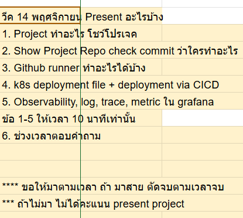
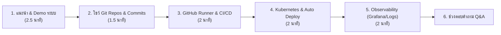
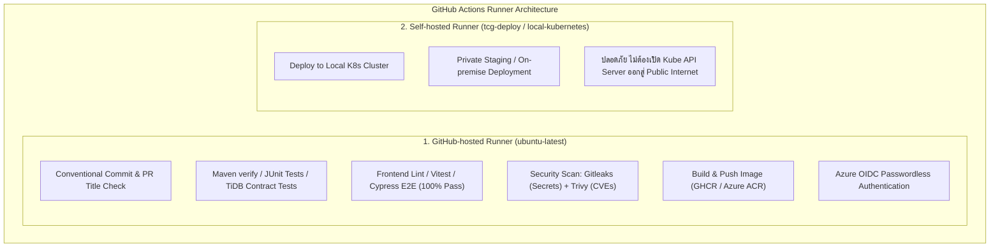
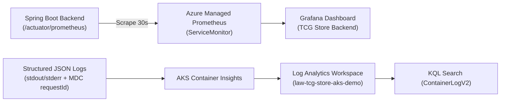

# 🎯 แผนเตรียมพรีเซนต์โปรเจกต์ TCG Store (สัปดาห์ที่ 14 พฤศจิกายน)
**ระบบ Mythix TCG Store DevOps Platform & Microservices**

> **⏱️ กฎเวลา:** ข้อ 1 - 5 มีเวลาให้ **รวมกันเพียง 10 นาทีเท่านั้น!** (เฉลี่ยหัวข้อละ ~2 นาที)  
> **⚠️ ข้อควรระวังสำคัญ:**
> * ขอให้มาตามเวลา ถ้ามาสายจะตัดจบตามเวลาจบ
> * ถ้าไม่มา ไม่ได้คะแนน Present Project

---

## 📌 สารบัญ (Table of Contents)
1. [เช็กลิสต์การเปิดหน้าจอและโปรแกรมล่วงหน้า (Pre-flight Checklist)](#1-เช็กลิสต์การเปิดหน้าจอและโปรแกรมล่วงหน้า-pre-flight-checklist)
2. [ภาพรวมการจัดสรรเวลา 10 นาที (Timeline Allocation)](#2-ภาพรวมการจัดสรรเวลา-10-นาที-timeline-allocation)
3. [เจาะลึก 5 หัวข้อการนำเสนอ](#3-เจาะลึก-5-หัวข้อการนำเสนอ)
   - [ข้อ 1: Project ทำอะไร โชว์โปรเจค (Demo)](#ข้อ-1-project-ทำอะไร-โชว์โปรเจค-demo-เวลา-25-นาที)
   - [ข้อ 2: Show Project Repo + Check Commit ว่าใครทำอะไร](#ข้อ-2-show-project-repo--check-commit-ว่าใครทำอะไร-เวลา-15-นาที)
   - [ข้อ 3: Github Runner ทำอะไรได้บ้าง](#ข้อ-3-github-runner-ทำอะไรได้บ้าง-เวลา-2-นาที)
   - [ข้อ 4: K8s Deployment File + Deployment via CI/CD](#ข้อ-4-k8s-deployment-file--deployment-via-cicd-เวลา-2-นาที)
   - [ข้อ 5: Observability, Log, Trace, Metric ใน Grafana](#ข้อ-5-observability-log-trace-metric-ใน-grafana-เวลา-2-นาที)
4. [ข้อ 6: แนวทางการตอบคำถามช่วง Q&A](#4-ข้อ-6-แนวทางการตอบคำถามช่วง-qa)

---

## 1. เช็กลิสต์การเปิดหน้าจอและโปรแกรมล่วงหน้า (Pre-flight Checklist)

ก่อนถึงคิวพรีเซนต์ ให้เปิดโปรแกรมและแท็บเบราว์เซอร์เรียงไว้ล่วงหน้า จะได้ไม่ต้องพิมพ์หรือรอโหลดระหว่างนำเสนอ:

* [ ] **Tab 1 - Live Web App:** หน้าเว็บจริงหรือ Localhost ที่เปิดหน้ารอไว้:
  * Marketplace / Card Detail พร้อม 3D Holographic Viewer
  * Cart / Reservation
  * Seller Portal & Profit Dashboard
  * Admin Weekly Reports
* [ ] **Tab 2 - GitHub Repositories (หน้า Contributors / Network Graph):**
  * [`tcg-store-backend`](https://github.com/MUDST-2026-luntungsadungyong/tcg-store-backend/graphs/contributors)
  * [`tcg-store-frontend`](https://github.com/MUDST-2026-luntungsadungyong/tcg-store-frontend/graphs/contributors)
  * [`tcg-store-document`](https://github.com/MUDST-2026-luntungsadungyong/tcg-store-document/graphs/contributors)
  * [`User-FlowANDFigma-Progress`](https://github.com/MUDST-2026-luntungsadungyong/User-FlowANDFigma-Progress/graphs/contributors)
* [ ] **Tab 3 - GitHub Actions Pipelines:**
  * หน้า GitHub Actions แท็บ Workflows ที่ผ่านสีเขียว (CI, Docker Build, Deploy AKS)
* [ ] **Tab 4 - Code Editor (VS Code):**
  * เปิดไฟล์ `infra/kubernetes/base/deployment.yaml` และ `infra/kubernetes/base/migration/job.yaml`
  * เปิดไฟล์ `.github/workflows/deploy-aks-demo.yml`
* [ ] **Tab 5 - Grafana Dashboard & Azure Monitor:**
  * หน้า Grafana Dashboard `TCG Store Backend` (แสดง HTTP Rate, P95 Latency, JVM, HikariCP)
  * หน้า Azure Log Analytics (`law-tcg-store-aks-demo`) รัน KQL Query ดู Structured Logs พร้อม `requestId`

---

## 2. ภาพรวมการจัดสรรเวลา 10 นาที (Timeline Allocation)

| ลำดับ | หัวข้อที่อาจารย์กำหนด | เวลาที่แนะนำ | ผู้รับผิดชอบ/สิ่งที่ต้องเปิดโชว์ |
| :---: | :--- | :---: | :--- |
| **1** | Project ทำอะไร โชว์โปรเจค | 2.5 นาที | Live Demo เว็บ (Buyer, Seller, Admin flows) |
| **2** | Show Project Repo check commit ว่าใครทำอะไร | 1.5 นาที | GitHub Insights / Contributors ของทั้ง 4 Repos |
| **3** | Github runner ทำอะไรได้บ้าง | 2.0 นาที | GitHub-hosted vs Self-hosted Runners + CI Workflows |
| **4** | k8s deployment file + deployment via CICD | 2.0 นาที | Manifests (Kustomize, Migration Job) + Deploy Action |
| **5** | Observability, log, trace, metric ใน grafana | 2.0 นาที | Grafana Dashboard + Container Insights KQL + Tracing |
| **6** | ช่วงเวลาตอบคำถาม (Q&A) | ตามที่อาจารย์ถาม | สรุปประเด็น Concurrency, Zero-Downtime, Security |

---

## 3. เจาะลึก 5 หัวข้อการนำเสนอ

### ข้อ 1: Project ทำอะไร โชว์โปรเจค (Demo) (เวลา: ~2.5 นาที)

* **ภาพรวมโปรเจกต์ (Elevator Pitch):**
  * โปรเจกต์ **Mythix TCG Store** เป็นแพลตฟอร์ม Marketplace สำหรับซื้อขายแลกเปลี่ยนการ์ดสะสม (Trading Card Games เช่น Pokémon, One Piece, MTG) แบบ Multi-seller Multi-currency รองรับการตรวจสอบสต็อกและการซื้อแบบปลอดภัยสูง
* **ลำดับการคลิกโชว์ (Live Demo Quick Tour):**
  1. **Buyer Flow (ฝั่งผู้ซื้อ):**
     * **Marketplace Discovery:** ค้นหาการ์ด, กรองตาม Condition, Set, Price Range
     * **Interactive 3D Viewer:** หมุนดูมิติการ์ดแบบ Holographic 3D บนหน้า Card Detail
     * **Stock Notification CTA:** หากการ์ดหมดสต็อก ผู้ซื้อสามารถกด *"Notify Me"* เพื่อรับอีเมลแจ้งเตือนอัตโนมัติเมื่อผู้ขายเติมสต็อกการ์ดใบนั้น
     * **Cart & Atomic Reservation:** กดจองการ์ดลงตะกร้า โดยมีระบบ Hold Stock ป้องกันการแย่งซื้อการ์ดใบเดียวกัน (Race condition)
  2. **Seller Flow (ฝั่งผู้ขาย):**
     * **Seller Workspace:** จัดการสต็อกการ์ด (Listing Management), กำหนดสภาพการ์ด (Mint/Near Mint)
     * **Order Fulfillment & Profit Dashboard:** ตรวจสอบคำสั่งซื้อ, ยืนยันการจัดส่ง, และดูกราฟสรุปรายได้
  3. **Admin Flow (ฝั่งผู้ดูแลระบบ):**
     * **Weekly Reports:** หน้าสรุปรายงานยอดขาย ยอดจอง และสินค้าขายดีประจำสัปดาห์ พร้อมปุ่มดาวน์โหลดรายงานเป็นไฟล์ CSV

---

### ข้อ 2: Show Project Repo + Check Commit ว่าใครทำอะไร (เวลา: ~1.5 นาที)

* **การแบ่งสถาปัตยกรรม 4 Repositories (Decoupled Microservices Pattern):**
  1. **`tcg-store-backend`**: Core API พัฒนาด้วย Spring Boot 3, Java 21, TiDB / PostgreSQL, Spring Security JWT, Kubernetes Manifests และ Bicep Alert Rules
  2. **`tcg-store-frontend`**: Web Application พัฒนาด้วย React 18, Vite, TypeScript, Tailwind CSS, Zustand และ Cypress E2E
  3. **`tcg-store-document`**: แหล่งรวบรวมเอกสารสถาปัตยกรรม, Runbooks, รายงานสถาปัตยกรรม Pipeline และ Presentation Slides
  4. **`User-FlowANDFigma-Progress`**: เอกสารด้านการออกแบบ UX/UI, Wireframes, User Journeys และ Design System
* **การเช็ก Commit และบทบาทสมาชิกในทีม:**
  * เปิดหน้า GitHub -> **Insights -> Contributors** ของแต่ละ Repo:
    * **Naphat Phoruang:** Frontend Lead, UI Architecture, E2E Stability, Discovery & Cart
    * **NuNKantinan (Kantinan Srisuwan):** Backend/Frontend Core, Jira Tracking, Admin/Store features, Database schemas
    * **YEONOIR:** UX/Flow, Design System, Frontend Features, Documentation
    * **Pakinnar (Pakin Narkjaroen):** Backend API, Catalog/Product models, Notification Service
    * **dekjefff:** DevOps Lead, CI/CD GitHub Actions, Docker, Kubernetes Manifests, Azure Infrastructure & Observability
    * **เพื่อนร่วมทีม (Jittipat, Thirapat, ssun, TokJai):** โมดูลย่อย, Testing, และ Documentation

---

### ข้อ 3: Github Runner ทำอะไรได้บ้าง (เวลา: ~2 นาที)

> [!IMPORTANT]
> **ประเด็นเด่น:** ชี้ให้เห็นว่าระบบเรามีการใช้ Runner 2 รูปแบบอย่างชัดเจนตามลักษณะงานและความปลอดภัย

1. **GitHub-hosted Runner (`ubuntu-latest`):**
   * **Quality Gates:** ตรวจชื่อ Branch และ Conventional Commit ใน PR Title (`branch-name-check.yml`, `pr-title-check.yml`)
   * **Automated Testing:** รัน Backend Maven Verify + PostgreSQL Container และรัน Frontend Vitest + Cypress E2E (ผ่าน 100% ทั้ง 20 specs)
   * **Security Scanning:** รัน **Gitleaks** เพื่อตรวจจับ Secret/API Key หลุด และรัน **Trivy** ตรวจหาช่องโหว่ระดับ OS & Dependencies
   * **Azure Deployment:** ใช้ **GitHub OIDC (`azure/login@v3`)** เพื่อยืนยันตัวตนกับ Azure แบบไม่ต้องเก็บ Password หรือ Long-lived Credentials
2. **Self-hosted Runner (`[self-hosted, tcg-deploy]`, `[self-hosted, Windows, X64, local-kubernetes]`):**
   * ใช้ใน Workflow `build-and-deploy-local-self-host.yml`, `deploy-staging.yml`, และ `deploy-production.yml`
   * **ข้อได้เปรียบ:** รันอยู่ภายใน Local Network หรือเครื่องภายในองค์กร ทำให้สั่ง `kubectl apply` ลง K8s คลัสเตอร์ภายในได้โดยตรง ไม่ต้องเปิดพอร์ต Kubernetes API Server ออกสู่ภายนอก

---

### ข้อ 4: K8s Deployment File + Deployment via CI/CD (เวลา: ~2 นาที)

* **1. โครงสร้างไฟล์ Kubernetes Manifests (`infra/kubernetes/`):**
  * ใช้ **Kustomize** แบ่งเป็น `base/` และ `overlays/` (`aks-demo`, `staging`, `production`, `local`):
    * `deployment.yaml`: จัดการ Backend Pods, กำหนด **Liveness & Readiness Probes** ที่ `/actuator/health`, กำหนด SecurityContext ห้ามรัน Root, ตั้งค่า Resource Requests & Limits
    * `service.yaml`: ควบคุม Service แบบ `ClusterIP` ภายในคลัสเตอร์
    * `horizontalpodautoscaler.yaml` (HPA): ปรับขนาดจำนวน Pod อัตโนมัติเมื่อ CPU/Memory สูง
    * `poddisruptionbudget.yaml` (PDB): ป้องกัน Downtime ขณะทำการ Maintenance Node
    * `components/network/`: กำหนด **NetworkPolicy** อนุญาตเฉพาะ Traffic ที่จำเป็น
    * `migration/job.yaml`: **Kubernetes Job พิเศษสำหรับรัน Database Flyway Migration**
* **2. โฟลว์การ Deployment อัตโนมัติผ่าน CI/CD (`deploy-aks-demo.yml`):**
  * **Zero-Downtime Safe Deployment Steps:**
    1. **Trigger:** เกิดขึ้นเมื่อ Workflow Build Image บน `main` ผ่านสำเร็จ
    2. **Image Digest Pinning:** ดึงค่า SHA256 Digest ที่แน่นอนของ Image จาก ACR มาแทนที่ใน `kustomization.yaml` เพื่อความปลอดภัยและ Reproducibility
    3. **Pre-flight DB Migration:** สั่งรัน Database Migration Job ก่อน (`kubectl apply -f migration.yaml`) และรอจนเสร็จสมบูรณ์ (`kubectl wait --for=condition=complete`) หาก Migration ล้มเหลว ระบบจะหยุดทันที ไม่ปล่อยให้ Pods ตัวใหม่ทำงาน
    4. **Rolling Update:** รัน `kubectl apply -k infra/kubernetes/overlays/aks-demo` และเช็กสถานะด้วย `kubectl rollout status` เพื่อให้แน่ใจว่า Pods ใหม่ทำงานได้ 100%

---

### ข้อ 5: Observability, Log, Trace, Metric ใน Grafana (เวลา: ~2 นาที)

* **1. Metrics (Prometheus + Grafana):**
  * Spring Boot Expose Metrics ผ่าน Micrometer Actuator ที่ `/actuator/prometheus`
  * มี Azure Managed Prometheus **`ServiceMonitor`** (`servicemonitor-backend.yaml`) คอย Scrape ทุก 30 วินาที
  * **โชว์ Grafana Dashboard (`TCG Store Backend`):**
    * *Traffic & Error Rate:* อัตราการเรียก API และสัดส่วน HTTP 5xx %
    * *Latency:* ค่า P95 Response Time ของ API
    * *JVM & Connection Pool:* การใช้ JVM Heap Memory และ HikariCP Active/Idle Connections
    * *Storage & Neon Quota:* การเรียก S3 Object Storage และจำนวน Connection ไปยัง Neon DB
  * **Alerting Rules:** มี Azure Prometheus Alerting (`aks-demo-prometheus-rules.bicep`) คอยตรวจจับ Service ล่ม, 5xx พุ่งสูง และส่งอีเมลแจ้งเตือนทันที
* **2. Logs (Container Insights & KQL):**
  * แอปเขียน Log เป็น Structured JSON ออกมาทาง `stdout`/`stderr`
  * Azure Container Insights ดึง Log เข้า **Log Analytics Workspace (`law-tcg-store-aks-demo`)**
  * สามารถค้นหาผ่านตาราง **`ContainerLogV2`** ด้วย Kusto Query Language (KQL)
  * **Data Protection Contract:** ปิด `JPA_SHOW_SQL` และไม่เก็บข้อมูล Sensitive (Password, Token, บัตรเครดิต) ลงใน Log
* **3. Tracing (Request Correlation):**
  * มี **`RequestCorrelationFilter`** คอยผูก `X-Request-ID` เข้ากับ MDC
  * ทุก Log Line จะมี `requestId` แนบอยู่ ทำให้สามารถค้นหา Trace ของ 1 Request ตั้งแต่ต้นจนจบได้แม่นยำ

---

## 4. ข้อ 6: แนวทางการตอบคำถามช่วง Q&A

| คำถามที่อาจารย์มักจะถาม | แนวทางตอบสั้นกระชับ ตรงประเด็น |
|---|---|
| **ถ้ามีการแก้ Schema ฐานข้อมูล จะทำให้แอปหยุดทำงาน (Downtime) ไหม?** | ไม่ครับ/ค่ะ เพราะใน CI/CD เราแยกการรัน Database Migration ออกมาเป็น **Kubernetes Job** ให้ทำงานก่อน และใช้คำสั่ง `kubectl wait --for=condition=complete` เพื่อรอให้การปรับ Schema สำเร็จ 100% ก่อนที่ K8s จะเริ่มทำ Rolling Update ตัวแอปใหม่ |
| **ถ้าผู้ซื้อ 2 คนกดซื้อการ์ดที่มีสต็อกเหลือแค่ 1 ใบพร้อมกัน ระบบจัดการอย่างไร?** | Backend ใช้ **Stock Reservation Service** ที่มี Concurrency Lock และ Database Transaction แบบ Atomic พร้อมกำหนดเวลา Timeout (เช่น 15 นาที) หากผู้ซื้อไม่ชำระเงินตามเวลา ระบบจะปลดล็อกคืนสต็อกให้คนอื่นซื้อต่อได้ |
| **ทำไมถึงต้องมีทั้ง Self-hosted Runner และ GitHub-hosted Runner?** | GitHub-hosted Runner เหมาะสำหรับงาน CI ทั่วไป เช่น Lint, Test, Scan ช่องโหว่ เพราะ Scale สะดวก ส่วน Self-hosted Runner จำเป็นสำหรับสภาพแวดล้อมที่ต้องการความปลอดภัยสูง เช่น การ Deploy เข้า Private On-premise หรือ Local K8s Cluster โดยไม่ต้องเปิดพอร์ตหรือ Secret สู่ภายนอก |
| **Grafana ดูแลด้านความปลอดภัยของข้อมูลผู้ใช้อย่างไรในการทำ Observability?** | มีการกำหนด Logging Contract อย่างเข้มงวด โดยใน Prometheus Metrics จะไม่เก็บ User ID หรือ Email ใน Label เพื่อไม่ให้เกิด High Cardinality และใน Application Log จะกรองไม่ให้มีรหัสผ่าน, JWT Token, หรือข้อมูลชำระเงินหลุดเข้าไปใน Log Analytics |
