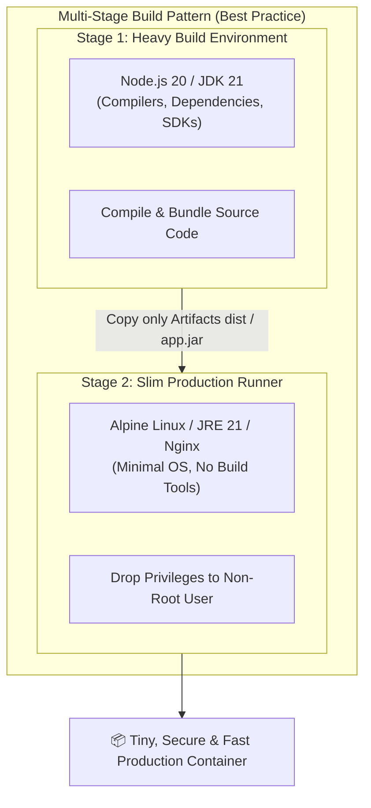
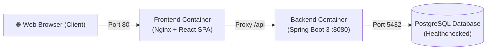

# 🐳 Docker Build & Multi-Stage Containerization Guide

> **โปรเจกต์:** Mythix TCG Marketplace Platform  
> **หมวดหมู่:** `CI_CD / DockerBuild`  
> **สถานะการทำงาน:** ✅ **Production Ready & CI Integrated**  
> **เครื่องมือหลัก:** Docker, Docker Compose, Nginx Alpine, Eclipse Temurin 21 (JDK/JRE)

---

## 📌 1. ภาพรวมกลยุทธ์การ Containerization (Architecture Overview)

ในแพลตฟอร์ม Mythix TCG เราเลือกใช้สถาปัตยกรรม **Multi-Stage Docker Builds** สำหรับทั้งระบบ Frontend (React/Vite) และ Backend (Spring Boot 3) โดยยึดหลักการออกแบบตามมาตรฐานสากล:



### ประโยชน์ของ Multi-Stage Builds:
1. **ขนาด Image เล็กกระทัดรัด (Minimal Image Size):** ไม่นำ Source code, node_modules ตัวเต็ม, หรือ Maven cache ติดไปใน Image จริง ทำให้ดาวน์โหลดและ Deploy ได้รวดเร็ว
2. **ความปลอดภัยระดับสูง (Zero Attack Surface):** ตัด Compiler และ Package Managers (เช่น `npm`, `mvn`) ออกจาก Production Image เพื่อไม่ให้แฮกเกอร์ใช้เครื่องมือเหล่านี้หากเกิดการเจาะระบบ
3. **การทำงานแบบ Non-Root (Least Privilege):** มีการสร้าง User เฉพาะ (`spring:spring`) เพื่อรันแอปพลิเคชันโดยไม่ใช้สิทธิ์ Root

---

## 🎨 2. Frontend Containerization (`tcg-store-frontend`)

ไฟล์คอนฟิก: [`Code_devops/tcg-store-frontend/Dockerfile`](file:///c:/Devops_NEW/Code_devops/tcg-store-frontend/Dockerfile)

### 2.1 รายละเอียดการทำงานของ Dockerfile
```dockerfile
# ==========================================
# Stage 1: Build Frontend Assets (Builder)
# ==========================================
FROM node:20-alpine AS builder
WORKDIR /app
COPY package.json package-lock.json ./
RUN npm ci --legacy-peer-deps
COPY . .
RUN npm run build   # ผลลัพธ์อยู่ที่ /app/dist

# ==========================================
# Stage 2: Serve with Nginx Alpine (Runner)
# ==========================================
FROM nginx:alpine AS runner
RUN rm -rf /etc/nginx/conf.d/default.conf
COPY nginx.conf /etc/nginx/conf.d/default.conf
COPY --from=builder /app/dist /usr/share/nginx/html
EXPOSE 80
CMD ["nginx", "-g", "daemon off;"]
```

### 2.2 Nginx Configuration สำหรับ Single Page Application (SPA)
ไฟล์ `nginx.conf` มีการตั้งค่า `try_files $uri $uri/ /index.html;` เพื่อให้ React Router DOM สามารถจัดการ Client-side Routing ได้อย่างสมบูรณ์แบบโดยไม่เกิดข้อผิดพลาด 404 เมื่อ Refresh หน้าเว็บ

---

## ☕ 3. Backend Containerization (`tcg-store-backend`)

ไฟล์คอนฟิก: [`Code_devops/tcg-store-backend/Dockerfile`](file:///c:/Devops_NEW/Code_devops/tcg-store-backend/Dockerfile)

### 3.1 รายละเอียดการทำงานของ Dockerfile
```dockerfile
# ==========================================
# Stage 1: Build Application JAR (JDK 21)
# ==========================================
FROM eclipse-temurin:21-jdk-alpine AS build
WORKDIR /workspace
COPY .mvn .mvn
COPY mvnw pom.xml ./
RUN chmod +x mvnw && ./mvnw --batch-mode dependency:go-offline
COPY src src
RUN ./mvnw --batch-mode clean package -DskipTests

# ==========================================
# Stage 2: Minimal Runtime Environment (JRE 21)
# ==========================================
FROM eclipse-temurin:21-jre-alpine
RUN addgroup -S spring && adduser -S spring -G spring
WORKDIR /app
RUN mkdir -p /app/uploads/products && chown -R spring:spring /app
COPY --from=build --chown=spring:spring /workspace/target/*.jar app.jar
USER spring:spring
EXPOSE 8080
ENTRYPOINT ["java", "-jar", "/app/app.jar"]
```

### 3.2 จุดเด่นด้านความปลอดภัยและประสิทธิภาพ
* แยก Layer การดาวน์โหลด Library (`dependency:go-offline`) ออกจาก Source code ทำให้ Docker Layer Caching ทำงานได้เต็มประสิทธิภาพ (ไม่ต้องโหลด dependency ใหม่ทุกครั้งที่แก้โค้ด)
* รันภายใต้ User `spring` (UID 1000) ที่จำกัดสิทธิ์ เพื่อความปลอดภัยตามมาตรฐาน CIS Docker Benchmark

---

## 🎼 4. Full-Stack Multi-Service Orchestration (`docker-compose.yml`)

ไฟล์คอนฟิก: [`docker-compose.yml`](file:///c:/Devops_NEW/docker-compose.yml)

ระบบประกอบด้วย 3 Services หลักที่เชื่อมต่อกันผ่าน Network ภายใน:



| Service Name | Image / Build Context | Port Mapping | Healthcheck / Dependency |
|---|---|:---:|---|
| **`postgres`** | `postgres:16-alpine` | `5432:5432` | ตรวจสอบผ่าน `pg_isready -U postgres` |
| **`backend`** | `./Code_devops/tcg-store-backend` | `8080:8080` | `depends_on: postgres` (Condition: healthy) |
| **`frontend`** | `./Code_devops/tcg-store-frontend` | `80:80` | `depends_on: backend` |

---

## 🚀 5. การตรวจสอบในกระบวนการ CI/CD Pipeline

ใน [`Jenkinsfile`](file:///c:/Devops_NEW/Jenkinsfile) มีขั้นตอนการตรวจสอบความถูกต้องของการประกอบร่าง Docker อัตโนมัติ:

```groovy
stage('Validate Docker Compose') {
    steps {
        echo '=== Validating Multi-Service Orchestration ==='
        sh 'docker compose config'   // <-- ตรวจสอบความถูกต้องของ Syntax และ Environment
    }
}
```

และใน Pipeline ย่อยของ Frontend / Backend จะมีขั้นตอนการ Build Docker Image จริง:
```bash
docker build -t tcg-store-frontend:latest ./Code_devops/tcg-store-frontend
docker build -t tcg-store-backend:latest ./Code_devops/tcg-store-backend
```

---

## 💻 6. คำสั่งสำหรับทดสอบและใช้งาน (Developer Quick Start)

```bash
# 1. ตรวจสอบความถูกต้องของ docker-compose
docker compose config

# 2. Build และรันทั้งระบบแบบ Full-Stack ใน Background
docker compose up --build -d

# 3. ตรวจสอบสถานะการทำงานของ Container ทั้งหมด
docker compose ps

# 4. ดู Logs รวมของทุกระบบ
docker compose logs -f

# 5. สั่งหยุดการทำงานและล้าง Container
docker compose down
```
