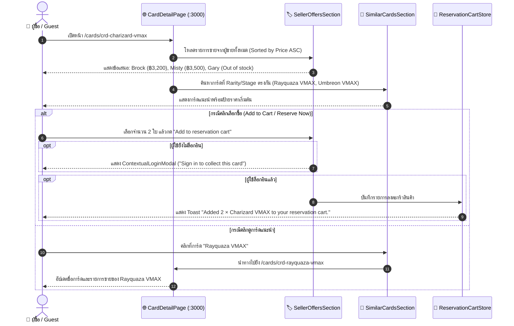

# 🔍 คู่มือการทดสอบ E2E: Multi-Seller Listing Comparison & Recommendations (US-02-2 & US-02-3)

> **อ้างอิง Spec File:** [`tcg-store-frontend/cypress/e2e/12_card_detail_multi_seller_and_recommendations.cy.ts`](file:///c:/Devops/tcg-store-frontend/cypress/e2e/12_card_detail_multi_seller_and_recommendations.cy.ts)  
> **NPM Script:** `npm run test:e2e:card-detail`  
> **หมวดหมู่:** `CI_CD / E2E / 01_Navigation_and_Discovery`  
> **User Stories:**  
> - **US-02-2:** เปรียบเทียบข้อเสนอจากผู้ขายหลายรายในหน้ารายละเอียดการ์ด (Multi-Seller Listing Comparison)  
> - **US-02-3:** ระบบแนะนำการ์ดใกล้เคียงและการ์ดที่คล้ายคลึงกัน (Similar Cards Recommendation Engine)  
> - **US-10-7:** การเพิ่มการ์ดเข้าคอลเลกชันส่วนตัวจากหน้ารายละเอียดการ์ด (Collect Card Panel)

---

## 📌 1. วัตถุประสงค์ (Objective)

ทดสอบประสบการณ์ของผู้ซื้อในการสำรวจการ์ดสะสมรายใบ (`/cards/:id`) โดยเน้นฟังก์ชันสำคัญ 2 ส่วน:
1. **Multi-Seller Listing Comparison (US-02-2):**
   - แสดงรายการข้อเสนอขายการ์ดใบเดียวกันจากผู้ขายหลายราย (Multi-seller offers) พร้อมป้ายระบุจำนวนข้อเสนอ
   - เรียงลำดับรายการขายจากราคาต่ำสุดไปราคาสูงสุด (Sorted ascending by price)
   - แสดงข้อมูลผู้ขาย ชื่อร้าน และลิงก์ไปยังหน้าร้านสาธารณะ (`/stores/:sellerId`)
   - แสดงสภาพการ์ด (Condition เช่น `Near Mint`, `Lightly Played`, `Mint`), ภาษา (เช่น Japanese, English) และราคาขาย
   - ตัวเลือกจำนวนการ์ด (Quantity dropdown) แสดงจำนวนตามสต๊อกพร้อมขายจริง (`1..stock`)
   - กรณีการ์ดหมดสต๊อก (`stock: 0`): แสดงข้อความ **"Out of stock"** และปิดการใช้งานปุ่มเลือกซื้อ
   - การจัดการสิทธิ์ (Contextual Login): เมื่อ Guest พยายามกด "Add to reservation cart" หรือ "Reserve now" จะแสดง Modal แจ้งเตือนให้เข้าสู่ระบบก่อน
   - การทำงานของผู้ซื้อที่ล็อกอินแล้ว: สามารถเพิ่มการ์ดลงตะกร้าพร้อม Toast แจ้งเตือน หรือกด "Reserve now" เพื่อนำทางไปยังหน้า `/cart` ทันที

2. **Similar Cards Recommendation Engine (US-02-3):**
   - คำนวณและแสดงผลการ์ดที่ใกล้เคียงกันโดยอ้างอิงจากระดับความหายาก (`rarity`) หรือลำดับขั้นของการ์ด (`stage`)
   - ไม่แสดงการ์ดใบเดิมที่กำลังเปิดดูอยู่ (Exclude current card)
   - แสดงรูปภาพการ์ด, ชื่อการ์ด, จำนวนผู้ขายที่ลงขาย (`X sellers`), และราคาเริ่มต้น (`From ฿X.XX`)
   - เมื่อคลิกที่การ์ดแนะนำ ระบบจะนำทางไปยังหน้ารายละเอียดการ์ดใบนั้นอย่างราบรื่น (Seamless transition) พร้อมอัปเดต Breadcrumb และรายการขาย

3. **Fallback & Empty States:**
   - กรณีเข้าดูการ์ดที่ยังไม่มีผู้ขายลงรายการขาย (`offers.length === 0`): แสดงกล่องข้อความเตือน *"No seller has this card listed right now."* โดยที่ยังสามารถกดบันทึกเข้าอัลบั้มสะสมส่วนตัวได้

---

## 🔄 2. แผนภาพแสดงสถาปัตยกรรม (Component Interaction Sequence)



---

## 🧪 3. รายละเอียด Test Scenarios (13 Tests Passing)

### 🔹 Suite 1: Card Details & Metadata Presentation (1 Test)
- `TC-DETAIL-01`: ตรวจสอบ Breadcrumb (Cards > Charizard VMAX), หัวข้อการ์ด, 3D Visual Viewer, และตารางข้อมูลจำเพาะ (Card Number, Rarity, Card Text, Grading Company, Grade, Year, Set, Tournament, Cert Number)

### 🔹 Suite 2: Multi-Seller Listing Comparison (US-02-2) (4 Tests)
- `TC-COMPARE-01`: ตรวจสอบการแสดงข้อเสนอจากผู้ขาย เรียงลำดับราคาจากน้อยไปมาก พร้อมชื่อร้านและลิงก์ไปยังหน้าร้าน (`/stores/:sellerId`)
- `TC-COMPARE-02`: ตรวจสอบข้อเสนอที่หมดสต๊อก (`stock: 0`): ป้าย "Out of stock", Dropdown เป็น 0 และ Disable, ปุ่ม Add to cart / Reserve now ถูกปิดใช้งาน
- `TC-COMPARE-03`: ตรวจสอบ Dropdown จำนวนของการ์ดที่มีสต๊อก: มีตัวเลือกครบตามจำนวนสต๊อก (เช่น 1, 2, 3) และสามารถเลือกค่าได้
- `TC-COMPARE-04`: คลิกชื่อผู้ขายในแถวข้อเสนอแล้วนำทางไปยังหน้าร้านสาธารณะ (`/stores/usr-3`) ได้อย่างถูกต้อง

### 🔹 Suite 3: Cart & Reservation Actions from Card Detail (3 Tests)
- `TC-ACTION-01`: Guest พยายามกด "Add to reservation cart" หรือ "Reserve now" ➔ แสดง `ContextualLoginModal` ("Sign in to collect this card") และปิด Modal ได้
- `TC-ACTION-02`: Customer ที่ล็อกอินแล้ว เลือกจำนวน 2 ใบ แล้วกด "Add to reservation cart" ➔ แสดง Toast ยืนยันการเพิ่มลงตะกร้า
- `TC-ACTION-03`: Customer ที่ล็อกอินแล้ว กดปุ่ม "Reserve now" ➔ นำทางไปยังหน้า `/cart` ทันที

### 🔹 Suite 4: Card Collect Panel (2 Tests)
- `TC-COLLECT-01`: Guest กดปุ่ม "Collect Charizard VMAX" ➔ แสดง `ContextualLoginModal`
- `TC-COLLECT-02`: Customer ที่ล็อกอินแล้วกดปุ่ม Collect ➔ บันทึกการ์ดลงคอลเลกชันและแสดง `FeedbackPopup` (Case 7: "Added to your collection")

### 🔹 Suite 5: Similar Cards Recommendation Flow (US-02-3) (2 Tests)
- `TC-SIMILAR-01`: ตรวจสอบการแนะนำการ์ดที่มีระดับ Rarity/Stage เดียวกัน (Rayquaza VMAX, Umbreon VMAX) พร้อมราคาเริ่มต้นและจำนวนผู้ขาย โดยไม่แสดงการ์ดใบปัจจุบัน
- `TC-SIMILAR-02`: คลิกที่การ์ดแนะนำ "Rayquaza VMAX" ➔ นำทางไปยัง `/cards/crd-rayquaza-vmax` และแสดงข้อมูลการ์ดใหม่พร้อมรายการขายอย่างราบรื่น

### 🔹 Suite 6: Empty Seller Offers Handling (1 Test)
- `TC-EMPTY-01`: เมื่อเข้าดูการ์ดที่ไม่มีผู้ขายวางขาย (`status: HIDE` หรือ Catalog only) ➔ แสดงข้อความ *"No seller has this card listed right now."* โดยที่ฟังก์ชัน Collect การ์ดยังคงใช้งานได้ตามปกติ

---

## 💻 4. คำสั่งในการรันการทดสอบ (Execution Commands)

```bash
# รันเฉพาะชุดทดสอบ Card Detail & Multi-Seller Comparison E2E
npm run test:e2e:card-detail

# หรือรันผ่าน npx cypress run เจาะจงไฟล์
npx cypress run --spec "cypress/e2e/12_card_detail_multi_seller_and_recommendations.cy.ts"
```
