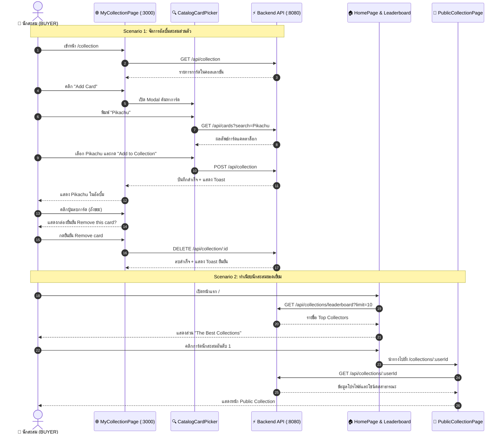

# 🏆 คู่มือการทดสอบ E2E: Personal Collection & Collector Leaderboard (US-10)

> **อ้างอิง Spec File:** [`tcg-store-frontend/cypress/e2e/10_collection_and_leaderboard.cy.ts`](file:///c:/Devops/tcg-store-frontend/cypress/e2e/10_collection_and_leaderboard.cy.ts)  
> **NPM Script:** `npm run test:e2e:collection`  
> **หมวดหมู่:** `CI_CD / E2E / 01_Navigation_and_Discovery`  
> **User Stories:**  
> - **US-10-1:** การดูอัลบั้มคอลเลกชันการ์ดสะสมส่วนตัว (`/collection`)  
> - **US-10-2:** การเพิ่มการ์ดเข้าอัลบั้มคอลเลกชันจากแคตตาล็อกฐานข้อมูลการ์ด (Add to Collection Modal)  
> - **US-10-3:** การลบการ์ดออกจากอัลบั้มคอลเลกชันส่วนตัว พร้อมกล่องยืนยัน (Remove Card Dialog)  
> - **US-10-6:** ทำเนียบผู้สะสมยอดเยี่ยมและหน้าโชว์เคสสาธารณะ (Top Collector Leaderboard & Public Showcase `/collections/:userId`)

---

## 📌 1. วัตถุประสงค์ (Objective)

ทดสอบการจัดการคอลเลกชันสะสมการ์ดของผู้ใช้ (Buyer/Collector) ทั้งในส่วนการจัดการอัลบั้มส่วนตัว และการแสดงผลทำเนียบยอดนักสะสมบนหน้าแรก:
1. **Personal Collection Album (US-10-1, US-10-2, US-10-3):**
   - ผู้ใช้ที่เข้าสู่ระบบสามารถเข้าดูหน้ารวมการ์ดสะสมส่วนตัว (`/collection`)
   - สามารถเปิด Modal "Add Card" เพื่อค้นหาการ์ดจากแคตตาล็อก (เช่น พิมพ์ค้นหา "Pikachu") เลือกการ์ด และระบุจำนวนเพื่อบันทึกลงคอลเลกชัน
   - มี Toast แจ้งเตือนเมื่อเพิ่มการ์ดสำเร็จ และการ์ดปรากฏในรายการ Grid ทันที
   - สามารถกดลบการ์ดออกจากคอลเลกชันผ่านปุ่มถังขยะ พร้อมยืนยันผ่าน `FeedbackPopup` และแสดง Toast แจ้งเตือน
2. **Top Collector Leaderboard & Public Showcase (US-10-6):**
   - หน้าแรก (`/`) มีส่วน "The Best Collections" จัดอันดับผู้สะสมการ์ดระดับท็อป 10
   - แสดงข้อมูลจำนวนการ์ดหายาก (Rare cards) และการ์ดไฮไลท์
   - สามารถคลิกที่ชื่อ/การ์ดของผู้สะสม เพื่อนำทางไปยังหน้าโชว์เคสสาธารณะ (`/collections/:userId`) ได้อย่างถูกต้อง

---

## 🔄 2. แผนภาพแสดงสถาปัตยกรรม (Component Interaction Sequence)



---

## 🧪 3. รายละเอียด Test Scenarios (2 Tests Passing)

### 🔹 Suite: US-10: Collection and Leaderboard

| รหัสทดสอบ | User Story | ขั้นตอนการทดสอบ | ผลลัพธ์ที่คาดหวัง |
|---|---|---|---|
| `TC-COLLECTION-01` | US-10-1, US-10-2, US-10-3 | 1. เข้าหน้า `/collection`<br>2. ตรวจสอบหัวข้อ `My Collection`<br>3. คลิกปุ่ม `Add Card`<br>4. พิมพ์ค้นหา `Pikachu` ในกล่องค้นหาแคตตาล็อก<br>5. เลือกการ์ดจากลิสต์บ็อกซ์และกด `Add to Collection`<br>6. ตรวจสอบการ์ด Pikachu ปรากฏใน Grid<br>7. คลิกปุ่ม Remove จากการ์ดใบแรก<br>8. กดยืนยันใน `FeedbackPopup` | - หัวข้อและปุ่ม Add Card แสดงผลสมบูรณ์<br>- Toast ยืนยัน *"added to your collection"* ปรากฏ<br>- Grid แสดงการ์ด Pikachu ทันที<br>- Modal ยืนยันการลบทำงานถูกต้อง<br>- Toast ยืนยัน *"Removed ... from your collection"* ปรากฏ |
| `TC-LEADERBOARD-01` | US-10-6 | 1. เข้าหน้าแรก (`/`)<br>2. เลื่อนไปยังเซกชัน *"The Best Collections"*<br>3. ตรวจสอบข้อมูลสถิติการ์ดของผู้สะสม<br>4. คลิกที่ลิงก์ผู้สะสมคนแรก (`/collections/:userId`) | - เซกชัน Leaderboard เรนเดอร์ครบถ้วน<br>- URL นำทางไปยัง `/collections/:userId`<br>- แสดงหน้า Public Collection อัลบั้มสาธารณะอย่างถูกต้อง |

---

## 💻 4. คำสั่งในการรันการทดสอบ (Execution Commands)

```bash
# รันเฉพาะชุดทดสอบ Collection & Leaderboard E2E
npm run test:e2e:collection

# หรือรันผ่าน Cypress run เจาะจงไฟล์
npx cypress run --spec "cypress/e2e/10_collection_and_leaderboard.cy.ts"
```
