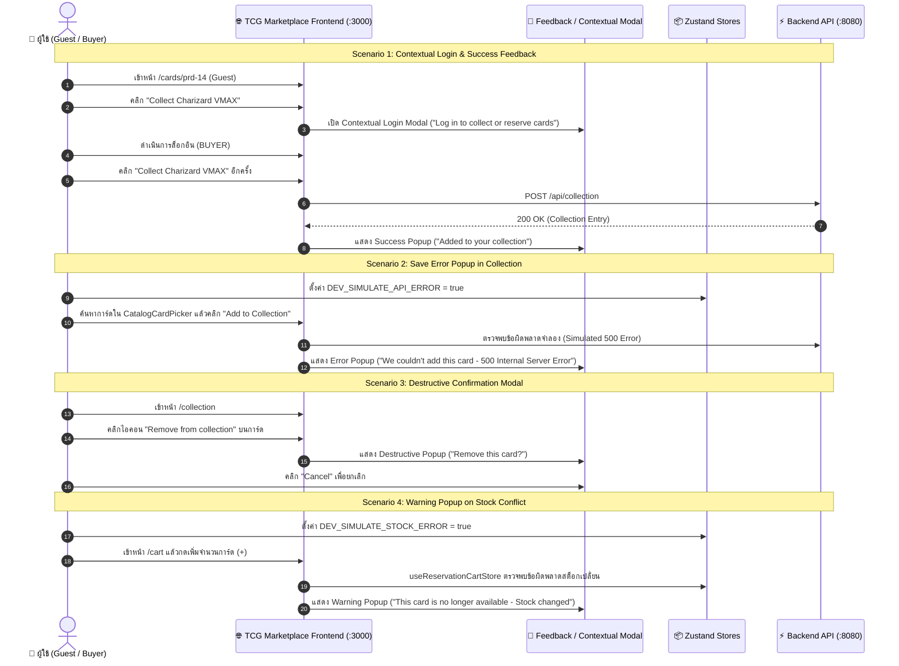

# 🛡️ US-30: คู่มือการทดสอบ E2E สำหรับ Feedback Popups & Error Handling UX

> **อ้างอิง Spec File:** [`Code_devops/tcg-store-frontend/cypress/e2e/07_feedback_and_errors.cy.ts`](file:///c:/Devops/tcg-store-frontend/cypress/e2e/07_feedback_and_errors.cy.ts)  
> **หมวดหมู่:** `CI_CD / E2E / 02_Authentication_and_Security`  
> **User Stories:**  
> - **US-30:** การจัดการ Feedback Popups, Contextual Login Modal, และ Error Handling UX  
>   - **US-30-1:** แสดง Contextual Login Modal เมื่อผู้ใช้ Guest พยายามสะสมหรือจองการ์ด  
>   - **US-30-2:** แสดง Success Popup เมื่อบันทึกการ์ดเข้า My Collection สำเร็จ  
>   - **US-30-3:** แสดง Destructive Confirmation Popup ก่อนลบการ์ดออกจาก Collection  
>   - **US-30-4:** แสดง Warning Popup เมื่อสินค้าในตะกร้าสต็อกเปลี่ยนแปลง/ไม่พร้อมจำหน่าย  
>   - **US-30-5:** แสดง Error Popup พร้อมข้อความและปุ่มปิดเมื่อเกิด API / Server Error  
>   - **US-30-6:** แสดงหน้า 404 Not Found Page เมื่อเข้า URL ที่ไม่มีในระบบ พร้อมปุ่มกลับหน้าแรก  

---

## 📌 1. วัตถุประสงค์ (Objective)

ชุดทดสอบนี้มุ่งเน้นการตรวจสอบประสบการณ์ผู้ใช้งาน (User Experience) ในสถานะ Edge Cases, แจ้งเตือนข้อผิดพลาด (Error Feedback), กล่องยืนยันการกระทำ (Confirmation Modals), และหน้า 404 Page:
1. **หน้า 404 Not Found (Case 7):**
   - ตรวจสอบการเข้าถึง Route ที่ไม่มีอยู่จริง เช่น `/invalid-route-12345`
   - ตรวจสอบองค์ประกอบ: รหัส `404`, ข้อความ `This page doesn't exist`, และปุ่ม `Back to homepage`
   - เมื่อคลิกปุ่มระบบต้องนำทางกลับไปยังหน้าแรก (`/`)
2. **Contextual Login Modal & Success Popup (Case 5 & Case 1):**
   - ผู้ใช้สถานะ Guest เข้าชมหน้าการ์ด (`/cards/prd-14`) แล้วกดปุ่มสะสมการ์ด "Collect Charizard VMAX"
   - แสดง Contextual Login Modal พร้อมข้อความ "Log in to collect or reserve cards"
   - เมื่อล็อกอินเป็น BUYER แล้วกดปุ่มเดิมอีกครั้ง ระบบแสดง Success Popup "Added to your collection" พร้อมปุ่ม "View collection"
3. **Save Error Popup in Collection (Case 8):**
   - จำลองข้อผิดพลาดจำลองของระบบผ่านตัวแปร `DEV_SIMULATE_API_ERROR` ใน Local Storage
   - ค้นหาและเลือกการ์ดใน CatalogCardPicker แล้วกดยืนยัน "Add to Collection"
   - ระบบแสดง Error Popup "We couldn't add this card" พร้อมรายละเอียด "500 Internal Server Error" และปุ่ม "Close"
4. **Destructive Popup on Remove (Case 2):**
   - เข้าหน้า My Collection (`/collection`) แล้วคลิกไอคอนถังขยะ "Remove from collection" บนการ์ด
   - ระบบแสดง Destructive Modal แจ้งเตือน "Remove this card?" และระบุผลกระทบ
   - มีปุ่ม "Remove card" และปุ่ม "Cancel" เพื่อยกเลิกการลบ
5. **Warning Popup on Cart Stock Change (Case 3):**
   - จำลองสต็อกการ์ดไม่เพียงพอผ่านตัวแปร `DEV_SIMULATE_STOCK_ERROR` ใน Local Storage
   - ในหน้าตะกร้าสินค้า (`/cart`) กดปุ่มเพิ่มจำนวนการ์ด (+)
   - ระบบตรวจจับความขัดแย้งของสต็อกและแสดง Warning Popup "This card is no longer available" พร้อม "Stock changed while you were reserving it" และปุ่ม "View other offers"

---

## 🔄 2. แผนภาพแสดงสถาปัตยกรรม (Component Interaction Sequence)



---

## 🧪 3. รายละเอียด Test Scenarios (5 Tests Passing)

### 🔹 Suite: US-30: Feedback Popups & Error Handling UX

| รหัสเคส | สถานการณ์ทดสอบ | ขั้นตอนการทดสอบ | ผลลัพธ์ที่คาดหวัง |
|---|---|---|---|
| `Case 7` | **404 Not Found Page** | 1. เข้าหน้า URL ที่ไม่มีอยู่จริง `/invalid-route-12345`<br>2. ตรวจสอบข้อความ 404 และคำอธิบาย<br>3. คลิกปุ่ม "Back to homepage" | - แสดงผลข้อความ `404` และ `This page doesn't exist`<br>- ปุ่ม `Back to homepage` นำทางกลับไปยัง URL หน้าแรก (`/`) สำเร็จ |
| `Case 5 & 1` | **Contextual Login & Success Popup** | 1. เข้าชมหน้าการ์ด `/cards/prd-14` แบบ Guest<br>2. คลิกปุ่ม "Collect Charizard VMAX"<br>3. ตรวจสอบ Modal แจ้งเตือนเข้าสู่ระบบ<br>4. จำลองเข้าสู่ระบบ Buyer ผ่าน `loginByMock`<br>5. คลิกปุ่ม Collect อีกครั้ง | - แสดง Modal `Log in to collect or reserve cards`<br>- ไม่นำทางออกนอกหน้าการ์ด<br>- หลังล็อกอินแล้วสะสม แสดง Success Popup `Added to your collection` พร้อมปุ่ม `View collection` |
| `Case 8` | **Save Error Popup in Collection** | 1. ตั้งค่า Local Storage `DEV_SIMULATE_API_ERROR = true`<br>2. เข้าหน้า `/collection` แล้วกดปุ่ม "Add Card"<br>3. ค้นหาและเลือกการ์ด Charizard ในกล่องค้นหา<br>4. กดปุ่ม "Add to Collection" | - แสดง Error Popup `We couldn't add this card`<br>- แสดงข้อความข้อผิดพลาด `500 Internal Server Error`<br>- สามารถกดปุ่ม `Close` ปิด Popup ได้ |
| `Case 2` | **Destructive Popup on Remove** | 1. เข้าสู่ระบบ Buyer เข้าหน้า `/collection`<br>2. คลิกไอคอนถังขยะบนการ์ดในคอลเลกชัน<br>3. ตรวจสอบกล่องยืนยันการลบ<br>4. คลิกปุ่ม Cancel เพื่อยกเลิก | - แสดง Destructive Modal `Remove this card?`<br>- แสดงคำเตือนผลกระทบต่อ Collection<br>- แสดงปุ่ม `Remove card` และ `Cancel` |
| `Case 3` | **Warning Popup on Stock Change** | 1. ตั้งค่า Local Storage `DEV_SIMULATE_STOCK_ERROR = true`<br>2. เพิ่มการ์ดเข้าตะกร้าสินค้า `/cart`<br>3. คลิกปุ่มเพิ่มจำนวนการ์ด (+)<br>4. ตรวจสอบ Warning Popup | - ตรวจพบสถานะสต็อกเปลี่ยนแปลงทันที<br>- แสดง Warning Popup `This card is no longer available`<br>- แสดงเหตุผล `Stock changed while you were reserving it`<br>- แสดงปุ่ม `View other offers` |

---

## 💻 4. คำสั่งในการรันการทดสอบ (Execution Commands)

```bash
# รันชุดทดสอบ Feedback & Error Handling ผ่าน NPM Script
npm run test:e2e:feedback-errors

# หรือรันผ่าน Cypress run เจาะจงไฟล์
npx cypress run --spec "cypress/e2e/07_feedback_and_errors.cy.ts"
```
