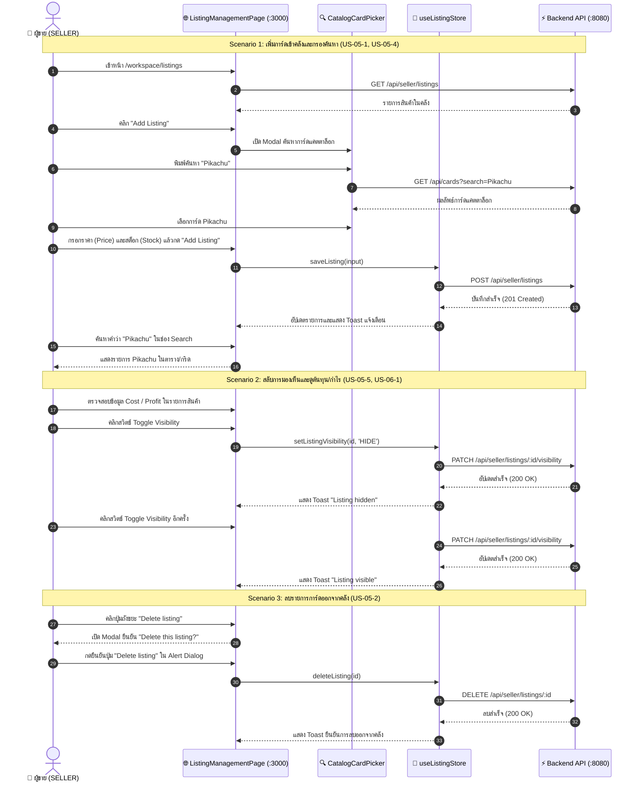

# 📦 คู่มือการทดสอบ E2E: Seller Inventory Management & Metrics (US-05 & US-06)

> **อ้างอิง Spec File:** [`tcg-store-frontend/cypress/e2e/09_seller_inventory_management.cy.ts`](file:///c:/Devops/tcg-store-frontend/cypress/e2e/09_seller_inventory_management.cy.ts)  
> **NPM Script:** `npm run test:e2e:seller-inventory`  
> **หมวดหมู่:** `CI_CD / E2E / 03_Cart_and_Inventory`  
> **User Stories:**  
> - **US-05-1:** การเพิ่มสินค้า/การ์ดใหม่เข้าสู่คลังสินค้าของผู้ขาย (Add New Listing)  
> - **US-05-2:** การลบรายการการ์ดออกจากคลังสินค้าพร้อมกล่องยืนยัน (Delete Listing Dialog)  
> - **US-05-4:** การค้นหาและกรองรายการสินค้าในคลังตามคำค้นหา (Inventory Filter & Search)  
> - **US-05-5:** การเปิด/ปิดการมองเห็นรายการการ์ดในระบบ (Toggle Listing Visibility SHOW/HIDE)  
> - **US-06-1:** การแสดงข้อมูลตัวชี้วัดต้นทุนและกำไรจากการขาย (Cost & Profit Metrics)  

---

## 📌 1. วัตถุประสงค์ (Objective)

ทดสอบระบบจัดการคลังสินค้าการ์ดของผู้ขาย (Seller Inventory Management) บนหน้า `/workspace/listings`:
1. **การเพิ่มการ์ดลงคลังสินค้า (US-05-1, US-05-4):**
   - ผู้ขายเข้าสู่ระบบด้วยสิทธิ์ผู้ขาย (`SELLER`)
   - เปิด Modal เพิ่มรายการการ์ด ("Add Listing") และค้นหาการ์ดจากแคตตาล็อกฐานข้อมูลกลาง (`CatalogCardPicker`)
   - ระบุราคาขาย (Price) และจำนวนสต็อก (Stock) แล้วบันทึก
   - มี Toast แจ้งเตือนความสำเร็จและแสดงรายการการ์ดในคลัง
   - รองรับการกรองรายการการ์ดด้วยคำค้นหา (Search Filter)
2. **การปรับการมองเห็นและตัวชี้วัดกำไร (US-05-5, US-06-1):**
   - ตรวจสอบการแสดงผลคอลัมน์/ข้อมูลต้นทุน (Cost) และกำไร (Profit)
   - สลับสถานะเปิด/ปิดการแสดงผลการ์ดผ่านสวิตช์ Toggle Visibility (`PATCH /api/seller/listings/:id/visibility`)
   - แสดง Toast ยืนยันสถานะ `Listing hidden` หรือ `Listing visible`
3. **การลบรายการการ์ด (US-05-2):**
   - กดปุ่มลบรายการการ์ด (Delete listing)
   - แสดงกล่องข้อความยืนยัน (`Delete this listing?`)
   - กดยืนยันการลบ และตรวจสอบ Toast ยืนยันว่ารายการถูกลบออกจากคลัง

---

## 🔄 2. แผนภาพแสดงสถาปัตยกรรม (Component Interaction Sequence)



---

## 🧪 3. รายละเอียด Test Scenarios (3 Tests Passing)

### 🔹 Suite: US-05 & US-06: Seller Inventory Management and Metrics

| รหัสทดสอบ | User Story | ขั้นตอนการทดสอบ | ผลลัพธ์ที่คาดหวัง |
|---|---|---|---|
| `TC-INVENTORY-01` | US-05-1, US-05-4 | 1. เข้าหน้า `/workspace/listings`<br>2. คลิกปุ่ม `Add Listing`<br>3. ค้นหาการ์ด `Pikachu` ผ่านแคตตาล็อกและเลือกการ์ด<br>4. กรอกราคา 1000 และสต็อก 5 แล้วกดยืนยัน<br>5. ตรวจสอบ Toast ยืนยัน<br>6. ค้นหาคำว่า `Pikachu` ในช่อง Filter | - เปิด Modal สำเร็จ<br>- ค้นหาและเลือกการ์ดจากแคตตาล็อกได้<br>- Toast *"added to your inventory"* ปรากฏ<br>- รายการกรองแสดงเฉพาะการ์ด Pikachu |
| `TC-INVENTORY-02` | US-05-5, US-06-1 | 1. เข้าหน้า `/workspace/listings`<br>2. ตรวจสอบข้อความหรือคอลัมน์ `Cost` / `Profit`<br>3. คลิกสลับสวิตช์แสดงผล (`button[role="switch"]`) ครั้งแรก<br>4. ตรวจสอบ Toast แจ้งสถานะ<br>5. คลิกสลับสวิตช์กลับคืน | - แสดงข้อมูล Cost และ Profit ชัดเจน<br>- ยิง `PATCH /api/seller/listings/:id/visibility`<br>- Toast ยืนยัน *"Listing hidden"* / *"Listing visible"* ปรากฏสมบูรณ์ทั้งสองครั้ง |
| `TC-INVENTORY-03` | US-05-2 | 1. เข้าหน้า `/workspace/listings`<br>2. คลิกปุ่ม `Delete listing` ที่รายการแรก<br>3. ตรวจสอบ Modal ยืนยัน `Delete this listing?`<br>4. กดยืนยันการลบในกล่อง Alert Dialog | - กล่องยืนยันการลบปรากฏ<br>- ยิง `DELETE /api/seller/listings/:id`<br>- Toast ยืนยันการลบสำเร็จปรากฏ |

---

## 💻 4. คำสั่งในการรันการทดสอบ (Execution Commands)

```bash
# รันเฉพาะชุดทดสอบ Seller Inventory E2E ผ่าน NPM Script
npm run test:e2e:seller-inventory

# หรือรันผ่าน Cypress run เจาะจงไฟล์
npx cypress run --spec "cypress/e2e/09_seller_inventory_management.cy.ts"
```
