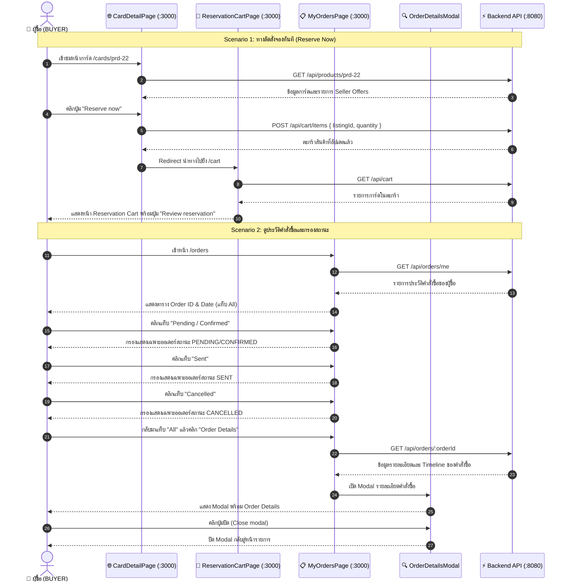

# 📦 คู่มือการทดสอบ E2E: Buyer Order History, Direct Buy & Filtering (US-04-2 & US-09)

> **อ้างอิง Spec File:** [`tcg-store-frontend/cypress/e2e/08_buyer_order_history_and_direct_buy.cy.ts`](file:///c:/Devops/tcg-store-frontend/cypress/e2e/08_buyer_order_history_and_direct_buy.cy.ts)  
> **NPM Script:** `npm run test:e2e:buyer-orders`  
> **หมวดหมู่:** `CI_CD / E2E / 04_Order_Fulfillment_Lifecycle`  
> **User Stories:**  
> - **US-04-2:** ทางลัดการสั่งซื้อการ์ดทันที (Place Order Directly / Reserve Now Shortcut)  
> - **US-09-1:** การตรวจสอบประวัติคำสั่งซื้อและการจองของผู้ซื้อ (Buyer Order History บนหน้า `/orders`)  
> - **US-09-2:** การกรองสถานะคำสั่งซื้อและการเปิดดูรายละเอียดคำสั่งซื้อ (Filter Orders & View Order Details Modal)  

---

## 📌 1. วัตถุประสงค์ (Objective)

ทดสอบประสบการณ์ของผู้ซื้อ (Buyer Experience) ตั้งแต่การใช้ทางลัดจองสินค้าทันทีไปจนถึงการตรวจสอบและกรองประวัติคำสั่งซื้อ:
1. **ทางลัด Reserve Now (US-04-2):**
   - ผู้ซื้อที่เข้าสู่ระบบเข้าชมหน้ารายละเอียดการ์ด (`/cards/prd-22`)
   - ในส่วนข้อเสนอของผู้ขาย (Seller offers) กดปุ่ม "Reserve now"
   - ระบบเพิ่มสินค้าลงตะกร้าพร้อมนำทาง (Redirect) ไปยังหน้าตะกร้าสินค้า (`/cart`) อัตโนมัติ
   - แสดงรายการสินค้าในตะกร้าและปุ่ม "Review reservation" เพื่อดำเนินการสั่งซื้อต่อไป
2. **การดูประวัติและกรองสถานะคำสั่งซื้อ (US-09-1, US-09-2):**
   - เข้าหน้าประวัติคำสั่งซื้อของผู้ซื้อ (`/orders`)
   - ตรวจสอบตารางแสดงรายการคำสั่งซื้อ (`Order ID & Date`, ผู้ขาย, รายการการ์ด, และสถานะ)
   - สลับแท็บตัวกรองสถานะคำสั่งซื้อ:
     - `All` (คำสั่งซื้อทั้งหมด)
     - `Pending / Confirmed` (รอการจัดส่ง)
     - `Sent` (จัดส่งแล้ว)
     - `Cancelled` (ยกเลิกแล้ว)
   - ตรวจสอบสถานะแท็บที่เลือกด้วยคลาสไฮไลต์ (`bg-[#EFA025]`)
   - ทดสอบเปิดกล่องโต้ตอบรายละเอียดคำสั่งซื้อ ("Order Details" Modal) และปิดกล่องโต้ตอบได้อย่างถูกต้อง

---

## 🔄 2. แผนภาพแสดงสถาปัตยกรรม (Component Interaction Sequence)



---

## 🧪 3. รายละเอียด Test Scenarios (2 Tests Passing)

### 🔹 Suite: US-04-2 & US-09: Buyer Order History, Direct Buy, and Filtering

| รหัสทดสอบ | User Story | ขั้นตอนการทดสอบ | ผลลัพธ์ที่คาดหวัง |
|---|---|---|---|
| `TC-DIRECTBUY-01` | US-04-2 | 1. ล้างตะกร้าสินค้าเดิมใน Local Storage<br>2. เข้าชมหน้าการ์ด `/cards/prd-22`<br>3. คลิกปุ่ม `Reserve now` ในส่วน Seller offers<br>4. ตรวจสอบ URL และหน้าตะกร้าสินค้า<br>5. ตรวจสอบปุ่ม Review reservation | - ปุ่ม Reserve now ตอบสนองทันที<br>- Redirect ไปยัง `/cart`<br>- หัวข้อ `Reservation Cart` แสดงผลสมบูรณ์<br>- ลิงก์ `Review reservation` ปรากฏพร้อมคลิกไป Checkout |
| `TC-ORDERHISTORY-01` | US-09-1, US-09-2 | 1. เข้าหน้า `/orders`<br>2. ตรวจสอบหัวข้อ `My Orders` และแถวหัวตาราง `Order ID & Date`<br>3. สลับแท็บตัวกรองไปยัง `Pending / Confirmed`<br>4. สลับแท็บตัวกรองไปยัง `Sent`<br>5. สลับแท็บตัวกรองไปยัง `Cancelled`<br>6. สลับกลับมาแท็บ `All`<br>7. คลิกเปิด `Order Details` Modal<br>8. ตรวจสอบเนื้อหา Modal และคลิกปุ่มปิด | - รายการคำสั่งซื้อโหลดถูกต้อง<br>- แท็บที่เลือกเปลี่ยนสีไฮไลต์ `bg-[#EFA025]` ชัดเจน<br>- ตารางกรองรายการตามสถานะถูกต้องในทุกแท็บ<br>- กล่อง `[role="dialog"]` เปิดแสดงรายละเอียดคำสั่งซื้อ<br>- ปิด Modal ได้อย่างราบรื่น |

---

## 💻 4. คำสั่งในการรันการทดสอบ (Execution Commands)

```bash
# รันชุดทดสอบ Buyer Order History & Direct Buy ผ่าน NPM Script
npm run test:e2e:buyer-orders

# หรือรันผ่าน Cypress run เจาะจงไฟล์
npx cypress run --spec "cypress/e2e/08_buyer_order_history_and_direct_buy.cy.ts"
```
