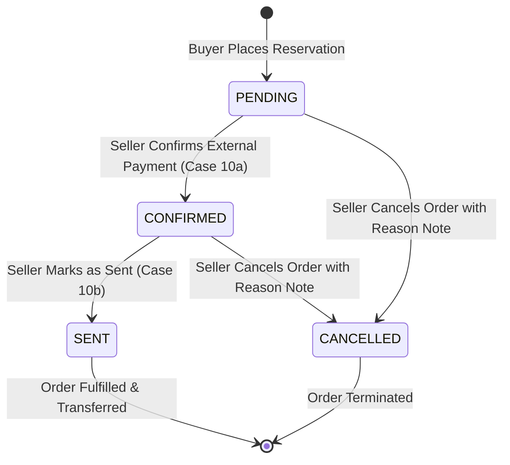

# 📋 คู่มือการทดสอบ E2E: Seller Order Management & Profit Dashboard (US-07-1 & US-07-2)

> **อ้างอิง Spec File:** [`tcg-store-frontend/cypress/e2e/11_seller_order_management.cy.ts`](file:///c:/Devops/tcg-store-frontend/cypress/e2e/11_seller_order_management.cy.ts)  
> **NPM Script:** `npm run test:e2e:seller-orders`  
> **หมวดหมู่:** `CI_CD / E2E / 04_Order_Fulfillment_Lifecycle`  
> **User Stories:**  
> - **US-07-1:** จัดการและตรวจสอบรายการจองสินค้าผ่าน UI ผู้ขาย (`/workspace/orders`)  
> - **US-07-2:** อัปเดตสถานะคำสั่งซื้อการจอง (Confirm Payment, Mark as Sent, Cancel Order)  
> - **US-06-1:** สรุปภาพรวมกำไรและต้นทุน (Profit KPI Summary Cards)

---

## 📌 1. วัตถุประสงค์ (Objective)

ทดสอบการทำงานของระบบจัดการคำสั่งซื้อสำหรับผู้ขาย (Seller Order Management) แบบครบวงจรผ่านหน้าจอ `/workspace/orders` โดยครอบคลุมทั้ง:
1. **Route Protection & Role Guard:** ป้องกันการเข้าถึงหน้าจัดการคำสั่งซื้อของผู้ขายจาก Guest และ Customer ทั่วไป
2. **Profit KPI Summary Cards:** ตรวจสอบการคำนวณและแสดงผลตัวชี้วัดทางการเงิน (Total Revenue, Total Cost, Net Profit, Orders Breakdown)
3. **Orders Table & Condition Labels:** แสดงตารางคำสั่งซื้อพร้อมข้อมูลสินค้า ราคา ต้นทุน กำไร และป้ายสภาพการ์ด (Condition Badge)
4. **Search & Status Tab Filtering:** การค้นหาแบบ Instant Search (Order #, Customer Name, Card Name) และการคัดกรองตามแถบสถานะ (All, Pending, Sent, Cancelled)
5. **Order Details & Customer Contact Modal:** ตรวจสอบการเปิดดูรายละเอียดคำสั่งซื้อ ช่องทางติดต่อผู้ซื้อ (โทรศัพท์, Line ID, Facebook) และประวัติ Timeline Logs
6. **Order Status Transitions (State Machine):**
   - การยืนยันชำระเงิน (`CONFIRMED`) ผ่าน `FeedbackPopup` (Case 10a)
   - การยืนยันส่งสินค้า (`SENT`) ผ่าน `FeedbackPopup` (Case 10b)
   - การยกเลิกคำสั่งซื้อ (`CANCELLED`) พร้อมการระบุเหตุผล (Reason Note) และบันทึกลงใน Timeline Log
7. **Empty State & Data Refresh:** ตรวจสอบกรณีที่ไม่มีรายการคำสั่งซื้อตรงเงื่อนไข และปุ่ม Refresh ข้อมูล

---

## 🔄 2. แผนภาพแสดงสถานะคำสั่งซื้อ (Seller Order State Machine)



---

## 🧪 3. รายละเอียด Test Scenarios (13 Tests Passing)

### 🔹 Suite 1: Route Protection & Role Guards (3 Tests)
- `TC-SELLER-ORD-01`: Guest (ยังไม่ล็อกอิน) พยายามเข้า `/workspace/orders` ➔ ถูก Redirect ไปยัง `/login`
- `TC-SELLER-ORD-02`: Customer ทั่วไป (`isSeller: false`) เข้า `/workspace/orders` ➔ ถูก Redirect ไปยัง `/`
- `TC-SELLER-ORD-03`: ผู้ขายที่ยืนยันตัวตนแล้ว (`isSeller: true`, `sellerStatus: 'VERIFIED'`) เข้า `/workspace/orders` ได้สำเร็จ และแสดง Workspace Layout พร้อมเมนู Reservation orders

### 🔹 Suite 2: Profit KPI Cards & Table Presentation (2 Tests)
- `TC-SELLER-ORD-04`: ตรวจสอบการแสดงผลการ์ดสรุปผลกำไร:
  - Total Sales (Revenue): `฿5,000.00`
  - Total Cost: `฿2,200.00`
  - Net Profit (กำไรสุทธิ): `฿2,800.00`
  - Orders Overview: `4 Total`, `2 Pending`, `1 Sent`, `1 Cancelled`
- `TC-SELLER-ORD-05`: ตรวจสอบหัวตาราง (Order Details, Customer, Items Reserved, Financials, Status, Actions) และข้อมูลแถวการจองพร้อม Condition Badge (`Near Mint`, `Mint`, `Played`)

### 🔹 Suite 3: Search & Status Filtering (2 Tests)
- `TC-SELLER-ORD-06`: คลิกแถบ Filter สถานะ:
  - แถบ **Pending**: แสดง 2 รายการ (`PENDING` และ `CONFIRMED`)
  - แถบ **Sent**: แสดง 1 รายการ (`SENT`)
  - แถบ **Cancelled**: แสดง 1 รายการ (`CANCELLED`)
  - แถบ **All Orders**: แสดงครบทั้ง 4 รายการ
- `TC-SELLER-ORD-07`: ค้นหาใน Search Input:
  - ค้นหาด้วย Order Number (เช่น `ORD-2026-0002`)
  - ค้นหาด้วย Card Name (เช่น `Charizard`)
  - ค้นหาด้วย Customer Name (เช่น `Gary`)

### 🔹 Suite 4: Order Details & Customer Contact Modal (1 Test)
- `TC-SELLER-ORD-08`: คลิกปุ่ม "Order Details":
  - Modal แสดงชื่อลูกค้า เบอร์โทรศัพท์ Line ID และ Facebook
  - แสดงรายการการ์ดพร้อมกำไรสุทธิต่อรายการ
  - แสดงประวัติ Timeline Logs
  - กดปุ่ม "Close" แล้ว Modal ปิดตัวลงอย่างถูกต้อง

### 🔹 Suite 5: Order Status Update Actions (3 Tests)
- `TC-SELLER-ORD-09`: อัปเดตสถานะจาก `PENDING` เป็น `CONFIRMED`
  - คลิกปุ่ม "Confirm Payment"
  - กล่องยืนยัน `FeedbackPopup` แสดงคำถามยืนยันการรับเงิน
  - คลิกยืนยัน ➔ สถานะเปลี่ยนเป็น Confirmed และปุ่ม Action เปลี่ยนเป็น "Mark as Sent"
- `TC-SELLER-ORD-10`: อัปเดตสถานะจาก `CONFIRMED` เป็น `SENT`
  - คลิกปุ่ม "Mark as Sent"
  - กล่องยืนยัน `FeedbackPopup` แสดงคำเตือนการโอนย้ายการ์ด
  - คลิกยืนยัน ➔ สถานะเปลี่ยนเป็น Sent
- `TC-SELLER-ORD-11`: ยกเลิกคำสั่งซื้อพร้อมเหตุผล (`CANCELLED`)
  - คลิกปุ่ม "Cancel Order"
  - Modal ขอให้ระบุเหตุผล (ปุ่ม Cancel Order ปิดใช้งานจนกว่าจะพิมพ์เหตุผล)
  - พิมพ์เหตุผลและกดยืนยัน ➔ สถานะเปลี่ยนเป็น Cancelled
  - เปิด Order Details ตรวจสอบว่าบันทึกเหตุผลลงใน Order Timeline

### 🔹 Suite 6: Empty State & Refresh Handling (2 Tests)
- `TC-SELLER-ORD-12`: แสดง Empty State ข้อความ "No orders found matching criteria" เมื่อไม่มีคำสั่งซื้อ
- `TC-SELLER-ORD-13`: กดปุ่ม Refresh แล้วหน้าเว็บสามารถโหลดข้อมูลใหม่ได้อย่างถูกต้อง

---

## 💻 4. คำสั่งในการรันการทดสอบ (Execution Command)

```bash
# รันเฉพาะชุดทดสอบ Seller Order Management E2E แบบ Headless
npm run test:e2e:seller-orders

# หรือรันผ่าน npx cypress run เจาะจงไฟล์
npx cypress run --spec "cypress/e2e/11_seller_order_management.cy.ts"
```
