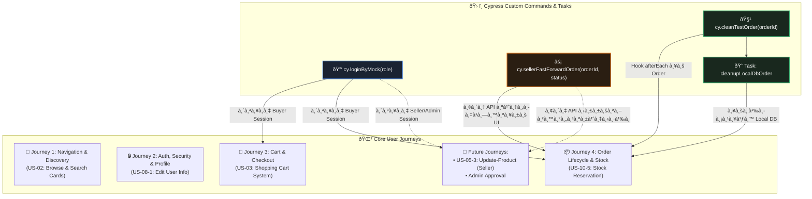

# 🧩 แผนผังความสัมพันธ์ Custom Commands กับ Core User Journeys (Commands Matrix)

> **ไฟล์ต้นทาง:** [`Code_devops/tcg-store-frontend/cypress/support/commands.ts`](file:///c:/Devops_NEW/Code_devops/tcg-store-frontend/cypress/support/commands.ts)  
> **หมวดหมู่:** `CI_CD / E2E / Custom Commands Reference`  
> **วัตถุประสงค์:** แสดงการจับคู่ (Mapping) ระหว่างคำสั่งเสริมของ Cypress กับแต่ละ User Journey ที่เรียกใช้งาน

---

## 📊 1. ตารางความสัมพันธ์หลัก (Commands-to-Journeys Matrix)

| คำสั่ง Custom Command | พารามิเตอร์ที่รับ | วัตถุประสงค์การทำงาน | Core User Journeys ที่ใช้งานปัจจุบัน | รองรับ Use Cases ในอนาคต |
| :--- | :--- | :--- | :--- | :--- |
| **`cy.loginByMock()`** | `role?: 'CUSTOMER' \| 'SELLER' \| 'ADMIN'` | จำลอง Authentication State ลงใน `localStorage` (`token` และ `tcg_auth_storage`) โดยไม่ต้องพิมพ์ฟอร์มล็อกอิน | 🔹 **Journey 3** (Cart & Inventory)<br>🔹 **Journey 4** (Order Lifecycle) | • จัดการร้านค้าผู้ขาย (Seller Workspace)<br>• อนุมัติ KYC ผู้ขาย (Admin Dashboard)<br>• คอลเลกชันส่วนตัว (My Collection) |
| **`cy.loginByUI()`** | `email: string`, `password?: string` | กรอกฟอร์มล็อกอินจริงผ่านหน้าจอเบราว์เซอร์ (`#email`, `#password`) แล้วกด Submit | 🔹 **Journey 2** (Flow 2.1 Login) | • การทดสอบ UI Login End-to-End |
| **`cy.registerNewUser()`** | `name, email, password` | กรอกฟอร์มสมัครสมาชิกใหม่ครบ 4 ช่องที่หน้า `/register` แล้วกด Submit | 🔹 **Journey 2** (Flow 2.2 Sign-Up) | • Onboarding Tour ผู้ใช้ใหม่ |
| **`cy.requestPasswordReset()`**| `email: string` | กรอกอีเมลที่หน้า `/forgot-password` เพื่อขอลิงก์รีเซ็ตรหัสผ่าน | 🔹 **Journey 2** (Flow 2.3 Reset Password) | • กู้คืนบัญชีผู้ใช้ |
| **`cy.updateProfileName()`** | `name: string` | เข้าหน้า `/profile/edit` เปลี่ยนชื่อและกดบันทึก | 🔹 **Journey 2** (Flow 2.4 Profile) | • การเปลี่ยนชื่อผู้ใช้งาน |
| **`cy.updateProfileContact()`** | `{ phone, line, facebook }` | เข้าหน้า `/profile/edit/contact` อัปเดตช่องทางติดต่อและกดบันทึก | 🔹 **Journey 2** (Flow 2.4 Contact) | • ข้อมูลติดต่อสำหรับผู้ซื้อ/ผู้ขาย |
| **`cy.sellerFastForwardOrder()`** | `orderId: string`, `status?: string` | **API Fast-Forward:** ส่งคำขอ HTTP ตรงไปยัง Backend ด้วย JWT ของผู้ขายเพื่อเปลี่ยนสถานะ Order ทันที (50ms) | 🔹 **Journey 4** (Order Lifecycle) | • ผู้ขายกรอกเลขพัสดุ (Tracking Number Flow)<br>• ผู้ขายปฏิเสธ/ยกเลิกคำสั่งซื้อ (Seller Cancellation)<br>• ตรวจสอบการหักค่าธรรมเนียม Tier ผู้ขาย |
| **`cy.cleanTestOrder()`** | `orderId: string \| number` | **Data Teardown:** ล้างข้อมูล Order และ Order Items ที่สร้างขึ้นออกจาก Local PostgreSQL เพื่อไม่ให้มีขยะสะสม | 🔹 **Journey 4** (Order Lifecycle) | • ทุก Test Journey ที่มีการสร้างคำสั่งซื้อจริง (Checkout & Payment)<br>• การทดสอบ Concurrency สั่งซื้อการ์ดพร้อมกัน |
| **`cleanupLocalDbOrder`** *(Cypress Node Task)* | `orderId: string \| number` | รันคำสั่ง SQL `DELETE` ผ่าน `docker exec tcg_postgres psql` เพื่อลบระเบียนในฐานข้อมูล Local | 🔹 **Journey 4** (เรียกผ่าน `cy.cleanTestOrder`) | • ใช้คู่กับ `cy.cleanTestOrder` ในระดับระบบปฏิบัติการ |

---

## 🔍 2. เจาะลึกรายละเอียดคำสั่งและการเชื่อมโยงในแต่ละ Journey



---

### 🔹 2.1 `cy.loginByMock(role)`
* **Journey ที่ใช้:** 
  * [`03_cart_and_checkout_flow.cy.ts`](file:///c:/Devops_NEW/Code_devops/tcg-store-frontend/cypress/e2e/03_cart_and_checkout_flow.cy.ts)
  * [`04_order_fastforward_lifecycle.cy.ts`](file:///c:/Devops_NEW/Code_devops/tcg-store-frontend/cypress/e2e/04_order_fastforward_lifecycle.cy.ts)
* **ทำไม Journey 1 และ 2 ถึงไม่ใช้?**
  * **Journey 1 (Navigation):** มุ่งเน้นทดสอบ Guest ที่ยังไม่ได้เข้าสู่ระบบ
  * **Journey 2 (Auth):** มุ่งเน้นทดสอบตัวแบบฟอร์มล็อกอินจริง (`/login`) และการทำงานของ `ProtectedRoute` เมื่อไม่มี Token จึงต้องปล่อย Storage ให้ว่างเปล่า
* **รูปแบบการนำไปใช้ในโค้ด:**
  ```typescript
  beforeEach(() => {
    // กำหนด Session ผู้ซื้อก่อนเข้าหน้า Cart
    cy.loginByMock('CUSTOMER');
    cy.visit('/cart');
  });
  ```

---

### 🔹 2.2 `cy.sellerFastForwardOrder(orderId, status)`
* **Journey ที่ใช้:**
  * [`04_order_fastforward_lifecycle.cy.ts`](file:///c:/Devops_NEW/Code_devops/tcg-store-frontend/cypress/e2e/04_order_fastforward_lifecycle.cy.ts)
* **เหตุผลทางสถาปัตยกรรม:**
  * การสลับผู้ใช้บนเบราว์เซอร์ไปมา (Buyer ➔ Seller ➔ Buyer) มี Overhead ด้านเวลาสูงมาก (~30-40 วินาที)
  * คำสั่งนี้เปลี่ยนกระบวนการฝั่งผู้ขายให้กลายเป็นคำขอ **HTTP Request ตรงไปที่ API Backend** โดยใช้เวลาเพียง ~50ms ทำให้เทสรันได้เร็วและเสถียร ไม่หลุด Flaky
* **รูปแบบการนำไปใช้ในโค้ด:**
  ```typescript
  // ดักจับ orderId จาก URL แล้วสั่งให้ผู้ขายยืนยันการส่งของทันที
  cy.sellerFastForwardOrder(createdOrderId, 'FULFILLED');
  ```

---

### 🔹 2.3 `cy.cleanTestOrder(orderId)` & `cleanupLocalDbOrder` (Node Task)
* **Journey ที่ใช้:**
  * [`04_order_fastforward_lifecycle.cy.ts`](file:///c:/Devops_NEW/Code_devops/tcg-store-frontend/cypress/e2e/04_order_fastforward_lifecycle.cy.ts)
* **เหตุผลทางสถาปัตยกรรม:**
  * ทุกครั้งที่ทดสอบการสั่งซื้อ ข้อมูลจะถูกบันทึกลงในตาราง `orders` และ `order_items` ของ Local PostgreSQL จริง
  * หากไม่ลบออก ข้อมูลจะสะสมจนเต็ม และสต็อกของการ์ดจะลดลงเรื่อยๆ จนเกิดข้อผิดพลาด "Out of Stock" ในรอบถัดไป
  * คำสั่งนี้จะทำงานใน Hook `afterEach()` เพื่อรับประกันว่าไม่ว่าจะเทสผ่านหรือเทสตก ข้อมูลทดสอบจะถูกล้างทิ้ง 100%
* **รูปแบบการนำไปใช้ในโค้ด:**
  ```typescript
  afterEach(() => {
    if (createdOrderId) {
      cy.cleanTestOrder(createdOrderId);
    }
  });
  ```

---

## 🔮 3. แนวทางการเพิ่ม Custom Commands สำหรับ Use Cases ใหม่

เมื่อมี Use Case ใน Sprint 4 เพิ่มเติม ให้ปฏิบัติตามมาตรฐานโครงสร้างนี้:

1. **เพิ่ม Implementation ใน [`commands.ts`](file:///c:/Devops_NEW/Code_devops/tcg-store-frontend/cypress/support/commands.ts):**
   ```typescript
   Cypress.Commands.add('sellerAddTrackingNumber', (orderId: string, trackingNo: string) => {
     // ยิง API หรือกรอกฟอร์มเลขพัสดุ
   });
   ```
2. **ประกาศ TypeScript Interface Declaration:**
   ```typescript
   declare global {
     namespace Cypress {
       interface Chainable {
         sellerAddTrackingNumber(orderId: string, trackingNo: string): Chainable<void>;
       }
     }
   }
   ```
3. **อัปเดตลงในตาราง Commands Matrix ในเอกสารนี้เสมอ**

### 🔹 2.4 `cy.loginAsAdmin()`
* **Journey ที่ใช้:**
  * Journey 5 (Admin Platform)
* **เหตุผลทางสถาปัตยกรรม:**
  * ใช้สำหรับ Login เข้าระบบผ่าน UI ด้วยสิทธิ์ ADMIN เพื่อทดสอบฟีเจอร์ของ Platform Admin (US-11-1, US-11-2, US-11-3)

