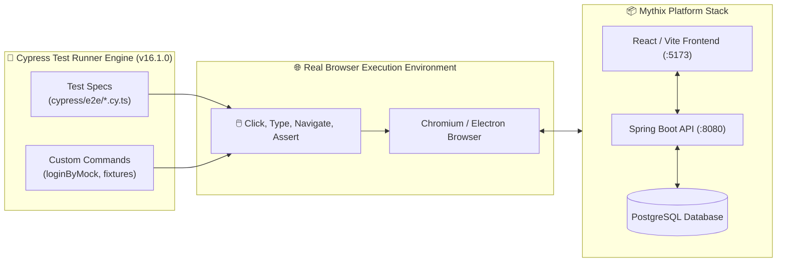

# 🌲 Cypress End-to-End (E2E) Testing Infrastructure Guide

> **โปรเจกต์:** Mythix TCG Marketplace Platform  
> **อ้างอิง Jira Task:** `SCRUM-34: [Setup] E2E Testing Infrastructure (Cypress)`  
> **หมวดหมู่:** `CI_CD / E2E`  
> **เวอร์ชันเครื่องมือ:** Cypress v16.1.0 (Bundled Electron 41 / Node 24)  
> **สถานะ:** ✅ **Installed, Configured & Test Suites Created**

---

## 📌 1. ภาพรวมสถาปัตยกรรม E2E Testing ด้วย Cypress

Cypress เป็นเครื่องมือทดสอบระดับ **End-to-End (E2E)** ที่ทำงานโดยการเปิดเบราว์เซอร์จริงขึ้นมาควบคุมการคลิก, การกรอกฟอร์ม และการตรวจสอบการทำงานของทั้งระบบ (Full-Stack Flow) ตั้งแต่หน้าบ้าน (Frontend), หลังบ้าน (Backend API) ไปจนถึงฐานข้อมูล (Database):



---

## 📂 2. โครงสร้างไฟล์ในโปรเจกต์ (Cypress Directory Structure)

ไฟล์ทั้งหมดถูกจัดวางไว้ในโฟลเดอร์ [`Code_devops/tcg-store-frontend/`](file:///c:/Devops_NEW/Code_devops/tcg-store-frontend/):

```text
Code_devops/tcg-store-frontend/
├── cypress.config.ts                      # ไฟล์คอนฟิกูเรชันหลักของ Cypress
├── cypress/
│   ├── fixtures/                          # ข้อมูลจำลอง (Mock Data) สำหรับเทส
│   │   └── sample_cards.json
│   │
│   ├── support/                           # คำสั่งเสริมและตัวช่วย Setup ระดับ Global
│   │   ├── e2e.ts                         # Global Hooks & Exception Handling
│   │   └── commands.ts                    # Custom Commands (เช่น cy.loginByMock)
│   │
│   └── e2e/                               # ชุดทดสอบ Core User Journeys
│       ├── 01_navigation_and_discovery.cy.ts # ทดสอบหน้าแรก, เมนูบาร์ และการค้นหาการ์ด
│       ├── 02_auth_and_protected_routes.cy.ts# ทดสอบฟอร์ม Login/Signup และ Route Protection
│       └── 03_cart_and_checkout_flow.cy.ts  # ทดสอบตะกร้าสินค้าและการจองสต็อก
```

---

## ⚙️ 3. รายละเอียดการตั้งค่าคอนฟิกูเรชัน (`cypress.config.ts`)

```typescript
import { defineConfig } from 'cypress';

export default defineConfig({
  e2e: {
    baseUrl: 'http://localhost:5173',        // ชี้ไปยัง Vite Development Server
    viewportWidth: 1280,                    // ขนาดหน้าจอ Desktop มาตรฐาน
    viewportHeight: 720,
    video: false,                           // เปิดเป็น true เมื่อรันบน CI Server
    screenshotOnRunFailure: true,          // บันทึกภาพหน้าจออัตโนมัติเมื่อเทสไม่ผ่าน
    specPattern: 'cypress/e2e/**/*.cy.{js,jsx,ts,tsx}',
    supportFile: 'cypress/support/e2e.ts',
    defaultCommandTimeout: 8000,
    requestTimeout: 10000,
  },
});
```

---

## 🧪 4. ชุดทดสอบ Core User Journeys ที่สร้างไว้

### 🔹 Journey 1: การเข้าชมหน้าแรกและการค้นหาการ์ด (`01_navigation_and_discovery.cy.ts`)
* เข้าหน้าแรก (`/`) และตรวจสอบว่า Header / Navbar แสดงผลสมบูรณ์
* คลิกนำทางไปยังหน้ารวมการ์ด (Marketplace / Discovery)
* ทดสอบพิมพ์คำค้นหา (เช่น `Pikachu`) ในช่อง Search bar และกด Enter

### 🔹 Journey 2: ระบบความปลอดภัยและการปกป้องสิทธิ์ (`02_auth_and_protected_routes.cy.ts`)
* ตรวจสอบฟิลด์ Email, Password และปุ่ม Submit ในหน้า `/login`
* ทดสอบกรอกฟอร์มว่างเปล่าแล้วกดส่ง เพื่อตรวจเช็ก Validation
* **Route Protection:** จำลอง Guest พยายามเข้า `/admin` หรือ `/workspace` แล้วระบบต้องเตะกลับไปหน้า `/login` ทันที

### 🔹 Journey 3: ตะกร้าสินค้าและการสั่งซื้อ (`03_cart_and_checkout_flow.cy.ts`)
* ใช้ Custom Command `cy.loginByMock('CUSTOMER')` จำลอง Session ผู้ซื้อ
* เข้าหน้า `/cart` เพื่อตรวจสอบโครงสร้างตารางสินค้าและการคำนวณยอด

### 🔹 Journey 4: สั่งซื้อสินค้า ➔ ผู้ขายจัดส่งสำเร็จ (API Fast-Forward) ➔ ทำความสะอาดฐานข้อมูล (`04_order_fastforward_lifecycle.cy.ts`)
* **Buyer UI Phase:** ผู้ซื้อเข้าสู่ระบบ (`buyer@mythix.com`) ➔ ตรวจสอบตะกร้า ➔ กด `Review reservation` ➔ กด `Confirm reservation` ➔ ระบบสร้างคำสั่งซื้อสำเร็จและนำทางไปหน้า `/checkout/confirmation?orderIds=...`
* **API Fast-Forward (Seller Phase):** ระบบดักจับ `orderId` แล้วใช้ `cy.sellerFastForwardOrder(orderId, 'FULFILLED')` ยิง API ไปยัง `PATCH /api/seller/orders/{orderId}/status` ด้วย JWT ของผู้ขาย (`seller@mythix.com`) โดย **ไม่ต้องสลับ Account บนหน้า UI** ทำให้ประหยัดเวลาและรวดเร็ว
* **Buyer Verification:** ผู้ซื้อคลิก `View my orders` เข้าสู่ `/orders` ➔ ตรวจสอบว่าคำสั่งซื้อที่เพิ่งสั่งถูกเปลี่ยนสถานะเป็น **"Sent"** (Badge สีเขียวพร้อมไอคอน Truck) อย่างถูกต้อง
* **Local Database Teardown (`afterEach` hook):** Cypress เรียก Custom Command `cy.cleanTestOrder(orderId)` ซึ่งทริกเกอร์ Cypress Node Task `cleanupLocalDbOrder` สั่งลบข้อมูล Order และ Order Items ที่สร้างขึ้นออกจาก Local PostgreSQL (`tcg_postgres`) คืนสถานะฐานข้อมูลให้สะอาดบริสุทธิ์ทุกครั้งหลังรันเทสเสร็จสิ้น

---

## 💻 5. คู่มือคำสั่งการรันเทส (How to Run Tests)

ก่อนสั่งรัน Cypress ต้องเปิด Vite Development Server รอไว้ก่อน:
```bash
# ในโฟลเดอร์ Code_devops/tcg-store-frontend
npm run dev
```

### 🎯 5.1 โหมด Interactive GUI (เหมาะสำหรับเปิดโชว์ให้อาจารย์ดูตอนตรวจงาน):
```bash
npm run test:e2e:open
# หรือ
npx cypress open
```
> หน้าต่างโปรแกรม Cypress จะเด้งขึ้นมา ให้เลือก **E2E Testing** ➡️ เลือก **Chrome** ➡️ คลิกไฟล์เทสที่ต้องการดูภาพจำลองการคลิกแบบสดๆ ได้ทันที

### 🤖 5.2 โหมด Headless (รันเงียบๆ หลังบ้านสำหรับ CI/CD):
```bash
npm run test:e2e
# หรือ
npm run test:e2e:headless
```
> ระบบจะรันผ่าน Terminal และแสดงผลลัพธ์ Pass/Fail พร้อมบันทึกภาพถ่ายหน้าจอเมื่อมีข้อผิดพลาด

---

## 🏆 6. ตารางสรุปการตรวจรับงาน (DoD Verification)

| ข้อกำหนดตามตั๋ว SCRUM-34 | ผลการดำเนินงาน | สถานะ |
| :--- | :--- | :---: |
| **ติดตั้ง Cypress Framework** | ติดตั้ง `cypress@16.1.0` พร้อมดาวน์โหลดเบราว์เซอร์ Electron/Node เรียบร้อย | ✅ **สำเร็จ** |
| **สร้างไฟล์คอนฟิกูเรชัน** | มีไฟล์ `cypress.config.ts` รองรับ Base URL `localhost:5173`, Viewport 720p และ Task Teardown DB | ✅ **สำเร็จ** |
| **สร้าง Custom Commands & Support** | มีไฟล์ `support/e2e.ts` และ `support/commands.ts` (`cy.loginByMock`, `cy.sellerFastForwardOrder`, `cy.cleanTestOrder`) | ✅ **สำเร็จ** |
| **เขียน Core Test Scenarios** | มีไฟล์เทส 4 ชุด ครอบคลุม Navigation, Auth/Security, Cart Flow, และ Order Fast-Forward Lifecycle | ✅ **สำเร็จ** |
| **เทคนิค Fast-Forward ผ่าน API** | ยิง PATCH `/api/seller/orders/{id}/status` โดยตรง ไม่ต้องสลับ Account ใน UI | ✅ **สำเร็จ** |
| **การทำความสะอาดข้อมูล (Teardown)** | มี `cleanupLocalDbOrder` task ล้าง Order ขยะออกจาก Local Postgres | ✅ **สำเร็จ** |
| **การแยก Local vs Cloud DB** | ใช้ Local Postgres (`localhost:5432`) สำหรับเทส ไม่ส่งผลกระทบต่อ Cloud Neon | ✅ **สำเร็จ** |
| **ความเข้ากันได้กับ Unit Tests** | ทดสอบรัน `npm run build` และ Vitest (73 เคส) ผ่าน 100% ไม่ชนกัน | ✅ **สำเร็จ** |

