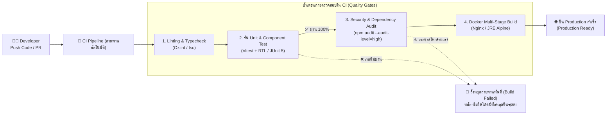

# 🚀 CI/CD & DevOps Documentation Portal

โฟลเดอร์นี้รวบรวมเอกสารคู่มือและรายงานทางเทคนิคสำหรับกระบวนการ **CI/CD Pipeline, Automated Quality Gates, และ DevOps Infrastructure** ของแพลตฟอร์ม Mythix TCG โดยแบ่งออกเป็น 3 หมวดหมู่หลักตามโครงสร้างการทำงาน:

---

## 🔄 ภาพรวมกระบวนการ: จาก Unit Test สู่ Production (Flow Overview)

แผนภาพแสดงความสัมพันธ์ระหว่าง **Developer**, **ด่านตรวจคุณภาพ (Quality Gates)** และ **สายพานการส่งมอบอัตโนมัติ (CI/CD Pipeline)** ตั้งแต่การส่งโค้ดจนกระทั่งขึ้นสู่ระบบจริง:



### 💡 คำอธิบายขั้นตอนในสายพาน (Pipeline Stages Breakdown):
1. **👨‍💻 Push Code / PR:** เมื่อนักพัฒนาส่งโค้ดใหม่เข้ามายัง Repository ระบบ Webhook จะปลุกระบบ CI (Jenkins หรือ GitHub Actions) ขึ้นมาทำงานโดยอัตโนมัติ
2. **1. Linting & Typecheck:** ตรวจสอบความถูกต้องของไวยากรณ์ (Syntax) และ Type Safety ด้วย TypeScript และ Oxlint
3. **2. รัน Unit & Component Test (ด่านตรวจหัวใจสำคัญ):**
   * ระบบสั่งรันชุดทดสอบอัตโนมัติทั้ง Frontend (24 ไฟล์ 71 เคส) และ Backend Service Tests
   * **กรณีเทสไม่ผ่าน:** ระบบจะตัดการทำงาน (Abort) และแจ้งเตือนทันที โค้ดจะไม่ถูกส่งต่อไปยังขั้นตอนถัดไป
4. **3. Security & Dependency Audit:** ตรวจสอบช่องโหว่ความปลอดภัยของ Third-Party Libraries ด้วย `npm audit` และสแกนหา Secret หลุด
5. **4. Docker Multi-Stage Build:** ประกอบร่าง Production Image ขนาดเล็กกระทัดรัด (Alpine Linux) พร้อมตรวจสอบ `docker compose config`
6. **🌐 ขึ้น Production สำเร็จ:** เมื่อผ่านครบทุกด่านอย่างสมบูรณ์ โค้ดจึงจะได้รับอนุญาตให้ Deploy ขึ้นสู่เซิร์ฟเวอร์จริงได้อย่างมั่นใจ 100%

---

## 📂 โครงสร้างโฟลเดอร์ (Directory Hierarchy)

```
docs/CI_CD/
├── 🧪 Unitest/
│   ├── frontend_unit_and_component_tests.md    # คู่มือและรายงาน Vitest + React Testing Library (71 Tests Passed)
│   └── sprint1_backend_unit_tests.md           # คู่มือและรายงาน JUnit 5 + Mockito Service Layer Tests
│
├── 🛡️ Security Audit/
│   └── security_and_dependency_audit_guide.md  # คู่มือ npm audit, Dependabot, Trivy & Security Gates
│
├── 🐳 DockerBuild/
│   └── docker_build_and_containerization_guide.md # คู่มือ Multi-stage Dockerfile & Docker Compose Full-Stack
│
├── ci_cd_pipelines_overview.md                 # ภาพรวมสถาปัตยกรรม CI/CD ทั้งระบบ (GitHub Actions + Jenkins)
├── jenkins_cicd_comprehensive_guide.md         # คู่มือ Jenkins Orchestration & Declarative Pipelines
└── ci_cd_quality_gates_report.md               # รายงานการตรวจรับงาน Quality Gates
```

---

## 📑 สรุปรายละเอียดแต่ละหมวดหมู่

### 1. 🧪 `/Unitest`
* [Frontend Unit & Component Testing Guide](./Unitest/frontend_unit_and_component_tests.md): อธิบายระบบการทดสอบฝั่ง Frontend ด้วย Vitest v4.1 และ React Testing Library ครบทั้ง 24 ไฟล์ 71 เคส (เจาะลึก 5 Pillars of Testing Infrastructure)
* [Backend Unit Testing Guide](./Unitest/sprint1_backend_unit_tests.md): อธิบายระบบการทดสอบฝั่ง Backend Service Layer ด้วย JUnit 5 และ Mockito

### 2. 🛡️ `/Security Audit`
* [Security & Dependency Audit Guide](./Security%20Audit/security_and_dependency_audit_guide.md): อธิบายกลยุทธ์ป้องกันช่องโหว่ซัพพลายเชน 4 เลเยอร์ (npm audit `--audit-level=high`, Dependabot weekly PRs, Gitleaks, และ Trivy Scanner)

### 3. 🐳 `/DockerBuild`
* [Docker Build & Containerization Guide](./DockerBuild/docker_build_and_containerization_guide.md): อธิบายสถาปัตยกรรม Multi-Stage Build ของ Frontend (Nginx Alpine) และ Backend (Eclipse Temurin JRE 21 Non-root) พร้อมการตรวจสอบผ่าน `docker compose config`

---

## 🌐 เอกสารภาพรวมในระดับ Root CI_CD
* [CI/CD Pipelines Overview](./ci_cd_pipelines_overview.md)
* [Jenkins CI/CD Comprehensive Guide](./jenkins_cicd_comprehensive_guide.md)
* [CI/CD Quality Gates Report](./ci_cd_quality_gates_report.md)
