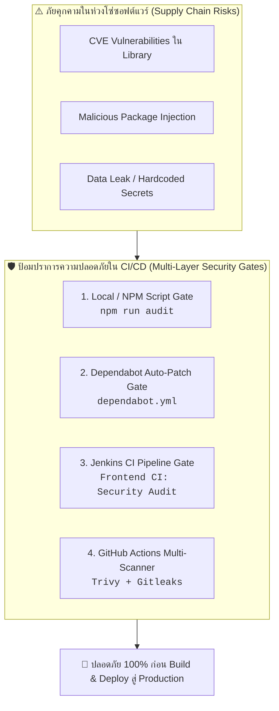

# 🛡️ Security & Dependency Audit in CI Pipeline Guide

> **โปรเจกต์:** Mythix TCG Marketplace Platform  
> **อ้างอิง Jira Task:** `SCRUM-33: [Setup] Security & Dependency Audit in CI`  
> **สถานะการติดตั้ง:** ✅ **Implemented & Verified** (0 Vulnerabilities Found)  
> **เครื่องมือหลัก:** `npm audit`, GitHub Dependabot, Jenkins Pipeline, Trivy & Gitleaks

---

## 📌 1. ภาพรวมและเหตุผลความจำเป็น (Security Context)

ในการพัฒนาเว็บแอปพลิเคชันยุคใหม่ (Modern Web Application) โค้ดส่วนใหญ่กว่า 70-80% ของโปรเจกต์ไม่ได้เขียนขึ้นเองทั้งหมด แต่มาจากการพึ่งพา **Third-Party Libraries (Dependencies)** ใน `package.json` เช่น `axios`, `react-router-dom`, `zustand`, `tailwindcss` ฯลฯ



### ทำไมต้องมี Security Audit ใน CI?
1. **ป้องกัน CVEs ระดับโลก:** ป้องกันช่องโหว่ความปลอดภัย เช่น Remote Code Execution (RCE), Prototype Pollution, Cross-Site Scripting (XSS), และ Denial of Service (DoS)
2. **ห้ามนำโค้ดเสี่ยงขึ้น Production โดยเด็ดขาด:** หากพบช่องโหว่ร้ายแรง ระบบ CI จะต้อง **สั่ง Fail Build ทันที (Quality Gate)** เพื่อบล็อกไม่ให้เกิดการสร้าง Docker Image
3. **ลดหนี้ทางเทคนิคด้านความปลอดภัย (Security Debt):** ตรวจจับและอัปเดตแพ็กเกจเป็นเวอร์ชันล่าสุดที่มีการ Patch แก้บั๊กอยู่เสมอ

---

## ⚙️ 2. สถาปัตยกรรมและสิ่งที่ได้ติดตั้งไป (Implementation Architecture)

ระบบ Security Audit ในโปรเจกต์นี้ถูกออกแบบเป็น **4 เลเยอร์ความปลอดภัย (4 Defense Layers)**:

### 🔹 เลเยอร์ที่ 1: Package-level Script (`package.json`)
เพิ่มคำสั่งตรวจสอบระดับโปรเจกต์ใน [`Code_devops/tcg-store-frontend/package.json`](file:///c:/Devops_NEW/Code_devops/tcg-store-frontend/package.json):

```json
"scripts": {
  "lint": "oxlint",
  "test": "vitest run",
  "audit": "npm audit --audit-level=high",
  "preview": "vite preview"
}
```

* **ทำไมต้อง `--audit-level=high`?**  
  เพื่อกำหนดเกณฑ์ความเข้มงวดให้ระบบตรวจจับเฉพาะช่องโหว่ระดับ **High** และ **Critical** ที่ส่งผลกระทบต่อความมั่นคงปลอดภัยของระบบจริง โดยอนุญาตให้ระดับ Low/Moderate ผ่านได้ชั่วคราวเพื่อไม่ให้ขัดขวางกระบวนการพัฒนาต่อเนื่อง (Continuous Delivery) แต่ยังคงบล็อกความเสี่ยงร้ายแรงได้อย่างสมบูรณ์

---

### 🔹 เลเยอร์ที่ 2: Jenkins CI Pipeline Integration (`Jenkinsfile`)
นำคำสั่ง Security Audit เข้าไปเป็น **ขั้นตอนบังคับ (Mandatory Stage)** ใน Pipeline:

1. **ใน Root Orchestration Pipeline ([`Jenkinsfile`](file:///c:/Devops_NEW/Jenkinsfile)):**
```groovy
stage('Frontend CI') {
    steps {
        dir('Code_devops/tcg-store-frontend') {
            echo '=== Running Frontend Tests & Typecheck ==='
            sh 'npm ci || npm install'
            sh 'npm run audit'       // <-- ตรวจสอบความปลอดภัย Library (Quality Gate)
            sh 'npm test'            // <-- ตรวจสอบ Unit & Component Tests
            sh 'npm run build'       // <-- Compile Web Bundle
        }
    }
}
```

2. **ใน Frontend Pipeline ([`Code_devops/tcg-store-frontend/Jenkinsfile`](file:///c:/Devops_NEW/Code_devops/tcg-store-frontend/Jenkinsfile)):**
```groovy
stage('Security & Dependency Audit') {
    steps {
        echo '=== Stage: Dependency Vulnerability Audit (npm audit) ==='
        sh 'npm run audit'
    }
}
```
> **พฤติกรรม:** หาก `npm audit` ตรวจพบช่องโหว่ระดับ High/Critical ตัวคำสั่งจะคืนค่า `Exit Code != 0` ทำให้ Jenkins ขึ้นสถานะ **FAILURE (สีแดง)** ทันที

---

### 🔹 เลเยอร์ที่ 3: GitHub Actions CI Workflow (`ci.yml`)
ในไฟล์ [`.github/workflows/ci.yml`](file:///c:/Devops_NEW/Code_devops/tcg-store-frontend/.github/workflows/ci.yml) มีการเสริมเกราะป้องกันแบบอัตโนมัติในทุก PR และ Push:

1. **Step ตรวจสอบ NPM Dependencies:**
   ```yaml
   - name: Run Security & Dependency Audit (npm audit)
     run: npm run audit
   ```
2. **Job ตรวจจับ Secret รั่วไหล (Gitleaks):** ป้องกันการเผลอ Commit API Keys, Token หรือรหัสผ่านลง Git
3. **Job ตรวจสอบช่องโหว่ Filesystem (Aqua Trivy):** สแกนไฟล์โครงสร้างและ Library ในระดับ Filesystem

---

### 🔹 เลเยอร์ที่ 4: ระบบอัปเดตอัตโนมัติ GitHub Dependabot (`dependabot.yml`)
สร้างไฟล์คอนฟิก [`.github/dependabot.yml`](file:///c:/Devops_NEW/Code_devops/tcg-store-frontend/.github/dependabot.yml):

```yaml
version: 2
updates:
  - package-ecosystem: "npm"
    directory: "/"
    schedule:
      interval: "weekly"
    open-pull-requests-limit: 10
    labels:
      - "dependencies"
      - "security"
```
> **การทำงาน:** Dependabot ของ GitHub จะสแกน `package.json` ทุกสัปดาห์ หากพบ Library ตัวใดมี Security Advisory จะทำการเปิด **Pull Request (PR)** อัปเดตเวอร์ชันที่ปลอดภัยให้ทีมกด Merge ได้ทันที

---

## 🧪 3. ผลการรันตรวจสอบจริง (Audit Verification Output)

ผลการทดสอบรันคำสั่งบนเครื่องจริง:

```text
> tcg-store-frontend@0.0.0 audit
> npm audit --audit-level=high

found 0 vulnerabilities
```
* **ผลลัพธ์:** ปัจจุบันระบบ Frontend มีความปลอดภัยสูง **ไม่พบช่องโหว่ (0 vulnerabilities)** พร้อมผ่าน Quality Gate ขึ้นสู่ระบบ Production

---

## 🛠️ 4. คู่มือการแก้ไขเมื่อตรวจพบช่องโหว่ (Developer Remediation Guide)

กรณีที่ในอนาคตมี Dependency ตัวใหม่ถูกประกาศว่ามีช่องโหว่ (Vulnerability Detected) ให้นักพัฒนาปฏิบัติตามขั้นตอนนี้:

### ขั้นตอนที่ 1: ตรวจสอบรายละเอียดของช่องโหว่
รันคำสั่งเพื่อดูรายงานแบบละเอียดว่าเกิดจากแพ็กเกจตัวไหน และกระทบอย่างไร:
```bash
npm audit
```

### ขั้นตอนที่ 2: ให้ NPM แก้ไขและอัปเดตแบบปลอดภัยอัตโนมัติ
หากเป็น SemVer Minor/Patch อัปเดต ให้ใช้คำสั่ง:
```bash
npm audit fix
```
คำสั่งนี้จะอัปเดตเวอร์ชันของ Library ที่มีช่องโหว่ไปยังเวอร์ชันที่แก้ไขแล้วโดยไม่ทำลาย Breaking Changes

### ขั้นตอนที่ 3: กรณีที่ติด Breaking Changes (Major Version Update)
หากการแก้ปัญหาจำเป็นต้องเปลี่ยนเวอร์ชันหลัก (Major Version):
1. **ตรวจสอบความเข้ากันได้:** อ่าน Release Notes ของแพ็กเกจนั้นว่ามีฟังก์ชันไหนเปลี่ยนไปบ้าง
2. **ใช้คำสั่ง Force Fix (ระมัดระวัง):**
   ```bash
   npm audit fix --force
   ```
3. **รันชุดทดสอบเพื่อยืนยัน:**
   ```bash
   npm test
   npm run build
   ```
   *ต้องมั่นใจว่าทั้ง 71 Tests ยังคงผ่าน 100% หลังอัปเดต Library*

---

## 🏆 5. ตารางสรุปการตรวจรับงานตาม Definition of Done (DoD Verification)

| ข้อกำหนดตามตั๋ว SCRUM-33 | รายละเอียดสิ่งที่ดำเนินการ | สถานะ |
| :--- | :--- | :---: |
| **1. เพิ่ม Script ตรวจสอบช่องโหว่** | เพิ่ม `"audit": "npm audit --audit-level=high"` ใน `package.json` | ✅ **เสร็จสมบูรณ์** |
| **2. ติดตั้ง GitHub Dependabot** | สร้างไฟล์ `.github/dependabot.yml` สำหรับสแกนและเปิด PR อัตโนมัติ | ✅ **เสร็จสมบูรณ์** |
| **3. บูรณาการเข้ากับ GitHub Actions CI** | เพิ่มขั้นตอน `Run Security & Dependency Audit` ลงใน `ci.yml` | ✅ **เสร็จสมบูรณ์** |
| **4. บูรณาการเข้ากับ Jenkins CI Pipeline** | เพิ่มขั้นตอน `npm run audit` ลงในทั้ง Root และ Frontend `Jenkinsfile` | ✅ **เสร็จสมบูรณ์** |
| **5. ทดสอบการทำงานจริง (Verification)** | รันคำสั่งตรวจสอบผลลัพธ์: ผ่าน 100% (`found 0 vulnerabilities`) | ✅ **เสร็จสมบูรณ์** |
