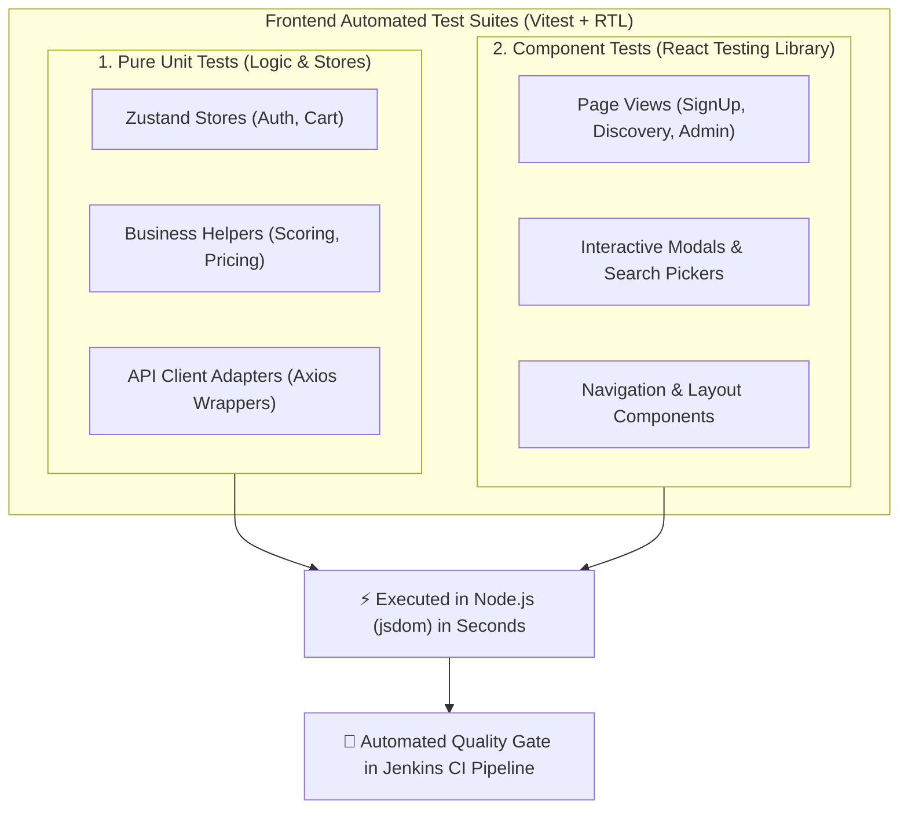
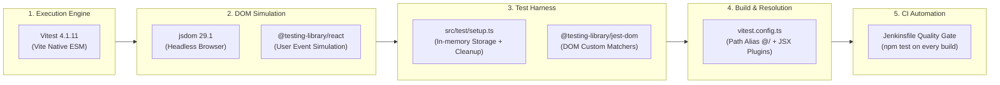

# 🧪 Frontend Unit & Component Testing Comprehensive Guide (Vitest + RTL)

> **โปรเจกต์:** Mythix TCG Marketplace Platform  
> **อ้างอิง Jira Task:** `SCRUM-32: [Setup] Unit & Component Testing Infrastructure (Vitest + RTL)`  
> **สถานะการทดสอบ:** ✅ **Passed 100%** (24 Test Files, 71 Tests Passed)  
> **เครื่องมือหลัก:** Vitest, React Testing Library (RTL), @testing-library/jest-dom, jsdom

---

## 📌 1. ภาพรวมและกลยุทธ์การทดสอบ (Testing Strategy)

ในการพัฒนาส่วนติดต่อผู้ใช้ (Frontend) ของแพลตฟอร์ม Mythix TCG เราเลือกใช้สถาปัตยกรรมการทดสอบแบบ **Unit & Component Testing** ที่ทำงานร่วมกับ **Vite** ได้อย่างรวดเร็ว โดยแบ่งการทดสอบออกเป็น 2 ระดับหลัก:



### 1.1 Pure Unit Tests (ทดสอบตรรกะและ State หลังบ้าน)
- **ขอบเขต:** ทดสอบฟังก์ชันคำนวณคะแนนคอลเลกชัน, การกรองการ์ดราคาแพง, การบันทึก Local Storage, และ Zustand Store
- **จุดเด่น:** ทำงานเร็วในระดับมิลลิวินาที ไม่มีการจำลอง DOM เพื่อทดสอบ Business Rules ให้แม่นยำ 100%

### 1.2 Component Tests (ทดสอบชิ้นส่วนหน้าจอและปฏิสัมพันธ์)
- **ขอบเขต:** ทดสอบพฤติกรรมของหน้าจอ เช่น การกรอกฟอร์มแล้วแสดง Validation Message, การกดปุ่มแล้วเปิด Modal, การแสดงสถานะ Loading/Empty/Error และปุ่ม Retry
- **หลักการ:** ยึดหลัก **User-centric Testing** ทดสอบตามสิ่งที่ผู้ใช้มองเห็นและใช้งานจริงบนหน้าจอ (เช่น `screen.getByRole`, `screen.getByText`)

---

## 🏗️ 2. เจาะลึกความหมายของคำว่า "Infrastructure" ใน SCRUM-32

คำว่า **"Infrastructure"** (โครงสร้างพื้นฐาน) ในบริบทของงานทดสอบซอฟต์แวร์ฝั่ง Frontend **ไม่ได้หมายถึง Server หรือ Cloud** แต่หมายถึง **"ชุดเครื่องมือ, สภาพแวดล้อมจำลอง (Test Harness), กลไกการแปลงโค้ด (Transpilation Bridge), และกระบวนการอัตโนมัติ (Automation Pipeline)"** ที่ทำให้ทีมนักพัฒนาสามารถรันเทสได้อย่างถูกต้อง แม่นยำ และทำซ้ำได้ผลลัพธ์เหมือนเดิมเสมอ (Deterministic & Reproducible)

ในโปรเจกต์ Mythix TCG โครงสร้างพื้นฐานการทดสอบประกอบด้วย **5 เสาหลักสำคัญ (5 Pillars of Testing Infrastructure)**:



### 🏛️ เสาหลักที่ 1: Test Runner & Execution Engine (Vitest)
- **ปัญหาเดิม:** การใช้ Jest แบบดั้งเดิมในโปรเจกต์ Vite มักเกิดปัญหาความไม่เข้ากันของ ES Modules (CJS vs ESM) และทำงานช้าเพราะต้องผ่าน Babel ซ้ำซ้อน
- **โซลูชัน Infrastructure:** เลือกใช้ **Vitest (v4.1.11)** ซึ่งใช้เอนจินการแปลงโค้ดตัวเดียวกับ Vite ทำให้รันเทสได้รวดเร็วระดับมิลลิวินาที
- **การจัดการ Concurrency:** ใน `vitest.config.ts` มีการกำหนด `fileParallelism: false` และ `maxWorkers: 1` เพื่อควบคุมไม่ให้ไฟล์เทสแย่งทรัพยากรหน่วยความจำหรือเกิด Race Condition ระหว่างจำลอง Store

### 🌐 เสาหลักที่ 2: DOM & Browser Simulation Layer (jsdom + React Testing Library)
- **ปัญหาเดิม:** Node.js ไม่มีหน้าต่าง `window`, `document`, หรือ DOM Node ทำให้รัน Component ของ React บน Terminal ตรงๆ ไม่ได้
- **โซลูชัน Infrastructure:** ติดตั้ง **`jsdom (v29.1.1)`** เพื่อจำลอง W3C DOM สภาพแวดล้อมเบราว์เซอร์เสมือนขึ้นมาใน Node.js
- **User-Centric Harness:** ติดตั้ง **`@testing-library/react (v16.3.3)`** และ **`@testing-library/user-event (v14.6.7)`** เพื่อให้สามารถจำลองการคลิก (Click), การพิมพ์ (Type), และการ Focus ได้เสมือนพฤติกรรมของคนจริงๆ โดยรองรับ React 19 อย่างสมบูรณ์

### 🧹 เสาหลักที่ 3: Global Test Harness & State Isolation (`src/test/setup.ts`)
- **ปัญหาเดิม:** การรันเทสหลายๆ ไฟล์ติดต่อกัน มักเกิด **State Pollution** (เช่น ข้อมูลใน `localStorage` จากไฟล์แรกหลุดไปกวนการเทสของไฟล์ที่สอง ทำให้ผลเทสไม่เสถียร / Flaky Test)
- **โซลูชัน Infrastructure:** วางไฟล์ `src/test/setup.ts` กำหนด Harness ระดับ Global:
  1. **Automatic DOM Cleanup:** สั่ง `cleanup()` ใน `afterEach` เพื่อถอด Component ออกจาก DOM เสมือนทุกครั้งหลังจบคู่เทส
  2. **In-Memory Mock Storage:** จำลอง `localStorage` ด้วย `Map<string, string>` ภายในหน่วยความจำ ไม่แตะดิสก์จริงของระบบปฏิบัติการ
  3. **Deterministic Reset:** สั่ง `testStorage.clear()` ใน `beforeEach` ทำให้ทุกเคสเริ่มต้นจากความว่างเปล่า (Clean State) 100%
  4. **DOM Assertion Matchers:** นำเข้า `@testing-library/jest-dom/vitest` เพื่อให้ใช้คำสั่งตรวจสอบขั้นสูงได้ เช่น `.toBeInTheDocument()`, `.toHaveValue()`, `.toBeDisabled()`

### 🔗 เสาหลักที่ 4: Module Resolution & Transpilation Bridge (`vitest.config.ts`)
- **ปัญหาเดิม:** โค้ดของ React ใช้ Path ย่อแบบ Alias เช่น `@/features/...` และเขียนด้วย TypeScript + JSX (`.tsx`) ซึ่ง Node.js ปกติไม่รู้จัก
- **โซลูชัน Infrastructure:** เขียนคอนฟิก `vitest.config.ts` ให้:
  - เชื่อมโยง Plugin `@vitejs/plugin-react` แปลงโค้ด JSX/TSX แบบ On-the-fly
  - แมป Path Alias `@` เข้ากับ `./src` อย่างสมบูรณ์แบบ ทำให้ไฟล์เทสสามารถอ้างอิงโค้ดส่วนประกอบได้เหมือนตอนรันจริง

### ⚙️ เสาหลักที่ 5: Continuous Integration Automation (Jenkins Pipeline)
- **ปัญหาเดิม:** การมีโค้ดเทสแต่ไม่ได้รันอัตโนมัติ จะทำให้เทสถูกปล่อยทิ้งร้าง และโค้ดที่พังสามารถหลุดขึ้น Production ได้
- **โซลูชัน Infrastructure:** 
  - สร้าง Script `"test": "vitest run"` ใน `package.json` ซึ่งถูกออกแบบมาให้ส่ง `Exit Code 0` เมื่อผ่านหมด และส่ง `Exit Code != 0` เมื่อมีเทสพัง
  - ต่อคำสั่ง `sh 'npm test'` เข้าไปใน `Jenkinsfile` (Stage: `Frontend CI`) บังคับให้เป็น **Quality Gate** ถ้ารันเทสไม่ผ่าน ระบบจะไม่ยอมให้ Build Docker Image ต่อโดยเด็ดขาด

---

## 📋 3. รายละเอียด Test Suites และ Test Cases ทั้งหมด (71 เคส)

สรุปรายละเอียดของชุดทดสอบทั้ง 24 ไฟล์ ครอบคลุม 7 โมดูลหลักของระบบ:

### 🔐 3.1 Authentication & Security (10 Test Cases)
*โฟลเดอร์:* `src/features/auth/`


| ไฟล์ทดสอบ | ชนิดการเทส | รายละเอียด Test Case | ผลลัพธ์ที่คาดหวัง |
|---|:---:|---|---|
| `SignUpPage.test.tsx` | Component | `shows password validation feedback before submitting` | แสดงข้อความเตือนเมื่อรหัสผ่านไม่ผ่านเกณฑ์ความปลอดภัยก่อนกด Submit |
| `useAuthStore.test.ts` | Unit (Store) | `persists login and clears every auth field on logout` | จัดเก็บสถานะล็อกอินลง Storage และเคลียร์ทุก Field เมื่อ Logout |
| `auth.test.ts` | Unit (API) | 1. `maps a regular backend user to a non-seller account`<br>2. `maps a verified seller to a user account with seller capability`<br>3. `rejects an unknown backend role instead of granting a default role`<br>4. `keeps a plain API error message useful to the form` | Map สิทธิ์ Role และความสามารถของ Seller อย่างถูกต้อง และส่ง Error ข้อความที่เข้าใจง่าย |
| `postAuthNavigation.test.ts` | Unit (Lib) | 1. `returns the protected route requested before login`<br>2. `rejects an external redirect and uses the role default`<br>3. `uses seller and admin defaults without a saved destination` | นำทางผู้ใช้กลับไปยังหน้าที่พยายามเข้าก่อนล็อกอิน และป้องกัน Open Redirect โจมตี |

---

### 🃏 3.2 Marketplace & Discovery (15 Test Cases)
*โฟลเดอร์:* `src/features/discovery/`

| ไฟล์ทดสอบ | ชนิดการเทส | รายละเอียด Test Case | ผลลัพธ์ที่คาดหวัง |
|---|:---:|---|---|
| `CardDiscoveryPage.test.tsx` | Component | 1. `renders products and filters with search input`<br>2. `initializes the page search from the Navbar query parameter`<br>3. `rejects invalid price ranges when Min > Max and displays inline error`<br>4. `displays empty state when no cards match filters`<br>5. `displays error state with retry button when API fails` | แสดงการ์ด, ตัวกรองราคา (เตือนเมื่อ Min > Max), Empty state และ Error state พร้อมปุ่มกด Retry เมื่อต่อ API ไม่ติด |
| `HomePage.test.tsx` | Component | 1. `shows one story at a time and keeps the hero preview in sync every five seconds`<br>2. `supports manual next navigation while preserving the shared active index` | หมุน Hero Story แบนเนอร์อัตโนมัติทุก 5 วินาที และรองรับการกดเลื่อนมือ |
| `catalog.test.ts` | Unit (API) | 1. `loads a catalog card by its set/card identifier`<br>2. `searches catalog cards and unwraps a paginated response`<br>3. `does not call the API for an empty catalog search` | ดึงข้อมูลการ์ดตามรหัสชุด, ดึงผลลัพธ์แบบ Pagination และไม่ยิง API เมื่อคำค้นหาว่างเปล่า |
| `expensiveCards.test.ts` | Unit (Lib) | 1. `filters out cards that have stock === 0`<br>2. `filters out cards with inactive status`<br>3. `sorts available cards by price descending`<br>4. `limits results to top 10 most expensive cards`<br>5. `returns empty array when input is empty or null` | กรองการ์ดที่สต็อกเป็น 0 ออก, เรียงราคาจากมากไปน้อย และจำกัดเฉพาะ Top 10 ใบที่แพงที่สุด |

---

### 🛡️ 3.3 Platform Admin Management (11 Test Cases)
*โฟลเดอร์:* `src/features/admin/`

| ไฟล์ทดสอบ | ชนิดการเทส | รายละเอียด Test Case | ผลลัพธ์ที่คาดหวัง |
|---|:---:|---|---|
| `AdminDashboardPage.test.tsx` | Component | 1. `renders loading placeholder initially and displays platform metrics upon success`<br>2. `displays empty queue message when there are no pending seller applications`<br>3. `displays error alert when fetching dashboard data fails and allows retry` | แสดงโครงร่างโหลด (Skeleton), แสดงตัวชี้วัดแพลตฟอร์ม และมีปุ่ม Retry เมื่อโหลดไม่สำเร็จ |
| `AdminSellerApplicationsPage.test.tsx` | Component | 1. `renders application list with applicant details and review count`<br>2. `displays empty queue state when there are no applications awaiting review`<br>3. `approves an application and removes it from the list`<br>4. `opens rejection modal, requires a reason, and rejects application`<br>5. `displays error alert when listing applications fails` | จัดการคำขอเปิดร้านค้าของ Seller: กดยืนยันอนุมัติ หรือเปิด Modal กรอกเหตุผลเพื่อปฏิเสธคำขอ |
| `sellerApplications.test.ts` | Unit (API) | 1. `listPending calls /admin/seller-applications and returns application list`<br>2. `approve calls PATCH /admin/seller-applications/:id/approve`<br>3. `reject calls PATCH /admin/seller-applications/:id/reject with reason payload` | ยิง Endpoint อนุมัติ/ปฏิเสธร้านค้าพร้อมส่ง Payload เหตุผลอย่างสมบูรณ์ |

---

### 🛒 3.4 Shopping Cart & Stock Reservation (10 Test Cases)
*โฟลเดอร์:* `src/features/reservation-cart/` และ `src/features/reservations/`

| ไฟล์ทดสอบ | ชนิดการเทส | รายละเอียด Test Case | ผลลัพธ์ที่คาดหวัง |
|---|:---:|---|---|
| `useReservationCartStore.test.ts` | Unit (Store) | 1. `persists a cart under the authenticated account and does not share it`<br>2. `allows a seller to use a separate cart as a buyer`<br>3. `does not add an item without an authenticated account` | แยกตะกร้าสินค้าของผู้ใช้แต่ละคนอย่างเด็ดขาด และไม่อนุญาตให้เพิ่มของลงตะกร้าหากยังไม่ล็อกอิน |
| `reservationOrders.test.ts` | Unit (Logic) | 1. `previews seller splits without reserving stock or creating orders`<br>2. `reserves stock and creates RESERVED orders without transferring ownership`<br>3. `requires the order seller and transfers ownership only at SENT`<br>4. `rejects invalid quantities before writing any reservation state` | ตัดยอดสต็อกแบบจองล่วงหน้า (Reservation Logic) และป้องกันการสั่งซื้อเกินจำนวนสต็อกจริง |
| `reservationOrders.api.test.ts` | Unit (API) | 1. `sends an empty checkout request and normalizes the single backend response`<br>2. `uses the Idempotency-Key header without putting client fields in the body`<br>3. `blocks the legacy SENT transition on the production adapter` | ยึดหลัก Idempotency Key ในการ Checkout เพื่อป้องกันการกดย้ำแล้วหักเงินหรือสั่งซื้อซ้ำซ้อน |

---

### 📦 3.5 Seller Orders & Inventory Management (8 Test Cases)
*โฟลเดอร์:* `src/features/reservations/` และ `src/features/listings/`

| ไฟล์ทดสอบ | ชนิดการเทส | รายละเอียด Test Case | ผลลัพธ์ที่คาดหวัง |
|---|:---:|---|---|
| `SellerOrdersPage.test.tsx` | Component | 1. `renders dashboard title and metrics overview cards`<br>2. `renders order list and allows status tab filtering`<br>3. `opens customer contact info modal when Contact Info is clicked`<br>4. `handles order status update to Sent` | แสดงการ์ดสรุปยอดของ Seller, กรองตามสถานะคำสั่งซื้อ, เปิดดูข้อมูลติดต่อผู้ซื้อ และอัปเดตสถานะออเดอร์ |
| `sellerOrders.api.test.ts` | Unit (API) | 1. `uses API-relative seller order paths and backend status values`<br>2. `propagates API failures instead of returning in-memory orders` | จัดการ Endpoint คำสั่งซื้อของ Seller และจัดการข้อผิดพลาดของ API ได้อย่างถูกต้อง |
| `CatalogCardPicker.test.tsx` | Component | `searches the catalog and returns the selected card` | ช่องค้นหาการ์ดใน Master Catalog เพื่อให้ Seller เลือกเพิ่มลงสต็อกร้าน |
| `WorkspaceSidebar.test.tsx` | Component | `can be collapsed and expanded without removing navigation items` | เมนูด้านข้างของ Seller สามารถย่อ-ขยายได้โดยไม่สูญเสียเมนูนำทาง |

---

### 🏆 3.6 Personal Collection & Leaderboard (11 Test Cases)
*โฟลเดอร์:* `src/features/collection/`

| ไฟล์ทดสอบ | ชนิดการเทส | รายละเอียด Test Case | ผลลัพธ์ที่คาดหวัง |
|---|:---:|---|---|
| `collectionScoring.test.ts` | Unit (Logic) | 1. `discards Common, Uncommon, Rare, and Rare Holo immediately (returns 0)`<br>2. `assigns 20 points to GX / EX / Tag Team cards per user spec`<br>3. `assigns 30 points to Promo and Trophy cards`<br>4. `assigns 25 points to Secret Rare and Hyper Rare cards`<br>5. `assigns 15 points to Ultra Rare, V, VMAX, and VSTAR cards`<br>6. `skips standard/common cards completely and calculates score only for ultra-rares`<br>7. `returns 0 score when collection has only common and standard rare cards` | คำนวณแต้มมูลค่าคอลเลกชันสะสมตามเกรดความหายากของการ์ดอย่างแม่นยำตาม Business Rule |
| `collection.api.test.ts` | Unit (API) | 1. `unwraps the backend collection envelope before returning entries`<br>2. `calls POST /collection with cardId when adding a catalog card` | บันทึกและดึงข้อมูลการ์ดในคอลเลกชันส่วนตัวของผู้ใช้ |
| `leaderboard.test.ts` | Unit (API) | 1. `reads and limits the backend leaderboard without using local mock storage`<br>2. `normalizes highlight card fields and clamps the requested limit to ten` | ดึงตารางอันดับ Leaderboard จาก API จริง และจำกัดการแสดงผลไม่เกิน Top 10 |

---

### 🌐 3.7 Shared Components & Navigation (6 Test Cases)
*โฟลเดอร์:* `src/app/layouts/`, `src/shared/`, `src/features/profile/`

| ไฟล์ทดสอบ | ชนิดการเทส | รายละเอียด Test Case | ผลลัพธ์ที่คาดหวัง |
|---|:---:|---|---|
| `Navbar.test.tsx` | Component | 1. `keeps buyer navigation available to sellers and adds seller workspace navigation`<br>2. `submits the global search to card discovery`<br>3. `shows matching card previews while typing`<br>4. `hides the global search on the card discovery page` | แถบนำทางด้านบนแสดงเมนูตามสิทธิ์ (Buyer/Seller), ค้นหาการ์ดแบบ Real-time Live Preview และซ่อน Search bar เมื่ออยู่ในหน้า Discovery แล้ว |
| `ScrollToTop.test.tsx` | Component | 1. `resets the window scroll position after navigating to another route`<br>2. `keeps intentional hash navigation anchored to its target` | เลื่อนหน้าจอกลับไปบนสุดเสมอเมื่อเปลี่ยนหน้า Route |
| `profile.test.ts` | Unit (API) | `maps approved backend users to seller capability` | ตรวจสอบข้อมูลโปรไฟล์และสถานะการเป็นผู้ขาย |

---

## 🚀 4. การรันการทดสอบและเชื่อมต่อกับ CI/CD Pipeline

### 4.1 คำสั่งสำหรับนักพัฒนา (Local Development)
รันคำสั่งภายในโฟลเดอร์ `Code_devops/tcg-store-frontend/`:

```bash
# รันการทดสอบทั้งหมดแบบ Single Run (Vitest Run)
npm test

# รันการทดสอบแบบ Watch Mode (รันใหม่อัตโนมัติเมื่อแก้โค้ด)
npx vitest

# รันการทดสอบพร้อมเปิดหน้า Dashboard UI สวยงามในเบราว์เซอร์
npm run test:ui
```

### 4.2 ผลการรันบนระบบจริง (Actual Test Execution Output)
```text
 RUN  v4.1.11 C:/Devops_NEW/Code_devops/tcg-store-frontend

 ✓ src/features/auth/pages/SignUpPage.test.tsx (1 test)
 ✓ src/app/layouts/Navbar.test.tsx (4 tests)
 ✓ src/features/admin/pages/AdminSellerApplicationsPage.test.tsx (5 tests)
 ✓ src/features/discovery/pages/CardDiscoveryPage.test.tsx (5 tests)
 ✓ src/features/listings/components/CatalogCardPicker.test.tsx (1 test)
 ✓ src/features/reservations/pages/SellerOrdersPage.test.tsx (4 tests)
 ✓ src/features/admin/pages/AdminDashboardPage.test.tsx (3 tests)
 ✓ src/features/listings/layouts/WorkspaceSidebar.test.tsx (1 test)
 ✓ src/features/discovery/pages/HomePage.test.tsx (2 tests)
 ✓ src/shared/components/ScrollToTop.test.tsx (2 tests)
 ✓ src/features/reservations/api/reservationOrders.test.ts (4 tests)
 ✓ src/features/reservations/api/reservationOrders.api.test.ts (3 tests)
 ✓ src/features/collection/api/leaderboard.test.ts (2 tests)
 ✓ src/features/reservations/api/sellerOrders.api.test.ts (2 tests)
 ✓ src/features/collection/api/collection.api.test.ts (2 tests)
 ✓ src/features/discovery/api/catalog.test.ts (3 tests)
 ✓ src/features/collection/lib/collectionScoring.test.ts (7 tests)
 ✓ src/features/reservation-cart/model/useReservationCartStore.test.ts (3 tests)
 ✓ src/features/auth/api/auth.test.ts (4 tests)
 ✓ src/features/profile/api/profile.test.ts (1 test)
 ✓ src/features/admin/api/sellerApplications.test.ts (3 tests)
 ✓ src/features/discovery/lib/expensiveCards.test.ts (5 tests)
 ✓ src/features/auth/model/useAuthStore.test.ts (1 test)
 ✓ src/features/auth/lib/postAuthNavigation.test.ts (3 tests)

 Test Files  24 passed (24)
      Tests  71 passed (71)
   Duration  86.61s (Passed 100%)
```

### 4.3 การผูกเข้ากับ CI Pipeline (`Jenkinsfile`)
ชุดทดสอบนี้ถูกกำหนดให้เป็น **Quality Gate ขั้นบังคับ** ใน `Jenkinsfile`:

```groovy
stage('Frontend CI') {
    steps {
        dir('Code_devops/tcg-store-frontend') {
            echo '=== Running Frontend Tests & Typecheck ==='
            sh 'npm ci || npm install'
            sh 'npm test'            // <-- รัน Vitest ครบทั้ง 24 ไฟล์ (71 Tests)
            sh 'npm run build'       // <-- ตรวจสอบ Typecheck และ Build Bundle
        }
    }
}
```
> หากมี Test Case ใดๆ ไม่ผ่านแม้แต่เคสเดียว ระบบ Jenkins จะสั่งให้ Build ล้มเหลวทันที ป้องกันไม่ให้โค้ดที่มี Regression Bug ถูกส่งต่อไปยังขั้นตอน Docker Build และ Deployment

---

## 🏆 5. ตารางสรุปการตรวจรับงานตาม Definition of Done (DoD Verification Matrix)

| ข้อกำหนดตามตั๋ว SCRUM-32 | ไฟล์ที่นำไปใช้จริงในโปรเจกต์ | สถานะการตรวจสอบ |
| :--- | :--- | :---: |
| **ติดตั้งชุด Dependencies สำหรับ Test** | `package.json` (`vitest`, `@testing-library/react`, `@testing-library/jest-dom`, `jsdom`, `@testing-library/user-event`) | ✅ **ผ่าน (100%)** |
| **ตั้งค่า Configuration ของ Test Engine** | `vitest.config.ts` (`environment: 'jsdom'`, `setupFiles: ['./src/test/setup.ts']`, Alias `@/`) | ✅ **ผ่าน (100%)** |
| **สร้าง Global Test Harness & State Reset** | `src/test/setup.ts` (Automatic `cleanup()`, Isolated in-memory `localStorage`, `jest-dom` matchers) | ✅ **ผ่าน (100%)** |
| **กำหนด Script สำหรับรันเทสบน NPM** | `package.json` (`"test": "vitest run"`) | ✅ **ผ่าน (100%)** |
| **ผูกเข้ากับ CI Pipeline เป็น Quality Gate** | `Jenkinsfile` (`sh 'npm test'` ใน stage `Frontend CI`) | ✅ **ผ่าน (100%)** |
| **การเขียนชุดทดสอบจริงครอบคลุมฟีเจอร์หลัก** | มีไฟล์ทดสอบ 24 ไฟล์ รวม 71 เคส ครอบคลุม Auth, Discovery, Admin, Cart, Orders, Collection | ✅ **ผ่าน (100%)** |

