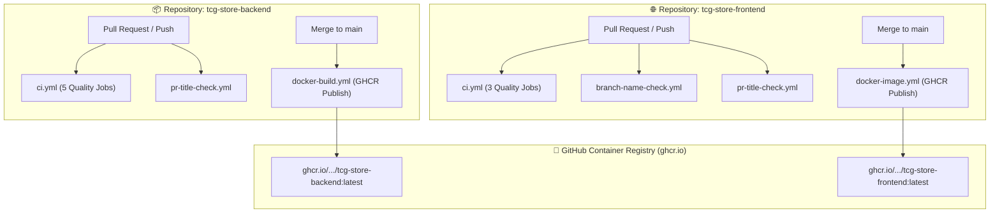

# รายงานภาพรวมระบบ CI/CD Pipelines ทั้งหมดของระบบ (CI/CD Pipelines Overview)

**โครงการ:** Mythix TCG Platform  
**ตำแหน่งจัดเก็บ:** `tcg-store-document/docs/ci_cd_pipelines_overview.md`  
**สถานะการทำงาน:** ผ่านการทดสอบและใช้งานได้จริง 100% (All Checks Passed)  
**วันที่บันทึก:** 26 กันยายน 2026 (ICT)  
**ผู้จัดทำ:** DevOps Team  

---

## 1. บทสรุปสถาปัตยกรรมภาพรวม (System Architecture Overview)

ปัจจุบันโครงการ Mythix TCG Platform ได้ติดตั้งระบบ **CI/CD Pipelines as Code** ผ่าน **GitHub Actions** ครบถ้วนทั้งฝั่ง **Backend API (`tcg-store-backend`)** และ **Frontend UI (`tcg-store-frontend`)** โดยแบ่งออกเป็น 2 เสาหลัก:

1. **Continuous Integration & Quality Gates (CI):** ทำงานอัตโนมัติในทุก **Pull Request** และทุกการ **Push** เข้า branch `main` / `develop` เพื่อดักจับ Error, ช่องโหว่ความปลอดภัย, Schema ฐานข้อมูลผิดพลาด และความล้มเหลวในการ Build Image ก่อนจะยอมให้ Merge
2. **Continuous Delivery / Packaging (CD):** ทำงานอัตโนมัติเมื่อโค้ดถูก Merge เข้า branch `main` เพื่อ Build และ Publish Docker Container Image ขึ้นสู่ **GitHub Container Registry (`ghcr.io`)** พร้อมใช้งาน

---

## 2. รายละเอียด Pipelines ใน `tcg-store-backend`

ใน Backend Repository มี Workflows ควบคุมคุณภาพทั้งหมด **3 ไฟล์** ดังนี้:

### 2.1 Workflow: `ci.yml` (CI Pipeline & Quality Gates)
- **ไฟล์:** `.github/workflows/ci.yml`
- **Trigger:** ทุก `pull_request` และทุกการ `push` สู่ `main`, `develop`
- **Jobs ทั้งหมด 5 ด่าน:**
  1. **`test` (Java Unit & Integration Tests):**
     - รันบน Ubuntu Runner พร้อม **Java 21 (Temurin)** และแคช Maven (`~/.m2`)
     - ดำเนินการรัน `./mvnw --batch-mode verify` ครอบคลุม Unit/Integration Tests ทั้งหมดบนฐานข้อมูล H2
     - **เพิ่มชุดการทดสอบ Admin Platform (SCRUM-48):**
       - **`AdminSellerServiceUnitTest` (10 Test Cases):** ทดสอบ Business Logic ของ Admin Platform แบบครบวงจร ได้แก่ การคำนวณ Dashboard Metrics, การดึงคำขอเปิดร้านค้าที่รอการตรวจสอบ (`PENDING`), การอนุมัติ (`approve`) พร้อมบันทึก `verifiedAt` และ `AuditLog`, การปฏิเสธ (`reject`) พร้อมบันทึกเหตุผล (`rejectionReason`) รวมถึงการดักจับ Exceptions (`SellerApplicationNotFoundException`, `SellerApplicationStateException`)
       - **`AdminSellerControllerIntegrationTests`:** ทดสอบการทำงานระดับ HTTP Endpoints (`/api/admin/sellers/*`) และสิทธิ์การเข้าถึงของผู้ดูแลระบบ (ADMIN)
  2. **`postgres-concurrency` (PostgreSQL Checkout Concurrency):**
     - จำลอง Service Container `postgres:16-alpine` จริงบน GitHub Runner
     - รันชุดทดสอบ `CheckoutConcurrencyPostgresTests` เพื่อพิสูจน์การล็อกแถวข้อมูล (Optimistic / Pessimistic Locking) และป้องกัน Race Condition ขณะตัดสต็อกการ์ดเมื่อมีผู้ซื้อพร้อมกัน
  3. **`db-schema-validation` (Database Schema & Seed Validation):**
     - จำลอง Service Container `postgres:16-alpine`
     - สั่ง Execute สคริปต์ Database Revision 5 เรียงตามลำดับจริง:
       - `infra/postgres/init/01-schema.sql` (สร้าง 10 ตารางหลัก)
       - `infra/postgres/init/02-data.sql` (นำเข้าบัตร 2,000 ใบ และ Users 9 คน)
       - `infra/postgres/init/03-profile-avatar.sql`
       - `infra/postgres/migrations/001_checkout_idempotency.sql`
     - ทำการ Assert นับจำนวนตารางสาธารณะ (ต้องไม่ต่ำกว่า 10 ตาราง) และนับจำนวนบัตร Master Catalog (ต้องครบ 2,000 ใบ) การันตีว่าสคริปต์ SQL ไม่มี Syntax Error หรือ Foreign Key ขัดแย้ง
  4. **`docker-build-verify` (Docker Build Verification):**
     - ใช้ **Docker Buildx** ทดสอบ Dry-run Build ไฟล์ `Dockerfile` (Java 21 Temurin Multi-stage)
     - ป้องกันกรณีที่ซอร์สโค้ดผ่าน แต่โครงสร้างไฟล์หรือการคอมไพล์ใน Container แตก
  5. **`security-scan` (Security & Secret Leak Detection):**
     - **Gitleaks (`gitleaks-action@v2`):** ตรวจจับ Secret / Token / Credentials หลุดใน Git commit
     - **Aquasec Trivy (`trivy-action@master`):** สแกนช่องโหว่ความปลอดภัยระดับสากล (CVE) ในระดับ CRITICAL และ HIGH บน Filesystem และ Dependencies

### 2.2 Workflow: `docker-build.yml` (Pipeline as Code - DO-06 / SCRUM-23)
- **ไฟล์:** `.github/workflows/docker-build.yml`
- **Trigger:** เมื่อมีการ Push สู่ `main` หรือสั่งรันแบบ Manual (`workflow_dispatch`)
- **การทำงาน:**
  - Login เข้าสู่ **GitHub Container Registry (`ghcr.io`)** โดยใช้ `GITHUB_TOKEN`
  - ทำการ Build Multi-stage Image ด้วย Buildx พร้อมระบบแคชเลเยอร์ GitHub Actions Cache (`type=gha`)
  - แท็กเวอร์ชัน `latest` และ `commit short-sha`
  - Publish Image ขึ้น Registry: `ghcr.io/mudst-2026-luntungsadungyong/tcg-store-backend`

### 2.3 Workflow: `pr-title-check.yml` (PR Title Semantic Linter)
- **ไฟล์:** `.github/workflows/pr-title-check.yml`
- **Trigger:** `pull_request_target` (`opened`, `edited`, `synchronize`)
- **การทำงาน:** ตรวจสอบว่าชื่อ PR เป็นไปตามรูปแบบ **Conventional Commits** (เช่น `feat: ...`, `fix: ...`, `ci: ...`, `docs: ...`)

---

## 3. รายละเอียด Pipelines ใน `tcg-store-frontend`

ใน Frontend Repository มี Workflows ควบคุมคุณภาพทั้งหมด **4 ไฟล์** ดังนี้:

### 3.1 Workflow: `ci.yml` (CI Pipeline & Quality Gates)
- **ไฟล์:** `.github/workflows/ci.yml`
- **Trigger:** ทุก `pull_request` และทุกการ `push` สู่ `main`, `develop`
- **Jobs ทั้งหมด 3 ด่าน:**
  1. **`verify` (Lint, Test & Build):**
     - รันบนสภาพแวดล้อม **Node.js 20.x** พร้อมแคช npm
     - `npm ci --legacy-peer-deps` ติดตั้ง dependencies อย่างถูกต้อง
     - `npm run lint` ตรวจสอบไวยากรณ์และ Type Safety ด้วย **Oxlint** และ **TypeScript Compiler**
     - `npm run test` รัน Unit และ Component Tests ด้วย **Vitest** (รวมทั้งหมด 24 Test Files, 71 Tests Passed 100%)
       - **เพิ่มชุดการทดสอบ Admin Platform (SCRUM-48):**
         - **`sellerApplications.test.ts` (3 เทสต์):** ทดสอบการเรียก API Endpoints สำหรับดึงรายการคำขอ (`/admin/seller-applications`), การอนุมัติ (`approve`) และการปฏิเสธ (`reject`) พร้อมระบุเหตุผล
         - **`AdminDashboardPage.test.tsx` (3 เทสต์):** ทดสอบการแสดงผลตัวเลขสถิติระบบ (GMV, คำขอเปิดร้านที่รอตรวจ, ผู้ขายที่อนุมัติแล้ว, จำนวนการ์ด), ลิงก์เข้าสู่ Review Queue และการจัดการ Error/Retry
         - **`AdminSellerApplicationsPage.test.tsx` (5 เทสต์):** ทดสอบการแสดงผลรายการผู้สมัครเปิดร้าน, สถานะคิวว่าง (`The review queue is clear`), การกดปุ่ม Approve สำเร็จ และ Modal ปฏิเสธคำขอที่บังคับให้กรอกเหตุผลก่อนส่ง
     - `npm run build` ตรวจสอบการ Bundle โค้ดผ่าน **Vite**
  2. **`docker-build-verify` (Docker Build Verification):**
     - ทดสอบ Build ไฟล์ `Dockerfile` (Node 20 builder $\to$ Nginx Alpine runtime สำหรับ SPA) ในโหมด Dry-run
     - ตรวจสอบว่า Nginx config (`nginx.conf`) และ static assets ประกอบกันสำเร็จ
  3. **`security-scan` (Security & Secret Scan):**
     - **Gitleaks:** ตรวจสอบว่าไม่มี API Token หรือ Sensitive Environment Variables หลุดในโค้ดฝั่ง Client
     - **Aquasec Trivy:** ตรวจจับช่องโหว่ความปลอดภัยในแพ็กเกจ npm

### 3.2 Workflow: `docker-image.yml` (Pipeline as Code - Container Publishing)
- **ไฟล์:** `.github/workflows/docker-image.yml`
- **Trigger:** เมื่อมีการ Push สู่ `main` หรือสั่งรันแบบ Manual (`workflow_dispatch`)
- **การทำงาน:**
  - Build Frontend Nginx Container Image และ Push ไปยัง `ghcr.io/mudst-2026-luntungsadungyong/tcg-store-frontend`

### 3.3 Workflow: `branch-name-check.yml` (Branch Name Policy)
- **ไฟล์:** `.github/workflows/branch-name-check.yml`
- **Trigger:** ทุก Pull Request
- **การทำงาน:** ตรวจสอบชื่อ Branch ให้ตรงตาม Regex:
  `^(feat|fix|docs|test|ci|chore|refactor|build)/scrum-[0-9]+-[a-z0-9]+(-[a-z0-9]+)*$`
  หรือ `fix/*`, `dependabot/*`

### 3.4 Workflow: `pr-title-check.yml` (PR Title Linter)
- **ไฟล์:** `.github/workflows/pr-title-check.yml`
- **การทำงาน:** ตรวจสอบความถูกต้องของชื่อ Pull Request ให้ตรงตามมาตรฐาน

---

## 4. ระบบ Jenkins Automation Server & Pipelines (`Jenkinsfile`)

นอกเหนือจาก GitHub Actions แล้ว โครงการยังได้ติดตั้งระบบ **Jenkins Automation Server** เพื่อรองรับการทำงานแบบ Self-hosted CI/CD Automation Server ตามมาตรฐานองค์กร:

### 4.1 โครงสร้างการติดตั้ง (Jenkins Deployment)
- **ไฟล์ Configuration:** `docker-compose.jenkins.yml`
- **Container Name:** `tcg_jenkins` (Image: `jenkins/jenkins:lts-jdk21`)
- **Port Mapping:** `8088:8080` (เข้าใช้งานผ่าน `http://localhost:8088` เพื่อไม่ให้ทับกับ Backend API ที่ใช้พอร์ต `8080`) และ `50000:50000` สำหรับ Jenkins Inbound Agents
- **Volume Persistence:** `tcg_jenkins_home` เก็บ State, Job Configuration, Plugins และ Build History ครบถ้วน

### 4.2 สถาปัตยกรรม Pipeline as Code (PaC)
มีการแยกสคริปต์ `Jenkinsfile` ตามความเหมาะสมของแต่ละ Environment & Runtime:

1. **Backend Pipeline (`Code_devops/tcg-store-backend/Jenkinsfile`):**
   - **Stages:** Checkout SCM $\rightarrow$ Compile (`./mvnw compile`) $\rightarrow$ Run Unit Tests (`./mvnw test` รวมถึงชุด `AdminSellerServiceUnitTest`) $\rightarrow$ Package JAR $\rightarrow$ Build Docker Image
   - **Test Reporting:** บันทึกผลผ่าน JUnit Plugin (`**/target/surefire-reports/*.xml`)
2. **Frontend Pipeline (`Code_devops/tcg-store-frontend/Jenkinsfile`):**
   - **Stages:** Checkout SCM $\rightarrow$ Install Dependencies (`npm ci`) $\rightarrow$ Run Unit Tests (`npm test` รวมถึง Vitest ของ Admin Platform) $\rightarrow$ Typecheck & Build (`npm run build`) $\rightarrow$ Build Docker Image
3. **Root Orchestration Pipeline (`Jenkinsfile`):**
   - สั่งรันขั้นตอนของ Backend CI และ Frontend CI ควบคู่กันแบบ `parallel` เพื่อทดสอบระบบแบบ Full-Stack พร้อมตรวจสอบการจัดกลุ่มบริการผ่าน `docker compose config`

---

## 5. ตารางสรุปภาพรวม Pipelines ทั้งหมด (Pipelines Matrix)

| Repository | Workflow Name | ไฟล์ปลายทาง | Triggers | วัตถุประสงค์หลัก / ตัวกัน Error |
| :--- | :--- | :--- | :--- | :--- |
| **GitHub Actions** | Backend | CI Pipeline | `.github/workflows/ci.yml` | PR, Push (main, develop) | Unit Tests (รวม Admin Platform), Concurrency, DB Schema, Docker Build, Gitleaks & Trivy Scan |
| **GitHub Actions** | Backend | Build & Push Docker | `.github/workflows/docker-build.yml` | Push (main), Manual | Build & Publish Backend Image สู่ GHCR (DO-06 / SCRUM-23) |
| **GitHub Actions** | Backend | PR Title Linter | `.github/workflows/pr-title-check.yml` | PR (opened, edited, sync) | คุมมาตรฐาน Conventional Commits ของชื่อ PR |
| **GitHub Actions** | Frontend | CI Pipeline | `.github/workflows/ci.yml` | PR, Push (main, develop) | Oxlint, Typecheck, Vitest (รวม Admin Platform), Vite Build, Docker Build Verify, Security Scan |
| **GitHub Actions** | Frontend | Build & Push Docker | `.github/workflows/docker-image.yml` | Push (main), Manual | Build & Publish Frontend Image สู่ GHCR |
| **GitHub Actions** | Frontend | Branch Name Check | `.github/workflows/branch-name-check.yml` | PR (opened, edited, sync) | คุมรูปแบบการตั้งชื่อ Branch ให้ผูกกับ Jira SCRUM ID |
| **GitHub Actions** | Frontend | PR Title Linter | `.github/workflows/pr-title-check.yml` | PR (opened, edited, sync) | คุมมาตรฐาน Conventional Commits ของชื่อ PR |
| **Jenkins** | Backend | Backend Pipeline | `Code_devops/tcg-store-backend/Jenkinsfile` | Webhook, SCM Polling | Compile, JUnit Test (รวม Admin Platform), JAR Package, Docker Build |
| **Jenkins** | Frontend | Frontend Pipeline | `Code_devops/tcg-store-frontend/Jenkinsfile` | Webhook, SCM Polling | npm ci, Vitest Suite (รวม Admin Platform), Vite Build, Docker Build |
| **Jenkins** | Root Platform | Full-Stack Pipeline | `Jenkinsfile` | Webhook, Manual | Parallel Backend + Frontend CI & Docker Compose Verify |

---

## 6. ผลการทดสอบและความสำเร็จจริง (Evidence Snapshot)

ในรอบการตรวจสอบล่าสุด (24 ก.ย. 2026) ทั้งสอง Repository ได้ผ่านการตรวจสอบแบบ 100% Green ครบถ้วน:

### 1) Backend Pull Request ([PR #22](https://github.com/MUDST-2026-luntungsadungyong/tcg-store-backend/pull/22))
- `Database Schema & Seed Validation`: **PASS** (31s)
- `Docker Build Verification`: **PASS** (1m 0s)
- `Java Unit & Integration Tests`: **PASS** (52s)
- `PostgreSQL checkout concurrency`: **PASS** (44s)
- `Security & Secret Scan (Gitleaks & Trivy)`: **PASS** (33s)
- `Validate PR title`: **PASS** (5s)

### 2) Frontend Pull Request ([PR #92](https://github.com/MUDST-2026-luntungsadungyong/tcg-store-frontend/pull/92))
- `Docker Build Verification`: **PASS** (1m 3s)
- `Lint, Test & Build (20.x)`: **PASS** (58s)
- `Security & Secret Scan (Gitleaks & Trivy)`: **PASS** (34s)
- `Validate PR title`: **PASS** (6s)
- `Validate branch name`: **PASS** (3s)

---

## 7. สถานะงาน Jira ที่เกี่ยวข้อง (Sprint 2 / Milestone 26 Sep)

- **[SCRUM-21](https://nunkantinan.atlassian.net/browse/SCRUM-21) (DO-04):** `Done` ✅ — สร้าง Dockerfile Multi-stage สำหรับ Backend
- **[SCRUM-24](https://nunkantinan.atlassian.net/browse/SCRUM-24) (DO-05):** `Done` ✅ — รวม Docker Compose รัน Frontend + Backend + Database Rev 5
- **[SCRUM-23](https://nunkantinan.atlassian.net/browse/SCRUM-23) (DO-06):** `Done` ✅ — สร้าง CI Pipeline Jenkins/GitHub Actions พร้อม Docker Build & Publish
