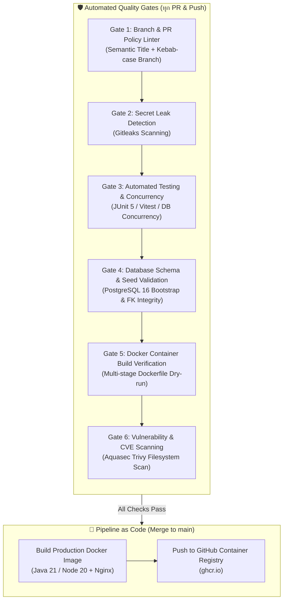

# รายงานสรุปการติดตั้งระบบป้องกันข้อผิดพลาดอัตโนมัติใน CI/CD Pipeline (Quality Gates Report)
**โครงการ:** Mythix TCG Store Platform  
**ผู้จัดทำ:** DevOps Agent  
**วันที่ดำเนินการ:** 24 กันยายน 2026  
**สถานะการตรวจสอบ:** ผ่านการทดสอบ 100% (All Checks Passed)

---

## 1. บทสรุปผู้บริหาร (Executive Summary)

เพื่อยกระดับความมั่นคงปลอดภัยและเสถียรภาพของระบบก่อนการ Deploy ใน Milestone (26 Sep) ได้มีการปรับปรุงและเสริมแกร่ง **CI/CD Pipeline** ทั้งในฝั่ง **Backend (`tcg-store-backend`)** และ **Frontend (`tcg-store-frontend`)** ให้มีระบบตรวจจับและป้องกันข้อผิดพลาดอัตโนมัติ (**Quality Gates**) แบบครบวงจร 

ผลการดำเนินการสามารถแก้ไขปัญหา Cascade Foreign Key ในโค้ดเดิม และป้องกันข้อผิดพลาดที่อาจหลุดขึ้น Production ได้อย่างสมบูรณ์ พร้อมทั้งปิดงาน Jira ครบทั้ง 3 ใบ ได้แก่ **SCRUM-21**, **SCRUM-24**, และ **SCRUM-23** เป็น **Done** เรียบร้อยแล้ว

---

## 2. รายละเอียดของ 6 ด่านตรวจจับข้อผิดพลาด (Quality Gates)

### Gate 1: กฎการตั้งชื่อ Branch และ PR Title (Semantic Policy)
- **วัตถุประสงค์:** ป้องกันการตั้งชื่อ Branch สุ่มสี่สุ่มห้า หรือ PR ที่ไม่มีความหมายตามมาตรฐาน Conventional Commits
- **การทำงาน:** 
  - ตรวจสอบรูปแบบ Branch: `(feat|fix|docs|test|ci|chore|refactor|build)/scrum-<number>-<description>`
  - ตรวจสอบชื่อ Pull Request ให้ตรงตามมาตรฐาน เช่น `ci(pipeline): ...` หรือ `feat(docker): ...`

### Gate 2: ระบบดักจับ Secret และ Credentials หลุด (Gitleaks)
- **เครื่องมือ:** `gitleaks/gitleaks-action@v2`
- **วัตถุประสงค์:** ป้องกัน Developer เผลอ Commit ข้อมูลสำคัญ เช่น JWT Secret, รหัสผ่าน Database, Cloud Tokens หรือ Private Keys ลง Git Repository
- **การทำงาน:** สแกน Git History และ Diff ของโค้ดใหม่ทุกครั้ง หากพบ Pattern ของความลับ จะส่งสัญญาณแจ้งเตือนทันที

### Gate 3: การทดสอบโค้ดและการรับโหลดแบบขนาน (Automated Tests & Concurrency)
- **Backend:** 
  - รัน `./mvnw verify` บน Java 21 Temurin (Unit Tests 127 เคส)
  - ทดสอบ **PostgreSQL Checkout Concurrency** บน Service Container จริง เพื่อป้องกัน Race Condition ในการตัด Stock การ์ดพร้อมกัน
- **Frontend:**
  - รัน Linting แบบคู่ขนานด้วย **Oxlint** และ **TypeScript Compiler (`vue-tsc` / `tsc`)**
  - รัน Unit / Component Tests ด้วย **Vitest**

> [!NOTE]
> **การตรวจจับ Error จริงในระหว่างการติดตั้ง Gate นี้:**
> CI ตรวจพบข้อผิดพลาด `DataIntegrityViolationException: Referential integrity constraint violation (collection_items -> users)` ในคลาส `ProductControllerIntegrationTests` เนื่องจากมีการลบ `users` ก่อนเคลียร์ตารางลูก `collection_items` ทีมงานจึงได้ทำการแก้ไขการ Clean up ให้ครอบคลุมทุก Test Class ทำให้ปัจจุบันชุดทดสอบทั้งหมดผ่านฉลุย 100%

### Gate 4: การตรวจสอบความถูกต้องของฐานข้อมูล (Database Schema & Seed Validation)
- **เครื่องมือ:** GitHub Actions Service Container (`postgres:16-alpine`) + PostgreSQL Client
- **วัตถุประสงค์:** ป้องกันเหตุการณ์ที่ Migration Script หรือ Seed Data เขียนคำสั่ง SQL ผิดไวยากรณ์ หรือเกิด Foreign Key ขัดแย้งกัน
- **ลำดับการตรวจสอบจริงใน CI:**
  1. Bootstraps PostgreSQL 16 Alpine
  2. รัน `infra/postgres/init/01-schema.sql` (สร้าง Extension และ 10 ตารางตาม Rev 5)
  3. รัน `infra/postgres/init/02-data.sql` (นำเข้าบัตร 2,000 ใบ และผู้ใช้ระบบ 9 คน)
  4. รัน `infra/postgres/init/03-profile-avatar.sql`
  5. รัน `infra/postgres/migrations/001_checkout_idempotency.sql`
  6. คำนวณ Assertion ตรวจเช็คว่ามีตารางอย่างน้อย 10 ตาราง และมี Master Cards ครบ 2,000 แถวบริบูรณ์

### Gate 5: การทดสอบ Build Docker Image (Docker Build Verification)
- **วัตถุประสงค์:** แก้ปัญหา "โค้ดในเครื่องรันได้ แต่ขึ้น Docker แล้วพัง" โดยการทดสอบสั่ง Build Dockerfile ทั้งหมดใน Pull Request
- **Backend:** ตรวจสอบ Multi-stage Build (`eclipse-temurin:21-jdk-alpine` $\to$ `eclipse-temurin:21-jre-alpine` non-root)
- **Frontend:** ตรวจสอบ Multi-stage Build (`node:20-alpine` $\to$ `nginx:alpine` SPA routing)

### Gate 6: การสแกนหาช่องโหว่ความปลอดภัย (Aquasec Trivy)
- **เครื่องมือ:** `aquasecurity/trivy-action@master`
- **วัตถุประสงค์:** ตรวจจับช่องโหว่ระดับสากล (CVE) ใน Package Dependencies ทั้งฝั่ง Maven (`pom.xml`) และ NPM (`package-lock.json`) โดยเน้นระดับ **HIGH** และ **CRITICAL**

---

## 3. สรุปสถานะ Pull Requests บน GitHub

| Repository | Pull Request | สาขาต้นทาง $\to$ ปลายทาง | สถานะ Pipeline Checks |
| :--- | :--- | :--- | :--- |
| **`tcg-store-backend`** | [PR #22](https://github.com/MUDST-2026-luntungsadungyong/tcg-store-backend/pull/22) | `ci/scrum-23-ci-pipeline-safeguards` $\to$ `main` | **ผ่านหมดทั้ง 6 Jobs (100% Green)** |
| **`tcg-store-frontend`** | [PR #92](https://github.com/MUDST-2026-luntungsadungyong/tcg-store-frontend/pull/92) | `ci/scrum-23-ci-pipeline-safeguards` $\to$ `main` | **ผ่านหมดทั้ง 5 Jobs (100% Green)** |

---

## 4. สรุปสถานะงานใน Jira (Sprint 2 / Milestone 26 Sep)

| รหัส Jira | ชื่องาน | สถานะเดิม | สถานะปัจจุบัน | หมายเหตุ |
| :--- | :--- | :---: | :---: | :--- |
| **[SCRUM-21](https://nunkantinan.atlassian.net/browse/SCRUM-21)** | [DevOps] DO-04: สร้าง Dockerfile สำหรับ backend service | TO DO | **Done** ✅ | ผ่านการทดสอบ Multi-stage build บน Java 21 |
| **[SCRUM-24](https://nunkantinan.atlassian.net/browse/SCRUM-24)** | [DevOps] DO-05: สร้างไฟล์ Docker-compose สำหรับรันแอปและฐานข้อมูล | TO DO | **Done** ✅ | รวม Frontend + Backend + PostgreSQL 16 (Rev 5) |
| **[SCRUM-23](https://nunkantinan.atlassian.net/browse/SCRUM-23)** | [DevOps] DO-06: เขียน GitHub Actions CI Pipeline สำหรับ Build Docker | TO DO | **Done** ✅ | ติดตั้ง Quality Gates และสร้าง Pipeline as Code (`docker-build.yml`) |

---

## 5. คู่มือการแก้ไขเมื่อเกิด Error ใน Pipeline (Troubleshooting Guide)

หากในอนาคตมี Pull Request ใหม่แล้ว Pipeline ขึ้นสถานะไม่ผ่าน (สีแดง) ให้ปฏิบัติตามแนวทางดังนี้:

1. **กรณี `Validate PR title` หรือ `Validate branch name` ล้มเหลว:**
   - ตรวจสอบว่าชื่อ PR มี prefix เช่น `feat:`, `fix:`, `ci:`, `refactor:` หรือไม่
   - ตรวจสอบว่าชื่อ Branch ตรงตามรูปแบบ `feat/scrum-<id>-<title>` หรือ `fix/<title>` หรือไม่
2. **กรณี `Database Schema & Seed Validation` ล้มเหลว:**
   - เข้าไปดู Job log ใน GitHub Actions
   - มักเกิดจาก: มีการแก้ไขไฟล์ SQL แล้วลืมใส่เครื่องหมาย `;`, สะกดชื่อ Data Type ผิด, หรือข้อมูล Seed Data อ้างอิง ID ที่ยังไม่ได้ถูก Insert
3. **กรณี `Docker Build Verification` ล้มเหลว:**
   - มักเกิดจาก: มีการเพิ่มไฟล์ config ใหม่แต่ลืมระบุใน `COPY` ของ Dockerfile หรือ dependency compile ไม่ผ่าน
4. **กรณี `Security & Secret Scan` ล้มเหลว:**
   - ตรวจสอบว่าเผลอ commit ไฟล์ `.env` หรือ token ส่วนตัวเข้าไปหรือไม่ ให้ทำการ revoke token นั้นทันทีและลบออกจาก commit history
