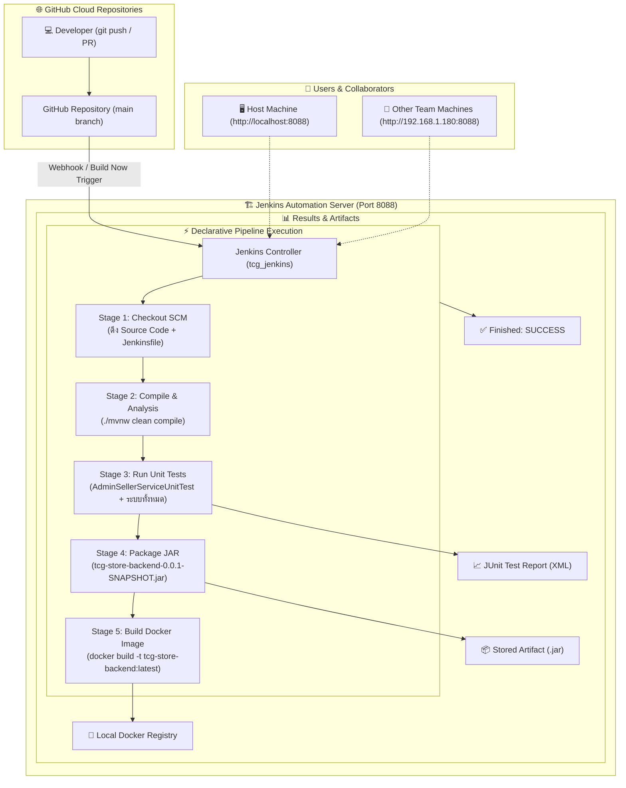

# 🛠️ คู่มือและรายละเอียดสถาปัตยกรรม Jenkins CI/CD Pipeline ฉบับสมบูรณ์ (Mythix TCG Platform)

> **โครงการ:** Mythix TCG Platform  
> **ตำแหน่งไฟล์ในคลังเอกสาร:** `tcg-store-document/docs/jenkins_cicd_comprehensive_guide.md`  
> **สถานะระบบ:** ใช้งานได้จริง 100% (Pipeline Build #3 Succeeded Green ✅)  
> **วันที่บันทึก:** 26 กันยายน 2026 (ICT)  
> **ผู้จัดทำ:** DevOps Team  

---

## 📌 สารบัญ (Table of Contents)
1. [บทนำ: Jenkins คืออะไร และเข้ามาช่วยอะไรในโปรเจกต์นี้](#1-บทนำ-jenkins-คืออะไร-และเข้ามาช่วยอะไรในโปรเจกต์นี้)
2. [โครงสร้างและตำแหน่งที่อยู่ของไฟล์ทั้งหมด](#2-โครงสร้างและตำแหน่งที่อยู่ของไฟล์ทั้งหมด-file-structure--roles)
3. [แผนผังการทำงานภาพรวม (Pipeline Lifecycle Flow)](#3-แผนผังการทำงานภาพรวม-pipeline-lifecycle-flow)
4. [เจาะลึกรายละเอียดขั้นตอนใน Jenkinsfile (Pipeline Stages Breakdown)](#4-เจาะลึกรายละเอียดขั้นตอนใน-jenkinsfile)
5. [คู่มือการติดตั้งและการเริ่มใช้งานครั้งแรก (Day-1 Setup Guide)](#5-คู่มือการติดตั้งและการเริ่มใช้งานครั้งแรก-day-1-setup-guide)
6. [คู่มือการใช้งานในการทำงานจริงหรือครั้งที่ 2 เป็นต้นไป (Day-2 Operations Guide)](#6-คู่มือการใช้งานในการทำงานจริงหรือครั้งที่-2-เป็นต้นไป-day-2-operations)
7. [การแก้ไขปัญหาที่พบบ่อยและแนวทางป้องกัน (Troubleshooting & FAQ)](#7-การแก้ไขปัญหาที่พบบ่อยและแนวทางป้องกัน-troubleshooting)

---

## 1. บทนำ: Jenkins คืออะไร และเข้ามาช่วยอะไรในโปรเจกต์นี้

### 1.1 Jenkins คืออะไร?
**Jenkins** คือ Open-source Automation Server ระดับมาตรฐานสากล ที่ออกแบบมาเพื่อบริหารจัดการกระบวนการ **CI/CD (Continuous Integration & Continuous Delivery)** โดยทำหน้าที่เป็นศูนย์กลางคอยรับคำสั่ง ดักฟังการเปลี่ยนแปลงของ Source Code บน GitHub แล้วสั่งรันขั้นตอนการ Compile, Test, Package และ Docker Build โดยอัตโนมัติ

### 1.2 Jenkins เข้ามาช่วยอะไรใน Mythix TCG Platform? (ประโยชน์หลักตามสไลด์)
1. **Faster Delivery (ส่งมอบคุณสมบัติใหม่ได้รวดเร็ว):** ไม่ต้องเสียเวลามานั่งพิมพ์คำสั่งคอมไพล์ รันเทสต์ หรือบิลด์ Image ทีละเครื่องด้วยตนเอง
2. **Improved Code Quality (ยกระดับคุณภาพโค้ด):** ทุกครั้งที่มีการ Commit หรือเปิด Pull Request ตัว Jenkins จะสั่งรัน Unit Tests ทันที (รวมถึงระบบ **Admin Platform Tests** ที่เพิ่งเพิ่มเข้ามา) หากมีโค้ดส่วนใดพัง ระบบจะแจ้งเตือนทันทีก่อนที่โค้ดเสียจะหลุดไปถึง Production
3. **Reduced Manual Effort & Eliminate Human Error (ลดภาระงานและตัดความผิดพลาดของมนุษย์):** การทดสอบและแพ็คเกจ `.jar` หรือ Docker Image ทำผ่านสคริปต์อัตโนมัติ 100%
4. **Consistent Builds (ป้องกันปัญหา "Works on my machine"):** โค้ดจะถูกนำมารันและประกอบร่างภายในสภาพแวดล้อมมาตรฐานของ Container ทำให้ผลลัพธ์เหมือนกันทุกครั้ง ไม่ขึ้นกับสภาพเครื่องของนักพัฒนาคนใดคนหนึ่ง
5. **Fast Feedback Loop (รับรู้ผลลัพธ์อย่างรวดเร็ว):** แจ้งผลสำเร็จ (SUCCESS) หรือล้มเหลว (FAILURE) ให้นักพัฒนาทราบภายในไม่กี่นาทีผ่านหน้าจอ Console Output

---

## 2. โครงสร้างและตำแหน่งที่อยู่ของไฟล์ทั้งหมด (File Structure & Roles)

ในโปรเจกต์ Mythix ได้มีการจัดวางไฟล์ที่เกี่ยวข้องกับ Jenkins ไว้อย่างเป็นระเบียบตามหลัก **Pipeline as Code (PaC)** ดังนี้:

```
c:\Devops_NEW\
│
├── docker-compose.jenkins.yml          <-- [A] คอนฟิกรัน Jenkins Server บน Docker
├── Jenkinsfile                          <-- [B] Root Pipeline สำหรับรันขนานทั้งระบบ (Full-Stack)
│
└── Code_devops\
    ├── tcg-store-backend\
    │   ├── Dockerfile                   <-- [C] Multi-stage Containerfile ของ Backend
    │   ├── Jenkinsfile                  <-- [D] Backend Spring Boot CI/CD Pipeline
    │   └── pom.xml / mvnw
    │
    ├── tcg-store-frontend\
    │   ├── Dockerfile                   <-- [E] NGINX Containerfile ของ Frontend
    │   ├── Jenkinsfile                  <-- [F] Frontend React / Vitest CI/CD Pipeline
    │   └── package.json
    │
    └── tcg-store-document\
        └── docs\
            └── jenkins_cicd_comprehensive_guide.md  <-- [เอกสารคู่มือฉบับนี้]
```

### 📋 ตารางแจกแจงหน้าที่ของแต่ละไฟล์

| ลำดับ | ตำแหน่งไฟล์ | เทคโนโลยี | หน้าที่และความรับผิดชอบ |
| :---: | :--- | :---: | :--- |
| **A** | `docker-compose.jenkins.yml` | Docker Compose | สร้างและบริหารจัดการ **Jenkins Server Container (`tcg_jenkins`)** บน Image `jenkins/jenkins:lts-jdk21` กำหนดพอร์ต `8088:8080`, พอร์ต Agent `50000`, Persistent Volume `tcg_jenkins_home` และเชื่อมต่อ `/var/run/docker.sock` |
| **B** | `Jenkinsfile` (Root) | Groovy (Declarative) | Pipeline กลางระดับองค์กร ใช้คำสั่ง `parallel` เพื่อสั่งรันขั้นตอนทดสอบ Backend CI และ Frontend CI ควบคู่กันไปพร้อมๆ กันเพื่อประหยัดเวลา และตรวจเช็คความถูกต้องของ Docker Compose |
| **C** | `tcg-store-backend/Dockerfile` | Docker Multi-stage | สคริปต์ประกอบร่าง Container ของ Backend โดยใช้ Stage 1 (`eclipse-temurin:21-jdk-alpine`) คอมไพล์ และ Stage 2 (`eclipse-temurin:21-jre-alpine`) รัน พร้อมกำหนดสิทธิ์โฟลเดอร์รูปภาพ `uploads/products` ภายใต้ Non-root user `spring` |
| **D** | `tcg-store-backend/Jenkinsfile` | Groovy (Declarative) | Pipeline เฉพาะทางของ Backend: ดึงโค้ด, คอมไพล์, รัน Unit/Integration Tests (ครอบคลุม Admin Platform), สร้างไฟล์ `.jar` และ Build Docker Image |
| **E** | `tcg-store-frontend/Dockerfile` | Docker Multi-stage | สคริปต์ประกอบร่าง Container ของ Frontend โดยใช้ Node 20 Build Web Bundle และส่งต่อไปยัง Nginx Alpine เพื่อทำหน้าที่เป็น High-performance Static Web Server |
| **F** | `tcg-store-frontend/Jenkinsfile` | Groovy (Declarative) | Pipeline เฉพาะทางของ Frontend: ดึงโค้ด, ติดตั้ง `npm ci`, รันชุดทดสอบ Vitest (รวม Admin Platform), Typecheck & Bundle และ Build Docker Container |

---

## 3. แผนผังการทำงานภาพรวม (Pipeline Lifecycle Flow)



---

## 4. เจาะลึกรายละเอียดขั้นตอนใน Jenkinsfile

### 4.1 เบื้องหลังขั้นตอนของ Backend Pipeline (`tcg-store-backend/Jenkinsfile`)

```groovy
pipeline {
    agent any

    environment {
        APP_NAME = 'tcg-store-backend'
        DOCKER_IMAGE = "tcg-store-backend:${BUILD_NUMBER}"
    }

    stages {
        // ด่านที่ 1: ดึงซอร์สโค้ดจาก Git ผ่าน Credentials ที่ผูกไว้
        stage('Checkout SCM') {
            steps {
                echo '=== Stage 1: Checkout Source Code ==='
                checkout scm
            }
        }

        // ด่านที่ 2: คอมไพล์โค้ด Java 21 เพื่อตรวจ Syntax Error
        stage('Compile & Static Analysis') {
            steps {
                echo '=== Stage 2: Compile Java Source Code ==='
                sh 'chmod +x ./mvnw || true'
                sh './mvnw clean compile -DskipTests'
            }
        }

        // ด่านที่ 3: รันชุดทดสอบ Unit Tests ทั้งหมด (รวม Admin Platform SCRUM-48)
        stage('Run Unit & Integration Tests') {
            steps {
                echo '=== Stage 3: Execute Unit & Admin Platform Tests ==='
                sh './mvnw test'
            }
            post {
                always {
                    // สร้างกราฟและเก็บบันทึกผลการทดสอบผ่าน JUnit Plugin
                    junit testResults: '**/target/surefire-reports/*.xml', allowEmptyResults: true
                }
            }
        }

        // ด่านที่ 4: ประกอบไฟล์แพ็กเกจ .jar และจัดเก็บเป็น Build Artifact
        stage('Package Application') {
            steps {
                echo '=== Stage 4: Package Spring Boot Executable JAR ==='
                sh './mvnw package -DskipTests'
                archiveArtifacts artifacts: '**/target/*.jar', fingerprint: true, allowEmptyArchive: true
            }
        }

        // ด่านที่ 5: สั่ง Docker Engine สร้าง Image ติดแท็กหมายเลข Build อัตโนมัติ
        stage('Build Docker Image') {
            steps {
                echo '=== Stage 5: Build Production Docker Image ==='
                sh "docker build -t ${DOCKER_IMAGE} -t tcg-store-backend:latest ."
            }
        }
    }

    post {
        success {
            echo "✅ [SUCCESS] Pipeline for ${env.APP_NAME} (Build #${env.BUILD_NUMBER}) completed successfully."
        }
        failure {
            echo "❌ [FAILURE] Pipeline for ${env.APP_NAME} (Build #${env.BUILD_NUMBER}) failed. Please inspect console logs."
        }
    }
}
```

---

## 5. คู่มือการติดตั้งและการเริ่มใช้งานครั้งแรก (Day-1 Setup Guide)

### ตอนที่ 1: การติดตั้งและรัน Jenkins Server (เครื่อง Host)
1. เปิดโปรแกรม **Docker Desktop** บน Windows ให้สถานะเป็นสีเขียว (Running)
2. เปิด PowerShell ที่โฟลเดอร์รากของโปรเจกต์ `c:\Devops_NEW` แล้วสั่งรัน Container:
   ```powershell
   docker compose -f docker-compose.jenkins.yml up -d
   ```
3. ดึงรหัสผ่านเริ่มต้นสำหรับปลดล็อกครั้งแรก (Initial Admin Password):
   ```powershell
   docker exec tcg_jenkins cat /var/jenkins_home/secrets/initialAdminPassword
   ```
   *(นำรหัสสตริง 32 หลักที่ได้ไปใช้ในขั้นตอนถัดไป)*

### ตอนที่ 2: การตั้งค่า Setup Wizard ครั้งแรกบนเว็บ
1. เปิดเบราว์เซอร์ไปที่: **`http://localhost:8088`**
2. นำรหัสผ่านที่ได้จากข้อ 3 ไปวางในช่อง **Administrator password** แล้วกด **Continue**
3. คลิกเลือก **Install suggested plugins** (ระบบจะลง Git, Pipeline และเครื่องมือพื้นฐานให้อัตโนมัติ)
4. ตั้งชื่อบัญชีผู้ดูแลระบบ (Admin User) และกำหนดรหัสผ่านประจำตัว
5. กด **Save and Finish** $\rightarrow$ เข้าสู่หน้าหลักของ Jenkins

### ตอนที่ 3: การเพิ่มสิทธิ์เข้าถึง GitHub (Credentials)
เนื่องจาก Repository ของเราเป็น **Private Repository**:
1. ในหน้าสร้าง Job หรือหน้า Manage Jenkins ให้หาหัวข้อ **Credentials**
2. กดปุ่ม **`+ Add` $\rightarrow$ `Jenkins`**
3. กรอกข้อมูล:
   * **Kind:** `Username with password`
   * **Username:** GitHub Username ของคุณ (เช่น `KantinanSrisuwan`)
   * **Password:** นำ **GitHub Personal Access Token (PAT)** มาวาง
   * **ID:** `github-token`
4. กด **Add**

### ตอนที่ 4: การสร้าง Pipeline Job ครั้งแรก
1. ที่หน้าหลัก Jenkins กด **`New Item`** (หรือ `Create a job`)
2. ตั้งชื่อ Job เช่น `tcg-store-backend-ci` $\rightarrow$ เลือกประเภท **`Pipeline`** $\rightarrow$ กด **OK**
3. เลื่อนลงมาล่างสุดที่หัวข้อ **Pipeline**:
   * **Definition:** เปลี่ยนเป็น **`Pipeline script from SCM`**
   * **SCM:** เลือก **`Git`**
   * **Repository URL:** วาง URL ของ Repo เช่น:
     `https://github.com/MUDST-2026-luntungsadungyong/tcg-store-backend.git`
   * **Credentials:** เลือกตัวที่เพิ่งสร้างในข้อ 3 (`KantinanSrisuwan/******`)
   * **Branch Specifier:** ระบุเป็น `*/main`
   * **Script Path:** ตรวจสอบว่าเป็น `Jenkinsfile`
4. กด **Save** $\rightarrow$ กด **Build Now** เป็นอันเสร็จสิ้น!

---

## 6. คู่มือการใช้งานในการทำงานจริงหรือครั้งที่ 2 เป็นต้นไป (Day-2 Operations)

เมื่อผ่านการตั้งค่าเริ่มต้นครั้งแรกไปแล้ว ในการทำงานประจำวันจะมีขั้นตอนที่ง่ายและสะดวกมาก โดยระบบรองรับการเข้าใช้งาน 2 รูปแบบ: **ภายในวง LAN/Wi-Fi เดียวกัน** และ **การเข้าใช้งานผ่านอินเทอร์เน็ตภายนอก (Remote via ngrok Tunnel)**

---

### 🔑 ข้อมูลบัญชีผู้ใช้สำหรับเข้าสู่ระบบ (Credentials)
สำหรับทีมงานหรือผู้ตรวจประเมิน สามารถใช้ข้อมูลล็อกอินมาตรฐานดังนี้:
* **Username:** `admin`  
  *(⚠️ ข้อควรระวัง: ต้องพิมพ์ `admin` ตัวพิมพ์เล็กล้วน **ห้ามพิมพ์** `Kantinan_admin` เนื่องจากเป็นเพียงชื่อแสดงผล Display Name)*
* **Password:** `admin`

---

### 🖥️ 6.1 ฝั่ง Server (เครื่อง Host ที่เปิดให้บริการ)

#### 1) การเปิดและปิดระบบ Jenkins
* เมื่อเปิดคอมพิวเตอร์ขึ้นมาใหม่ สามารถสั่งเปิด Jenkins ได้ทันที:
  ```powershell
  docker compose -f docker-compose.jenkins.yml start
  ```
* เมื่อต้องการหยุดการทำงานชั่วคราว:
  ```powershell
  docker compose -f docker-compose.jenkins.yml stop
  ```

#### 2) การตรวจสอบสถานะการทำงาน
* เช็คดูว่า Jenkins ยังทำงานอยู่หรือไม่:
  ```powershell
  docker ps --filter "name=tcg_jenkins"
  ```
* ดูบันทึกการทำงานแบบ Real-time:
  ```powershell
  docker logs -f tcg_jenkins
  ```

#### 3) การเปิดช่องทางเชื่อมต่อให้เครื่องอื่น (Local LAN & Remote Internet)
* **กรณีเครื่องอื่นอยู่ในวง Wi-Fi / LAN เดียวกัน:**
  * เครื่อง Host ตรวจสอบ IP เครื่องตนเอง (เช่น `192.168.1.180` หรือ `192.168.1.135`)
  * เครื่องอื่นๆ สามารถเปิดเบราว์เซอร์เข้าตรงได้ที่: `http://192.168.1.180:8088`

* **กรณีเครื่องอื่นอยู่คนละวงแลน / อินเทอร์เน็ตภายนอก (ผ่าน ngrok):**
  * เปิด PowerShell บนเครื่อง Host แล้วสั่งรัน:
    ```powershell
    ngrok http 8088
    ```
  * หน้าต่าง ngrok จะแสดง URL สาธารณะ (เช่น `https://designing-gallery-arbitrate.ngrok-free.dev`)
  * ส่ง URL นี้ให้เพื่อนร่วมทีมหรือผู้ตรวจประเมินเข้าใช้งานได้จากทุกที่ทั่วโลก!

---

### 💻 6.2 ฝั่ง Client (เครื่องเพื่อนร่วมทีม หรือ อาจารย์)

เครื่อง Client **ไม่จำเป็นต้องติดตั้งโปรแกรม Jenkins, Java, หรือ Docker ใดๆ ทั้งสิ้น**:

#### 1) การเข้าสู่ระบบ Jenkins จากเครื่องอื่น
* **หากต่อ Wi-Fi / LAN วงเดียวกันกับ Server:**
  1. เปิด Web Browser แล้วไปที่: `http://192.168.1.180:8088`
* **หากอยู่คนละวงแลน (ต่อผ่านเน็ตมือถือ 4G/5G หรือเน็ตบ้านอื่น):**
  1. เปิด Web Browser ไปที่ลิงก์ ngrok ที่ Host ส่งให้ เช่น:
     `https://designing-gallery-arbitrate.ngrok-free.dev`
  2. เมื่อเจอหน้าต่างแจ้งเตือนความปลอดภัยของ ngrok ให้คลิกปุ่ม **`Visit Site`**
* **หน้าเข้าสู่ระบบ (Login):**
  * กรอก **Username:** `admin`
  * กรอก **Password:** `admin`
  * กดปุ่ม **Sign in** เพื่อเข้าสู่หน้าจัดการระบบ

#### 2) การสั่งรันงาน (Trigger Build)
1. คลิกเลือก Pipeline Job ที่ต้องการ เช่น `tcg-store-backend-ci`
2. คลิกปุ่ม **`Build Now`** ที่เมนูด้านซ้าย
3. ระบบ Jenkins บนเครื่อง Server จะดึงโค้ดล่าสุดจาก GitHub `main` มารันกระบวนการทดสอบและประกอบร่างให้อัตโนมัติ

#### 3) การตรวจผลลัพธ์และดาวน์โหลด Artifacts
* **ดูไทม์ไลน์แต่ละด่าน:** ตรวจสอบความคืบหน้าผ่าน **Stage View** (Checkout -> Compile -> Unit Tests -> Package -> Docker Build)
* **ดู Log ละเอียด:** คลิกที่หมายเลข Build (เช่น `#3`) $\rightarrow$ เลือก **`Console Output`** จะเห็นผลการรัน Maven และ Unit Tests ทั้ง 10 เคส
* **ดาวน์โหลดไฟล์ผลลัพธ์:** สามารถคลิกดาวน์โหลดไฟล์ `.jar` ภายใต้หัวข้อ **Build Artifacts** (`tcg-store-backend-0.0.1-SNAPSHOT.jar`) ลงมาเก็บไว้ที่เครื่อง Client ได้ทันที

---

## 7. การแก้ไขปัญหาที่พบบ่อยและแนวทางป้องกัน (Troubleshooting)

### ⚠️ ปัญหาที่ 1: `Failed to connect to repository` (Error code 128)
* **อาการ:** ใส่ Repository URL ใน Jenkins แล้วขึ้นแถบสีแดงแจ้งว่า Authentication failed
* **สาเหตุ:** Repository เป็นแบบ Private แต่ไม่ได้เลือก Credentials หรือใส่ Password แทน Personal Access Token
* **วิธีแก้:** ตรวจสอบว่าในช่อง Credentials ได้เลือก Token ที่มีสิทธิ์ `repo` และ `read:org` ครบถ้วน

### ⚠️ ปัญหาที่ 2: `mkdir: cannot create directory ‘uploads’: Permission denied`
* **อาการ:** Pipeline รัน Unit Tests ผ่านหมดแล้ว แต่มาล้มเหลวที่ด่าน `Build Docker Image`
* **สาเหตุ:** ภายใน `Dockerfile` มีการสลับไปเป็น Non-root user (`USER spring:spring`) ก่อนคำสั่งสร้างโฟลเดอร์ ทำให้ติดสิทธิ์ Permission ของ Linux
* **วิธีแก้:** ต้องสร้างโฟลเดอร์และกำหนดเจ้าของสิทธิ์ (`chown -R spring:spring /app`) ตั้งแต่ตอนที่ยังเป็นสิทธิ์ root ก่อนที่จะเรียกใช้ `USER spring:spring` *(แก้ไขเรียบร้อยแล้วใน Commit `47a0dde`)*

### ⚠️ ปัญหาที่ 3: `ERROR: Unable to find Jenkinsfile from git`
* **อาการ:** สั่ง Build Now แล้วระบบแจ้งว่าหาไฟล์ `Jenkinsfile` ไม่เจอ
* **สาเหตุ:** เขียนไฟล์ `Jenkinsfile` ไว้ในเครื่อง Local แต่ยังไม่ได้ทำการ `git push` ขึ้นไปยัง Branch ที่กำหนดบน GitHub
* **วิธีแก้:** ดำเนินการ `git add Jenkinsfile`, `git commit` และ `git push origin main` ให้เรียบร้อยก่อนสั่งรัน Job

---

> 🎯 **บทสรุป:**  
> ปัจจุบันโปรเจกต์ Mythix TCG Platform มีระบบ **Continuous Integration (CI)** ที่สมบูรณ์แบบ ทั้งบน **GitHub Actions** (รันอัตโนมัติบน Cloud เมื่อมี PR) และ **Jenkins Automation Server** (รันอัตโนมัติหรือสั่งรัน Manual ภายใน Local/Private Environment) รองรับการพัฒนาและทดสอบระบบระดับองค์กรได้อย่างมีเสถียรภาพสูงสุด
