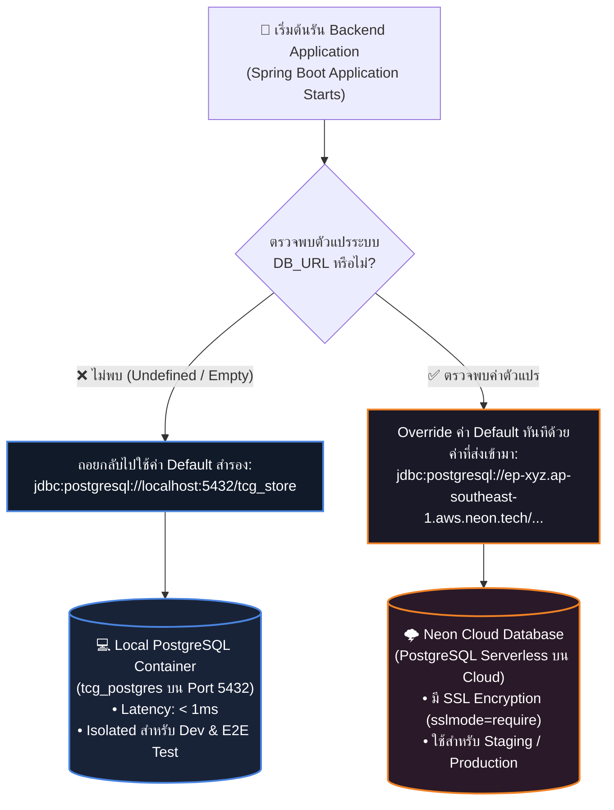
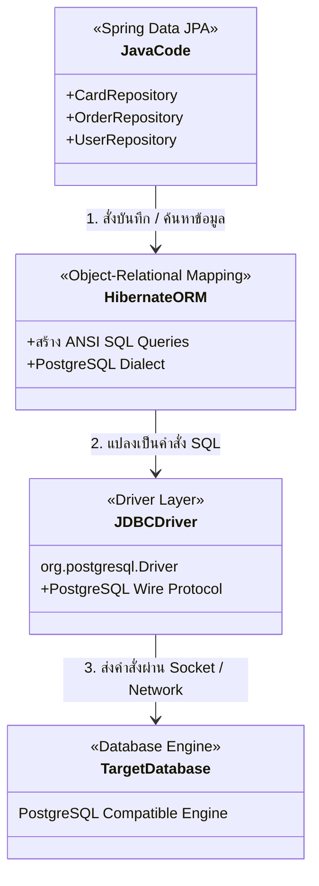

# 🌐 คู่มือสถาปัตยกรรม: Spring Boot ใน application.yml สลับเรียกใช้ Local vs Cloud Database อย่างไร?

> **โปรเจกต์:** Mythix TCG Marketplace Platform  
> **หมวดหมู่:** `Database / Cloud Architecture`  
> **ไฟล์คอนฟิกหลัก:** [`Code_devops/tcg-store-backend/src/main/resources/application.yml`](file:///c:/Devops_NEW/Code_devops/tcg-store-backend/src/main/resources/application.yml)  
> **สถานะ:** 📖 เอกสารอธิบายเชิงสถาปัตยกรรม (Architecture Reference Guide)

---

## 📌 1. บทนำ (Introduction)

ในระบบระดับ Enterprise และงาน DevOps ยุคใหม่ เรายึดหลักการของ **12-Factor App (Config Isolation)**:
> *"Codebase ต้องมีเพียงชุดเดียว แต่สามารถนำไปรันได้ในทุกสภาพแวดล้อม (Local, Testing, Staging, Production) โดยไม่มีการแก้โค้ดแม้แต่บรรทัดเดียว"*

คำถามสำคัญคือ: **Spring Boot รู้ได้อย่างไรว่าจะเชื่อมต่อ Local PostgreSQL ในเครื่อง หรือจะเชื่อมต่อ Cloud Database (เช่น Neon, AWS RDS, Supabase) และกลไกนี้ทำงานอย่างไรในทางปฏิบัติ?**

---

## ⚙️ 2. ถอดรหัสไวยากรณ์ใน `application.yml`

เปิดดูส่วน Datasource ในไฟล์ [`application.yml`](file:///c:/Devops_NEW/Code_devops/tcg-store-backend/src/main/resources/application.yml#L14-L18):

```yaml
spring:
  datasource:
    url: ${DB_URL:jdbc:postgresql://localhost:5432/tcg_store}
    username: ${DB_USERNAME:postgres}
    password: ${DB_PASSWORD:postgres}
    driver-class-name: org.postgresql.Driver
```

ไวยากรณ์นี้เรียกว่า **Spring Property Placeholder Resolution** มีโครงสร้างดังนี้:

$$\Large \$\{ \text{ตัวแปร Environment} : \text{ค่าเริ่มต้นสำรอง (Fallback Default)} \}$$

```text
       ┌─────────────────────────────── ตัวแปรที่ระบบจะตรวจหาก่อน
       │         ┌───────────────────── เครื่องหมายคั่น (Separator)
       ▼         ▼
  ${ DB_URL : jdbc:postgresql://localhost:5432/tcg_store }
              ▲
              └──────────────────────── ค่าที่จะถูกใช้เมื่อ "ไม่พบ" ตัวแปรด้านหน้า
```

### ลำดับความสำคัญในการค้นหาค่า Config (Property Resolution Order):
Spring Boot จะตรวจสอบหาค่าตามลำดับจากบนลงล่าง:
1. **Command Line Argument:** เช่น `--spring.datasource.url=...` (มีความสำคัญสูงสุด)
2. **OS Environment Variables:** ตัวแปรในระบบปฏิบัติการ เช่น `DB_URL`
3. **Application Properties/YAML (`application.yml`):** ค่า Fallback หลังเครื่องหมาย `:` (ใช้เป็นทางเลือกสุดท้าย)

---

## 🔄 3. ภาพจำลองการทำงานเปรียบเทียบ 2 สภาพแวดล้อม (Local vs Cloud)



### 💻 กรณีที่ 1: การรันบนเครื่อง Local (Local Dev & E2E Test)
* **สิ่งที่เราทำ:** เราเปิด Terminal แล้วสั่งรันแอปพลิเคชันตามปกติ:
  ```bash
  # รันผ่าน Docker หรือ IDE โดยไม่ได้ตั้งตัวแปร DB_URL ในระบบ
  docker compose up -d
  ```
* **สิ่งที่ Spring Boot ทำ:**
  1. ตรวจสอบในระบบว่ามีตัวแปร `DB_URL` หรือไม่ ➔ **ไม่พบ**
  2. Spring Boot จะถอยกลับมาใช้ค่าหลังเครื่องหมาย `:` ทันที
  3. ผลลัพธ์: แอปเชื่อมต่อไปยัง `jdbc:postgresql://localhost:5432/tcg_store` บนเครื่องเราอย่างปลอดภัย

### ☁️ กรณีที่ 2: การรันชี้ไปยัง Cloud Database (Neon / AWS RDS)
* **สิ่งที่เราทำ:** เราป้อนตัวแปร Environment ให้กับ Process ก่อนรัน เช่น:
  * **ในเครื่อง Local (ทดสอบต่อ Cloud ชั่วคราว):**
    ```bash
    # Windows PowerShell
    $env:DB_URL="jdbc:postgresql://ep-example-123456.ap-southeast-1.aws.neon.tech/tcg_store?sslmode=require"
    $env:DB_USERNAME="neon_admin"
    $env:DB_PASSWORD="neon_secure_password"
    ./mvnw spring-boot:run
    ```
  * **บน Cloud Hosting Dashboard (Render / Railway / AWS):**
    กรอกในช่อง Environment Variables:
    * Key: `DB_URL` ➔ Value: `jdbc:postgresql://ep-example-123456.neon.tech/tcg_store?sslmode=require`
* **สิ่งที่ Spring Boot ทำ:**
  1. ตรวจพบว่ามีตัวแปร `DB_URL` อยู่ในระบบ
  2. Spring Boot นำค่า URL ของ Neon มาใช้งานทันที และ **ข้ามค่า Default (`localhost:5432`) ไปทั้งหมด**
  3. ผลลัพธ์: แอปจะวิ่งออกอินเทอร์เน็ตไปเชื่อมต่อกับ Neon Cloud Database

---

## ❓ 4. ทำไมเพื่อนถึงบอกว่า "ไม่ส่งผลกระทบต่อ Code เลย"?

เหตุผลที่ **ไม่ต้องแก้โค้ด Java แม้แต่บรรทัดเดียว** เกิดจากโครงสร้างสถาปัตยกรรม **JDBC Abstraction**:



1. **JPA & Hibernate คือตัวกลาง:** โค้ด Java ของเราไม่เคยติดต่อ Database ตรงๆ แต่คุยผ่าน `Repository` และ `Entity`
2. **PostgreSQL Wire Protocol:** Neon คือ PostgreSQL 100% (ไม่ใช่ Database ชนิดใหม่) ดังนั้น Driver ที่ใช้จึงเป็น `org.postgresql.Driver` ตัวเดียวกัน
3. **สิ่งที่เปลี่ยนมีเพียง Network Endpoint:** ความแตกต่างมีแค่ปลายทางของ IP/Domain Name เท่านั้น ระบบจัดการข้อมูลภายในยังเป็น SQL เหมือนเดิมทุกประการ

---

## 🚀 5. Git กับ Cloud: เรา "Push" ฐานข้อมูลขึ้น Cloud อย่างไร?

หลายคนมักเข้าใจผิดว่าการเอา Database ขึ้น Cloud ทำได้ผ่าน `git push` ซึ่ง **ไม่เป็นความจริง**:

| เครื่องมือ | สิ่งที่จัดเก็บและรับผิดชอบ | วิธีนำขึ้น Cloud |
| :--- | :--- | :--- |
| **Git & GitHub** | **Code & Text Files** เท่านั้น (`.java`, `.tsx`, `.sql`, `.yml`) | `git push origin main` |
| **Neon / Database** | **Data & Tables** จริง (Row ข้อมูล, ตาราง, Index) | รันไฟล์ SQL บน Cloud Console หรือใช้ Migration Tool |

### ขั้นตอนการนำระบบขึ้น Cloud ทั้งระบบอย่างถูกต้อง:

```mermaid
sequenceDiagram
    autonumber
    actor Dev as 👩‍💻 นักพัฒนา (Developer)
    participant Neon as 🌩️ Neon Database Console
    participant Git as 🐙 GitHub Repository
    participant Host as 🚀 Cloud App Server (Render/Railway)

    rect rgb(25, 35, 56)
    Note over Dev,Neon: ขั้นตอนที่ 1: เตรียม Database บน Cloud (ทำครั้งแรก)
    Dev->>Neon: 1. สร้าง Project บน neon.tech
    Dev->>Neon: 2. Copy คำสั่งจาก 01-schema.sql และ 02-data.sql ไปรันใน SQL Editor
    Neon-->>Dev: 3. รับ Connection String (URL + Password)
    end

    rect rgb(30, 45, 40)
    Note over Dev,Git: ขั้นตอนที่ 2: นำ Code ขึ้น Repository
    Dev->>Git: 4. git push origin main (นำโค้ดล่าสุดขึ้น GitHub)
    end

    rect rgb(45, 30, 40)
    Note over Git,Host: ขั้นตอนที่ 3: เชื่อมต่อ Application กับ Database บน Cloud
    Git->>Host: 5. ดึงโค้ดไป Build เป็น Docker Container
    Dev->>Host: 6. กรอก Environment Variable (DB_URL จาก Neon) ลงใน Host Dashboard
    Host->>Neon: 7. Backend บูตขึ้นมา แล้วเชื่อมต่อ Neon Cloud Database สำเร็จ!
    end
```



---

## 🛡️ 6. กฎเหล็กความปลอดภัย & Best Practices (Security Rules)

1. **ห้าม Hardcode Connection String ของ Cloud ลงใน Git:**
   * ในไฟล์ [`application.yml`](file:///c:/Devops_NEW/Code_devops/tcg-store-backend/src/main/resources/application.yml) ต้องมีเฉพาะโครงสร้าง `${DB_URL:...}` เท่านั้น ห้ามใส่ Username/Password จริงของ Cloud ลงไป
2. **ใช้ไฟล์ `.env` ที่อยู่ใน `.gitignore`:**
   * หากต้องการเชื่อมต่อ Cloud บนเครื่องตัวเอง ให้ใส่ตัวแปรไว้ใน `.env` ส่วนตัว และตรวจสอบว่ามีชื่อ `.env` อยู่ใน `.gitignore` เสมอ
3. **การแยก Database สำหรับ Automated Testing (E2E / Unit Test):**
   * **ห้ามรัน Automated Test หรือ Cypress ยิงใส่ Production Cloud Database เด็ดขาด** เพราะจะทำให้เกิดข้อมูลขยะ (Pollution) และเสี่ยงต่อการลบข้อมูลจริง
   * ชุดทดสอบ E2E ควรทำงานบน **Local Docker PostgreSQL** เสมอ เพื่อความเร็ว (Latency ต่ำ) และสามารถล้างข้อมูล (Teardown) ได้สะอาด 100%

---

## 📊 7. ตารางสรุปเปรียบเทียบ Local vs Cloud Database

| หัวข้อ | Local Database (Docker Compose) | Cloud Database (Neon Serverless) |
| :--- | :--- | :--- |
| **จุดประสงค์หลัก** | การพัฒนาในเครื่อง (Local Dev), Unit Test, Cypress E2E | ทดสอบระบบร่วม (Staging), ใช้งานจริง (Production) |
| **URL Connection** | `jdbc:postgresql://localhost:5432/tcg_store` | `jdbc:postgresql://ep-xxx.neon.tech/tcg_store?sslmode=require` |
| **ความเร็ว (Latency)** | สูงมาก (< 1 ms ผ่าน Internal Network) | ขึ้นกับความเร็วอินเทอร์เน็ต (~50 - 200 ms) |
| **การเข้าถึง** | เข้าถึงได้เฉพาะเครื่องของเรา | เข้าถึงได้จากทุกที่ผ่านอินเทอร์เน็ต (มีสิทธิ์) |
| **การจัดการข้อมูลเทส** | สั่ง Reset / ลบขยะ (Teardown) ได้อิสระ | ต้องระวังไม่ให้ข้อมูลทดสอบปนเปื้อนข้อมูลจริง |
| **ค่าใช้จ่าย** | ฟรี 100% บนทรัพยากรเครื่องตัวเอง | มีโควตา Free Tier / มีค่าใช้จ่ายตามปริมาณการใช้งาน |
