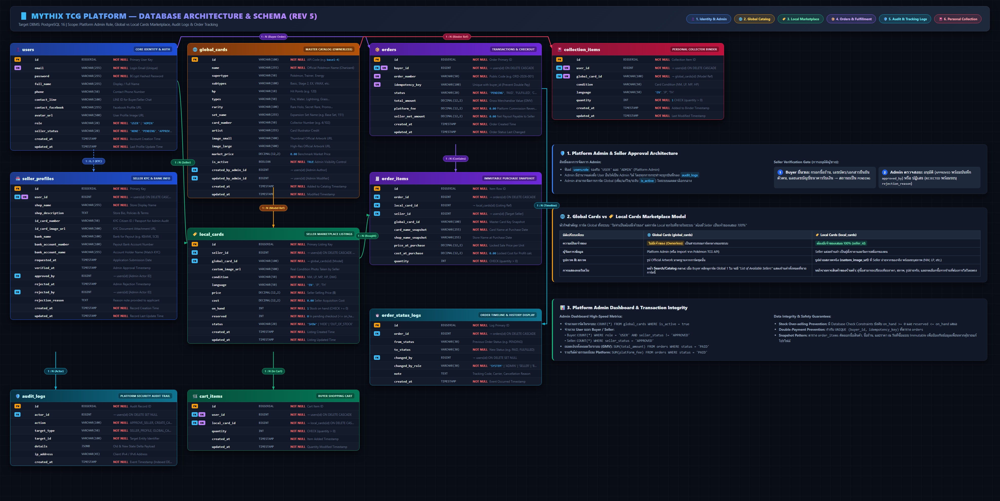
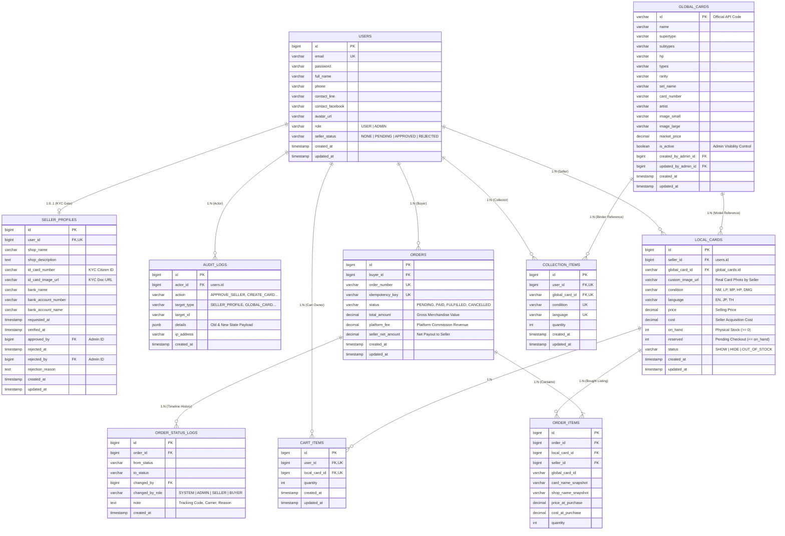
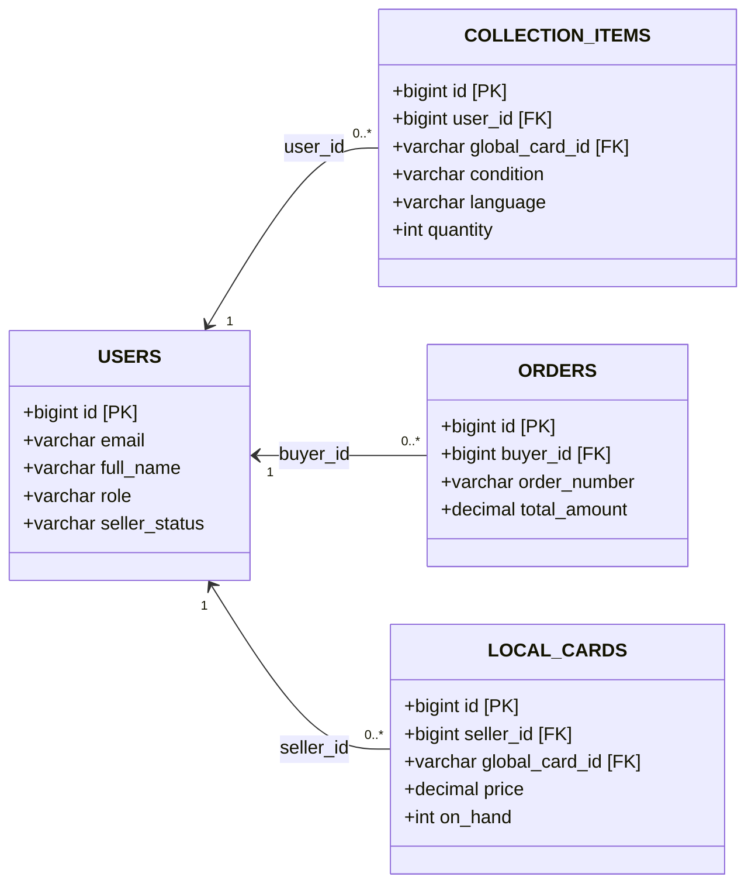

# 🗄️ Database Architecture & Data Model Specification — Mythix TCG Platform (Revision 5)

> **ฉบับปรับปรุงโครงสร้างสถาปัตยกรรมฐานข้อมูลระดับองค์กร (Enterprise Revision 5)**  
> รองรับ: **Platform Admin**, **Global vs. Local Cards Architecture**, **Seller KYC Verification Gate**, **Security Audit Trail** และ **Order Fulfillment Timeline Tracking**  
> 🖼️ **ภาพไดอะแกรมความละเอียดสูงระดับ 4K (3950 × 1980):** [database_er_diagram.png](database_er_diagram.png)  
> 🌐 **Interactive ERD Layout Source:** [database_architecture_detailed.html](database_architecture_detailed.html)

---

## 📌 1. ภาพรวมสถาปัตยกรรม (Database Architecture Overview)

สถาปัตยกรรมฐานข้อมูลของ **Mythix TCG Platform** บน **PostgreSQL 16** ประกอบด้วย **10 ตารางหลัก** ที่ออกแบบตามหลัก 3rd Normal Form (3NF) ผสานกับ Snapshot Pattern สำหรับข้อมูลทางธุรกรรม เพื่อรับประกันความถูกต้องแม่นยำ ป้องกันการ Over-selling และรองรับ Audit Trail ทุกกิจกรรมสำคัญ





---

## 🎯 2. สรุปความต้องการและการตอบโจทย์สถาปัตยกรรม (Requirements Alignment)

### 2.1 โครงสร้าง Role Admin Platform
1. **Audit Log:** มีตาราง `audit_logs` บันทึกทุกความเคลื่อนไหว (Actor, Action, Target, IP Address, JSONB Payload) โดยเฉพาะการกระทำของ Admin
2. **จัดการการ์ดที่เป็น Global:** Admin ควบคุมตาราง `global_cards` ทั้งการเพิ่ม/แก้ไข/ซ่อนการ์ด (`is_active`) พร้อมบันทึก `created_by_admin_id` และ `updated_by_admin_id`
3. **Approve ผู้ซื้อยืนยันตัวตนเป็นผู้ขาย (Seller KYC):**
   - Buyer กรอกข้อมูลยืนยันตัวตนใน `seller_profiles` (`id_card_number`, `id_card_image_url`, `bank_account_number`, `bank_account_name`)
   - ปรับสถานะ `users.seller_status = 'PENDING'`
   - Admin ตรวจสอบและเลือก **อนุมัติ (APPROVED)** โดยบันทึก `approved_by` หรือ **ปฏิเสธ (REJECTED)** พร้อมบันทึก `rejected_by` และ `rejection_reason`
4. **เพิ่ม/เลื่อนขั้น User เป็น Admin:** จัดการผ่านฟิลด์ `users.role` (`'USER'` หรือ `'ADMIN'`) และบันทึก Audit Trail
5. **Admin Dashboard Metrics:**
   - นับจำนวนการ์ดในระบบ: `SELECT COUNT(*) FROM global_cards WHERE is_active = true`
   - นับจำนวนผู้ใช้แยกตามประเภท:
     - Buyer: `SELECT COUNT(*) FROM users WHERE role = 'USER' AND seller_status != 'APPROVED'`
     - Seller: `SELECT COUNT(*) FROM users WHERE seller_status = 'APPROVED'`
   - ดูยอดเงินหมุนเวียนในระบบ: `SELECT SUM(total_amount) AS gmv, SUM(platform_fee) AS earnings FROM orders WHERE status = 'PAID'`
6. **Display Log Order / Timeline:** มีตาราง `order_status_logs` เก็บทุก Event ที่เกิดขึ้นในคำสั่งซื้อ รองรับการนำไป Render หน้าเว็บเป็น Timeline พร้อมระบุผู้กระทำ (`changed_by_role`), Tracking Number และขนส่ง

---

### 2.2 การแยก Global Cards กับ Local Cards อย่างเด็ดขาด

| มิติเปรียบเทียบ | 🌐 การ์ด Global (`global_cards`) | 🏷️ การ์ด Local (`local_cards`) |
| :--- | :--- | :--- |
| **ความเป็นเจ้าของ** | **ไม่มีเจ้าของ (Ownerless)** เป็นดาต้าเบสแม่บทกลางของระบบ | **มีผู้ขายเป็นเจ้าของ 100% (`seller_id`)** |
| **ผู้จัดการข้อมูล** | Platform Admin หรือ Cron Job ดึงจาก Pokémon TCG API | ผู้ขาย (Seller) แต่ละร้านค้าเป็นผู้ตั้งราคาและจัดการสต๊อก |
| **รูปภาพ & สภาพ** | Official Artwork ความละเอียดสูงจากผู้ผลิต | **รูปถ่ายสภาพการ์ดจริง (`custom_image_url`)** ที่ Seller ถ่ายเอง พร้อมระบุสภาพ (NM, LP, MP, HP, DMG) |
| **การแสดงผลบนเว็บ** | หน้า Search / Catalog กลาง: เมื่อ Buyer คลิกเลือกการ์ด จะพบลิสต์ "ร้านค้าที่ลงขายการ์ดใบนี้" ทั้งหมด | หน้ารายการสินค้าของร้านค้านั้นๆ ผู้ซื้อสามารถเปรียบเทียบราคา สภาพ รูปถ่ายจริง และหยิบใส่ตะกร้าได้ |

---

### 2.3 สถาปัตยกรรม Collection (Personal Binder) และความสัมพันธ์ 1:N ของตาราง `users`

#### 1) การรองรับ Collection ของทั้ง Buyer และ Seller
- ในระบบ Mythix แพลตฟอร์มใช้ Entity แม่เพียงตารางเดียวคือ `users` ในการระบุตัวตนของผู้ใช้ทุกคน
- **ไม่ว่าผู้ใช้จะเป็น Buyer ทั่วไป หรือ Seller ที่ได้รับการยืนยันตัวตนแล้ว** ผู้ใช้ทุกคนต่างมีสิทธิ์เป็น "นักสะสม (Collector)"
- ข้อมูลการ์ดสะสมส่วนตัว (Personal Binder) จะถูกจัดเก็บแยกในตาราง **`collection_items`** ซึ่งเชื่อมโยงการ์ดต้นแบบระดับสากล (`global_cards`) เข้ากับผู้ใช้แต่ละคน พร้อมระบุสภาพ (`condition`), ภาษา (`language`) และจำนวนการ์ดที่ครอบครอง (`quantity`)

#### 2) เหตุผลเชิงสถาปัตยกรรมที่ตาราง `users` ไม่มีฟิลด์ `collection_item_id`
ในการออกแบบฐานข้อมูลเชิงสัมพันธ์ระดับองค์กร (Relational Database Design) ตามมาตรฐาน **3rd Normal Form (3NF)**:
1. **ความสัมพันธ์แบบ 1 ต่อ กลุ่ม (1:N One-to-Many Relationship):**
   - ผู้ใช้ 1 คน (`users`) สามารถมีรายการสะสมในสมุดสะสมการ์ดได้หลายร้อยหลายพันรายการ ($1 \text{ User} \rightarrow N \text{ Collection Items}$)
   - เช่นเดียวกับคำสั่งซื้อ ($1 \text{ User} \rightarrow N \text{ Orders}$) หรือการลงขายสินค้า ($1 \text{ Seller} \rightarrow N \text{ Local Cards}$)
2. **การปฏิบัติตามกฎ First Normal Form (1NF):**
   - หากเรานำฟิลด์ `collection_item_id` ไปใส่ในตาราง `users` จะทำให้ผู้ใช้แต่ละคนผูกการ์ดสะสมได้เพียงใบเดียวเท่านั้น หรือหากเก็บเป็น Array/Comma-separated จะเป็นการละเมิดหลัก 1NF (Atomic Values) อย่างรุนแรง ทำให้ไม่สามารถทำ Indexing, Foreign Key Integrity Constraint หรือ Query กรองข้อมูลสภาพการ์ดได้อย่างมีประสิทธิภาพ
3. **หลักการ Foreign Key Placement ของสถาปัตยกรรม Parent-Child:**
   - **ตารางแม่ (Parent Table: `users`)**: ทำหน้าที่เก็บข้อมูล Identity, Credential และ Profile กลาง มี Primary Key คือ `id`
   - **ตารางลูก (Child Tables)**: เป็นฝ่ายถือ Foreign Key ชี้กลับมาหา `users.id` เสมอ ได้แก่:
     - `collection_items.user_id` $\rightarrow$ บ่งบอกว่าการ์ดสะสมใบนี้อยู่ในแฟ้มของใคร
     - `orders.buyer_id` $\rightarrow$ บ่งบอกว่าออเดอร์นี้เป็นของผู้ซื้อคนใด
     - `local_cards.seller_id` $\rightarrow$ บ่งบอกว่าสินค้าใบนี้ลงขายโดยร้านค้าใด
     - `cart_items.user_id` $\rightarrow$ บ่งบอกว่าตะกร้าใบนี้เป็นของผู้ใช้คนใด



#### 3) ตัวอย่างการสืบค้นข้อมูล Collection ของผู้ใช้งาน (Query Pattern)
เมื่อระบบต้องการแสดงหน้ารายการสมุดสะสมการ์ด (Binder) ของผู้ใช้ (ไม่ว่าจะเป็น Buyer หรือ Seller) Backend Service จะใช้คำสั่ง SQL ผ่าน Foreign Key ดังนี้:

```sql
-- ดึงรายการสมุดสะสมการ์ดของผู้ใช้งาน ID = 1 พร้อมข้อมูลการ์ดระดับสากล
SELECT 
    ci.id AS collection_item_id,
    ci.user_id,
    u.full_name AS owner_name,
    gc.id AS global_card_id,
    gc.name AS card_name,
    gc.set_name,
    gc.rarity,
    gc.image_small,
    ci.condition,
    ci.language,
    ci.quantity,
    ci.created_at
FROM collection_items ci
JOIN users u ON ci.user_id = u.id
JOIN global_cards gc ON ci.global_card_id = gc.id
WHERE ci.user_id = 1
ORDER BY ci.created_at DESC;
```

---

## 📊 3. พจนานุกรมข้อมูลฉบับสมบูรณ์ (Data Dictionary)

### 3.1 ตารางกลุ่ม Identity & Authentication

#### ตาราง `users` (ผู้ใช้งานระบบ)
| คอลัมน์ | ชนิดข้อมูล | Constraints | รายละเอียด |
| :--- | :--- | :--- | :--- |
| `id` | BIGSERIAL | **PK**, NOT NULL | รหัสผู้ใช้งาน |
| `email` | VARCHAR(255) | **UK**, NOT NULL | อีเมลล็อกอิน |
| `password` | VARCHAR(255) | NOT NULL | รหัสผ่าน Hashed ด้วย BCrypt |
| `full_name` | VARCHAR(255) | NOT NULL | ชื่อ-นามสกุล หรือ Display Name |
| `phone` | VARCHAR(50) | NULL | เบอร์โทรศัพท์ |
| `contact_line` | VARCHAR(100) | NULL | LINE ID สำหรับติดต่อ |
| `contact_facebook` | VARCHAR(255) | NULL | Facebook Profile URL |
| `avatar_url` | VARCHAR(500) | NULL | ลิงก์รูปโปรไฟล์ |
| `role` | VARCHAR(20) | NOT NULL, DEFAULT `'USER'` | สิทธิ์ในระบบ: `'USER'`, `'ADMIN'` |
| `seller_status` | VARCHAR(20) | NOT NULL, DEFAULT `'NONE'` | สถานะร้านค้า: `'NONE'`, `'PENDING'`, `'APPROVED'`, `'REJECTED'` |
| `created_at` | TIMESTAMP | NOT NULL, DEFAULT `CURRENT_TIMESTAMP` | วันที่สมัครสมาชิก |
| `updated_at` | TIMESTAMP | NOT NULL, DEFAULT `CURRENT_TIMESTAMP` | วันที่อัปเดตข้อมูลล่าสุด |

> 💡 **หมายเหตุเชิงสถาปัตยกรรม (Architectural Note):**  
> ตาราง `users` ไม่ได้มีคอลัมน์ `collection_item_id`, `order_id` หรือ `local_card_id` เนื่องจากความสัมพันธ์เป็นแบบ **1:N (One-to-Many)** โดย `users` ทำหน้าที่เป็น Parent Entity กลาง ข้อมูลความสัมพันธ์จะเก็บไว้ที่ตารางลูกเสมอผ่าน Foreign Key:
> - `collection_items.user_id` $\rightarrow$ แฟ้มสะสมการ์ดส่วนตัวของ User
> - `orders.buyer_id` $\rightarrow$ ประวัติคำสั่งซื้อของ User
> - `local_cards.seller_id` $\rightarrow$ รายการสินค้าที่ User วางขาย
> - `cart_items.user_id` $\rightarrow$ สินค้าในตะกร้าของ User

---

#### ตาราง `seller_profiles` (โปรไฟล์ร้านค้าและการยืนยันตัวตน KYC)
| คอลัมน์ | ชนิดข้อมูล | Constraints | รายละเอียด |
| :--- | :--- | :--- | :--- |
| `id` | BIGSERIAL | **PK**, NOT NULL | รหัสโปรไฟล์ร้านค้า |
| `user_id` | BIGINT | **FK**, **UK**, NOT NULL | อ้างอิง `users.id` (ON DELETE CASCADE) |
| `shop_name` | VARCHAR(255) | NOT NULL | ชื่อร้านค้าที่แสดงบน Marketplace |
| `shop_description`| TEXT | NULL | นโยบายร้าน รายละเอียดการจัดส่ง |
| `id_card_number` | VARCHAR(50) | NULL | เลขประจำตัวประชาชน 13 หลัก (KYC) |
| `id_card_image_url`| VARCHAR(500) | NULL | URL เอกสาร/ภาพถ่ายบัตรประชาชน |
| `bank_name` | VARCHAR(100) | NULL | ธนาคารรับเงิน (เช่น KBANK, SCB) |
| `bank_account_number` | VARCHAR(100) | NULL | เลขที่บัญชีธนาคารสำหรับรับเงินโอน |
| `bank_account_name` | VARCHAR(255) | NULL | ชื่อบัญชีธนาคาร (ต้องตรงกับบัตร) |
| `requested_at` | TIMESTAMP | NULL | วันที่ส่งคำขอยืนยันตัวตน |
| `verified_at` | TIMESTAMP | NULL | วันที่ Admin กดอนุมัติร้านค้า |
| `approved_by` | BIGINT | **FK**, NULL | Admin ID ผู้อนุมัติ (`users.id`) |
| `rejected_at` | TIMESTAMP | NULL | วันที่ Admin กดปฏิเสธคำขอ |
| `rejected_by` | BIGINT | **FK**, NULL | Admin ID ผู้ปฏิเสธ (`users.id`) |
| `rejection_reason`| TEXT | NULL | เหตุผลการปฏิเสธที่ส่งแจ้งให้ Buyer ทราบ |
| `created_at` | TIMESTAMP | NOT NULL, DEFAULT `CURRENT_TIMESTAMP` | วันที่เปิดโปรไฟล์ |
| `updated_at` | TIMESTAMP | NOT NULL, DEFAULT `CURRENT_TIMESTAMP` | วันที่อัปเดตข้อมูลล่าสุด |

---

#### ตาราง `audit_logs` (ประวัติความปลอดภัยและการกระทำของแอดมิน)
| คอลัมน์ | ชนิดข้อมูล | Constraints | รายละเอียด |
| :--- | :--- | :--- | :--- |
| `id` | BIGSERIAL | **PK**, NOT NULL | รหัสบันทึก Audit |
| `actor_id` | BIGINT | **FK**, NULL | ผู้กระทำ อ้างอิง `users.id` (ON DELETE SET NULL) |
| `action` | VARCHAR(100) | NOT NULL | ชื่อ Action เช่น `'APPROVE_SELLER'`, `'CREATE_GLOBAL_CARD'` |
| `target_type` | VARCHAR(50) | NOT NULL | ชนิดของเป้าหมาย เช่น `'SELLER_PROFILE'`, `'GLOBAL_CARD'`, `'USER'` |
| `target_id` | VARCHAR(100) | NOT NULL | รหัส ID ของเป้าหมาย |
| `details` | JSONB | NULL | ข้อมูล State เก่า/ใหม่ และ Metadata (JSONB) |
| `ip_address` | VARCHAR(45) | NULL | IPv4 หรือ IPv6 ของ Client |
| `created_at` | TIMESTAMP | NOT NULL, DEFAULT `CURRENT_TIMESTAMP` | วันและเวลาที่เกิดเหตุการณ์ |

---

### 3.2 ตารางกลุ่ม Card Catalog & Marketplace

#### ตาราง `global_cards` (แคตตาล็อกการ์ดกลางของระบบ - Ownerless)
| คอลัมน์ | ชนิดข้อมูล | Constraints | รายละเอียด |
| :--- | :--- | :--- | :--- |
| `id` | VARCHAR(100) | **PK**, NOT NULL | รหัสอ้างอิงทางการ เช่น `base1-4`, `swsh1-001` |
| `name` | VARCHAR(255) | NOT NULL | ชื่อการ์ด เช่น Charizard, Pikachu |
| `supertype` | VARCHAR(50) | NOT NULL | ประเภทหลัก: Pokémon, Trainer, Energy |
| `subtypes` | VARCHAR(100) | NULL | ประเภทย่อย: Basic, Stage 2, EX, VMAX |
| `hp` | VARCHAR(10) | NULL | พลังชีวิต เช่น 120, 330 |
| `types` | VARCHAR(50) | NULL | ธาตุของการ์ด เช่น Fire, Water, Lightning |
| `rarity` | VARCHAR(100) | NULL | ความหายาก เช่น Rare Holo, Secret Rare |
| `set_name` | VARCHAR(255) | NOT NULL | ชื่อชุด เช่น Base Set, Paldea Evolved |
| `card_number` | VARCHAR(50) | NOT NULL | ลำดับการ์ดในชุด เช่น 4/102 |
| `artist` | VARCHAR(255) | NULL | ผู้วาดภาพประกอบการ์ด |
| `image_small` | VARCHAR(500) | NOT NULL | URL ภาพ Thumbnail Official |
| `image_large` | VARCHAR(500) | NOT NULL | URL ภาพขนาดใหญ่ความละเอียดสูง Official |
| `market_price` | DECIMAL(12,2)| NOT NULL, DEFAULT `0.00` | ราคาตลาดกลางอ้างอิง |
| `is_active` | BOOLEAN | NOT NULL, DEFAULT `TRUE` | แอดมินเปิด/ปิดการมองเห็นในแคตตาล็อก |
| `created_by_admin_id`| BIGINT | **FK**, NULL | แอดมินผู้สร้าง (`users.id`) |
| `updated_by_admin_id`| BIGINT | **FK**, NULL | แอดมินผู้อัปเดตล่าสุด (`users.id`) |
| `created_at` | TIMESTAMP | NOT NULL, DEFAULT `CURRENT_TIMESTAMP` | วันที่บันทึกข้อมูล |
| `updated_at` | TIMESTAMP | NOT NULL, DEFAULT `CURRENT_TIMESTAMP` | วันที่แก้ไขข้อมูล |

---

#### ตาราง `local_cards` (สินค้าการ์ดที่ลงขายในระบบ - เป็นของ Seller แต่ละคน)
| คอลัมน์ | ชนิดข้อมูล | Constraints | รายละเอียด |
| :--- | :--- | :--- | :--- |
| `id` | BIGSERIAL | **PK**, NOT NULL | รหัสรายการสินค้าลงขาย |
| `seller_id` | BIGINT | **FK**, NOT NULL | ผู้ขาย อ้างอิง `users.id` (ON DELETE CASCADE) |
| `global_card_id` | VARCHAR(100) | **FK**, NOT NULL | อ้างอิงการ์ดแม่บท `global_cards.id` |
| `custom_image_url`| VARCHAR(500) | NOT NULL | **ภาพถ่ายสภาพการ์ดจริงที่ผู้ขายถ่ายเอง** |
| `condition` | VARCHAR(50) | NOT NULL | สภาพการ์ด: `NM`, `LP`, `MP`, `HP`, `DMG` |
| `language` | VARCHAR(50) | NOT NULL | ภาษาของการ์ด: `EN`, `JP`, `TH` |
| `price` | DECIMAL(12,2)| NOT NULL | ราคาขายที่ผู้ขายตั้ง (CHECK price > 0) |
| `cost` | DECIMAL(12,2)| NOT NULL, DEFAULT `0.00` | ต้นทุนที่ผู้ขายได้มา (สำหรับคำนวณกำไร) |
| `on_hand` | INT | NOT NULL, DEFAULT `1` | จำนวนสต๊อกการ์ดจริง (CHECK on_hand >= 0) |
| `reserved` | INT | NOT NULL, DEFAULT `0` | จำนวนที่ค้างในกระบวนการสั่งซื้อ |
| `status` | VARCHAR(20) | NOT NULL, DEFAULT `'SHOW'` | สถานะสินค้า: `SHOW`, `HIDE`, `OUT_OF_STOCK` |
| `created_at` | TIMESTAMP | NOT NULL, DEFAULT `CURRENT_TIMESTAMP` | วันที่ลงขายสินค้า |
| `updated_at` | TIMESTAMP | NOT NULL, DEFAULT `CURRENT_TIMESTAMP` | วันที่อัปเดตสถานะ |

---

### 3.3 ตารางกลุ่ม Shopping Cart, Orders & Order Timeline

#### ตาราง `cart_items` (ตะกร้าสินค้าของผู้ซื้อ)
| คอลัมน์ | ชนิดข้อมูล | Constraints | รายละเอียด |
| :--- | :--- | :--- | :--- |
| `id` | BIGSERIAL | **PK**, NOT NULL | รหัสไอเทมในตะกร้า |
| `user_id` | BIGINT | **FK**, NOT NULL | ผู้ซื้อ อ้างอิง `users.id` |
| `local_card_id` | BIGINT | **FK**, NOT NULL | รายการสินค้าที่เลือก อ้างอิง `local_cards.id` |
| `quantity` | INT | NOT NULL, DEFAULT `1` | จำนวนที่เลือกซื้อ (CHECK quantity > 0) |
| `created_at` | TIMESTAMP | NOT NULL, DEFAULT `CURRENT_TIMESTAMP` | วันที่หยิบใส่ตะกร้า |
| `updated_at` | TIMESTAMP | NOT NULL, DEFAULT `CURRENT_TIMESTAMP` | วันที่ปรับเปลี่ยนจำนวน |

> **Unique Constraint:** `(user_id, local_card_id)` ป้องกันการมีแถวซ้ำซ้อนในตะกร้าเดียวกัน

---

#### ตาราง `orders` (คำสั่งซื้อหลัก)
| คอลัมน์ | ชนิดข้อมูล | Constraints | รายละเอียด |
| :--- | :--- | :--- | :--- |
| `id` | BIGSERIAL | **PK**, NOT NULL | รหัสคำสั่งซื้อ |
| `buyer_id` | BIGINT | **FK**, NOT NULL | ผู้ซื้อ อ้างอิง `users.id` |
| `order_number` | VARCHAR(50) | **UK**, NOT NULL | รหัสออเดอร์สำหรับลูกค้า เช่น `ORD-2026-001` |
| `idempotency_key`| VARCHAR(100) | **UK**, NOT NULL | คีย์เฉพาะต่อต้านการชำระเงินซ้ำซ้อน |
| `status` | VARCHAR(20) | NOT NULL, DEFAULT `'PENDING'` | `PENDING`, `PAID`, `FULFILLED`, `CANCELLED` |
| `total_amount` | DECIMAL(12,2)| NOT NULL | ยอดรวมทั้งหมด (Gross Merchandise Value) |
| `platform_fee` | DECIMAL(12,2)| NOT NULL, DEFAULT `0.00` | ค่าธรรมเนียมที่แพลตฟอร์มหัก |
| `seller_net_amount`| DECIMAL(12,2)| NOT NULL, DEFAULT `0.00` | ยอดเงินสุทธิที่ต้องโอนให้ผู้ขาย |
| `created_at` | TIMESTAMP | NOT NULL, DEFAULT `CURRENT_TIMESTAMP` | วันเวลาที่สร้างออเดอร์ |
| `updated_at` | TIMESTAMP | NOT NULL, DEFAULT `CURRENT_TIMESTAMP` | วันเวลาที่อัปเดตสถานะ |

---

#### ตาราง `order_items` (รายการสินค้าในออเดอร์ - Snapshot Pattern)
| คอลัมน์ | ชนิดข้อมูล | Constraints | รายละเอียด |
| :--- | :--- | :--- | :--- |
| `id` | BIGSERIAL | **PK**, NOT NULL | รหัสรายการย่อย |
| `order_id` | BIGINT | **FK**, NOT NULL | อ้างอิง `orders.id` (ON DELETE CASCADE) |
| `local_card_id` | BIGINT | **FK**, NOT NULL | อ้างอิง `local_cards.id` (ON DELETE RESTRICT) |
| `seller_id` | BIGINT | **FK**, NOT NULL | ผู้ขาย อ้างอิง `users.id` |
| `global_card_id` | VARCHAR(100) | NOT NULL | Snapshot รหัสการ์ดแม่บท |
| `card_name_snapshot` | VARCHAR(255)| NOT NULL | บันทึกชื่อการ์ด ณ วันสั่งซื้อแบบคงที่ |
| `shop_name_snapshot` | VARCHAR(255)| NOT NULL | บันทึกชื่อร้านค้า ณ วันสั่งซื้อแบบคงที่ |
| `price_at_purchase` | DECIMAL(12,2)| NOT NULL | บันทึกราคาต่อหน่วยที่ตกลงซื้อขาย |
| `cost_at_purchase` | DECIMAL(12,2)| NOT NULL, DEFAULT `0.00` | ต้นทุนสินค้า ณ วันซื้อขาย |
| `quantity` | INT | NOT NULL | จำนวนชิ้นที่สั่งซื้อ (CHECK quantity > 0) |

---

#### ตาราง `order_status_logs` (ประวัติและบันทึกไทม์ไลน์สถานะคำสั่งซื้อ)
| คอลัมน์ | ชนิดข้อมูล | Constraints | รายละเอียด |
| :--- | :--- | :--- | :--- |
| `id` | BIGSERIAL | **PK**, NOT NULL | รหัสบันทึก Log ไทม์ไลน์ |
| `order_id` | BIGINT | **FK**, NOT NULL | อ้างอิงคำสั่งซื้อ `orders.id` (ON DELETE CASCADE) |
| `from_status` | VARCHAR(30) | NULL | สถานะเดิม เช่น `PENDING` |
| `to_status` | VARCHAR(30) | NOT NULL | สถานะใหม่ เช่น `PAID`, `FULFILLED` |
| `changed_by` | BIGINT | **FK**, NULL | รหัสผู้กระทำ อ้างอิง `users.id` |
| `changed_by_role`| VARCHAR(30) | NOT NULL | บทบาทผู้กระทำ: `SYSTEM`, `ADMIN`, `SELLER`, `BUYER` |
| `note` | TEXT | NULL | รายละเอียด เช่น หมายเลข Tracking พัสดุ หรือเหตุผลยกเลิก |
| `created_at` | TIMESTAMP | NOT NULL, DEFAULT `CURRENT_TIMESTAMP` | วันเวลาที่สถานะเปลี่ยน |

---

### 3.4 ตารางกลุ่ม Personal Binder & Collection

#### ตาราง `collection_items` (สมุดสะสมการ์ดส่วนตัว)
| คอลัมน์ | ชนิดข้อมูล | Constraints | รายละเอียด |
| :--- | :--- | :--- | :--- |
| `id` | BIGSERIAL | **PK**, NOT NULL | รหัสการ์ดในสมุดสะสม |
| `user_id` | BIGINT | **FK**, NOT NULL | เจ้าของสมุด อ้างอิง `users.id` (ON DELETE CASCADE) |
| `global_card_id` | VARCHAR(100) | **FK**, NOT NULL | อ้างอิงโมเดลการ์ดแม่บท `global_cards.id` |
| `condition` | VARCHAR(50) | NOT NULL | สภาพการ์ดสะสม (NM, LP, ฯลฯ) |
| `language` | VARCHAR(50) | NOT NULL | ภาษาของการ์ดสะสม (EN, JP, TH) |
| `quantity` | INT | NOT NULL, DEFAULT `1` | จำนวนการ์ดในแฟ้ม (CHECK quantity > 0) |
| `created_at` | TIMESTAMP | NOT NULL, DEFAULT `CURRENT_TIMESTAMP` | วันที่เพิ่มลงสมุดสะสม |
| `updated_at` | TIMESTAMP | NOT NULL, DEFAULT `CURRENT_TIMESTAMP` | วันที่ปรับปรุงข้อมูล |

> **Unique Constraint:** `(user_id, global_card_id, condition, language)` รับประกันไม่สร้างแถวซ้ำซ้อนในสมุดสะสม

---

## 📈 4. Admin Dashboard Analytics SQL Queries

แอดมินสามารถดึงข้อมูลสรุปภาพรวมระบบได้ทันทีด้วย SQL Queries ที่ผ่านการ Optimize ด้วย Indexes:

### 4.1 ตรวจสอบจำนวนการ์ด Global ที่ Active อยู่ในระบบ
```sql
SELECT 
    COUNT(*) AS total_global_cards,
    COUNT(CASE WHEN supertype = 'Pokémon' THEN 1 END) AS pokemon_cards,
    COUNT(CASE WHEN supertype = 'Trainer' THEN 1 END) AS trainer_cards,
    COUNT(CASE WHEN supertype = 'Energy' THEN 1 END) AS energy_cards
FROM global_cards 
WHERE is_active = TRUE;
```

### 4.2 ตรวจสอบจำนวนผู้ใช้งานแยกตามบทบาท (Buyer vs. Seller vs. Admin)
```sql
SELECT 
    COUNT(CASE WHEN role = 'ADMIN' THEN 1 END) AS admin_count,
    COUNT(CASE WHEN role = 'USER' AND seller_status = 'APPROVED' THEN 1 END) AS active_sellers,
    COUNT(CASE WHEN role = 'USER' AND seller_status = 'PENDING' THEN 1 END) AS pending_sellers,
    COUNT(CASE WHEN role = 'USER' AND seller_status = 'NONE' THEN 1 END) AS regular_buyers
FROM users;
```

### 4.3 ตรวจสอบยอดเงินหมุนเวียนรวม (GMV) และรายได้ค่าธรรมเนียม Platform
```sql
SELECT 
    COUNT(*) AS total_paid_orders,
    COALESCE(SUM(total_amount), 0.00) AS total_gmv,
    COALESCE(SUM(platform_fee), 0.00) AS platform_revenue,
    COALESCE(SUM(seller_net_amount), 0.00) AS total_seller_payout
FROM orders 
WHERE status IN ('PAID', 'FULFILLED');
```

### 4.4 ดึงไทม์ไลน์ประวัติคำสั่งซื้อ (Display Order Status Timeline)
```sql
SELECT 
    l.id AS log_id,
    l.from_status,
    l.to_status,
    l.changed_by_role,
    u.full_name AS operator_name,
    l.note,
    l.created_at AS timestamp
FROM order_status_logs l
LEFT JOIN users u ON l.changed_by = u.id
WHERE l.order_id = :orderId
ORDER BY l.created_at ASC;
```

---

## 💻 5. PostgreSQL 16 Production DDL Script

```sql
-- ============================================================================
-- Mythix TCG Platform — Production Schema DDL (Revision 5)
-- Target DBMS: PostgreSQL 16+
-- ============================================================================

CREATE EXTENSION IF NOT EXISTS "uuid-ossp";

-- 1. USERS TABLE
CREATE TABLE users (
    id BIGSERIAL PRIMARY KEY,
    email VARCHAR(255) NOT NULL UNIQUE,
    password VARCHAR(255) NOT NULL,
    full_name VARCHAR(255) NOT NULL,
    phone VARCHAR(50),
    contact_line VARCHAR(100),
    contact_facebook VARCHAR(255),
    avatar_url VARCHAR(500),
    role VARCHAR(20) NOT NULL DEFAULT 'USER' CHECK (role IN ('USER', 'ADMIN')),
    seller_status VARCHAR(20) NOT NULL DEFAULT 'NONE' CHECK (seller_status IN ('NONE', 'PENDING', 'APPROVED', 'REJECTED')),
    created_at TIMESTAMP NOT NULL DEFAULT CURRENT_TIMESTAMP,
    updated_at TIMESTAMP NOT NULL DEFAULT CURRENT_TIMESTAMP
);

CREATE INDEX idx_users_email ON users(email);
CREATE INDEX idx_users_role_seller_status ON users(role, seller_status);

-- 2. SELLER PROFILES TABLE
CREATE TABLE seller_profiles (
    id BIGSERIAL PRIMARY KEY,
    user_id BIGINT NOT NULL UNIQUE REFERENCES users(id) ON DELETE CASCADE,
    shop_name VARCHAR(255) NOT NULL,
    shop_description TEXT,
    id_card_number VARCHAR(50),
    id_card_image_url VARCHAR(500),
    bank_name VARCHAR(100),
    bank_account_number VARCHAR(100),
    bank_account_name VARCHAR(255),
    requested_at TIMESTAMP,
    verified_at TIMESTAMP,
    approved_by BIGINT REFERENCES users(id) ON DELETE SET NULL,
    rejected_at TIMESTAMP,
    rejected_by BIGINT REFERENCES users(id) ON DELETE SET NULL,
    rejection_reason TEXT,
    created_at TIMESTAMP NOT NULL DEFAULT CURRENT_TIMESTAMP,
    updated_at TIMESTAMP NOT NULL DEFAULT CURRENT_TIMESTAMP
);

CREATE INDEX idx_seller_profiles_user ON seller_profiles(user_id);

-- 3. AUDIT LOGS TABLE
CREATE TABLE audit_logs (
    id BIGSERIAL PRIMARY KEY,
    actor_id BIGINT REFERENCES users(id) ON DELETE SET NULL,
    action VARCHAR(100) NOT NULL,
    target_type VARCHAR(50) NOT NULL,
    target_id VARCHAR(100) NOT NULL,
    details JSONB,
    ip_address VARCHAR(45),
    created_at TIMESTAMP NOT NULL DEFAULT CURRENT_TIMESTAMP
);

CREATE INDEX idx_audit_logs_actor ON audit_logs(actor_id);
CREATE INDEX idx_audit_logs_action ON audit_logs(action);
CREATE INDEX idx_audit_logs_created_at ON audit_logs(created_at DESC);

-- 4. GLOBAL CARDS TABLE (Ownerless Master Catalog)
CREATE TABLE global_cards (
    id VARCHAR(100) PRIMARY KEY,
    name VARCHAR(255) NOT NULL,
    supertype VARCHAR(50) NOT NULL,
    subtypes VARCHAR(100),
    hp VARCHAR(10),
    types VARCHAR(50),
    rarity VARCHAR(100),
    set_name VARCHAR(255) NOT NULL,
    card_number VARCHAR(50) NOT NULL,
    artist VARCHAR(255),
    image_small VARCHAR(500) NOT NULL,
    image_large VARCHAR(500) NOT NULL,
    market_price DECIMAL(12,2) NOT NULL DEFAULT 0.00,
    is_active BOOLEAN NOT NULL DEFAULT TRUE,
    created_by_admin_id BIGINT REFERENCES users(id) ON DELETE SET NULL,
    updated_by_admin_id BIGINT REFERENCES users(id) ON DELETE SET NULL,
    created_at TIMESTAMP NOT NULL DEFAULT CURRENT_TIMESTAMP,
    updated_at TIMESTAMP NOT NULL DEFAULT CURRENT_TIMESTAMP
);

CREATE INDEX idx_global_cards_name ON global_cards(name);
CREATE INDEX idx_global_cards_set_rarity ON global_cards(set_name, rarity);
CREATE INDEX idx_global_cards_active ON global_cards(is_active);

-- 5. LOCAL CARDS TABLE (Seller Marketplace Listings)
CREATE TABLE local_cards (
    id BIGSERIAL PRIMARY KEY,
    seller_id BIGINT NOT NULL REFERENCES users(id) ON DELETE CASCADE,
    global_card_id VARCHAR(100) NOT NULL REFERENCES global_cards(id) ON DELETE RESTRICT,
    custom_image_url VARCHAR(500) NOT NULL,
    condition VARCHAR(50) NOT NULL CHECK (condition IN ('NM', 'LP', 'MP', 'HP', 'DMG')),
    language VARCHAR(50) NOT NULL CHECK (language IN ('EN', 'JP', 'TH')),
    price DECIMAL(12,2) NOT NULL CHECK (price > 0),
    cost DECIMAL(12,2) NOT NULL DEFAULT 0.00,
    on_hand INT NOT NULL DEFAULT 1 CHECK (on_hand >= 0),
    reserved INT NOT NULL DEFAULT 0 CHECK (reserved >= 0 AND reserved <= on_hand),
    status VARCHAR(20) NOT NULL DEFAULT 'SHOW' CHECK (status IN ('SHOW', 'HIDE', 'OUT_OF_STOCK')),
    created_at TIMESTAMP NOT NULL DEFAULT CURRENT_TIMESTAMP,
    updated_at TIMESTAMP NOT NULL DEFAULT CURRENT_TIMESTAMP
);

CREATE INDEX idx_local_cards_seller ON local_cards(seller_id);
CREATE INDEX idx_local_cards_global_card ON local_cards(global_card_id);
CREATE INDEX idx_local_cards_status_price ON local_cards(status, price);

-- 6. CART ITEMS TABLE
CREATE TABLE cart_items (
    id BIGSERIAL PRIMARY KEY,
    user_id BIGINT NOT NULL REFERENCES users(id) ON DELETE CASCADE,
    local_card_id BIGINT NOT NULL REFERENCES local_cards(id) ON DELETE CASCADE,
    quantity INT NOT NULL DEFAULT 1 CHECK (quantity > 0),
    created_at TIMESTAMP NOT NULL DEFAULT CURRENT_TIMESTAMP,
    updated_at TIMESTAMP NOT NULL DEFAULT CURRENT_TIMESTAMP,
    CONSTRAINT uq_cart_user_product UNIQUE (user_id, local_card_id)
);

CREATE INDEX idx_cart_user ON cart_items(user_id);

-- 7. ORDERS TABLE
CREATE TABLE orders (
    id BIGSERIAL PRIMARY KEY,
    buyer_id BIGINT NOT NULL REFERENCES users(id) ON DELETE RESTRICT,
    order_number VARCHAR(50) NOT NULL UNIQUE,
    idempotency_key VARCHAR(100) NOT NULL UNIQUE,
    status VARCHAR(20) NOT NULL DEFAULT 'PENDING' CHECK (status IN ('PENDING', 'PAID', 'FULFILLED', 'CANCELLED')),
    total_amount DECIMAL(12,2) NOT NULL CHECK (total_amount >= 0),
    platform_fee DECIMAL(12,2) NOT NULL DEFAULT 0.00 CHECK (platform_fee >= 0),
    seller_net_amount DECIMAL(12,2) NOT NULL DEFAULT 0.00,
    created_at TIMESTAMP NOT NULL DEFAULT CURRENT_TIMESTAMP,
    updated_at TIMESTAMP NOT NULL DEFAULT CURRENT_TIMESTAMP
);

CREATE INDEX idx_orders_buyer ON orders(buyer_id);
CREATE INDEX idx_orders_status ON orders(status);

-- 8. ORDER ITEMS TABLE (Immutable Snapshot)
CREATE TABLE order_items (
    id BIGSERIAL PRIMARY KEY,
    order_id BIGINT NOT NULL REFERENCES orders(id) ON DELETE CASCADE,
    local_card_id BIGINT NOT NULL REFERENCES local_cards(id) ON DELETE RESTRICT,
    seller_id BIGINT NOT NULL REFERENCES users(id) ON DELETE RESTRICT,
    global_card_id VARCHAR(100) NOT NULL,
    card_name_snapshot VARCHAR(255) NOT NULL,
    shop_name_snapshot VARCHAR(255) NOT NULL,
    price_at_purchase DECIMAL(12,2) NOT NULL CHECK (price_at_purchase >= 0),
    cost_at_purchase DECIMAL(12,2) NOT NULL DEFAULT 0.00,
    quantity INT NOT NULL CHECK (quantity > 0)
);

CREATE INDEX idx_order_items_order ON order_items(order_id);
CREATE INDEX idx_order_items_seller ON order_items(seller_id);

-- 9. ORDER STATUS LOGS TABLE (Fulfillment Timeline)
CREATE TABLE order_status_logs (
    id BIGSERIAL PRIMARY KEY,
    order_id BIGINT NOT NULL REFERENCES orders(id) ON DELETE CASCADE,
    from_status VARCHAR(30),
    to_status VARCHAR(30) NOT NULL,
    changed_by BIGINT REFERENCES users(id) ON DELETE SET NULL,
    changed_by_role VARCHAR(30) NOT NULL CHECK (changed_by_role IN ('SYSTEM', 'ADMIN', 'SELLER', 'BUYER')),
    note TEXT,
    created_at TIMESTAMP NOT NULL DEFAULT CURRENT_TIMESTAMP
);

CREATE INDEX idx_order_status_logs_order ON order_status_logs(order_id, created_at ASC);

-- 10. COLLECTION ITEMS TABLE (Personal Binder)
CREATE TABLE collection_items (
    id BIGSERIAL PRIMARY KEY,
    user_id BIGINT NOT NULL REFERENCES users(id) ON DELETE CASCADE,
    global_card_id VARCHAR(100) NOT NULL REFERENCES global_cards(id) ON DELETE RESTRICT,
    condition VARCHAR(50) NOT NULL,
    language VARCHAR(50) NOT NULL,
    quantity INT NOT NULL DEFAULT 1 CHECK (quantity > 0),
    created_at TIMESTAMP NOT NULL DEFAULT CURRENT_TIMESTAMP,
    updated_at TIMESTAMP NOT NULL DEFAULT CURRENT_TIMESTAMP,
    CONSTRAINT uq_collection_user_card UNIQUE (user_id, global_card_id, condition, language)
);

CREATE INDEX idx_collection_user ON collection_items(user_id);
```
