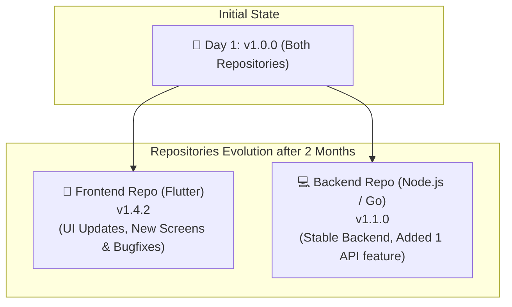

> 📌 **แนวทางการกำหนดเลขเวอร์ชันมาตรฐาน Semantic Versioning (SemVer)**
> 
> 
> โครงสร้างรูปแบบ: **`[Major].[Minor].[Patch]`**
> 
> หลักการกำหนดเลขเวอร์ชันมาตรฐานสากล สำหรับการบริหารจัดการซอฟต์แวร์อย่างเป็นระบบ
> 

---

## 🧩 โครงสร้างตัวเลข 3 หลัก (SemVer Structure)

> **ตัวอย่างเลขเวอร์ชัน:** `v1.0.0`
> 

| หลัก | ตำแหน่ง / ชื่อหลัก | ความหมาย & การเปลี่ยนแปลง | ตัวอย่าง Frontend | ตัวอย่าง Backend |
| --- | --- | --- | --- | --- |
| **1** | **Major** | **Breaking Changes** การเปลี่ยนแปลงระดับโครงสร้างที่ส่งผลกระทบย้อนหลัง (ของเก่าใช้ไม่ได้ ต้องแก้โค้ดตาม) | รื้อแอปทำใหม่ทั้งหมด, ยกเลิกการรองรับ OS เวอร์ชันเก่า | เปลี่ยนโครงสร้าง Database ใหม่, ลบ API เก่าทิ้ง, เปลี่ยนโครงสร้าง JSON Response |
| **2** | **Minor** | **New Features** การเพิ่มฟีเจอร์ใหม่แบบ Backward Compatible (ของใหม่ใช้ได้ ของเก่ายังทำงานได้ปกติ) | เพิ่มหน้าจอ "โปรไฟล์ผู้ใช้", เพิ่มปุ่มแชร์ | สร้าง API Endpoint ใหม่ (เช่น `/api/v1/users/profile`) โดย API เดิมยังทำงานเหมือนเดิม |
| **3** | **Patch** | **Bug Fixes** การซ่อมแซมบัคหรืออุดช่องโหว่ความปลอดภัย โดยไม่มีการเพิ่มฟีเจอร์ใหม่ | แก้ปัญหาแอปค้างเวลากดปุ่ม, ปรับแก้ตัวหนังสือที่สะกดผิด | แก้บัคคำนวณเงินผิด, อุดช่องโหว่ความปลอดภัย (Security Patch) |

> ⚠️ **กฎเหล็ก (Reset Rule):**
> 
> 
> หากขยับเลขหลักที่ใหญ่กว่า (ขยับตัวเลขทางซ้าย) **เลขทางขวามือทั้งหมดจะต้องถูกรีเซ็ตเป็น 0 เสมอ**
> 

---

## 🔄 ภาพจำลองการทำงานจริง (Real-World Workflow)

> **สถานการณ์:** เริ่มต้นออกระบบเวอร์ชันแรกพร้อมกันที่ **`v1.0.0`** ทั้งคู่
> 
> 
> เมื่อเวลาผ่านไป 2 เดือน การพัฒนาของแต่ละ Repository อาจดำเนินไปในจังหวะที่แตกต่างกัน:
> 

### 📱 Frontend Repo (Flutter) — `v1.4.2`

> 💡 **อัปเดตบ่อย (High Frequency Updates):**
> 
> 
> มีการปรับเปลี่ยน UI ตาม Feedback ผู้ใช้ เพิ่มหน้าจอใหม่ๆ และแก้ไขบัคยิบย่อยในแอปอย่างต่อเนื่อง
> 
- **`v1.0.0`** — Release แอปรอบแรก
- **`v1.1.0`** — เพิ่มหน้าจอ *"โปรไฟล์ผู้ใช้"* *(Minor +1)*
- **`v1.2.0`** — เพิ่มระบบ *"Dark Mode"* *(Minor +1)*
- **`v1.3.0`** — เพิ่มปุ่ม *"แชร์ไปยัง Social Media"* *(Minor +1)*
- **`v1.4.0`** — เพิ่มหน้า *"ประวัติการสั่งซื้อ"* *(Minor +1)*
- **`v1.4.1`** — แก้บัคตัวหนังสือสะกดผิดในหน้าโปรไฟล์ *(Patch +1)*
- **`v1.4.2`** — แก้ไขแอปค้างเวลากดปุ่มแชร์ *(Patch +1)*

---

### 💻 Backend Repo (Node.js / Go) — `v1.1.0`

> ⚡ **อัปเดตน้อย (High Stability):**
> 
> 
> ระบบหลังบ้านเน้นความเสถียร ไม่มีการเปลี่ยนแปลงบ่อย มีเพียงการเพิ่ม API Endpoint รอบเดียว
> 
- **`v1.0.0`** — Release ระบบ API และ Database รอบแรก
- **`v1.1.0`** — เพิ่ม API Endpoint ใหม่ `/api/v1/users/profile` เพื่อรองรับหน้าโปรไฟล์ฝั่ง Frontend *(Minor +1)*

---

🤖 Automated Semantic Release with GitHub Actions (React Web App) (1)