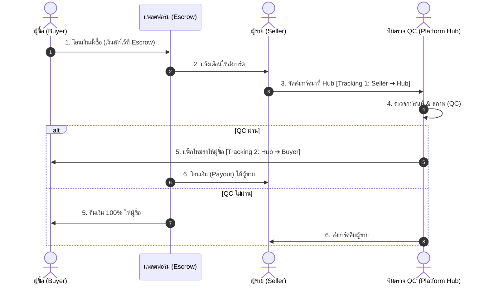

# 📦 TCG Platform: System Architecture & Business Strategy

> 💡 **Executive Summary**
สรุปรายละเอียดและวิเคราะห์โครงสร้างระบบ OPH (One Piece Hub) ตั้งแต่การเปลี่ยนผ่านสู่ Platform, การจัดการ User Flow, ระบบ Escrow, ไปจนถึงกลยุทธ์การบริหารต้นทุน
> 

---

## 📑 สรุปการจัดเก็บเอกสารใน Repository

| 📁 ไฟล์เอกสาร | 📝 รายละเอียดและเนื้อหาหลัก |
| --- | --- |
| **`docs/README.md`** | สารบัญภาพรวมของชุดเอกสารทั้งหมด |
| **`docs/GLOSSARY.md`** | **พจนานุกรมคำนิยาม (Glossary):** รวมศัพท์เฉพาะที่ทุกคนในทีมต้องเข้าใจตรงกัน เช่น Guest, Buyer, Seller, Escrow, Dual Tracking, Condition Grading |
| **`docs/PLATFORM_SPECIFICATION.md`** | **สถาปัตยกรรม & User Story:** การเปลี่ยนผ่านเป็น Platform + Community, Figma Frictionless UX, User Flow (ดูได้ก่อนล็อกอิน), User Story (Guest + Concurrency Stock Lock) |
| **`docs/ESCROW_AND_OPERATIONS.md`** | **ระบบเงินกลาง, ขนส่ง, ฐานข้อมูล:** แผนผัง Escrow, การจัดการเลขพัสดุ 2 ชุด, DB Schema (Double-Entry Ledger), และกลยุทธ์แก้ปัญหาต้นทุนการเป็นตัวกลาง |

---

## 1. 🔍 การปรับปรุง Flow & User Story (Guest-First & Concurrency)

### 1.1 เปลี่ยนจาก "ต้อง Login ก่อน" เป็น "ให้ดูได้ก่อน (Browse First)"

- **แนวคิด:** เปิดให้ผู้ใช้งานทั่วไปเข้ามาในฐานะ **Guest** สามารถค้นหาการ์ด, ดูกราฟราคาตลาด, ดูภาพสภาพการ์ดความละเอียดสูง, ดูกิจกรรม และดูเด็คของ Community ได้ทันทีแบบไม่มีสิ่งกีดขวาง (Zero-friction)
- **Contextual Login Trigger:** ระบบจะแสดง Modal เข้าสู่ระบบ/สมัครสมาชิกเฉพาะเมื่อผู้ใช้ต้องการทำ Action ที่ส่งผลต่อข้อมูล เช่น:
    - 🛒 กดสั่งซื้อ (Buy Now / Add to Cart)
    - ❤️ กดถูกใจ / บันทึกเด็ค / คอมเมนต์ใน Community
    - 🏪 กดเปิดร้านขายการ์ด (Become a Seller)

### 1.2 Figma / UI Guideline: สมัครสมาชิกแบบไร้แรงเสียดทาน (Frictionless Register)

> ⚠️ **ปัญหาเดิม:** การขอที่อยู่ (Address), เบอร์โทร หรือเอกสารยืนยันตัวตนในหน้า Register ทำให้ผู้ใช้รู้สึกยุ่งยากและปิดทิ้ง (Drop-off Rate สูงถึง 60-70%)
> 

**โซลูชันใหม่ (Progressive Profiling):**

- **หน้า Sign Up:** มีเพียงปุ่ม  `"Email + Password"` สั้นๆ เท่านั้น
- **การขอที่อยู่ (Shipping Address):** ไปขอในขั้นตอน Checkout ครั้งแรก เมื่อผู้ใช้ตัดสินใจจะซื้อสินค้าจริง
- **การขอข้อมูลบัญชี & ยืนยันตัวตน (KYC):** ไปขอในขั้นตอน Seller Onboarding เมื่อผู้ใช้ต้องการจะลงขายการ์ด

### 1.3 การจัดการเมื่อ Stock หมดชนกัน (Race Condition / Concurrency Lock)

การ์ดสะสม (Single Card) ส่วนใหญ่มีสต็อกเพียง 1 ใบต่อรายการขาย หากมีผู้ซื้อ 2 คนกดพร้อมกัน:

**Backend Logic:**

1. เมื่อผู้ใช้คนแรกกด `Proceed to Checkout` ระบบจะล็อกสต็อกชั่วคราว (Temporary Redis Lock 5-10 นาที)
2. ก่อนสร้างรายการชำระเงิน Backend จะทำ Double Check Stock & Status ใน **DB Transaction (Atomic Update)** อีก 1 ครั้ง เพื่อป้องกันการขายเกิน (Overselling) 100%

**UX Recovery (การแจ้งเตือนผู้ซื้อที่กดไม่ทัน):**

- 💬 **แจ้งเตือนอย่างสุภาพ:** *"ขออภัย การ์ดใบนี้กำลังมีผู้ซื้อรายอื่นทำรายการชำระเงิน หรือจำหน่ายไปแล้ว"*
- 🔄 **แสดงทางเลือกทันที:** นำเสนอการ์ดใบเดียวกันจากร้านอื่นที่มีสภาพและราคาใกล้เคียง หรือปุ่ม *"แจ้งเตือนฉันเมื่อมีการ์ดนี้เข้ามาใหม่"*

---

## 2. 🏛️ การเปลี่ยนจาก Single Store เป็น Community Trading Platform

**โครงสร้าง 3 เสาหลัก:**

1. **Marketplace (Buyer & Seller):** รองรับทั้งร้านค้าการ์ดทางการ (Verified Shops) และผู้สะสมรายย่อย (Individual Collectors)
2. **Card Community Hub:** ระบบค้นหาฐานข้อมูลการ์ด, ระบบจัดเด็ค (Deck Builder), กระดานแลกเปลี่ยน และตารางแข่งขัน Tournament
3. **Super Admin / QC Hub:** ทีมงานผู้เชี่ยวชาญของแพลตฟอร์มในการตรวจสอบการ์ดแท้ (Authentication) และตรวจสภาพตรงปก

---

## 3. 🛡️ วงจรการซื้อขาย Escrow & การจัดการเลขพัสดุ 2 ชุด

## **4. 🗄️ โครงสร้างฐานข้อมูลด้านการเงิน (Double-Entry Ledger DB)**

> 🔐 **เป้าหมาย:** ป้องกันเงินสูญหายและตรวจสอบย้อนหลังได้ 100% (Auditability)
> 
- **`ORDERS`**: เก็บมูลค่าสินค้า, ค่าส่ง 2 ขา, ค่าธรรมเนียม และสถานะรวม
- **`SHIPMENTS`**: เก็บรหัสพัสดุแยก 2 ชุดชัดเจน
    - `leg1_tracking_code` (ผู้ขาย ➔ Hub) + `leg1_status`
    - `leg2_tracking_code` (Hub ➔ ผู้ซื้อ) + `leg2_status`
    - `qc_result`, `qc_notes`, `qc_photos` (ภาพถ่ายและผลการตรวจการ์ด)
- **`ESCROW_LEDGER`**: บันทึกการขยับเงินแบบ **Debit / Credit** ทุกครั้ง (เงินเข้าจาก Buyer, เงินพักใน Escrow, เงินค่าธรรมเนียม Platform, เงินรอจ่าย Payout ให้ Seller)
- **`PAYOUT_TRANSACTIONS` & `REFUND_TRANSACTIONS`**: บันทึกประวัติการโอนเงินออกไปยังบัญชีธนาคารของผู้ขาย หรือคืนเงินให้ผู้ซื้ออย่างละเอียด

## **5. 💼 บทวิเคราะห์ปัญหาทางธุรกิจ & ค่าใช้จ่ายตัวกลาง**

### **5.1 ความท้าทายด้านต้นทุน (Operational Overheads)**

การเป็นตัวกลางตรวจสอบและจัดส่งมีค่าใช้จ่ายสูงกว่าร้านค้าทั่วไปมาก:

- 📦 **ค่าขนส่ง 2 ต่อ (Double Shipping):** ค่าส่งผู้ขายมา Hub + ค่าส่ง Hub ไปผู้ซื้อ (ต้นทุนรวม 70-100+ บาท)
- 🧑‍💻 **ค่าจ้างผู้เชี่ยวชาญ QC (Labor Cost):** ผู้ตรวจการ์ดแท้/ปลอมและการ์ดสภาพสมบูรณ์
- 🛡️ **ค่าบรรจุภัณฑ์มาตรฐานพรีเมียม (Packaging):** ซองกันรอย, Toploader, บับเบิ้ล, สติกเกอร์การันตีความแท้
- 💳 **ค่าธรรมเนียมระบบรับชำระเงิน (Payment Gateway):** 1.5% - 3.5%

### **5.2 กลยุทธ์แก้ปัญหาและโมเดลความคุ้มค่า (Business Solutions)**

**1. แบ่งระดับการตรวจสอบตามมูลค่าการ์ด (Tiered Authentication Threshold):**

- 💎 **การ์ดมูลค่าสูง (> 800 - 1,000 บาท):** บังคับตรวจ QC ผ่าน Hub 100% เพื่อสร้าง Trust สูงสุด
- 🃏 **การ์ดทั่วไป (< 300 บาท):** ใช้ระบบ **Direct Shipping with Buyer Protection** (ให้ร้านที่ได้รับการรับรองส่งตรงถึงผู้ซื้อได้ทันที โดยเงินยังถูก Hold ใน Escrow จนกว่าผู้ซื้อจะได้รับของ) และมีตัวเลือก "QC Add-on" หากผู้ซื้อยอมจ่ายเพิ่ม

**2. การรวมส่งหลายร้านในกล่องเดียว (Hub Consolidation):**

- เมื่อผู้ซื้อสั่งการ์ดจากหลายร้านพร้อมกัน Hub จะรวบรวมและตรวจครบก่อนแพ็กส่งเป็นกล่องเดียว ประหยัดค่าส่ง Leg 2 ให้ผู้ซื้อ

**3. สัญญาส่วนลดขนส่งแบบ B2B (Logistics Partnership):**

- ทำสัญญาส่วนลดกับบริษัทขนส่ง (Flash, KEX, ไปรษณีย์ไทย) ในเรทธุรกิจเพื่อลดค่าส่งต่อชิ้นเหลือ 20-25 บาท

**4. โครงสร้างรายได้หลากหลาย (Multi-Stream Monetization):**

- 💰 ค่าคอมมิชชันจากการขาย (Take Rate 5-8%)
- 🔎 ค่าบริการตรวจการันตีการ์ดแท้ (Authentication Fee)
- 🏷️ ค่าสมาชิกรายเดือนสำหรับร้านค้าพรีเมียม (Store Subscription / Verified Badge)