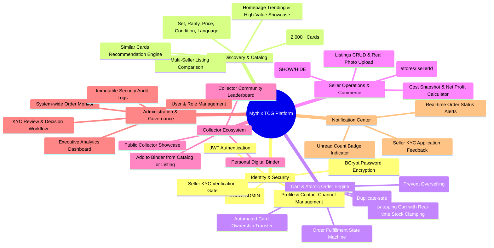
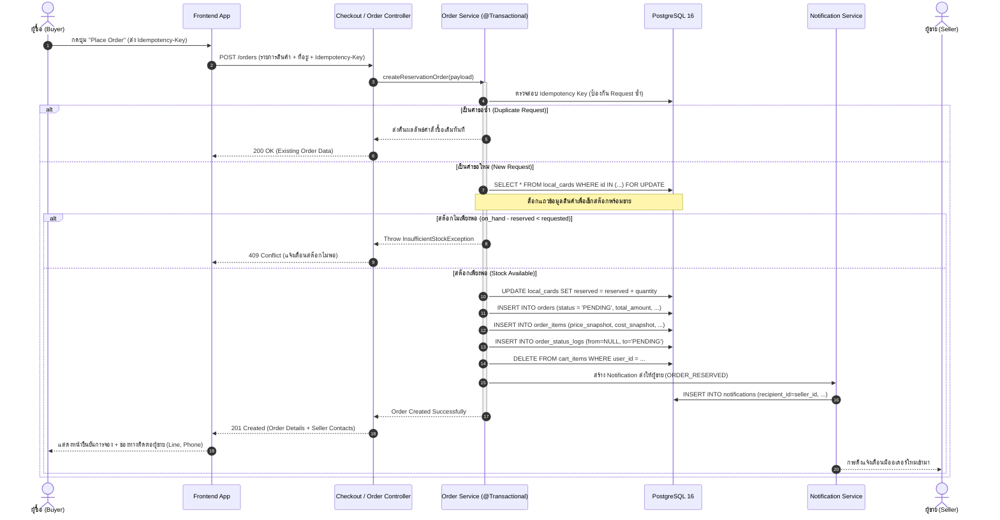
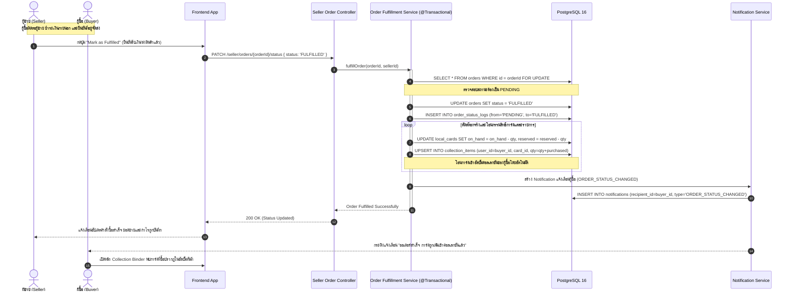
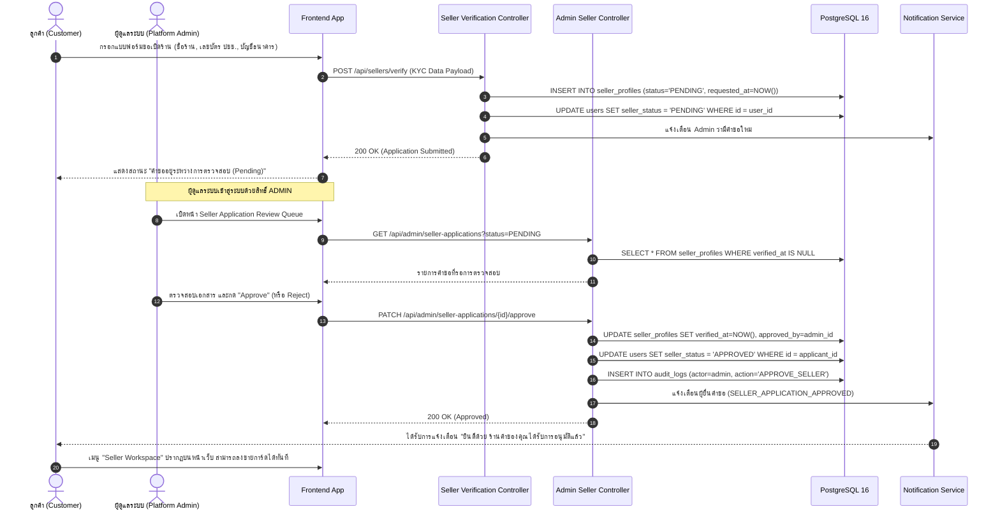

# 🎴 Mythix TCG Platform — Phase 1 Comprehensive System Specification & Architecture Summary
> **เอกสารสรุปภาพรวมระบบ สถาปัตยกรรม ฟีเจอร์ และ User Stories ประจำ Phase 1**  
> **Repository:** `tcg-store-document`  
> **Branch:** `docs/phase1-summary`  
> **สถานะโครงการ:** ผ่านการพัฒนาแกนหลัก (Phase 1 Baseline Complete) และติดตั้งระบบ CI/CD Quality Gates ครบวงจร  
> **วันจัดทำ:** ตุลาคม 2026  

---

## 📑 สารบัญ (Table of Contents)
1. [บทนำและภาพรวมของระบบ (Executive Overview)](#1-บทนำและภาพรวมของระบบ-executive-overview)
2. [บทบาทผู้ใช้งานในระบบ (System Actors & Personas)](#2-บทบาทผู้ใช้งานในระบบ-system-actors--personas)
3. [ฟีเจอร์หลักของระบบ (Core System Features)](#3-ฟีเจอร์หลักของระบบ-core-system-features)
4. [ตารางสรุป User Stories ทั้งหมด 43 ข้อ (Complete User Stories Matrix)](#4-ตารางสรุป-user-stories-ทั้งหมด-43-ข้อ-complete-user-stories-matrix)
5. [รายละเอียดเชิงลึกของ User Stories แยกตามหมวดหมู่ (US-01 ถึง US-12)](#5-รายละเอียดเชิงลึกของ-user-stories-แยกตามหมวดหมู่-us-01-ถึง-us-12)
6. [สถาปัตยกรรมระบบและโครงสร้างเทคโนโลยี (System Architecture & Tech Stack)](#6-สถาปัตยกรรมระบบและโครงสร้างเทคโนโลยี-system-architecture--tech-stack)
   - 6.1 [สถาปัตยกรรมระดับสูง (High-Level Architecture)](#61-สถาปัตยกรรมระดับสูง-high-level-architecture)
   - 6.2 [สถาปัตยกรรมฝั่ง Frontend (React 19 + TypeScript + Vite)](#62-สถาปัตยกรรมฝั่ง-frontend-react-19--typescript--vite)
   - 6.3 [สถาปัตยกรรมฝั่ง Backend (Spring Boot 3.3.4 + Java 21)](#63-สถาปัตยกรรมฝั่ง-backend-spring-boot-334--java-21)
   - 6.4 [สถาปัตยกรรมฐานข้อมูลและ Data Model (PostgreSQL 16 Revision 5)](#64-สถาปัตยกรรมฐานข้อมูลและ-data-model-postgresql-16-revision-5)
   - 6.5 [สถาปัตยกรรม DevOps, CI/CD และโครงสร้างพื้นฐาน (Infrastructure & Automation)](#65-สถาปัตยกรรม-devops-cicd-และโครงสร้างพื้นฐาน-infrastructure--automation)
7. [กระบวนการทำงานที่สำคัญ (Core Business & Transactional Workflows)](#7-กระบวนการทำงานที่สำคัญ-core-business--transactional-workflows)
   - 7.1 [โฟลว์การจองสต๊อกสินค้าแบบอะตอมมิก (Atomic Stock Reservation Flow)](#71-โฟลว์การจองสต๊อกสินค้าแบบอะตอมมิก-atomic-stock-reservation-flow)
   - 7.2 [โฟลว์การยืนยันชำระเงินและโอนกรรมสิทธิ์การ์ดอัตโนมัติ (Fulfillment & Card Ownership Transfer)](#72-โฟลว์การยืนยันชำระเงินและโอนกรรมสิทธิ์การ์ดอัตโนมัติ-fulfillment--card-ownership-transfer)
   - 7.3 [โฟลว์การขอเปิดร้านค้าและการตรวจสอบสิทธิ์ผู้ขาย (Seller KYC Verification Gate)](#73-โฟลว์การขอเปิดร้านค้าและการตรวจสอบสิทธิ์ผู้ขาย-seller-kyc-verification-gate)
8. [สรุปสถานะปัจจุบันและแผนงานสำหรับ Phase ต่อไป (Phase 1 Milestones & Phase 2 Roadmap)](#8-สรุปสถานะปัจจุบันและแผนงานสำหรับ-phase-ต่อไป-phase-1-milestones--phase-2-roadmap)

---

## 1. บทนำและภาพรวมของระบบ (Executive Overview)

### 1.1 ระบบนี้คืออะไร? (What is Mythix TCG Platform?)
**Mythix TCG Platform** เป็นแพลตฟอร์มเว็บแอปพลิเคชันสำหรับสังคมผู้เล่นและนักสะสมการ์ดเกม Trading Card Game (โดยเฉพาะการ์ด Pokémon และการ์ดสะสมยอดนิยม) ออกแบบมาในรูปแบบ **C2C (Customer-to-Customer) Trading & Reservation Marketplace** ที่ผสานการทำงานระหว่าง:
1. การค้นหาและเปรียบเทียบราคาการ์ดสะสมจากแคตตาล็อกกลางระดับโลก (Global Master Catalog)
2. ตลาดซื้อขายแลกเปลี่ยนระหว่างผู้เล่นด้วยกัน (Community Marketplace)
3. ระบบจัดการอัลบั้มการ์ดสะสมส่วนตัว (Personal Binder / Collection Showcase)
4. ศูนย์ควบคุมและตรวจสอบความโปร่งใสสำหรับผู้ดูแลระบบ (Platform Administration & Audit Governance)

### 1.2 ปัญหาของตลาดเดิม และแนวทางแก้ไข (Problem Statement & Solutions)
* **ปัญหาการแย่งซื้อการ์ดใบเดียวกันพร้อมกัน (Overselling / Race Condition):** การ์ดสะสมระดับหายากมักมีเพียง 1 หรือไม่กี่ใบในตลาด เมื่อมีผู้ซื้อกดสั่งซื้อพร้อมกันในเสี้ยววินาที ระบบ e-Commerce ทั่วไปมักเกิดปัญหาตัดสต๊อกชนกัน  
  👉 **ทางแก้:** ออกแบบระบบ **Atomic Stock Reservation** โดยใช้ Database Row-Level Locking และการแบ่งสต๊อกเป็น `on_hand` (สต๊อกจริง) กับ `reserved` (สต๊อกที่ถูกล็อกจอง) ทำให้รับประกันว่าจะไม่มีการขายการ์ดเกินสต๊อกเด็ดขาด
* **ปัญหาความโปร่งใสในสภาพการ์ดจริง (Condition & Trust Gap):** รูปถ่ายการ์ดจาก Official มักไม่ตรงกับสภาพการ์ดจริงที่ขาย (เช่น รอยขนแมว ขอบขาว มุมพับ)  
  👉 **ทางแก้:** สถาปัตยกรรม **Dual-Card Architecture** ที่แยก `Global Card` (ข้อมูลสเปก อาร์ตเวิร์กแท้ และราคากลาง) ออกจาก `Local Card` (รายการขายของผู้ขายแต่ละคน ที่บังคับระบุสภาพการ์ด NM, LP, MP, HP, DMG พร้อมอัปโหลดรูปถ่ายจริงของการ์ดใบนั้นๆ)
* **ข้อจำกัดเรื่อง Payment Gateway ภายนอก (Offline / P2P Settlement Simulation):** เพื่อให้ระบบสามารถทดสอบ รันในสภาพแวดล้อม Local/Lab/Kubernetes ได้โดยไม่พึ่งพา Third-party APIs ภายนอก  
  👉 **ทางแก้:** สถาปัตยกรรม **Reservation-Based Order with Contact Handoff** โดยเมื่อลูกค้าสั่งจอง ระบบจะออก Order Number และส่งมอบช่องทางติดต่อของผู้ขาย (เบอร์โทร, Line ID, Facebook) ให้ผู้ซื้อทำการชำระเงินโดยตรง จากนั้นผู้ขายจะเป็นผู้กดยืนยันเมื่อได้รับเงิน
* **การบันทึกการเป็นเจ้าของ (Digital Provenance / Ownership Transfer):** เมื่อซื้อขายสำเร็จ ลูกค้าต้องสามารถสะสมการ์ดใบนั้นลงในอัลบั้มตนเองได้ทันที  
  👉 **ทางแก้:** ระบบ **Automated Card Ownership Transfer** ทำงานแบบ Atomic เมื่อผู้ขายอัปเดตสถานะออเดอร์เป็น `FULFILLED` ระบบจะโอนการ์ดใบดังกล่าวเข้าสู่ตาราง `collection_items` ของผู้ซื้อโดยอัตโนมัติ

---

## 2. บทบาทผู้ใช้งานในระบบ (System Actors & Personas)

ระบบ Mythix TCG Platform รองรับการทำงานของผู้ใช้งาน 5 กลุ่มหลัก (Actors):

| กลุ่มผู้ใช้งาน (Actor) | สิทธิ์ในระบบ (Role / Status) | ขอบเขตหน้าที่และความสามารถ |
| :--- | :--- | :--- |
| **1. Guest (ผู้เยี่ยมชม)** | ไม่มีสิทธิ์ (Unauthenticated) | - เข้าชมหน้าแรก (Homepage), Hero Banners, การ์ดแนะนำ (Featured Cards)<br>- ค้นหาและกรองดูการ์ดในแคตตาล็อก (Browse Cards with Multi-Filters)<br>- ดูหน้ารายละเอียดการ์ด เปรียบเทียบราคาข้ามร้านค้า (Card Detail & Multi-Seller Comparison)<br>- ดูหน้าร้านค้าสาธารณะของผู้ขาย (`/stores/:sellerId`) และตาราง Leaderboard นักสะสม |
| **2. Customer / Buyer (ผู้ซื้อ)** | `role = 'USER'`, `seller_status = 'NONE'` | - สมัครสมาชิกและเข้าสู่ระบบ (JWT Auth)<br>- จัดการข้อมูลส่วนตัว อัปเดตช่องทางติดต่อ (Line, FB, Phone) และ Avatar<br>- เพิ่มการ์ดลงในตะกร้าสินค้า (Shopping Cart) และแก้ไขจำนวน<br>- กดสั่งจองสินค้า (Place Order from Cart / Buy Now) พร้อมสร้าง Idempotency Key ป้องกันการกดซ้ำ<br>- ตรวจสอบประวัติคำสั่งซื้อ (Order History) และสถานะการจอง<br>- จัดการอัลบั้มสะสมการ์ดส่วนตัว (Personal Collection Binder)<br>- ยื่นแบบฟอร์มขอเปิดร้านค้า (Self-serve Seller Verification Form) |
| **3. Verified Seller (ผู้ขาย)** | `role = 'USER'`, `seller_status = 'APPROVED'` | - ความสามารถครบถ้วนเหมือน Customer ทุกประการ<br>- สร้างรายการขายการ์ดใหม่ (List Card for Sale) พร้อมอัปโหลดรูปจริง กำหนดสภาพ ภาษา ราคา และต้นทุน<br>- จัดการสต๊อกสินค้า แก้ไขราคา ปรับสถานะซ่อน/แสดง (SHOW/HIDE) หรือลบรายการขาย<br>- ดูรายการคำสั่งซื้อของร้านตนเอง (Seller Orders) และปรับสถานะ (FULFILLED / CANCELLED)<br>- Seller Dashboard: ดูสถิติยอดขาย ต้นทุน snapshot และกำไรสุทธิ (Net Profit Metrics)<br>- ปรับแต่งข้อมูลหน้าร้าน (Store Profile Settings: Shop Name, Description) |
| **4. Platform Admin (ผู้ดูแลระบบ)** | `role = 'ADMIN'` | - ดู Admin Dashboard ภาพรวมสถิติทั้งระบบ (Total Users, Sellers, Volume, Pending KYC)<br>- คิวตรวจสอบและอนุมัติ/ปฏิเสธคำขอเปิดร้านค้า (Seller Application Review Queue)<br>- จัดการบัญชีผู้ใช้ ค้นหา เปลี่ยนแปลงสิทธิ์ (Promote User to Admin)<br>- มอนิเตอร์คำสั่งซื้อทั้งหมดในระบบแบบ Read-only (Platform-wide Order Logs)<br>- ตรวจสอบบันทึกความปลอดภัยและกิจกรรมสำคัญ (Administrative & Security Audit Logs) |
| **5. System Engine (ระบบอัตโนมัติ)** | Internal Daemon / Transaction Service | - ตรวจสอบและล็อกสต๊อกแบบ Atomic (`on_hand - reserved`) ขณะ Checkout<br>- คืนสต๊อกอัตโนมัติเมื่อออเดอร์ถูกยกเลิก (Order Cancelled)<br>- โอนกรรมสิทธิ์การ์ดเข้าอัลบั้มคอลเลกชันของผู้ซื้อเมื่อออเดอร์เสร็จสิ้น (Order Fulfilled)<br>- ส่ง In-App Notification แจ้งเตือนคู่ค้าเมื่อเกิดความเปลี่ยนแปลงในออเดอร์หรือสถานะร้านค้า |

---

## 3. ฟีเจอร์หลักของระบบ (Core System Features)



### รายละเอียดฟีเจอร์เชิงลึก:
1. **ระบบบริหารจัดการตัวตนและการเข้าถึง (Identity & Access Management):**
   - การลงทะเบียนและเข้าสู่ระบบด้วยอีเมลและรหัสผ่าน เข้ารหัสผ่านด้วย BCrypt
   - การยืนยันสิทธิ์ด้วย JSON Web Token (JWT) แนบผ่าน HTTP Authorization Header (`Bearer <token>`)
   - ระบบโปรไฟล์ผู้ใช้งาน: กำหนดชื่อแสดงตน เบอร์โทรศัพท์ ไอดีไลน์ บัญชีเฟซบุ๊ก และ URL รูปโปรไฟล์ (Avatar)
2. **ระบบสืบค้นและค้นหาการ์ดอัจฉริยะ (Catalog Discovery Engine):**
   - ฐานข้อมูลแคตตาล็อกการ์ดมาตรฐานระดับสากลมากกว่า 2,000 ใบ
   - ตัวกรองขั้นสูงแบบผสมผสาน (Multi-Filtering): คัดกรองตามชื่อชุดการ์ด (Set Name), ระดับความหายาก (Rarity), ช่วงราคา (Price Range), สภาพการ์ด (Condition), และภาษา (Language)
   - หน้ารายละเอียดการ์ด (Card Detail Page) ที่แสดงรายการขายจริงจากผู้ขายหลายรายพร้อมกัน (Multi-Seller Listing Comparison) เพื่อให้ผู้ซื้อเลือกข้อเสนอที่คุ้มค่าที่สุด
3. **ระบบตะกร้าสินค้าและการตรวจสอบสต๊อก (Cart & Pre-Order Validation):**
   - ผู้ซื้อสามารถเพิ่มการ์ดเข้าตะกร้า ปรับเพิ่ม/ลดจำนวน โดยระบบจะ Clamp ไม่ให้เกินสต๊อกที่พร้อมขายจริง (`on_hand - reserved`)
   - เมื่อลดจำนวนลงเหลือ 0 รายการจะถูกลบออกจากตะกร้าโดยอัตโนมัติ
4. **เครื่องมือจองสต๊อกแบบอะตอมมิกและวงจรชีวิตคำสั่งซื้อ (Atomic Reservation & Order State Machine):**
   - การสั่งจองสินค้าทั้งแบบผ่านตะกร้าสินค้า หรือกดซื้อทันที (Buy Now)
   - ป้องกันการส่งคำสั่งซื้อซ้ำซ้อนด้วย `Idempotency-Key` (UUID)
   - กลไกการตัดสต๊อกแบบ Atomic ใน Database Transaction เดียว (`reserved += quantity`)
   - สถานะคำสั่งซื้อรองรับ: `PENDING` (รอชำระเงิน/นัดหมาย) → `FULFILLED` (ยืนยันรับเงินและส่งมอบ) หรือ `CANCELLED` (ยกเลิกและคืนสต๊อก)
5. **ระบบโอนกรรมสิทธิ์การ์ดเข้าอัลบั้มคอลเลกชันอัตโนมัติ (Automated Card Ownership Transfer):**
   - เมื่อผู้ขายกดยืนยันออเดอร์เป็น `FULFILLED` ระบบจะบันทึกการ์ดใบนั้นลงใน `collection_items` ของผู้ซื้อทันที หากเคยมีอยู่แล้วจะเพิ่มจำนวน (Quantity Increment) หากยังไม่เคยมีจะสร้างเรคอร์ดใหม่
6. **ระบบคลังสินค้าและการคำนวณกำไรของผู้ขาย (Seller Inventory & Profit Metrics):**
   - การสร้างรายการขายใหม่โดยเลือกการ์ดต้นแบบจากแคตตาล็อก พร้อมอัปโหลดรูปถ่ายจริงของการ์ด (Custom Card Image Upload)
   - ผู้ขายสามารถบันทึกต้นทุนที่ตนเองได้การ์ดมา (`cost`)
   - เมื่อมีออเดอร์เกิดขึ้น ระบบจะ Snapshot บันทึก `cost_at_purchase` และ `price_at_purchase` ไว้อย่างถาวร ทำให้คำนวณกำไรสุทธิ `(Price - Cost) * Quantity` ได้อย่างแม่นยำ แม้ในอนาคตผู้ขายจะแก้ไขราคาหน้าร้านก็ตาม
7. **ระบบหน้าร้านค้าสาธารณะ (Public Storefront):**
   - ผู้ขายมีหน้า URL ร้านค้าของตนเองโดยเฉพาะ (`/stores/:sellerId`) พร้อมแสดงชื่อร้าน คำอธิบายร้าน และรายการสินค้าทั้งหมดที่ร้านนั้นวางจำหน่าย
8. **ระบบอัลบั้มการ์ดสะสมและตารางผู้นำ (Collection Binder & Community Leaderboard):**
   - อัลบั้มสะสมการ์ดส่วนตัวของผู้ใช้งาน (Personal Binder) แสดงการ์ดที่ตนครอบครอง พร้อมสภาพและภาษา
   - สามารถเพิ่มการ์ดเข้าคอลเลกชันได้โดยตรงจากทั้งหน้า Catalog และหน้า Product Listing
   - หน้า Showcase สาธารณะ (`/collections/:userId`) และตารางอันดับ Top Collector Leaderboard จัดอันดับผู้ใช้งานตามจำนวนการ์ด Rare ที่ครอบครอง
9. **ระบบการแจ้งเตือนภายในแอปพลิเคชัน (In-App Notification Center):**
   - กล่องจดหมายแจ้งเตือน (Inbox Notification) แจ้งเตือนเมื่อมีการจองสินค้า, เมื่อสถานะออเดอร์เปลี่ยน, และเมื่อผลการสมัครเปิดร้านได้รับการอนุมัติหรือปฏิเสธ
   - กระดิ่งแจ้งเตือนบน Navbar พร้อม Badge แสดงตัวเลขข้อความที่ยังไม่อ่าน (Unread Count)
10. **ศูนย์บัญชาการผู้ดูแลระบบและการตรวจสอบย้อนหลัง (Admin Platform & Audit Trail):**
    - Dashboard สรุปตัวชี้วัดสำคัญของแพลตฟอร์ม (ผู้ใช้งาน, ร้านค้า, ออเดอร์, ยอดเงินหมุนเวียน)
    - Queue สำหรับตรวจสอบคำขอเปิดร้านค้า (Approve พร้อมบันทึกผู้ตรวจ / Reject พร้อมระบุเหตุผล)
    - ระบบบริหารจัดการผู้ใช้ (User Management) และการเลื่อนขั้น Admin
    - บันทึก Audit Log ถาวรในตาราง `audit_logs` เก็บข้อมูล Actor, Action, Target, IP Address, และรายละเอียดการเปลี่ยนแปลง

---

## 4. ตารางสรุป User Stories ทั้งหมด 43 ข้อ (Complete User Stories Matrix)

ระบบได้รับการออกแบบและพัฒนาตามข้อกำหนดของ User Stories ทั้งหมด **43 ข้อ** ครอบคลุม 12 หมวดหมู่ ดังแสดงในตารางด้านล่างนี้:

| รหัส US | ชื่อฟีเจอร์ (Feature Title) | ผู้ใช้หลัก (Actor) | ขอบเขตการทำงาน | สถานะ Phase 1 |
| :--- | :--- | :--- | :--- | :--- |
| **US-01-1** | Customer Registration & Login | Customer | Frontend / Backend / Database | ✅ Implemented |
| **US-01-2** | Forgot & Reset Password Flow | Customer / Seller | Frontend / Backend / Security | ✅ Implemented |
| **US-02-1** | Browse TCG Cards with Multi-Filters | Customer / Guest | Frontend / Backend / Catalog | ✅ Implemented |
| **US-02-2** | Multi-Seller Listing Comparison on Card Detail | Customer | Frontend / Backend / Product | ✅ Implemented |
| **US-02-3** | Similar Cards Recommendation | Customer | Frontend / Discovery | ✅ Implemented |
| **US-02-4** | Homepage & Featured Cards Display | Guest / Customer | Frontend / Backend / Catalog | ✅ Implemented |
| **US-03-1** | Add Cards to Cart | Customer | Frontend / Backend / Cart | ✅ Implemented |
| **US-03-2** | Delete Cards from Cart | Customer | Frontend / Backend / Cart | ✅ Implemented |
| **US-03-3** | Decrease Quantity in Cart (Auto-remove at 0) | Customer | Frontend / Backend / Cart | ✅ Implemented |
| **US-03-4** | Increase Quantity in Cart (Clamped to Stock) | Customer | Frontend / Backend / Cart | ✅ Implemented |
| **US-04-1** | Place Order from Cart (Reservation-Based) | Customer | Frontend / Backend / Order | ✅ Implemented |
| **US-04-2** | Place Order Directly (Buy Now) | Customer | Frontend / Backend / Order | ✅ Implemented |
| **US-05-1** | Add Product Listing from Collection/Catalog | Seller | Frontend / Backend / Seller | ✅ Implemented |
| **US-05-2** | Delete Product Listing (Guarded by Active Orders) | Seller | Frontend / Backend / Seller | ✅ Implemented |
| **US-05-3** | Update Product Listing Details | Seller | Frontend / Backend / Seller | ✅ Implemented |
| **US-05-4** | View & Filter Seller Inventory List | Seller | Frontend / Backend / Seller | ✅ Implemented |
| **US-05-5** | Toggle Listing Visibility (Show / Hide) | Seller | Frontend / Backend / Seller | ✅ Implemented |
| **US-06-1** | Seller Dashboard (Cost & Profit Metrics) | Seller | Frontend / Backend / Order | ✅ Implemented |
| **US-06-2** | Public Storefront & Custom Store Settings | Seller / Buyer | Frontend / Backend / Seller | ✅ Implemented |
| **US-07-1** | View Seller Orders & Status Filter | Seller | Frontend / Backend / Order | ✅ Implemented |
| **US-07-2** | Update Order Status (Pending → Fulfilled / Cancelled) | Seller | Frontend / Backend / Order | ✅ Implemented |
| **US-07-3** | Automated Card Ownership Transfer | System / Buyer | Backend / Database Trigger | ✅ Implemented |
| **US-08-1** | Edit Contact Information (Line, FB, Phone) | User | Frontend / Backend / User | ✅ Implemented |
| **US-08-2** | Edit Display Name | User | Frontend / Backend / User | ✅ Implemented |
| **US-08-3** | Edit Phone Number | User | Frontend / Backend / User | ✅ Implemented |
| **US-08-4** | Edit Profile Avatar URL | User | Frontend / Backend / User | ✅ Implemented |
| **US-09-1** | View Buyer Order History & Seller Contact Info | Customer | Frontend / Backend / Order | ✅ Implemented |
| **US-09-2** | Filter Order History by Status | Customer | Frontend / Backend / Order | ✅ Implemented |
| **US-10-1** | View Personal Collection Album | User | Frontend / Backend / Collection | ✅ Implemented |
| **US-10-2** | Add Card to Collection from Catalog | User | Frontend / Backend / Collection | ✅ Implemented |
| **US-10-3** | Remove Card from Collection | User | Frontend / Backend / Collection | ✅ Implemented |
| **US-10-4** | Self-serve Seller Verification Form | Customer | Frontend / Backend / Seller | ✅ Implemented |
| **US-10-5** | Atomic Stock Reservation Semantics | System | Backend / Database Locking | ✅ Implemented |
| **US-10-6** | Public Collector Showcase & Top Collector Leaderboard | User / Guest | Frontend / Backend / Collection | ✅ Implemented |
| **US-10-7** | Add Card to Collection from Product Listing | User | Frontend / Backend / Collection | ✅ Implemented |
| **US-11-1** | In-App Notifications Inbox & Status Alerts | User (All) | Frontend / Backend / Notification | ✅ Implemented |
| **US-11-2** | Notification Badge & Unread Counter | User (All) | Frontend / UI Components | ✅ Implemented |
| **US-12-1** | Platform Admin Dashboard & Metrics | Admin | Frontend / Backend / Admin | ✅ Implemented |
| **US-12-2** | Seller Application Review Queue | Admin | Frontend / Backend / Admin | ✅ Implemented |
| **US-12-3** | Admin User & Role Management | Admin | Frontend / Backend / Admin | ✅ Implemented |
| **US-12-4** | Administrative & Security Audit Logs | Admin | Frontend / Backend / Admin | ✅ Implemented |
| **US-12-5** | Platform-wide Order Logs Monitoring | Admin | Frontend / Backend / Admin | ✅ Implemented |
| **US-12-6** | Review Seller Application Decision (Approve/Reject) | Admin | Frontend / Backend / Admin | ✅ Implemented |

---

## 5. รายละเอียดเชิงลึกของ User Stories แยกตามหมวดหมู่ (US-01 ถึง US-12)

### 🔐 หมวด US-01: Authentication & User Management
* **US-01-1: Customer Registration & Login**
  * **คำอธิบาย:** ผู้ใช้สามารถสมัครสมาชิกและเข้าสู่ระบบด้วยอีเมลและรหัสผ่าน เพื่อรับ JWT Token ในการยืนยันตัวตนสำหรับฟังก์ชันที่มีความคุ้มครอง (Protected Routes)
  * **เงื่อนไขสำคัญ:** รหัสผ่านต้องถูกเข้ารหัสด้วย BCrypt, อีเมลต้องมีรูปแบบที่ถูกต้องและไม่ซ้ำในระบบ, ส่งคืน JWT Token ที่ระบุ Role และสิทธิ์
  * **API Endpoints:** `POST /auth/register`, `POST /auth/login`, `GET /auth/me`
* **US-01-2: Forgot & Reset Password Flow**
  * **คำอธิบาย:** ผู้ใช้ที่ลืมรหัสผ่านสามารถส่งคำขอรีเซ็ตและตั้งรหัสผ่านใหม่เพื่อกู้คืนบัญชี
  * **API Endpoints:** `POST /auth/forgot-password`, `POST /auth/reset-password`

### 🔍 หมวด US-02: Browse Products & Catalog Discovery
* **US-02-1: Browse TCG Cards with Multi-Filters**
  * **คำอธิบาย:** ผู้ใช้และแขกทั่วไปสามารถค้นหาและกรองการ์ดในระบบตามชื่อ, เซ็ตการ์ด (Set Name), ระดับความหายาก (Rarity), ราคา, สภาพ และภาษา
  * **API Endpoints:** `GET /cards`, `GET /products`
* **US-02-2: Multi-Seller Listing Comparison on Card Detail**
  * **คำอธิบาย:** ในหน้ารายละเอียดการ์ด ผู้ซื้อสามารถดูเปรียบเทียบรายการขายจริงจากหลายผู้ขาย (Multi-seller offers) เพื่อเลือกซื้อการ์ดที่มีราคาหรือสภาพที่ต้องการ
  * **UI Components:** `CardDetailPage`, `SellerOffersSection`
* **US-02-3: Similar Cards Recommendation**
  * **คำอธิบาย:** ระบบแนะนำการ์ดที่มีลักษณะใกล้เคียงกัน (เช่น จากเซ็ตเดียวกัน หรือไทป์เดียวกัน) เพื่อกระตุ้นการค้นหาและการสะสม
* **US-02-4: Homepage & Featured Cards Display**
  * **คำอธิบาย:** หน้าแรกของระบบแสดง Hero Banner, สินค้าแนะนำยอดนิยม (Featured Cards) และการ์ดระดับสูง (High-value Highlights)

### 🛒 หมวด US-03: Shopping Cart Management
* **US-03-1: Add Cards to Cart**
  * **คำอธิบาย:** ผู้ซื้อสามารถเลือกการ์ดจากรายการขายของผู้ขายแล้วเพิ่มลงในตะกร้าสินค้า
  * **API Endpoints:** `POST /cart/items`
* **US-03-2: Delete Cards from Cart**
  * **คำอธิบาย:** ผู้ซื้อสามารถลบรายการการ์ดที่ไม่ต้องการออกจากตะกร้าได้ทุกเมื่อ
  * **API Endpoints:** `DELETE /cart/items/{id}`
* **US-03-3: Decrease Quantity in Cart**
  * **คำอธิบาย:** สามารถลดจำนวนการ์ดในตะกร้าได้ และหากลดลงจนเหลือ 0 ระบบจะลบรายการออกจากตะกร้าโดยอัตโนมัติ
  * **API Endpoints:** `PATCH /cart/items/{id}`
* **US-03-4: Increase Quantity in Cart (Clamped to Stock)**
  * **คำอธิบาย:** สามารถเพิ่มจำนวนการ์ดได้ โดยระบบจะจำกัด (Clamp) ไม่ให้เกินสต๊อกพร้อมขายจริง (`on_hand - reserved`)

### 📦 หมวด US-04: Place Order & Stock Reservation
* **US-04-1: Place Order from Cart (Reservation-Based)**
  * **คำอธิบาย:** ผู้ซื้อตรวจสอบสรุปรายการในตะกร้าและยืนยันสั่งซื้อ ระบบจะสร้าง Order และล็อกสต๊อกแบบอะตอมมิกทันที พร้อมแสดงช่องทางติดต่อของผู้ขาย
  * **เงื่อนไขสำคัญ:** รองรับ Header `Idempotency-Key` เพื่อป้องกันการยื่นคำสั่งซื้อซ้ำ
  * **API Endpoints:** `POST /orders`
* **US-04-2: Place Order Directly (Buy Now)**
  * **คำอธิบาย:** ผู้ซื้อสามารถสั่งจองการ์ดใบที่ต้องการได้ทันทีจากหน้ารายละเอียดสินค้าโดยไม่ต้องผ่านขั้นตอนตะกร้าสินค้า

### 🏷️ หมวด US-05: Seller Inventory & Listing CRUD
* **US-05-1: Add Product Listing from Collection/Catalog**
  * **คำอธิบาย:** ผู้ขายที่ผ่านการยืนยันตัวตนสามารถนำการ์ดจากแคตตาล็อกมาสร้างรายการขายใหม่ ระบุสภาพ (NM-DMG), ภาษา, ราคา, ต้นทุน และอัปโหลดรูปจริง
  * **API Endpoints:** `POST /seller/products`, `POST /seller/products/images`
* **US-05-2: Delete Product Listing**
  * **คำอธิบาย:** ผู้ขายสามารถลบรายการสินค้าที่วางขายได้ ยกเว้นกรณีที่มีคำสั่งซื้อที่ยังค้างดำเนินการ (Active Pending Orders) ค้างอยู่
  * **API Endpoints:** `DELETE /seller/products/{id}`
* **US-05-3: Update Product Listing Details**
  * **คำอธิบาย:** ผู้ขายสามารถแก้ไขราคา จำนวนสต๊อก และรายละเอียดของการ์ดที่ลงขาย
  * **API Endpoints:** `PUT /seller/products/{id}`
* **US-05-4: View & Filter Seller Inventory List**
  * **คำอธิบาย:** ผู้ขายสามารถเปิดดูรายการสินค้าทั้งหมดในร้าน พร้อมกรองตามสถานะ (SHOW/HIDE), สต๊อก และค้นหาตามชื่อ
  * **API Endpoints:** `GET /seller/products`
* **US-05-5: Toggle Listing Visibility (Show / Hide)**
  * **คำอธิบาย:** ผู้ขายสามารถสลับสถานะการมองเห็นของสินค้าหน้าร้านระหว่าง `SHOW` และ `HIDE` ได้โดยไม่ต้องลบสินค้า
  * **API Endpoints:** `PATCH /seller/products/{id}/status`

### 📊 หมวด US-06: Seller Dashboard, Profit & Storefront
* **US-06-1: Seller Dashboard (Cost & Profit Metrics)**
  * **คำอธิบาย:** ระบบสรุปรายงานทางการเงินสำหรับผู้ขาย แสดงยอดขายรวม (Gross Revenue), ต้นทุนสินค้ารวม (Total Cost), และกำไรสุทธิ (Net Profit) ที่คำนวณจาก Snapshot ราคาและต้นทุน ณ เวลาซื้อ
  * **API Endpoints:** `GET /seller/orders/profit-summary`
* **US-06-2: Public Storefront & Custom Store Settings**
  * **คำอธิบาย:** ผู้ขายสามารถปรับแต่งข้อมูลร้าน (ชื่อร้าน, คำอธิบาย) และมีหน้าเว็บหน้าร้านส่วนตัว (`/stores/:sellerId`) สำหรับให้ลูกค้าเข้าชมสินค้าของร้านโดยตรง
  * **API Endpoints:** `GET /api/sellers/{sellerId}/store`, `PUT /api/seller/store-profile`

### 📋 หมวด US-07: Seller Order Management & Fulfillment
* **US-07-1: View Seller Orders & Status Filter**
  * **คำอธิบาย:** ผู้ขายสามารถตรวจสอบคำสั่งซื้อทั้งหมดที่เกี่ยวข้องกับร้านตนเอง พร้อมตัวกรองตามสถานะ (`PENDING`, `FULFILLED`, `CANCELLED`)
  * **API Endpoints:** `GET /seller/orders`
* **US-07-2: Update Order Status (Pending → Fulfilled / Cancelled)**
  * **คำอธิบาย:** ผู้ขายสามารถปรับสถานะออเดอร์เป็น `FULFILLED` เมื่อได้รับการชำระเงินและส่งมอบสินค้าเรียบร้อย หรือปรับเป็น `CANCELLED` หากไม่สามารถตกลงซื้อขายได้ (ระบบจะปลดล็อกสต๊อกคืนทันที)
  * **API Endpoints:** `PATCH /seller/orders/{orderId}/status`
* **US-07-3: Automated Card Ownership Transfer**
  * **คำอธิบาย:** ทันทีที่ออเดอร์ถูกปรับเป็น `FULFILLED` ระบบจะดำเนินการโอนการ์ดในรายการคำสั่งซื้อเข้าสู่ตารางคอลเลกชันส่วนตัวของผู้ซื้อโดยอัตโนมัติ

### 👤 หมวด US-08: User Profile & Contact Channels
* **US-08-1: Edit Contact Information**
  * **คำอธิบาย:** ผู้ใช้สามารถแก้ไขข้อมูลช่องทางการติดต่อ (Line ID, Facebook Link, เบอร์โทรศัพท์) เพื่อใช้ในการนัดหมายซื้อขายแบบ Peer-to-Peer
  * **API Endpoints:** `PUT /users/me`
* **US-08-2: Edit Display Name**
  * **คำอธิบาย:** ผู้ใช้สามารถแก้ไขชื่อแสดงตน (Display Name) หรือชื่อ-นามสกุลจริง
* **US-08-3: Edit Phone Number**
  * **คำอธิบาย:** ผู้ใช้สามารถอัปเดตเบอร์โทรศัพท์หลักสำหรับติดต่อ
* **US-08-4: Edit Profile Avatar URL**
  * **คำอธิบาย:** ผู้ใช้สามารถกำหนดและเปลี่ยน URL รูปภาพประจำตัว (Avatar)
  * **API Endpoints:** `PUT /users/me`

### 📜 หมวด US-09: Buyer Order History & Tracking
* **US-09-1: View Buyer Order History & Seller Contact Info**
  * **คำอธิบาย:** ผู้ซื้อสามารถเปิดดูประวัติคำสั่งซื้อทั้งหมดของตนเอง รายการการ์ดที่สั่งจอง ยอดเงินรวม และข้อมูลการติดต่อของผู้ขายแต่ละร้าน
  * **API Endpoints:** `GET /orders/me`, `GET /orders/{id}`
* **US-09-2: Filter Order History by Status**
  * **คำอธิบาย:** ผู้ซื้อสามารถกรองประวัติคำสั่งซื้อตามสถานะ (รอชำระ/ดำเนินการเสร็จสิ้น/ยกเลิก)

### 🌟 หมวด US-10: Collection System, Leaderboard & Reservation Engine
* **US-10-1: View Personal Collection Album**
  * **คำอธิบาย:** ผู้ใช้สามารถเปิดดูอัลบั้มคอลเลกชันการ์ดสะสมส่วนตัว (Personal Digital Binder)
  * **API Endpoints:** `GET /collection`
* **US-10-2: Add Card to Collection from Catalog**
  * **คำอธิบาย:** ผู้ใช้สามารถเลือกการ์ดจากแคตตาล็อกกลางแล้วเพิ่มเข้าคอลเลกชันตนเองได้โดยตรง
  * **API Endpoints:** `POST /collection`
* **US-10-3: Remove Card from Collection**
  * **คำอธิบาย:** ผู้ใช้สามารถลบการ์ดที่ไม่ได้ครอบครองแล้วออกจากคอลเลกชัน
  * **API Endpoints:** `DELETE /collection/{id}`
* **US-10-4: Self-serve Seller Verification Form**
  * **คำอธิบาย:** ผู้ใช้ทั่วไปสามารถกรอกแบบฟอร์มยืนยันตัวตน (เลขบัตรประชาชน, สำเนาบัตร, ข้อมูลบัญชีธนาคาร, ชื่อร้าน) เพื่อยื่นขอสิทธิ์เป็นผู้ขาย
  * **API Endpoints:** `POST /api/sellers/verify`
* **US-10-5: Atomic Stock Reservation Semantics**
  * **คำอธิบาย:** ระบบคำนวณและล็อกสต๊อกแบบ Atomic เพื่อป้องกันปัญหาสต๊อกติดลบหรือการขายสินค้าเกินจำนวนจริง
* **US-10-6: Public Collector Showcase & Top Collector Leaderboard**
  * **คำอธิบาย:** หน้าแสดงอัลบั้มคอลเลกชันสาธารณะ (`/collections/:userId`) และตาราง Leaderboard แสดงรายชื่อนักสะสมที่มีการ์ดหายากมากที่สุด
  * **API Endpoints:** `GET /collections/leaderboard`, `GET /collections/{userId}`
* **US-10-7: Add Card to Collection from Product Listing**
  * **คำอธิบาย:** ผู้ใช้สามารถกดเพิ่มการ์ดเข้าคอลเลกชันได้โดยตรงจากหน้ารายการสินค้าของผู้ขาย
  * **API Endpoints:** `POST /collection/from-listing/{listingId}`

### 🔔 หมวด US-11: In-App Notification Center
* **US-11-1: In-App Notifications Inbox & Status Alerts**
  * **คำอธิบาย:** กล่องรับข้อความแจ้งเตือนภายในระบบ (Order Reserved, Status Changed, Seller KYC Decisions) พร้อมฟังก์ชันทำเครื่องหมายว่าอ่านแล้วหรือลบการแจ้งเตือน
  * **API Endpoints:** `GET /notifications`, `PATCH /notifications/{id}/read`, `DELETE /notifications/{id}`
* **US-11-2: Notification Badge & Unread Counter**
  * **คำอธิบาย:** แสดงไอคอนกระดิ่งพร้อมป้ายตัวเลขข้อความที่ยังไม่ได้อ่าน (Unread Count) บน Navbar แบบเรียลไทม์

### 🛡️ หมวด US-12: Platform Administration & Governance
* **US-12-1: Platform Admin Dashboard & Metrics**
  * **คำอธิบาย:** แดชบอร์ดสรุปสถิติสำคัญของผู้ดูแลระบบ: ผู้ใช้ทั้งหมด, จำนวนผู้ขาย, คำขอเปิดร้านที่รอตรวจ, และมูลค่าการซื้อขายรวม
  * **API Endpoints:** `GET /api/admin/dashboard`
* **US-12-2: Seller Application Review Queue**
  * **คำอธิบาย:** คิวแสดงรายการคำขอเปิดร้านค้าที่รอการตรวจสอบ พร้อมตัวกรองสถานะ
  * **API Endpoints:** `GET /api/admin/seller-applications`
* **US-12-3: Admin User & Role Management**
  * **คำอธิบาย:** ระบบค้นหาผู้ใช้ ตรวจสอบสถานะการเป็นผู้ขาย และสามารถแต่งตั้งหรือเพิกถอนสิทธิ์ Admin
  * **API Endpoints:** `GET /api/admin/users`, `POST /api/admin/users`, `DELETE /api/admin/users/{id}`
* **US-12-4: Administrative & Security Audit Logs**
  * **คำอธิบาย:** ระบบบันทึกและสืบค้น Audit Log สำหรับกิจกรรมที่มีความสำคัญด้านความปลอดภัยและการบริหาร
  * **API Endpoints:** `GET /api/admin/audit-logs`
* **US-12-5: Platform-wide Order Logs Monitoring**
  * **คำอธิบาย:** หน้าจอมอนิเตอร์คำสั่งซื้อทั้งหมดในระบบสำหรับ Admin เพื่อการตรวจสอบความถูกต้องและข้อพิพาท
  * **API Endpoints:** `GET /api/admin/orders`
* **US-12-6: Review Seller Application Decision (Approve/Reject)**
  * **คำอธิบาย:** หน้าจอพิจารณาคำขอเปิดร้านของผู้ดูแลระบบ สามารถกด Approve เพื่อเลื่อนสถานะเป็น Seller หรือ Reject พร้อมระบุเหตุผล
  * **API Endpoints:** `PATCH /api/admin/seller-applications/{id}/approve`, `PATCH /api/admin/seller-applications/{id}/reject`

---

## 6. สถาปัตยกรรมระบบและโครงสร้างเทคโนโลยี (System Architecture & Tech Stack)

### 6.1 สถาปัตยกรรมระดับสูง (High-Level Architecture)

ระบบ Mythix TCG Platform ถูกออกแบบตามสถาปัตยกรรมแบบ **Polyrepo Decoupled Architecture** แยกส่วนระหว่าง Frontend Application, Backend RESTful API และ ฐานข้อมูล Relational Database เชื่อมต่อผ่านโครงสร้างเครือข่าย Containerized Environment:

```mermaid
flowchart TB
    subgraph CLIENT_LAYER ["🌐 Client Layer (User Devices)"]
        Browser["Desktop & Mobile Browsers\n(Chrome / Safari / Firefox)"]
    end

    subgraph INGRESS_LAYER ["🛡️ Ingress & Web Server"]
        ViteServer["Vite / Nginx Reverse Proxy\n(Port 5173 / 80)"]
    end

    subgraph FRONTEND_CORE ["⚛️ Frontend SPA (tcg-store-frontend)"]
        direction TB
        ReactApp["React 19 + TypeScript Application"]
        StateStore["Zustand Global State Stores\n(Auth, Cart, Notification)"]
        Router["React Router 7 (Route Guards & Layouts)"]
        APIClient["Axios HTTP Client + Interceptors"]
        MockDB["Mock Storage Adapter\n(when VITE_ENABLE_MOCK_API=true)"]
    end

    subgraph BACKEND_CORE ["☕ Backend Application (tcg-store-backend)"]
        direction TB
        SecurityFilter["Spring Security Filter Chain\n(JWT Validator & Context)"]
        APIControllers["REST Controllers\n(Auth, Order, Seller, Admin, etc.)"]
        ServiceLayer["Domain Application Services\n(Stock Reservation, KYC, Notifications)"]
        PersistenceLayer["Spring Data JPA + Hibernate ORM"]
    end

    subgraph DATA_LAYER ["🗄️ Database & Storage Layer"]
        PostgresDB[("PostgreSQL 16 (Relational DB)\n- 11 Core Tables\n- Row-level Lock\n- Audit Trail")]
        CloudDB[("Neon Cloud PostgreSQL / TiDB\n(Serverless Staging Database)")]
        FileStorage["Local / Static Image Storage\n(/uploads/products/*)"]
    end

    Browser <--> ViteServer
    ViteServer <--> ReactApp
    ReactApp --> Router
    Router --> StateStore
    StateStore --> APIClient
    APIClient -.-> MockDB
    APIClient <-->|REST API (JSON / Bearer JWT)| SecurityFilter
    SecurityFilter --> APIControllers
    APIControllers --> ServiceLayer
    ServiceLayer --> PersistenceLayer
    PersistenceLayer <-->|JDBC HikariCP Pool| PostgresDB
    PersistenceLayer -.->|Neon Profile| CloudDB
    ServiceLayer <-->|Read / Write Card Photos| FileStorage
```

---

### 6.2 สถาปัตยกรรมฝั่ง Frontend (React 19 + TypeScript + Vite)

Frontend ถูกพัฒนาด้วยสถาปัตยกรรมแบบ **Feature-Sliced Design (Capability-driven Modular Pattern)** เพื่อให้โค้ดแยกส่วนกันอย่างชัดเจน ลด Coupling และดูแลรักษาได้ง่ายในระยะยาว

```
tcg-store-frontend/src/
├── app/               # Application Shell, Providers, Global Layouts, Route Registrations
├── entities/          # Core Business Models & Types (Account, Card, Reservation, Notification)
├── features/          # Business Capabilities (อิสระจากกันในแต่ละโมดูล)
│   ├── admin/         # Platform Admin Dashboard, KYC Queues, Audit Logs, Order Logs
│   ├── auth/          # Login, Register, Forgot Password, Reset Password
│   ├── checkout/      # Order Review, Shipping Info, Idempotent Checkout Submit
│   ├── collection/    # Personal Binder, Public Showcase, Leaderboard
│   ├── discovery/     # Card Catalog, Search, Multi-Filter, Card Detail, Similar Cards
│   ├── listings/      # Seller Inventory CRUD, Image Upload, Visibility Toggle, Profit Metrics
│   ├── notifications/ # Notification Inbox, Unread Counter Badge, Alert Modals
│   ├── profile/       # Edit Profile, Contact Channels, Avatar, KYC Submission
│   ├── reservation-cart/ # Shopping Cart State, Add/Remove, Quantity Stepper
│   ├── reservations/  # Buyer Order History, Seller Order Processing, Status Transitions
│   └── stores/        # Public Storefront (/stores/:sellerId), Store Profile Settings
├── infrastructure/    # Persistence Adapters & Mock Database Engine for Isolated E2E Testing
├── shared/            # Generic UI Primitives, Tailwind Themes, Axios Instance, Utilities
└── test/              # Vitest & Testing Library Mocks, Helpers, and Fixtures
```

#### Tech Stack ฝั่ง Frontend:
* **Core Framework:** React 19 (`^19.2.8`) & React DOM (`^19.3.0`)
* **Language & Type System:** TypeScript (`~6.0.2`)
* **Build Tooling:** Vite 8 (`^8.3.2`)
* **Styling & UI:** Tailwind CSS (`^3.4.19`), PostCSS, Autoprefixer, `tailwind-merge`, `clsx`
* **Icons & Animation:** Lucide React (`^1.50.0`), Motion (`^13.4.6`)
* **Routing:** React Router DOM 7 (`^7.18.4`)
* **State Management:** Zustand 5 (`^5.0.15`)
* **HTTP Client:** Axios (`^1.20.0`) พร้อม Request/Response Interceptors ดักจับ JWT Token และ Unauthorized 401
* **Testing & Quality Assurance:**
  - **Linter:** Oxlint (`^1.85.0`) – Linter สมัยใหม่ความเร็วสูง
  - **Unit & Component Testing:** Vitest 4 (`^4.1.11`), `@testing-library/react` 16, `@testing-library/user-event`
  - **End-to-End (E2E) Testing:** Cypress 16 (`^16.1.1`) ครอบคลุม 7 Core User Journeys

---

### 6.3 สถาปัตยกรรมฝั่ง Backend (Spring Boot 3.3.4 + Java 21)

Backend ถูกพัฒนาด้วยสถาปัตยกรรม **Clean Layered Domain-Driven Architecture** โดยแบ่งแยกความรับผิดชอบอย่างชัดเจนระหว่าง Controller, Service, Domain Entity และ Repository:

```
com.mythix.tcg/
├── admin/             # Platform Administration (Dashboard, KYC, Users, Orders, Audit Logs)
│   ├── api/           # Admin Controllers & DTOs
│   ├── application/   # Admin Business Logic Services
│   └── domain/        # Admin Specifications & Enums
├── auth/              # Authentication & Security Infrastructure
│   ├── api/           # AuthController, Request/Response DTOs
│   ├── application/   # AuthService, Custom UserDetailsService
│   └── security/      # JwtTokenProvider, JwtAuthenticationFilter, SecurityConfiguration
├── cart/              # Shopping Cart Module (CartController, CartService, CartItem Entity)
├── catalog/           # Master Pokémon Catalog (CardController, GlobalCard Entity, Search Repos)
├── collection/        # Personal Binder & Leaderboard (CollectionController, PublicCollectionController)
├── common/            # Cross-cutting Concerns (GlobalExceptionHandler, AuditTrailAspect, BaseEntity)
├── notification/      # Notification Hub (NotificationController, NotificationService, Event Listeners)
├── order/             # Transaction Core (BuyerOrderController, SellerOrderController, CheckoutController)
│   ├── api/           # Order DTOs, Idempotency Handlers
│   ├── application/   # Atomic Stock Reservation Service, Order Status State Machine
│   ├── domain/        # Order, OrderItem, OrderStatusLog Entities
│   └── persistence/   # OrderRepository, OrderItemRepository
├── product/           # Public Marketplace Listings (ProductController, LocalCard Entity)
├── seller/            # Seller Domain (SellerProductController, SellerVerificationController, StoreProfileController)
└── user/              # User Profile Management (UserProfileController, User Entity, UserRepository)
```

#### Tech Stack ฝั่ง Backend:
* **Runtime & SDK:** Java 21 LTS (Eclipse Temurin)
* **Framework:** Spring Boot 3.3.4
* **Security & Auth:** Spring Security 6, JJWT (io.jsonwebtoken `0.12.6`)
* **Data Access & Persistence:** Spring Data JPA, Hibernate 6, HikariCP Connection Pool
* **Validation:** Spring Boot Starter Validation (Hibernate Validator)
* **Database Drivers:** PostgreSQL JDBC Driver (`42.7.13`), MySQL Connector/J (รองรับ TiDB)
* **Monitoring & Health:** Spring Boot Actuator (`/actuator/health`)
* **Productivity:** Project Lombok
* **Testing Stack:**
  - JUnit 5 & Mockito (`spring-boot-starter-test`)
  - Spring Security Test
  - H2 Database Engine (สำหรับการทดสอบ Unit / In-Memory Isolation)
  - Testcontainers / PostgreSQL 16 Alpine Container (สำหรับการทดสอบ Concurrency จริง)

---

### 6.4 สถาปัตยกรรมฐานข้อมูลและ Data Model (PostgreSQL 16 Revision 5)

ฐานข้อมูลของระบบได้รับการออกแบบตามมาตรฐาน **Enterprise Revision 5** ประกอบด้วย **11 ตารางหลัก** ที่มีความสัมพันธ์กันอย่างรัดกุม ออกแบบตามหลัก 3rd Normal Form (3NF) และผสานการใช้ Snapshot Data Pattern สำหรับประวัติคำสั่งซื้อ

```mermaid
erDiagram
    USERS ||--o| SELLER_PROFILES : "1:0..1 (KYC Verification)"
    USERS ||--o{ AUDIT_LOGS : "1:N (Actor History)"
    USERS ||--o{ ORDERS : "1:N (Buyer Purchases)"
    USERS ||--o{ LOCAL_CARDS : "1:N (Seller Listings)"
    USERS ||--o{ CART_ITEMS : "1:N (Active Cart Items)"
    USERS ||--o{ COLLECTION_ITEMS : "1:N (Personal Binder)"
    USERS ||--o{ NOTIFICATIONS : "1:N (Recipient Alerts)"
    
    GLOBAL_CARDS ||--o{ LOCAL_CARDS : "1:N (Catalog Blueprint)"
    GLOBAL_CARDS ||--o{ COLLECTION_ITEMS : "1:N (Master Reference)"
    
    LOCAL_CARDS ||--o{ CART_ITEMS : "1:N (Cart References)"
    LOCAL_CARDS ||--o{ ORDER_ITEMS : "1:N (Purchased Listing)"
    
    ORDERS ||--|{ ORDER_ITEMS : "1:N (Line Items Snapshot)"
    ORDERS ||--o{ ORDER_STATUS_LOGS : "1:N (Timeline Transition)"
    ORDERS ||--o{ NOTIFICATIONS : "0..1:N (Order Trigger)"

    USERS {
        bigint id PK
        varchar email UK "Unique Email"
        varchar password "BCrypt Hash"
        varchar full_name "Full Name"
        varchar phone "Contact Phone"
        varchar contact_line "Line ID"
        varchar contact_facebook "Facebook URL"
        varchar avatar_url "Profile Avatar"
        varchar role "USER | ADMIN"
        varchar seller_status "NONE | PENDING | APPROVED | REJECTED"
        timestamp created_at
        timestamp updated_at
    }

    SELLER_PROFILES {
        bigint id PK
        bigint user_id FK,UK "Owner User"
        varchar shop_name "Store Name"
        text shop_description "Store Bio"
        varchar id_card_number "Citizen ID"
        varchar id_card_image_url "Citizen ID Doc"
        varchar bank_name "Payout Bank"
        varchar bank_account_number "Bank Acc No"
        varchar bank_account_name "Account Name"
        timestamp requested_at "Applied Time"
        timestamp verified_at "Approved Time"
        bigint approved_by FK "Admin Reviewer"
        timestamp rejected_at "Rejected Time"
        bigint rejected_by FK "Admin Reviewer"
        text rejection_reason "Rejection Note"
        timestamp created_at
        timestamp updated_at
    }

    AUDIT_LOGS {
        bigint id PK
        bigint actor_id FK "User ID"
        varchar action "APPROVE_SELLER, CREATE_PRODUCT..."
        varchar target_type "SELLER_PROFILE, ORDER, USER"
        varchar target_id "Target Entity ID"
        text details "Change State Payload"
        varchar ip_address "Client IP"
        timestamp created_at
    }

    GLOBAL_CARDS {
        varchar id PK "Official Card ID (e.g. sv4-001)"
        varchar name "Card Name"
        varchar supertype "Pokémon, Trainer, Energy"
        varchar subtypes "Basic, Stage 1, EX"
        varchar hp "Hit Points"
        varchar types "Fire, Water, Grass..."
        varchar rarity "Common, Rare Holo, Secret"
        varchar set_name "Expansion Set Name"
        varchar card_number "Card Number in Set"
        varchar artist "Card Illustrator"
        varchar image_small "Card Thumbnail"
        varchar image_large "High-Res Card Art"
        decimal market_price "Official Benchmark Price"
        boolean is_active "Active Status"
        bigint created_by_admin_id FK
        bigint updated_by_admin_id FK
        timestamp created_at
        timestamp updated_at
    }

    LOCAL_CARDS {
        bigint id PK
        bigint seller_id FK "Seller User ID"
        varchar global_card_id FK "Reference to Global Card"
        varchar custom_image_url "Seller Uploaded Real Photo"
        varchar condition "NM | LP | MP | HP | DMG"
        varchar language "EN | JP | TH"
        decimal price "Listing Price"
        decimal cost "Acquisition Cost"
        int on_hand "Physical Stock (>= 0)"
        int reserved "Locked Stock (<= on_hand)"
        varchar status "SHOW | HIDE | OUT_OF_STOCK"
        timestamp created_at
        timestamp updated_at
    }

    CART_ITEMS {
        bigint id PK
        bigint user_id FK "Cart Owner"
        bigint local_card_id FK "Selected Product"
        int quantity "Cart Quantity"
        timestamp created_at
        timestamp updated_at
    }

    ORDERS {
        bigint id PK
        bigint buyer_id FK "Buyer User ID"
        varchar order_number UK "Public Tracking Code"
        varchar idempotency_key UK "Deduplication Key"
        varchar status "PENDING | PAID | FULFILLED | CANCELLED"
        decimal total_amount "Gross Order Total"
        decimal platform_fee "Platform Commission"
        decimal seller_net_amount "Net Payout to Seller"
        timestamp created_at
        timestamp updated_at
    }

    ORDER_ITEMS {
        bigint id PK
        bigint order_id FK "Parent Order"
        bigint local_card_id FK "Original Local Card"
        bigint seller_id FK "Seller ID"
        varchar global_card_id "Global Card Code"
        varchar card_name_snapshot "Card Name at Purchase"
        varchar shop_name_snapshot "Shop Name at Purchase"
        decimal price_at_purchase "Price at Purchase Snapshot"
        decimal cost_at_purchase "Cost at Purchase Snapshot"
        int quantity "Purchased Quantity"
    }

    ORDER_STATUS_LOGS {
        bigint id PK
        bigint order_id FK "Parent Order"
        varchar from_status "Previous Status"
        varchar to_status "New Status"
        bigint changed_by FK "Actor User ID"
        varchar changed_by_role "SYSTEM | ADMIN | SELLER | BUYER"
        text note "Status Note / Tracking Code"
        timestamp created_at
    }

    COLLECTION_ITEMS {
        bigint id PK
        bigint user_id FK "Collector User ID"
        varchar global_card_id FK "Global Card Reference"
        varchar condition "NM | LP | MP | HP | DMG"
        varchar language "EN | JP | TH"
        int quantity "Owned Quantity"
        timestamp created_at
        timestamp updated_at
    }

    NOTIFICATIONS {
        bigint id PK
        bigint recipient_id FK "Recipient User ID"
        bigint order_id FK "Optional Related Order"
        bigint seller_profile_id FK "Optional Related Application"
        varchar notification_type "ORDER_RESERVED, STATUS_CHANGED..."
        varchar title "Alert Title"
        text message "Alert Content"
        boolean is_read "Read Status"
        timestamp created_at
    }
```



#### คุณลักษณะเด่นของโครงสร้างฐานข้อมูล:
1. **Pessimistic / Condition-Based Stock Clamping:** การจัดการสต๊อกคำนวณจาก `on_hand - reserved` ทำให้การสั่งซื้อสามารถจองสต๊อกได้ทันทีโดยไม่ต้องหักสต๊อกจริงออกจากคลังจนกว่าจะส่งมอบสำเร็จ
2. **Immutable Transactional Snapshot Pattern:** ตาราง `order_items` ทำการโคลน `card_name_snapshot`, `shop_name_snapshot`, `price_at_purchase`, และ `cost_at_purchase` ทันทีที่เกิดคำสั่งซื้อ ทำให้ประวัติการเงินและการคำนวณกำไรย้อนหลังไม่ได้รับผลกระทบแม้ผู้ขายจะเปลี่ยนชื่อร้านหรือแก้ราคาสินค้าในภายหลัง
3. **Traceability & Auditability:** มีทั้ง `order_status_logs` เพื่อบันทึกประวัติ Timeline ทุกครั้งที่สถานะออเดอร์เปลี่ยน และ `audit_logs` เพื่อบันทึกกิจกรรมเชิงบริหารและการรักษาความปลอดภัย

---

### 6.5 สถาปัตยกรรม DevOps, CI/CD และโครงสร้างพื้นฐาน (Infrastructure & Automation)

โครงการ Mythix TCG Platform ได้ติดตั้งระบบ Automation คุณภาพสูงตามมาตรฐานอุตสาหกรรม:

```mermaid
flowchart LR
    subgraph VCS ["🐙 GitHub Version Control"]
        PR["Pull Request / Branch Push"]
    end

    subgraph BACKEND_CI ["📦 Backend Quality Gates (5 Jobs)"]
        B1["1. Test (JUnit 5 + H2 verify)"]
        B2["2. Postgres Concurrency (Race Check)"]
        B3["3. DB Schema & Seed Validate"]
        B4["4. Docker Buildx Dry-run"]
        B5["5. Security Scan (Trivy + Gitleaks)"]
    end

    subgraph FRONTEND_CI ["🌐 Frontend Quality Gates (3 Jobs)"]
        F1["1. Lint (Oxlint + Type Check)"]
        F2["2. Unit & Component Test (Vitest)"]
        F3["3. Production Build (Vite Build)"]
    end

    subgraph E2E_TESTS ["🧪 E2E Cypress Test Suite (7 Journeys)"]
        E1["Auth & Security Journey"]
        E2["Navigation & Discovery Journey"]
        E3["Cart & Inventory Journey"]
        E4["Order Fulfillment Lifecycle"]
        E5["Seller Onboarding Journey"]
        E6["Public Storefront Journey"]
        E7["Admin Platform Journey"]
    end

    subgraph REGISTRY ["🚀 GitHub Container Registry (ghcr.io)"]
        DockerPublish["Publish Multi-stage Images\n- tcg-store-backend:latest\n- tcg-store-frontend:latest"]
    end

    subgraph CLOUD_DEPLOY ["☁️ Cloud & K8s Infrastructure"]
        DockerCompose["Docker Compose\n(Backend + Postgres DB)"]
        K8s["Kubernetes (Kustomize Base + Neon Cloud Overlay)\n- Deployments\n- Services\n- ConfigMaps\n- Secrets"]
    end

    PR --> BACKEND_CI
    PR --> FRONTEND_CI
    FRONTEND_CI --> E2E_TESTS
    BACKEND_CI & FRONTEND_CI -->|Merge to main| DockerPublish
    DockerPublish --> DockerCompose
    DockerPublish --> K8s
```



* **Backend CI (`.github/workflows/ci.yml`):** รัน 5 ด่านอัตโนมัติ ทดสอบ Unit Test, จำลอง Concurrency Race Condition บน PostgreSQL จริง, ตรวจสอบความถูกต้องของสคริปต์ SQL 11 ตารางและ Seed ข้อมูล 2,000 แถว, ตรวจสอบ Docker Buildx, และสแกนช่องโหว่ความปลอดภัยด้วย Aquasec Trivy และ Gitleaks
* **Frontend CI (`.github/workflows/ci.yml`):** รัน 3 ด่านอัตโนมัติ ทดสอบ Oxlint, Type Check ด้วย `tsc -b`, Unit Test ด้วย Vitest และทดสอบ Production Build
* **Containerization:** ใช้ Multi-stage Dockerfile เพื่อลดขนาด Image และเพิ่มความปลอดภัย โดยไม่รัน Container ในสิทธิ์ Root User
* **Orchestration & Cloud Database:** รองรับทั้ง Local Docker Compose และ Kubernetes Manifests (Kustomize) เชื่อมต่อกับ Neon Serverless PostgreSQL Cloud Database

---

## 7. กระบวนการทำงานที่สำคัญ (Core Business & Transactional Workflows)

### 7.1 โฟลว์การจองสต๊อกสินค้าแบบอะตอมมิก (Atomic Stock Reservation Flow)

เมื่อผู้ซื้อกดสั่งซื้อสินค้า ระบบจะดำเนินธุรกรรมการล็อกจองสต๊อกแบบ Atomic เพื่อป้องกันปัญหาสินค้าถูกขายซ้ำ (Overselling):



---

### 7.2 โฟลว์การยืนยันชำระเงินและโอนกรรมสิทธิ์การ์ดอัตโนมัติ (Fulfillment & Card Ownership Transfer)

กระบวนการส่งมอบสินค้าและการโอนกรรมสิทธิ์การ์ดเข้าอัลบั้มคอลเลกชันส่วนตัวของผู้ซื้อ:



---

### 7.3 โฟลว์การขอเปิดร้านค้าและการตรวจสอบสิทธิ์ผู้ขาย (Seller KYC Verification Gate)



---

## 8. สรุปสถานะปัจจุบันและแผนงานสำหรับ Phase ต่อไป (Phase 1 Milestones & Phase 2 Roadmap)

### 8.1 สิ่งที่ส่งมอบแล้วใน Phase 1 (Delivered & Verified Milestones)
1. ✅ **ระบบระบุตัวตนและความปลอดภัย (Authentication & User Profile):**
   - การสมัครสมาชิก, เข้าสู่ระบบด้วย JWT, เข้ารหัสผ่าน BCrypt, ปรับแต่งโปรไฟล์ ช่องทางติดต่อ และรูปภาพประจำตัว
2. ✅ **แคตตาล็อกและการค้นหาการ์ดสะสม (Master Catalog & Discovery):**
   - ฐานข้อมูลแคตตาล็อกการ์ด Pokémon มากกว่า 2,000 ใบ
   - ระบบตัวกรองผสมผสาน (Set, Rarity, Price, Condition, Language) และการเปรียบเทียบข้อเสนอจากผู้ขายหลายราย
3. ✅ **ระบบคลังสินค้าและการวางจำหน่ายการ์ด (Seller Inventory & Storefront):**
   - ระบบเพิ่ม/แก้ไข/ลบสินค้า พร้อมอัปโหลดรูปจริงของการ์ด (Custom Card Photo)
   - สลับการมองเห็นหน้าร้าน (SHOW/HIDE) และหน้าเว็บร้านค้าเฉพาะรายบุคคล (`/stores/:sellerId`)
4. ✅ **ระบบสั่งซื้อและการล็อกสต๊อกแบบอะตอมมิก (Atomic Cart & Reservation Engine):**
   - ตะกร้าสินค้าพร้อมระบบจำกัดจำนวนไม่ให้เกินสต๊อกว่าง
   - การสั่งจองแบบป้องกัน Overselling และการป้องกันคำสั่งซื้อซ้ำด้วย Idempotency Key
5. ✅ **ระบบวิเคราะห์การเงินและกำไรของผู้ขาย (Seller Financial Dashboard):**
   - การบันทึก Snapshot ราคาและต้นทุน ณ เวลาซื้อ เพื่อคำนวณรายได้ ยอดขาย และกำไรสุทธิได้อย่างแม่นยำ
6. ✅ **ระบบโอนกรรมสิทธิ์และการสะสมการ์ด (Ownership Transfer & Collection Binder):**
   - โอนการ์ดเข้าอัลบั้มคอลเลกชันส่วนตัวอัตโนมัติเมื่อออเดอร์เสร็จสิ้น
   - หน้าแสดงคอลเลกชันสาธารณะและตารางอันดับ Top Collector Leaderboard
7. ✅ **ระบบการแจ้งเตือนภายใน (In-App Notification Center):**
   - กล่องข้อความแจ้งเตือนสถานะออเดอร์และผลการอนุมัติร้านค้า พร้อมกระดิ่งแจ้งเตือนบน Navbar
8. ✅ **ศูนย์ควบคุมผู้ดูแลระบบและความโปร่งใส (Admin Platform & Governance):**
   - Dashboard ภาพรวมทั้งระบบ, คิวตรวจสอบคำขอเป็นผู้ขาย, ระบบจัดการผู้ใช้ และบันทึก Audit Logs
9. ✅ **ระบบโครงสร้างพื้นฐานและการทดสอบอัตโนมัติ (DevOps & CI/CD Pipelines):**
   - GitHub Actions CI/CD ควบคุมคุณภาพครอบคลุมทั้ง Backend และ Frontend ผ่านการทดสอบ 100%
   - Docker Multi-stage Containerization, Docker Compose และ Kubernetes Manifests รองรับ Neon Cloud Database
   - Cypress E2E Testing Suite ครอบคลุม 7 เส้นทางการใช้งานหลัก

---

### 8.2 แผนการพัฒนาต่อยอดสำหรับ Phase ต่อไป (Phase 2 Roadmap & Next Steps)
สำหรับการพัฒนาในลำดับถัดไป (Phase 2 และการปรับปรุงสู่ Production เต็มรูปแบบ) มีข้อเสนอแนะในการต่อยอดระบบดังนี้:

| ลำดับ | รายการพัฒนาต่อยอด (Phase 2 Scope) | ความสำคัญ | รายละเอียดและประโยชน์ |
| :---: | :--- | :---: | :--- |
| **1** | **ระบบชำระเงินอัตโนมัติ (Online Payment Gateway Integration)** | สูง | เชื่อมต่อ Payment Gateway (เช่น PromptPay QR, Stripe หรือ Omise) เพิ่มเติมจากระบบ Peer-to-Peer Reservation เดิม เพื่อรองรับการตัดบัตรเครดิตและการชำระเงินอัตโนมัติ |
| **2** | **ระบบแจ้งเตือนแบบเรียลไทม์ (WebSockets / Server-Sent Events - SSE)** | ปานกลาง | ปรับปรุงระบบกระดิ่งแจ้งเตือนจากการส่ง Request เป็นการ Push ข้อความแจ้งเตือนผ่าน WebSocket หรือ SSE เพื่อให้แจ้งเตือนเด้งทันทีโดยไม่ต้องรีเฟรชหน้าเว็บ |
| **3** | **ระบบส่งอีเมลยืนยันตัวตน (Automated Email Dispatcher)** | ปานกลาง | เชื่อมต่อ SMTP / SendGrid เพื่อส่งอีเมลยืนยันการสมัครสมาชิก, ใบเสร็จคำสั่งซื้อ และลิงก์รีเซ็ตรหัสผ่านแบบใช้ครั้งเดียว (One-Time Token Link) |
| **4** | **ระบบจัดส่งและติดตามพัสดุ (Third-Party Logistics / Tracking Integration)** | ปานกลาง | เพิ่มการเชื่อมต่อ API บริษัทขนส่ง (Thailand Post, Kerry, Flash) เพื่อออกหมายเลข Tracking อัตโนมัติและอัปเดตสถานะการจัดส่ง |
| **5** | **ระบบแชตสดระหว่างผู้ซื้อและผู้ขาย (In-App Direct Messaging)** | เสริม | เพิ่มห้องแชตและส่งรูปภาพสภาพการ์ดเพิ่มเติมภายในระบบ ลดการพึ่งพาช่องทางแชตภายนอก (Line/Facebook) |
| **6** | **Cloud Native Kubernetes Production Deployment** | สูง | ติดตั้ง Ingress Controller, Cert-Manager (Let's Encrypt SSL/TLS), HPA (Horizontal Pod Autoscaler) และ Prometheus/Grafana Monitoring บน Kubernetes Cluster จริง |

---
*เอกสารนี้จัดทำขึ้นโดยอ้างอิงจากข้อมูลสถาปัตยกรรม ฐานข้อมูล และซอร์สโค้ดจริงทั้งหมดในโครงการ Mythix TCG Platform ประจำ Phase 1*
